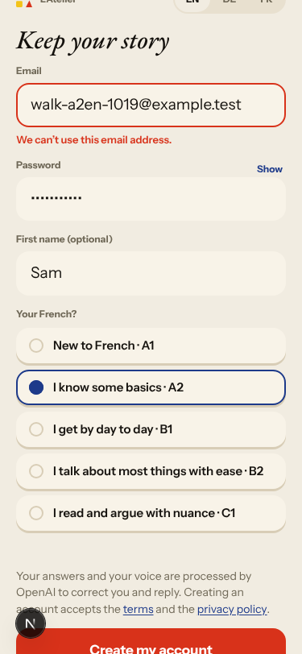
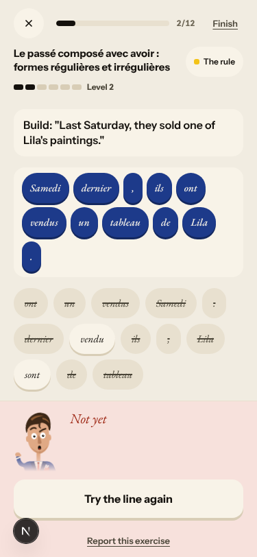
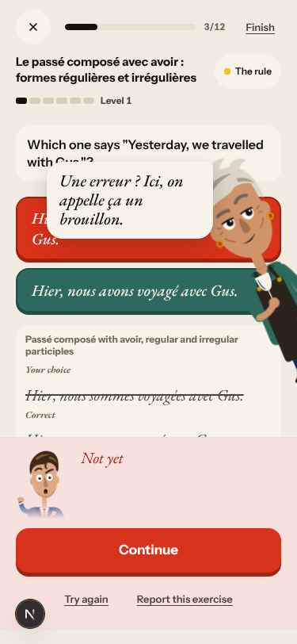
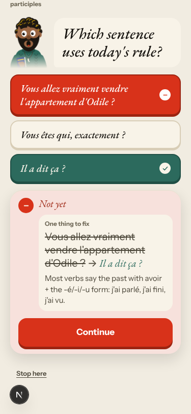
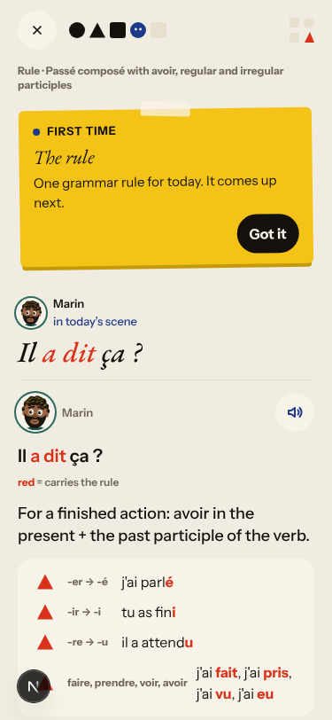
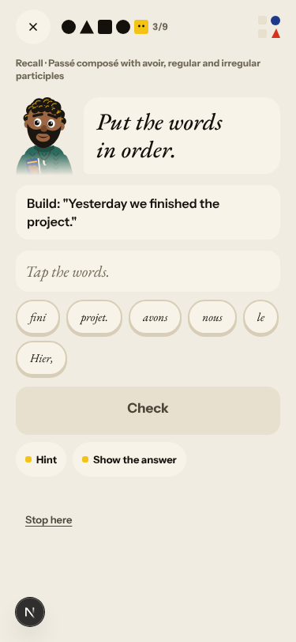
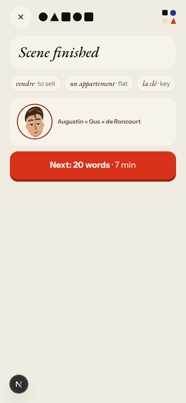
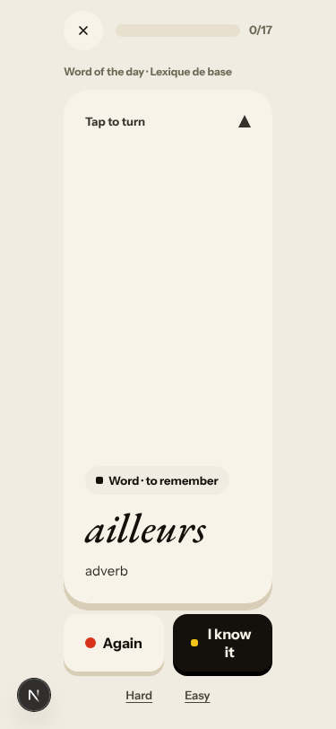
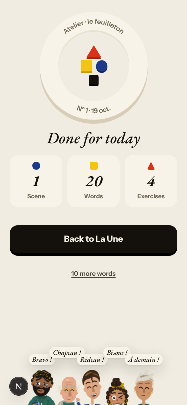
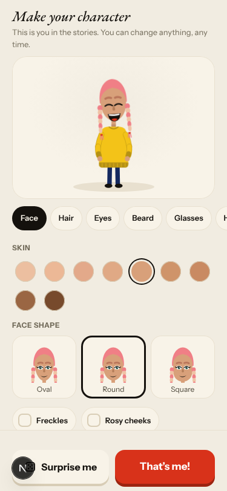

# Walk · 19 Oct 2026 · nightly explore walk

Main at `b5d15055` (10 commits since `da3433f9`, among them #234 La Forge on one quiet screen with a level, #232 a
calmer La Une, #224 a refused email explained under the field, #219 the Cahier word list loads, #228 Le Papier daily,
and the drawn character at sign-up). Fake story provider, local stack, Chromium at phone size, one persona.

| persona | played |
|---|---|
| `a2-en` (English speaker, A2.1, signs up through the UI) | teaser, sign-up (a refused email first), character editor, tour, day 1 scene with two free replies and an off-script question, rule, 9 recall items, 17 word cards, La Forge (4 of 12, two misses on purpose, finished early), Done, La Une |

Live column: [live walk 19 Oct](../live-walks/2026-10-19.md) on production with the real model
(branch `claude/live-walk-2026-10-19`; the link resolves once that report is on main). Its findings (#235–#237) are
not re-filed here. The 18 Oct column comes from report PR #218.

## Scores (rubric `docs/ops/walk-rubric.md`)

1 = bad, 5 = good. Per-screen questions score the worst screen of the day.

| # | question | a2-en d1 19 Oct | a1-de d1 18 Oct | a2-en d1 15 Oct | live 19 Oct |
|---|---|---|---|---|---|
| 1 | Where am I | 4 | 4 | 4 | 3 |
| 2 | What is at stake | 4 | 4 | 4 | 4 |
| 3 | What to do next | 3 | 3 | 3 | 3 |
| 4 | Scene reacts to my writing | fake | fake | fake | 5 |
| 5 | Story coherent | 4 | 4 | 4 | 3 |
| 6 | Characters consistent | 3 | 3 | 3 | 4 |
| 7 | Image, text, tone fit | 4 | 4 | 4 | 4 |
| 8 | Difficulty fits | 4 | 4 | 4 | 4 |
| 9 | Feedback explained | 2 | 4 | 3 | 3 |
| 10 | Right answers accepted | 5 | 5 | 5 | 2 |
| 11 | French correct | 4 | 4 | 4 | 4 |
| 12 | Clear goal today | 4 | 4 | 3 | 3 |
| 13 | Grammar practised | 4 | 4 | 4 | 3 |
| 14 | Earlier material returns | n/a | n/a | n/a | 4 |
| 15 | I produce French | 4 | 4 | 4 | 5 |
| 16 | Errors, dead ends | 3 | 3 | 3 | 3 |
| 17 | Varied, fun | 4 | 4 | 4 | 4 |
| 18 | Fast enough (local stack) | 4 | 4 | 4 | 3 |
| 19 | App only | n/a | n/a | n/a | n/a |
| 20 | Satisfying end | 4 | 4 | 4 | 3 |
| 21 | Would come back | 4 | 4 | 4 | 4 |
| 22 | Time vs promise | 3 | 3 | 3 | 3 |

**Better since the last walks:**
- A refused email now says «We can’t use this email address.» under the field (#224 closed #215). 
- La Forge accepts the corrected part alone («expliqué», «pris») and «un appartement» for «flat» (#208).
- The La Forge recap says «Still practising» after misses instead of «still proficient».
- The own-words bonus no longer follows a correction item (#216 not reproduced).

**Lower:** Q9, because after a miss the redesigned La Forge hides the correction and the reason (#239).

## Findings, by root cause

### #146 content and feedback not driven by one concept
1. **Medium · #239 (new)** After a tile-build miss, the screen shows only «Not yet» and «Try the line again». After a choice miss, the correction sits under the result sheet. The reason, where it can be read, prints the generic fallback profile's placeholder «auxiliary or stem + the ending or participle this unit teaches.» (`app/services/grammar_feedback.py`), because passé composé has no profile of its own.
    
2. **Low · #240 (new)** A wrong tap on «Which sentence uses today's rule?» reads «One thing to fix: Vous allez vraiment vendre… → Il a dit ça ?», two unrelated sentences. 

### #143 the day's progress has no single source of truth
3. Seen again (noted on #143): the rule and nine recall items come before the words. The counters grow mid-day as a missed drill comes back («Step 1 of 12» becomes «6 of 13», and «1/8» becomes «3/9»). «Step 13 of 13 · Scene finished» shows before the words and La Forge. The words promise 20, the review has 17, and Done says 20.
       

### #147 the cast is not one registry
4. Seen again: #217, where Gus is both «Gus» and «Augustin « Gus » de Roncourt» in one thread. La Forge addresses Romy, who is not in the cast intro, and a miss shows an unintroduced grey-haired woman (noted on #147).

Not filed:
- The fake stub's replies don't answer «Qui est Solvel ?», and Lila stumbles over «petite-fille» («Sa petite… son petit…»).
- The new character editor at sign-up is clear and skippable with «Surprise me». 

## Re-tests

| issue | result |
|---|---|
| #215 sign-up shows raw English 422 (closed by #224) | fixed: one localized line under the field |
| #216 own-words bonus on a correction | not reproduced after #234; the a1-de walk on 20 Oct re-checks it |
| #213 repair says «Not quite» and «Well done!» (live) | not reproduced on the fake stack: a miss shows «Not yet» only |
| #169 «still proficient» after a miss | fixed on the fake stack: «Still practising» after two misses |
| #217 Gus with two names | reproduced (fix not merged yet) |

## Queue after triage

New: #239 and #240 (`queue:ready`, `lane:code`, `size:S`, each with a **Done when**). Open `walk-finding` issues: 9 `queue:ready`, 2 `queue:owner` (#134, #193), the rest `queue:pr`.

## Scripted walk

The «Browser walk» CI job last ran on main on 18 Oct (`5fe3efb5`, scheduled) and passed.
