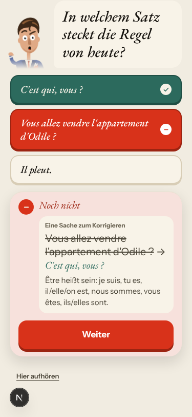
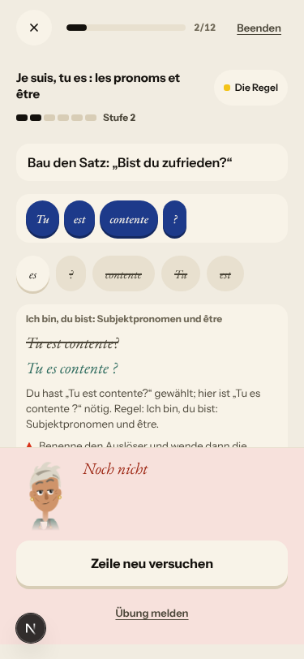
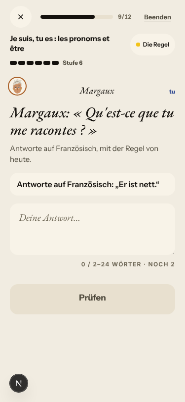
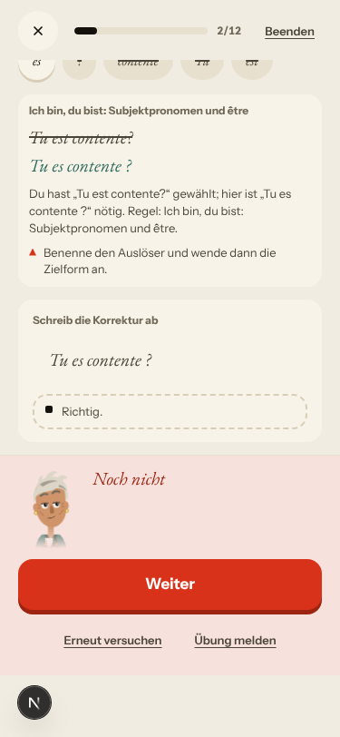
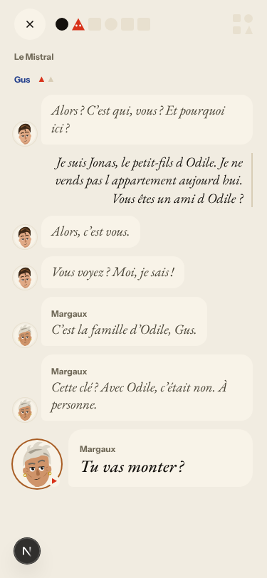
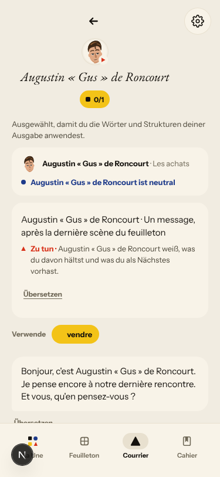
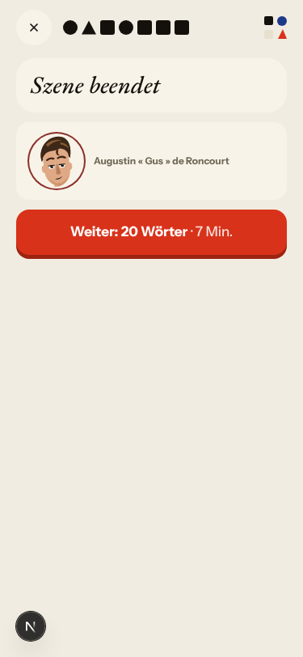
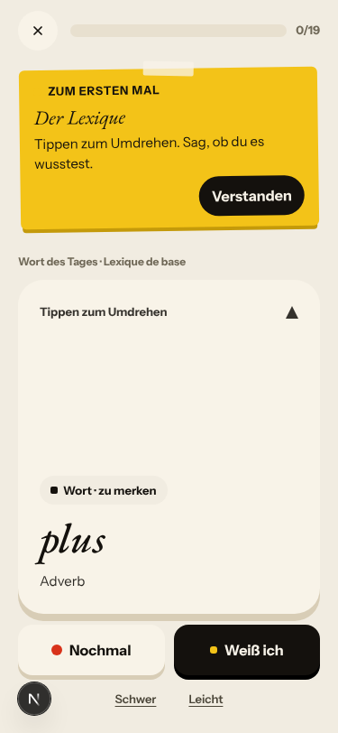
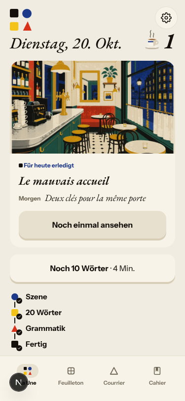
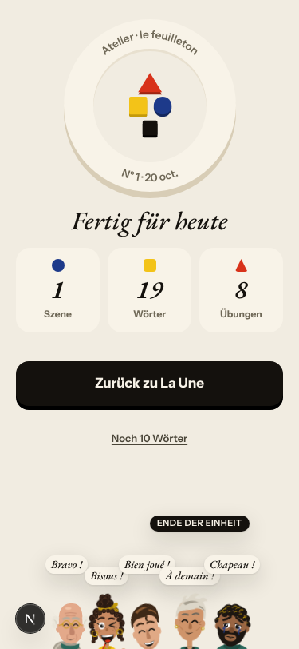

# Walk · 20 Oct 2026 · nightly explore walk

Main at `8e6695be` (19 commits since `b5d15055`, among them #247 La Forge shows the rule check's verdict and fixes only the
wrong parts, #242 a gap accepts every noun its prompt allows, #245 the La Une title and the être warm-up, #246 Le Papier,
#229 «Traduire» on every panel, #231 a filed card stays filed, #230 cast at fitting moments, and Les appels).
Fake story provider, local stack, Chromium at phone size, one persona.

| persona | played |
|---|---|
| `a1-de-fresh` (German, signs up through the UI) | teaser, sign-up, character editor, tour, day 1 scene with two free replies (a «non» and an off-script question), rule, 3 recall items (one miss), 19 word cards, La Forge (8 of 12, two misses, finished early), Done, Home, Courrier |

Live column: [live walk 20 Oct](../live-walks/2026-10-20.md) on production with the real model
(PR #255, branch `claude/live-walk-2026-10-20`; the link resolves once that report is on main), A1.1 day 9.
Its findings (#250–#254) are not re-filed here.

## Scores (rubric `docs/ops/walk-rubric.md`)

1 = bad, 5 = good. Per-screen questions score the worst screen of the day.

| # | question | a1-de d1 20 Oct | a2-en d1 19 Oct | a1-de d1 18 Oct | live 20 Oct (A1.1, day 9) |
|---|---|---|---|---|---|
| 1 | Where am I | 4 | 4 | 4 | 3 |
| 2 | What is at stake | 4 | 4 | 4 | 4 |
| 3 | What to do next | 3 | 3 | 3 | 3 |
| 4 | Scene reacts to my writing | fake | fake | fake | 4 |
| 5 | Story coherent | 4 | 4 | 4 | 2 |
| 6 | Characters consistent | 3 | 3 | 3 | 3 |
| 7 | Image, text, tone fit | 4 | 4 | 4 | 4 |
| 8 | Difficulty fits | 4 | 4 | 4 | 4 |
| 9 | Feedback explained | 3 | 2 | 4 | 2 |
| 10 | Right answers accepted | 5 | 5 | 5 | 4 |
| 11 | French correct | 4 | 4 | 4 | 4 |
| 12 | Clear goal today | 4 | 4 | 4 | 2 |
| 13 | Grammar practised | 4 | 4 | 4 | 3 |
| 14 | Earlier material returns | n/a | n/a | n/a | 4 |
| 15 | I produce French | 4 | 4 | 4 | 5 |
| 16 | Errors, dead ends | 3 | 3 | 3 | 3 |
| 17 | Varied, fun | 4 | 4 | 4 | 4 |
| 18 | Fast enough (local stack) | 4 | 4 | 4 | 3 |
| 19 | App only | n/a | n/a | n/a | n/a |
| 20 | Satisfying end | 4 | 4 | 4 | 2 |
| 21 | Would come back | 4 | 4 | 4 | 3 |
| 22 | Time vs promise | 3 | 3 | 3 | 3 |

**Better since the last walks:**
- Q9 (2 → 3): a La Forge miss now puts the corrected sentence and its reason on the card, for a build and for a choice
  («Du hast „Tu est contente?“ gewählt; hier ist „Tu es contente ?“ nötig»).
- The recap says «Weiterhin in Übung» after two misses (#169 stays fixed on the fake stack).
- Done counts the 19 words actually played instead of 20.

**Still low:** Q9 keeps the generic line «Benenne den Auslöser und wende dann die Zielform an.» on every miss. Q22: the day
promises 20 words and plays 19, and the step counter grows mid-day.

## Findings, by root cause

No new findings tonight. Every flaw seen is an open issue; the comments are on the issues.

### #146 content and feedback not driven by one concept
1. Seen again: **#240**. A wrong tap on «In welchem Satz steckt die Regel von heute?» is shown as a correction
   «Vous allez vendre l'appartement d'Odile ? → C'est qui, vous ?». It happens on the fake stack too, so the cause is the drill's code path,
   not the model. 
2. Partly better: **#239**. The correction now shows. The generic fallback line remains, and the reason runs under the «Noch nicht»
   sheet. 
3. Re-test failed: **#176** (fix #178 merged). Margaux's «Qu'est-ce que tu me racontes ?» sits above the task «Er ist nett.»
   Set back to `queue:ready`. 
4. Seen again: **#213** on the fake stack. Copying the correction shows «Richtig.» and «Noch nicht» on one card.
   It stays `queue:owner`. 

### #147 the cast is not one registry
5. Seen again: **#217**. In the reply thread Gus is «Gus» and then «Augustin « Gus » de Roncourt». The same display string reaches the
   Courrier: «Un mot de Augustin « Gus » de Roncourt» (with no elision), and in his own letter «c'est Augustin « Gus » de Roncourt».
   #226 is still open.  

### #144 du/tu register
6. Seen again: **#117** on the fake stack. Gus's note is in vous («Et vous, qu'en pensez-vous ?») and its P.S. is in tu, with a shop line
   («Il reste un seul article à ta taille»). #222 is still open.

### #143 day progress
7. Seen again:
   - «Schritt 5 von 6» becomes «5 von 7» after a recall miss.
   - «Schritt 7 von 7 · Szene beendet» shows before the words.
   - «20 Wörter» opens a deck of 0/19.
   - Home says «20 Wörter — erledigt» while Done says 19. #221 is still open.

    
    

Not filed:
- La Forge free production cannot be checked on the fake stack («Die zweite Prüfung brach ab»). That is the stub. The level
  still rose 5 → 6 on that unchecked answer, which contradicts «unavailable never counts» in `verdict_from_attempt`.
  The live walk should watch for a level rise after «the corrector was unavailable» (#251).
- «Finde den Fehler»: the typed fix commits on Enter or blur. With the harness, «Prüfen» stayed disabled until Enter.
  A phone tap on a disabled button may not blur the field. Not confirmed on a device.
- The first teaser line keeps the task «Grüß zurück.» after the greeting is answered («Bienvenue au Mistral !»). This is cosmetic.
- The «Die Wörter» coach mark appears on the first rule drill, not on the words.

## Re-tests

| issue | result |
|---|---|
| #176 Margaux's line vs the task (fix #178 merged) | reproduced; back to `queue:ready` |
| #239 La Forge miss hides why | partly fixed: the correction shows, but the generic line remains; stays `queue:ready` |
| #240 recall miss shown as a correction | reproduced on the fake stack |
| #216 own-words bonus on a correction | not reachable: no correction item tonight |
| #169 «still proficient» after a miss | stays fixed: «Weiterhin in Übung» |
| #217 Gus with two names | reproduced (#226 not merged), and it reaches the Courrier |
| #143, #117 | reproduced; fixes #221 and #222 not merged |

## Queue after triage

- No new issues tonight.
- #176 is back in `queue:ready`.
- Open `walk-finding` issues:
  - 14 `queue:ready`: #254, #253, #252, #251, #250, #240, #239, #237, #236, #176, #146, #145, #106, #93
  - 3 `queue:owner`: #216, #213, #193
  - the rest `queue:pr`

## Scripted walk

The «Browser walk» CI job last ran on main on 19 Oct (`5cd7d555`, scheduled) and passed.
