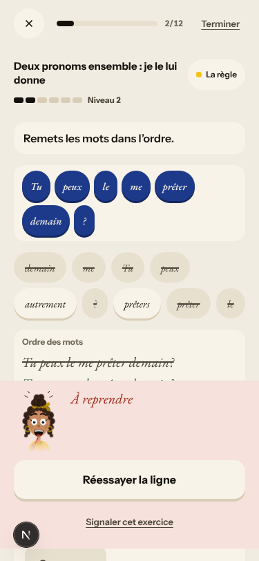
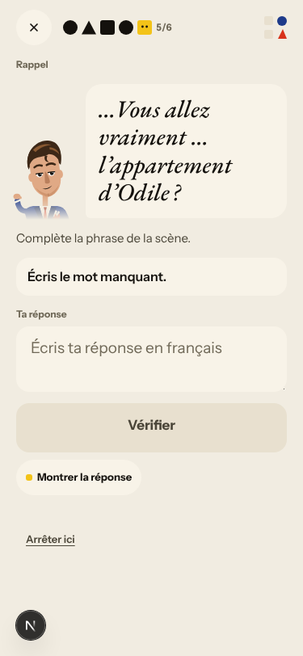
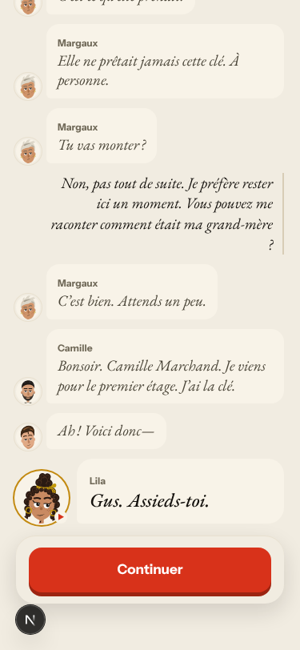
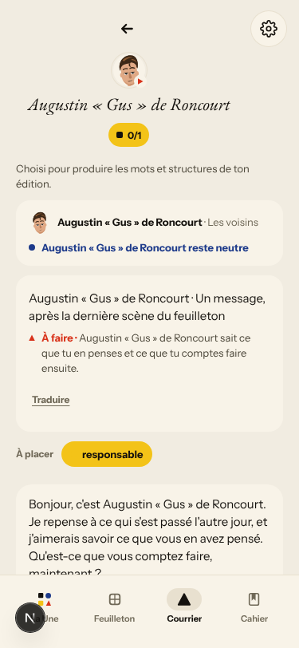
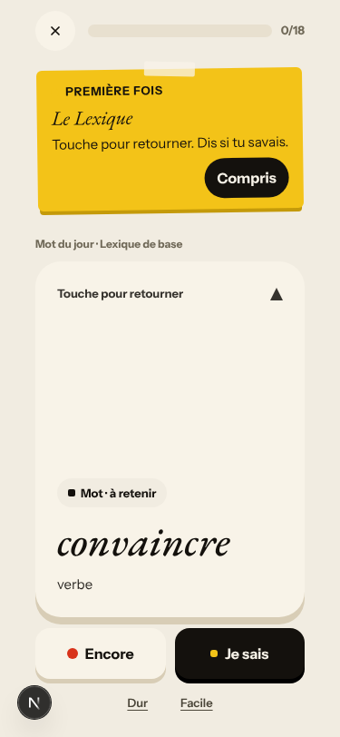

# Walk · 21 Oct 2026 · nightly explore walk

Main at `8e6695be` (unchanged since the 20 Oct walk). The walk ran because tonight's live walk is new.
Fake story provider, local stack, Chromium at phone size, one persona.

| persona | played |
|---|---|
| `b1-fr-chrome` (French chrome, B1, signs up through the UI) | teaser, sign-up, character editor, tour, day 1 scene with two free replies (a «non» and an off-script question), rule «Deux pronoms ensemble», 6 recall items (one miss), 18 word cards, La Forge (3 of 12, one miss, finished early), Done, Home, Courrier |

Live column: [live walk 21 Oct](../live-walks/2026-10-21.md) on production with the real model
(branch `claude/live-walk-2026-10-21`; the link resolves once that report is on main), A1.1 day 10.
Its findings (#262–#269) are not re-filed here. The 20 Oct column comes from report PR #256, still open.

## Scores (rubric `docs/ops/walk-rubric.md`)

1 = bad, 5 = good. Per-screen questions score the worst screen of the day.

| # | question | b1-fr d1 21 Oct | a1-de d1 20 Oct | b1-fr d1 17 Oct | live 21 Oct (A1.1, day 10) |
|---|---|---|---|---|---|
| 1 | Where am I | 4 | 4 | 4 | 3 |
| 2 | What is at stake | 4 | 4 | 4 | 4 |
| 3 | What to do next | 3 | 3 | 3 | 3 |
| 4 | Scene reacts to my writing | fake | fake | fake | 3 |
| 5 | Story coherent | 4 | 4 | 3 | 3 |
| 6 | Characters consistent | 3 | 3 | 3 | 2 |
| 7 | Image, text, tone fit | 4 | 4 | 4 | 4 |
| 8 | Difficulty fits | 4 | 4 | 4 | 3 |
| 9 | Feedback explained | 2 | 3 | 3 | 2 |
| 10 | Right answers accepted | 5 | 5 | 5 | 4 |
| 11 | French correct | 4 | 4 | 4 | 4 |
| 12 | Clear goal today | 3 | 4 | 4 | 3 |
| 13 | Grammar practised | 3 | 4 | 4 | 3 |
| 14 | Earlier material returns | n/a | n/a | n/a | 4 |
| 15 | I produce French | 4 | 4 | 4 | 5 |
| 16 | Errors, dead ends | 3 | 3 | 3 | 3 |
| 17 | Varied, fun | 4 | 4 | 4 | 4 |
| 18 | Fast enough (local stack) | 4 | 4 | 4 | 4 |
| 19 | App only | n/a | n/a | n/a | n/a |
| 20 | Satisfying end | 4 | 4 | 4 | 2 |
| 21 | Would come back | 4 | 4 | 4 | 3 |
| 22 | Time vs promise | 3 | 3 | 3 | 2 |

**Better:** the B1 scene text is richer than A1 and reads naturally. Free-text recall answers are accepted with and without
a capital or a full sentence («Je les leur donne.», «exactement»).

**Lower:**
- Q9 (3 → 2): a pronoun-order miss is called «Ordre des mots» (#271), and La Forge asks the learner to classify with the English
  buttons «Pronoun choice» / «different grammar role» (#196, reopened).
- Q12 and Q13 (4 → 3): the rule (double pronouns) has nothing to do with the scene, and two of three Forge items are the
  trivial classify item.

## Findings, by root cause

### #146 content and feedback not driven by one concept
1. **Medium · #271 (new)** «Tu peux le me prêter demain ?» is marked «Ordre des mots · les bons mots sont là…» instead of the rule
   (me before le). The order of the two pronouns *is* the rule. 
2. **Medium · #196 (reopened, was closed)** The fallback classify items show the English labels «Pronoun choice» and «different
   grammar role» in French chrome. The labels are hard-coded English in `atelier.py`'s fallback set for every grammar profile.
   The pair also makes the item trivial. 
3. With #239, these show one mechanism, noted on #146. When a concept has no authored item or explanation, the code builds one
   from inline English pattern strings, not from the concept's data and localized copy. The guard test belongs in #146.
4. Seen again: #213 in French («Juste.» and «À reprendre» on one card).

### #147 the cast is not one registry
5. Seen again: **#155** class. The recall item for Marin's line «…Vous allez vraiment … l’appartement d’Odile ?» shows Gus and says
   «Gus te sourit». 
6. Seen again: **#217** in French. «Écouter Gus» and «Écouter Augustin « Gus » de Roncourt», and the Courrier is «Un mot de Augustin « Gus »
   de Roncourt».  

### #143 day progress
7. Seen again:
   - «Étape 5 sur 9» becomes «5 sur 10».
   - «Étape 10 sur 10 · Scène terminée» shows before the words.
   - «20 mots» opens 0/18.
   - Done says 20 (yesterday it said the 19 actually played).

   

Not filed:
- With French chrome, the closing panel's «translation» repeats the French line («Deux clés, une seule porte. À suivre…» twice).
- A recall correction «m en» (no apostrophe) is accepted as «Correct» without a note on the elision (see #119).
- Lila stumbles over «petite-fille» («Sa petite… son petit…»). This is the stub's line, as on 19 Oct.

## Re-tests

| issue | result |
|---|---|
| #196 English task text in French chrome (closed) | not fixed for the fallback classify labels; reopened, `queue:ready` |
| #217 Gus with two names | reproduced (#226 not merged) |
| #155 cameo face vs speaker | reproduced in a recall item; commented |
| #213 two verdicts on one card | reproduced in French |
| #143 counters | reproduced |

## Queue after triage

- New: #271 (`queue:ready`, `lane:code`, `size:S`, with a **Done when**).
- Reopened: #196 (`queue:ready`, `size:M`).
- Open `walk-finding` issues:
  - 17 `queue:ready`
  - 6 `queue:owner`: #146, #193, #213, #216, #239, #240
  - the rest `queue:pr`

## Scripted walk

The «Browser walk» CI job last ran on main on 20 Oct (`8e6695be`, scheduled) and passed.
