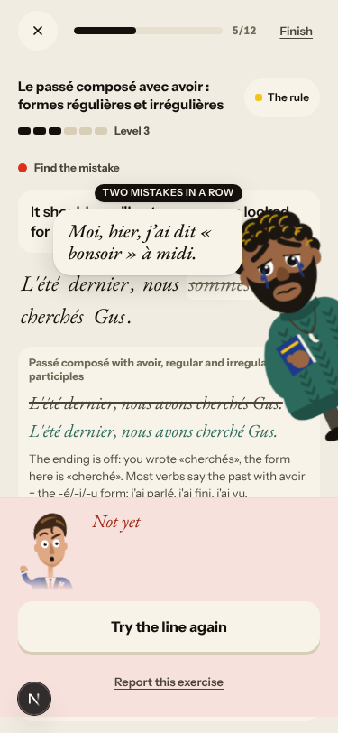
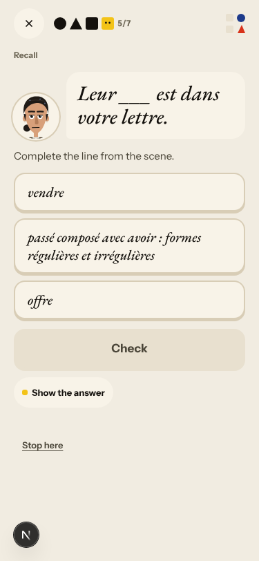

# Walk · 23 Oct 2026 · nightly explore walk

Main at `8e6695be`, unchanged since the 20 Oct walk. The last `a2-en` walk (19 Oct) ran on `b5d15055`, so tonight is the
first `a2-en` walk with #229, #230 and #231 in. Fake story provider, local stack, Chromium at phone size, one persona:
`a2-en` (English chrome, A2.1, signs up through the UI, answers off-script on purpose). Played day 1 (teaser, sign-up,
character, tour, scene with two free replies, rule, 9 recall drills, 17 word cards, La Forge 9 of 12, Done, Home,
Courrier, Cahier) and day 2 (scene with one free reply and one choice, 7 recall drills, 18 word cards, La Forge 4 items
then Finish, Done).

Live column: [live walk 23 Oct](../live-walks/2026-10-23.md) on production with the real model
(branch `claude/live-walk-2026-10-23`; the link resolves once that report is on main), A1.1 day 11.
Its findings (#295–#298 new, 12 commented) are not re-filed here.

## Scores (rubric `docs/ops/walk-rubric.md`)

| # | question | 23 Oct a2-en (d1–2) | live 23 Oct (A1.1, day 11) |
|---|---|---|---|
| 1 | Where am I | 4 | 3 |
| 2 | What is at stake | 4 | 4 |
| 3 | What to do next | 3 | 3 |
| 4 | Scene reacts to my writing | fake | 4 |
| 5 | Story coherent | 3 | 3 |
| 6 | Characters consistent | 3 | 3 |
| 7 | Image, text, tone fit | 4 | 3 |
| 8 | Difficulty fits | 4 | 3 |
| 9 | Feedback explained | 3 | 2 |
| 10 | Right answers accepted | 4 | 2 |
| 11 | French correct | 4 | 3 |
| 12 | Clear goal today | 4 | 3 |
| 13 | Grammar practised | 4 | 3 |
| 14 | Earlier material returns | 4 | 4 |
| 15 | I produce French | 4 | 5 |
| 16 | Errors, dead ends | 3 | 2 |
| 17 | Varied, fun | 4 | 4 |
| 18 | Fast enough | 4 | 3 |
| 19 | App only | n/a | n/a |
| 20 | Satisfying end | 4 | 3 |
| 21 | Would come back | 4 | 4 |
| 22 | Time vs promise | 3 | 3 |

Against the last `a2-en` walk (19 Oct): alternative right answers were accepted («on a pris un café» for «nous avons
pris», «un appartement», «lettre» without article), and day 2's words are about the building (immeuble, étage,
propriétaire, loyer). Q22 stays at 3 because «Grammar · 5 min» holds 12 to 17 items.

## Findings, by root cause

### #146 content and feedback not driven by one concept
- **#300 (new, medium)** A «Find the mistake» item has two mistakes («nous sommes cherchés»), while the card says «Tap the wrong word» and the retry says «Fix the one mistake». The feedback says «you wrote «cherchés»», a word the app wrote. `spot_window` allows up to three wrong words. The copy assumes one. 
- **#301 (new, medium)** The day-2 cloze «Leur ___ est dans votre lettre.» offers «passé composé avec avoir : formes régulières et irrégulières» as a word. The distractors in `scene_items.py` take every glossed `label_fr`, rule concepts included. 
- **#239 (again)** «auxiliary or stem + the ending or participle this unit teaches.» still ends a build miss.

### #143 the day's progress has no single source of truth
- **#302 (new, low)** «Two mistakes in a row» after one miss (right, right, wrong). The cameo director counts on its own; likely two answer events for one spot check (Enter, then Check).
- **#279 (again)** «20 words» opens at 0/17 and 0/18. Done says 20 and 22 words, and 11 and 3 exercises, for 18 and 11 drills.
- **#143 (again)** «Step 5 of 12» becomes «Step 5 of 13» after a miss. «Step 13 of 13 · Scene finished» comes before the words and grammar.
- **#281 (again)** «Answer saved, not checked yet» moved the level 5 → 6 on both days. The recap shows «Level 6 · Still practising».

### #174 a right answer is judged against one stored string
- **#295 (again, now reproducible locally)** For «They had dinner with Gus…» I wrote «Ils ont dîné…». The recap shows the stored «Elles ont dîné…».

### #145 the scene has no state of what is established
- **#132 (again, fake too)** Day 2: a clear «Non, je ne vais pas vendre» gets «"Pas encore", c'est déjà une réponse». The last panel then sends me home on Wednesday, although on day 1 I said I want to live here. This is the authored branch, so it is not only a model problem.

### #147 cast registry
- **#155 (again)** The day-2 Forge rule card is spoken by Romy, who is not in the cast list and whom I have not met.
- **#217 (again)** The reply thread labels each speaker twice («Margaux: / Margaux», «Camille Marchand: / Camille») and Gus with two names.

### Not filed
- Free-text replies on the fake stack get no correction, and the Courrier says «the corrector was unavailable». This is the stub.
- Home still reads «Friday 23 Oct» after `/clock` moved the server a day. This is the harness: the browser's date does not move.

## Re-tests

No code-lane fix merged since the 20 Oct walk (main unchanged), so nothing new to re-test. #281, #279, #239, #155 and
#217 reproduce on the fake stack as above.

## Scripted walk

The «Browser walk» CI job ran on main on 22 Oct (`8e6695be`, scheduled) and **passed** on all four jobs. The single
21 Oct failure (#285, de day 4 focus check) did not repeat on the same commit, so it is a timing race. #285 stays open.
