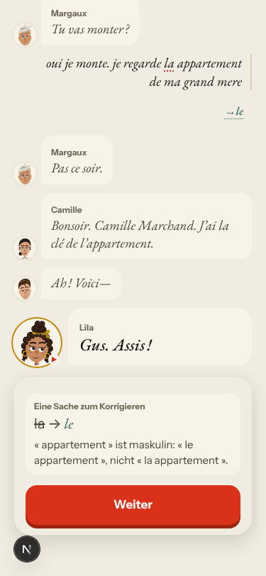
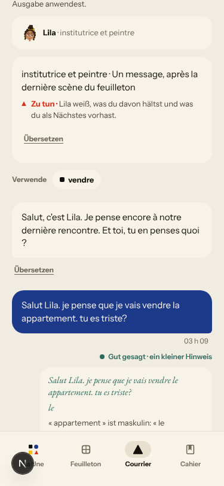
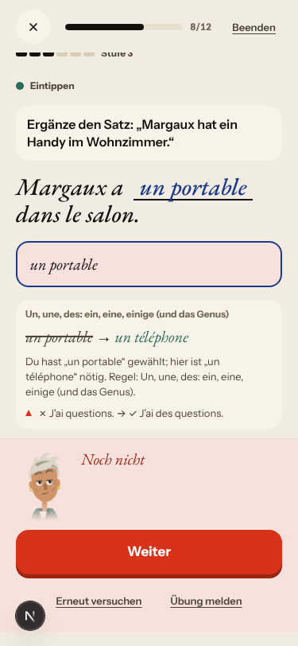
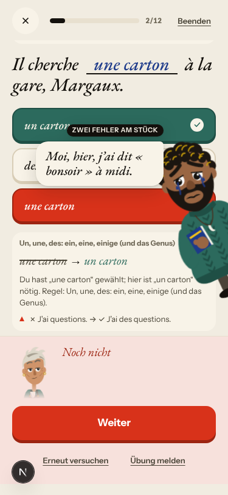

# Walk · 24 Oct 2026 · nightly explore walk

Main at `72e4571f`, seven merges since `8e6695be`: #307 (repair cards count their wrong words, gap-fills offer only words),
#222 (Courrier tu/vous), #226 (one name per cast member), #221 (one plan for the day's counters), #260 (La Forge line,
hint and miss correction), #261 (one correction contract, a model-free pass) and #257 (story: one tomorrow-hook, a
reasoned reply). Fake story provider, local stack, Chromium at phone size, one persona: `a1-de-fresh` (German chrome,
signs up through the UI, short answers with real beginner slips). Played day 1 in full (teaser, sign-up, character,
tour, scene with two free replies, rule, 3 recall drills, 19 word cards, La Forge 10 of 12, Done, Home, Courrier) and
the day-2 scene.

Live column: [live walk 24 Oct](../live-walks/2026-10-24.md) on production with the real model
(branch `claude/live-walk-2026-10-24`; the link resolves once that report is on main), A1.1 day 12.
Its findings (#313–#316 new, 12 commented) are not re-filed here.

## Scores (rubric `docs/ops/walk-rubric.md`)

| # | question | 24 Oct a1-de (d1–2) | live 24 Oct (A1.1, day 12) |
|---|---|---|---|
| 1 | Where am I | 4 | 3 |
| 2 | What is at stake | 4 | 3 |
| 3 | What to do next | 4 | 3 |
| 4 | Scene reacts to my writing | fake | 3 |
| 5 | Story coherent | 3 | 2 |
| 6 | Characters consistent | 3 | 3 |
| 7 | Image, text, tone fit | 4 | 3 |
| 8 | Difficulty fits | 4 | 3 |
| 9 | Feedback explained | 3 | 2 |
| 10 | Right answers accepted | 3 | 4 |
| 11 | French correct | 3 | 3 |
| 12 | Clear goal today | 4 | 3 |
| 13 | Grammar practised | 4 | 4 |
| 14 | Earlier material returns | n/a | 4 |
| 15 | I produce French | 4 | 5 |
| 16 | Errors, dead ends | 3 | 3 |
| 17 | Varied, fun | 4 | 4 |
| 18 | Fast enough | 4 | 3 |
| 19 | App only | n/a | n/a |
| 20 | Satisfying end | 4 | 3 |
| 21 | Would come back | 4 | 4 |
| 22 | Time vs promise | 4 | 2 |

Against the last `a1-de` walk (20 Oct): Q3 and Q22 went up (3 → 4). The step counter stays «Schritt 6 von 6» through a
repeat, and «19 Wörter» opens at 0/19 and ends at 19 on Done and Home. Q11 went down (4 → 3) because the new model-free
corrector teaches «le appartement» (#318). Q9 stays at 3: misses now show the right line above the sheet, but the
reason restates the rule card («J'ai questions → J'ai des questions») instead of naming the noun's gender.

## Re-tests of merged fixes

| issue | fix | result on the fake stack |
|---|---|---|
| #240 rule pick shown as a correction | #260 | fixed: «In diesem Satz steckt die Regel / Nicht dieser» ([screenshot](2026-10-24/fixed-240-rule-pick.png)) |
| #239 miss hides why, generic line | #260 | fixed: build and choice misses show the correction above the sheet ([screenshot](2026-10-24/fixed-239-build-miss.png)); one fr CI miss did not (#319) |
| #217 two names in the reply thread | #226 | fixed: «Gus», «Camille» once each |
| #117 Courrier tu/vous and level | #222 | fixed: Lila's note is short, A1, tu throughout |
| #143 / #279 day counters | #221 | fixed on the fake stack: «Schritt 6 von 6» holds, 19 words everywhere; live still differs |
| #132 a clear «non» answered «Pas encore» | #257 | better: «Parfait. Enfin… bien.»; the closing panel still sends me home on Wednesday |
| #300, #301 | #307 | closed by the merge; neither item came up tonight, so not re-seen |
| #302 «two mistakes in a row» after one miss | open PR | reproduced, now on the very first miss of a choice item |
| #281 level moves without a checked verdict | open PR | reproduced (5 → 6 unchecked), and a miss does not lower the level |

## Findings, by root cause

### #250 corrections are raw output, never checked
- **#318 (new, high)** The model-free corrector (#261) corrects «la appartement» to «le appartement» in the scene and the Courrier, and the Courrier saves it as a correction. It misses «de Odile», «petit fils» and «grand mere». In `correction_contract.py` the masculine `FR_GENDER_DET` branch has no vowel or mute-h guard, and elision covers only «je».  

### #174 a right answer is judged against one stored string
- **#174 (again)** «un portable» for «ein Handy» is «Noch nicht: hier ist „un téléphone“ nötig», on an item that trains the article. 

### #143 the day's progress has no single source of truth
- **#302 (again)** «ZWEI FEHLER AM STÜCK» on the first miss of the session. 
- **#281 (again)** The level rises on «noch nicht geprüft» and does not fall on a miss.

### #145 the scene has no state of what is established
- **#132 (again)** Day 1: «oui je monte» is answered «Pas ce soir.» Day 2: after «Je reste ici» the last panel says «Ton billet de retour est pour mercredi».

### #147 cast registry
- **#155 (again)** La Forge builds a line about Romy on day 1.

### No shared root cause
- **#319 (new, low)** The Browser walk on 23 Oct (`72e4571f`) failed one check in fr: `forge-miss-correction-above-the-sheet`, 4 pass, 1 fail. This is the guard #260 added for #239.

### Not filed
- Free-text replies get only the model-free corrections on the fake stack. Free production in La Forge says «Die zweite Prüfung brach ab». Both come from the stub.

## Scripted walk

The «Browser walk» CI job ran on main on 23 Oct (`72e4571f`, scheduled) and **failed** in one job:
- fr × 7 days: 1 of 824 checks failed (#319)
- de × 7, en + B1 × 7 and season × 10: passed. The de focus check from #285 passed again.
