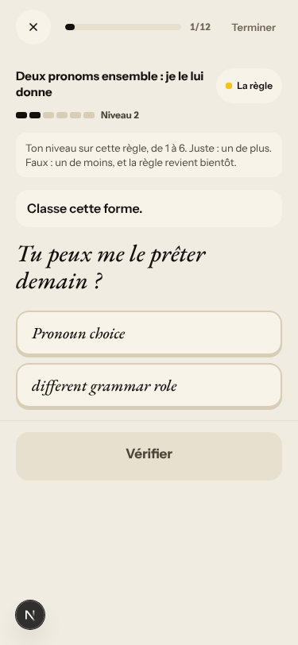
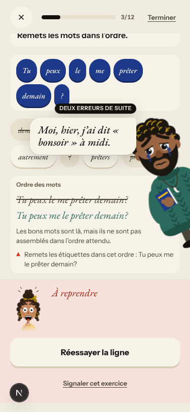

# Walk · 25 Oct 2026 · nightly explore walk

Main at `72e4571f`, unchanged since the 24 Oct walk. The last `b1-fr-chrome` walk (21 Oct) ran on `8e6695be`, before the
seven merges, so tonight is the first French-chrome walk with them. Fake story provider, local stack, Chromium at phone
size, one persona: `b1-fr-chrome` (`--native fr --level B1.1`). Played day 1: teaser, sign-up, character, tour, scene
with two free replies (one correct, one with slips), the rule, 6 recall drills, 18 word cards, La Forge 3 of 12, then
Terminer.

Live column: [live walk 25 Oct](../live-walks/2026-10-25.md) on production with the real model
(branch `claude/live-walk-2026-10-25`; the link resolves once that report is on main). It opened root cause #333
(a failed model call is shown as a result) and filed #334–#337. Its findings are not re-filed here.

## Scores (rubric `docs/ops/walk-rubric.md`)

| # | question | 25 Oct b1-fr (d1) | live 25 Oct |
|---|---|---|---|
| 1 | Where am I | 4 | 3 |
| 2 | What is at stake | 4 | 3 |
| 3 | What to do next | 4 | 3 |
| 4 | Scene reacts to my writing | fake | 2 |
| 5 | Story coherent | 3 | 3 |
| 6 | Characters consistent | 3 | 3 |
| 7 | Image, text, tone fit | 4 | 3 |
| 8 | Difficulty fits | 3 | 3 |
| 9 | Feedback explained | 3 | 2 |
| 10 | Right answers accepted | 4 | 3 |
| 11 | French correct | 3 | 3 |
| 12 | Clear goal today | 4 | 3 |
| 13 | Grammar practised | 4 | 3 |
| 14 | Earlier material returns | n/a | 4 |
| 15 | I produce French | 4 | 4 |
| 16 | Errors, dead ends | 3 | 2 |
| 17 | Varied, fun | 4 | 4 |
| 18 | Fast enough | 4 | 2 |
| 19 | App only | n/a | n/a |
| 20 | Satisfying end | 4 | 3 |
| 21 | Would come back | 4 | 4 |
| 22 | Time vs promise | 4 | 2 |

Against the last `b1-fr` walk (21 Oct), these got better:
- The chrome is French and tu everywhere I looked («Corrige cette phrase», «Ta réponse», «Compris»).
- A correct B1 reply drew no false correction.
- «18 mots» opened at 0/18.
- The step counter held at «Étape 9 sur 9» through a repeat.
- The recall miss reason was specific to the item («Ordre : me/te/se/nous/vous, puis le/la/les, puis lui/leur…»).

Q8 is 3 because a B1 learner's La Forge opened the A1 rule «Un, une, des» at Niveau 1 (see #318). Q11 is 3 for the same
wrong «le appartement» correction.

## Findings, by root cause

No new issue tonight. Every finding repeats an open one.

### #250 corrections are never checked
- **#318 (again, fr)** «si la appartement est en bon état» gets «« appartement » est masculin : « le appartement »». The same La Forge then drilled the A1 article rule, most likely from that saved false correction.

### #146 content and feedback not driven by one concept
- **#196 (again)** La Forge's first item offers the English labels «Pronoun choice» and «different grammar role» in French chrome. 
- **#271 (again)** «Tu peux le me prêter demain ?» is labelled «Ordre des mots», not the day's rule. 

### #143 the day's progress has no single source of truth
- **#302 (again, fr)** «DEUX ERREURS DE SUITE» on the first miss (same screenshot).
- **#281 (again)** After a miss at Niveau 3 the recap still shows Niveau 3.

### Not filed
- The French build prompt «Tu peux me le prêter demain?» has no space before «?».

## Re-tests

Main is unchanged since the 24 Oct walk, which re-tested the seven merges ([24 Oct report](2026-10-24.md), PR #320).
Tonight adds the French view: #117 and #217 hold, and #196 is only half fixed («Corrige» is fixed, English labels remain).

## Scripted walk

The «Browser walk» CI job ran on main on 24 Oct (`72e4571f`, scheduled) and **passed** on all four jobs. The single
23 Oct failure (#319, fr forge-miss guard) did not repeat on the same commit.
