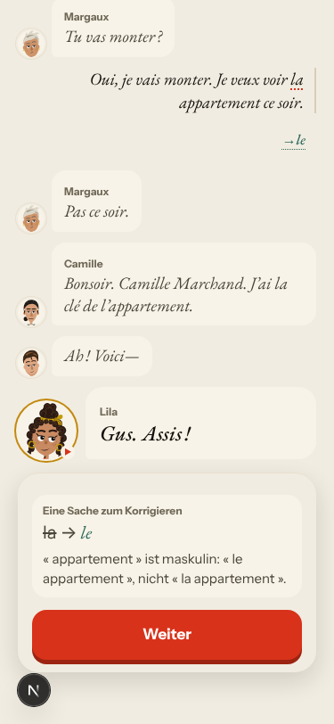
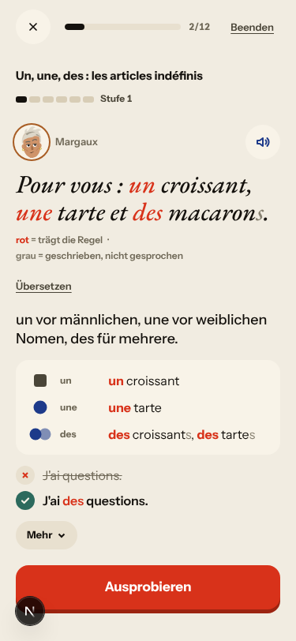
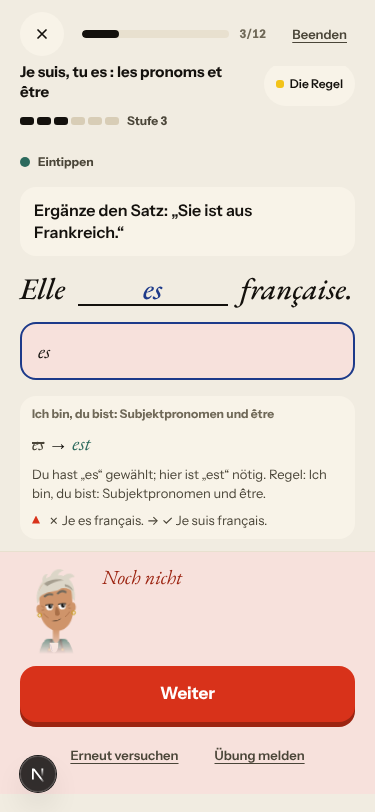

# Walk · 26 Oct 2026 · nightly explore walk

Main at `72e4571f`, unchanged since the 24 Oct walk. The walk ran because a new live walk report exists. Fake story
provider, local stack, Chromium at phone size, one persona: `a1-de-fresh` (`--native de`, A1). Played day 1: teaser,
sign-up, character, tour, scene with two free replies (both with the same «la appartement» slip), the rule, 2 recall
drills (one missed on purpose), 19 word cards, La Forge 6 of 12 (two missed on purpose), Hier aufhören, Fertig für heute.

Live column: [live walk 26 Oct](../live-walks/2026-10-26.md) on production with the real model
(branch `claude/live-walk-2026-10-26`; the link resolves once that report is on main). It reproduced root cause #333
(a failed model call is shown as a result) on La Forge and the Courrier and filed no new issue. Its findings are not
re-filed here.

## Scores (rubric `docs/ops/walk-rubric.md`)

| # | question | 26 Oct a1-de (d1) | live 26 Oct |
|---|---|---|---|
| 1 | Where am I | 4 | 3 |
| 2 | What is at stake | 4 | 4 |
| 3 | What to do next | 4 | 3 |
| 4 | Scene reacts to my writing | fake | 2 |
| 5 | Story coherent | 3 | 3 |
| 6 | Characters consistent | 3 | 4 |
| 7 | Image, text, tone fit | 4 | 4 |
| 8 | Difficulty fits | 4 | 4 |
| 9 | Feedback explained | 3 | 2 |
| 10 | Right answers accepted | 4 | 3 |
| 11 | French correct | 3 | 4 |
| 12 | Clear goal today | 4 | 3 |
| 13 | Grammar practised | 3 | 2 |
| 14 | Earlier material returns | 4 | 4 |
| 15 | I produce French | 4 | 4 |
| 16 | Errors, dead ends | 3 | 2 |
| 17 | Varied, fun | 4 | 4 |
| 18 | Fast enough | 4 | 4 |
| 19 | App only | n/a | n/a |
| 20 | Satisfying end | 4 | 3 |
| 21 | Would come back | 4 | 3 |
| 22 | Time vs promise | 4 | 3 |

Against the last `a1-de` walk (24 Oct, same code), counters agreed this time: «19 Wörter» on the scene's end, Lexique
0/19 → 19/19, «19 Wörter» on Fertig. The Forge recap marks missed items with a red triangle.

Q11 is 3 for the wrong «le appartement» correction. Q13 is 3 because «Regel des Tages schmieden» alternated être with
«Un, une, des», a rule the day never taught. Q16 is 3 because a miss does not lower the level the card promises to lower.

## Findings, by root cause

No new issue tonight. Every finding repeats an open one.

### #250 corrections are never checked
- **#318 (again, de A1)** «Je suis ici pour la appartement…» gets `la → le` and «« appartement » ist maskulin: « le appartement »», while Camille says «J'ai la clé de l'appartement» on the same screen. 

### #146 content and feedback not driven by one concept
- **#318 / #169 (again)** La Forge items 2, 4 and 6 drill «Un, une, des» at Stufe 1, most likely pulled in by the saved false correction. The live walk saw the same switch at day 14. 

### #143 the day's progress has no single source of truth
- **#281 (again)** The level card says «Falsch: eine runter»; after «Elle es française» the level stays at Stufe 3. 

### Not filed
- A typed Forge miss says «Du hast „es“ gewählt», though the learner typed it.
- Sign-up rejects an address on the reserved `.test` domain with «Diese E-Mail-Adresse geht nicht.» Real learners do not hit this.
- #302 («zwei Fehler in Folge» on the first miss) was not seen tonight; the cameo showed no text on either miss.

## Re-tests

Main is unchanged since the 24 Oct walk, which re-tested the merges ([24 Oct report](2026-10-24.md), PR #320).

## Scripted walk

The «Browser walk» on report PR #339 failed once on 25 Oct (`forge-miss-correction-above-the-sheet`, en, docs-only PR),
the second sighting of #319 after 23 Oct (fr). The failed job was re-run tonight.
