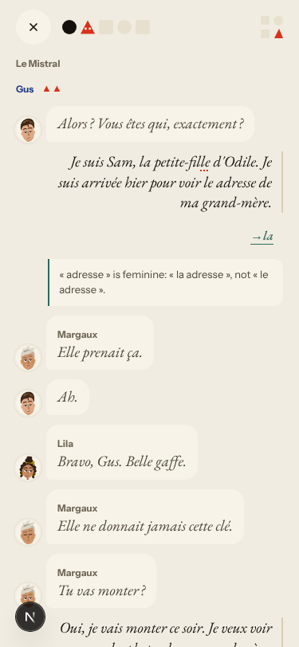
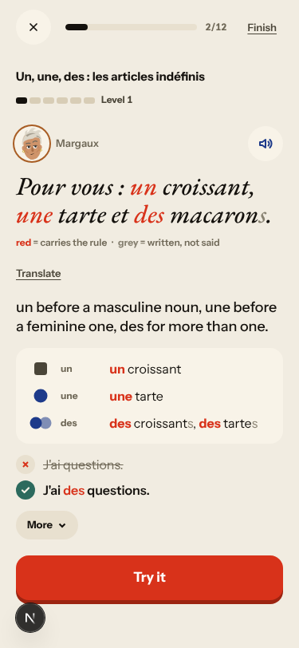

# Walk · 27 Oct 2026 · nightly explore walk

Main at `72e4571f`, unchanged since the 24 Oct walk. The walk ran because a new live walk report exists. Fake story
provider, local stack, Chromium at phone size, one persona: `a2-en` (`--native en --level A2.1`). Played day 1: teaser,
sign-up, character, tour, scene with two free replies (one with a «le adresse» slip, one correct), the rule, 9 recall
drills (one missed on purpose), 17 word cards, La Forge 3 of 12, Done. Day 2 (clock +1): 18 word cards and La Forge 4 of
12 (one item missed four times on purpose).

Live column: [live walk 27 Oct](../live-walks/2026-10-27.md) on production with the real model
(branch `claude/live-walk-2026-10-27`; the link resolves once that report is on main). It reproduced root cause #333
again and filed #348 (a Forge repair line built from a garbled earlier answer rejects a correct sentence), #349 (a scene
bubble pastes the earlier thread) and #350 (Gus switches tu/vous between scene and Courrier). Its findings are not
re-filed here.

## Scores (rubric `docs/ops/walk-rubric.md`)

| # | question | 27 Oct a2-en (d1–2) | live 27 Oct |
|---|---|---|---|
| 1 | Where am I | 4 | 3 |
| 2 | What is at stake | 4 | 4 |
| 3 | What to do next | 4 | 3 |
| 4 | Scene reacts to my writing | fake | 2 |
| 5 | Story coherent | 3 | 3 |
| 6 | Characters consistent | 3 | 3 |
| 7 | Image, text, tone fit | 4 | 4 |
| 8 | Difficulty fits | 4 | 4 |
| 9 | Feedback explained | 3 | 2 |
| 10 | Right answers accepted | 4 | 1 |
| 11 | French correct | 3 | 3 |
| 12 | Clear goal today | 4 | 3 |
| 13 | Grammar practised | 3 | 2 |
| 14 | Earlier material returns | 4 | 4 |
| 15 | I produce French | 4 | 4 |
| 16 | Errors, dead ends | 3 | 1 |
| 17 | Varied, fun | 4 | 4 |
| 18 | Fast enough | 4 | 3 |
| 19 | App only | n/a | n/a |
| 20 | Satisfying end | 4 | 3 |
| 21 | Would come back | 4 | 3 |
| 22 | Time vs promise | 3 | 3 |

A correct A2 reply drew no correction. Day 2's La Forge brought back the day-1 rule (passé composé avec avoir) next to
the new one, so Q14 is 4. The missed recall item came back as «Once more» and was accepted «with help».

Q11 is 3 for the wrong «la adresse» correction. Q13 is 3 because La Forge alternated today's rule with «Un, une, des»
on both days. Q22 is 3 because the scene's end said «17 words», Lexique counted 17 and Done said «20 Words» (#143).

## Findings, by root cause

No new issue tonight. Every finding repeats an open one.

### #250 corrections are never checked
- **#318 (again, en A2, feminine branch)** «…voir le adresse de ma grand-mère» gets `le → la` and «« adresse » is feminine: « la adresse », not « le adresse »». Both gender branches skip elision. 

### #146 content and feedback not driven by one concept
- **#318 / #169 (again)** La Forge drills «Un, une, des» at Level 1 on day 1 and day 2, an untaught rule pulled in by the false correction. Third persona in three nights. 

### #143 the day's progress has no single source of truth
- **#281 (again)** «nous avons ouvri» at Level 3 is «Not yet», and the level stays at 3.
- **#143 (again)** «17 words» on the scene card and in Lexique, «20 Words» on Done. The recall counter grew 2/8 → 3/9 after a miss.

### Not filed
- A typed Forge miss says «You chose “nous avons ouvri”», though the learner typed it (also seen in German on 26 Oct).
- #302 («two mistakes in a row») did not appear, even after four misses on one item.
- No Forge repair item built from my own earlier answer came up in 7 items, so #348 could not be re-tested on the fake provider.

## Re-tests

Main is unchanged since the 24 Oct walk, which re-tested the merges ([24 Oct report](2026-10-24.md), PR #320).

## Scripted walk

#319 failed again on report PR #346 (en, 26 Oct). The re-run is pending. #339's re-run passed.
