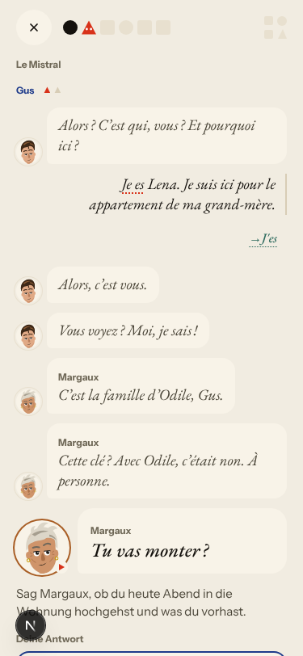
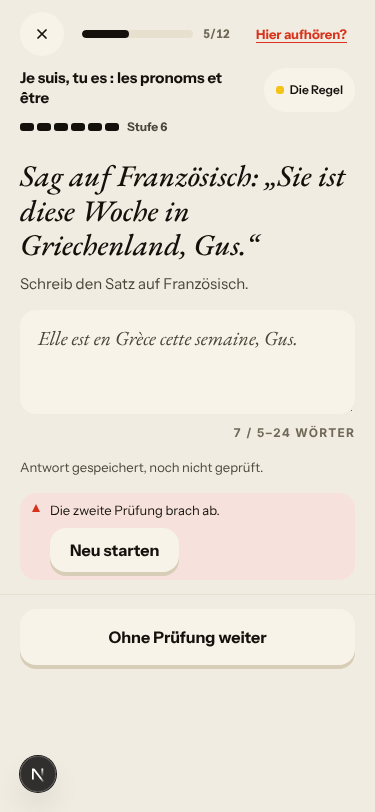
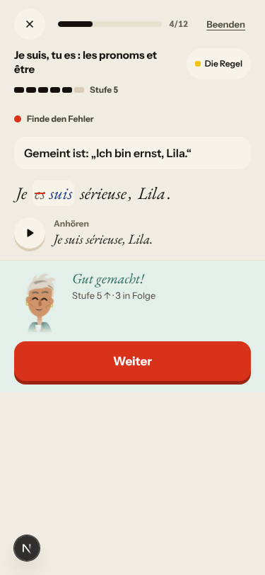

# Walk · 28 Oct 2026 · nightly explore walk

Main at `72e4571f`, unchanged since the 24 Oct walk. The walk ran because a new live walk report exists. Fake story
provider, local stack, Chromium at phone size, one persona: `a1-de-fresh` (`--native de`). Played day 1: sign-up, tour,
scene with two free replies (the first with «Je es Lena», «le appartement»), the rule (être), 2 recall drills, the words,
La Forge 5 of 12 (item 1 missed on purpose), Done. Day 2 (clock +1): scene with one free reply («Ce est pas plus simple
pour moi, je es triste»), the rule (avoir), 7 recall drills (one missed on purpose), La Forge 2 of 12.

Live column: [live walk 28 Oct](../live-walks/2026-10-28.md) on production with the real model, account on day 16
(branch `claude/live-walk-2026-10-28`; the link resolves once that report is on main). It saw #334, #333, #250, #132 and
#349 again. Its findings are not re-filed here.

## Scores (rubric `docs/ops/walk-rubric.md`)

| # | question | 28 Oct a1-de (d1–2) | live 28 Oct |
|---|---|---|---|
| 1 | Where am I | 4 | 3 |
| 2 | What is at stake | 4 | 3 |
| 3 | What to do next | 4 | 3 |
| 4 | Scene reacts to my writing | fake | 2 |
| 5 | Story coherent | 3 | 2 |
| 6 | Characters consistent | 3 | 2 |
| 7 | Image, text, tone fit | 4 | 4 |
| 8 | Difficulty fits | 4 | 4 |
| 9 | Feedback explained | 2 | 1 |
| 10 | Right answers accepted | 4 | 1 |
| 11 | French correct | 2 | 3 |
| 12 | Clear goal today | 4 | 3 |
| 13 | Grammar practised | 4 | 3 |
| 14 | Earlier material returns | 4 | 3 |
| 15 | I produce French | 4 | 3 |
| 16 | Errors, dead ends | 3 | 1 |
| 17 | Varied, fun | 4 | 4 |
| 18 | Fast enough | 4 | 3 |
| 19 | App only | n/a | n/a |
| 20 | Satisfying end | 4 | 2 |
| 21 | Would come back | 4 | 3 |
| 22 | Time vs promise | 4 | 3 |

Q9 and Q11 are 2: on both days the scene taught «J'es» as the correct form of «Je es», with the explanation «« je »
verliert vor einem Vokal den Vokal: « J'es »», and «Ce est» on day 2 got no correction at all. Q13 is 4, up from 3 on
26 and 27 Oct: without a false article correction La Forge stayed on today's rules (être on day 1, avoir and être on
day 2). Q14 is 4: day 2's La Forge brought back être, and day 1's La Forge built a «find the mistake» item from my own
«Je es» and asked for «suis», which is the right fix. Q16 is 3 for the unchecked free-text items below.

## Findings, by root cause

No new issue tonight. Every finding repeats an open one.

### #250 corrections are never checked
- **#318 (again, de A1, elision branch)** «Je es Lena» → «J'es» on day 1 and «je es triste» → «J'es» (capitalised mid-sentence) on day 2. The elision rule (`correction_contract.py` ~709) glues «je» to any vowel without fixing the verb. Fourth night in a row that #318 shows up, now in a third branch. 
- **#318 (new shape)** «Ce est pas plus simple» draws no correction: the rule only elides «je». Open PR #327 covers both «je es» and «ce est» in its elision rules and tests, so nothing new is filed. 

### #333 a failed or empty model call is shown as a result
- **#334 (reproduced on the fake provider)** Every free-text La Forge item ends «Antwort gespeichert, noch nicht geprüft. Die zweite Prüfung brach ab.», 2 of 2 tonight, and the level still rises (Stufe 5 → 6 on day 1, 5 → 6 on day 2). The 13 Oct report put this down to the stub, but the live walk sees the same on production, so it reproduces locally without the real model. 

### #143 the day's progress has no single source of truth
- **#281 (again)** A missed La Forge item at Stufe 2 stays at Stufe 2, while the explainer on the same screen says «Falsch: eine runter».

### Not filed
- Day 1's «find the mistake» item from my own «Je es» was right and readable (strike-through «es», «suis»). 
- After `/clock +1` the Home header still read «Mittwoch, 28. Okt.», while the Forge end sheet promised the next review for «Do., 29. Okt.». Probably the harness clock reaching the server but not the header; not checked further.
- #302 («two mistakes in a row») did not appear.

## Re-tests

Main is unchanged since the 24 Oct walk, which re-tested the merges ([24 Oct report](2026-10-24.md), PR #320).

## Scripted walk

The Browser walk on 27 Oct passed on `72e4571f`. Tonight's scheduled run has not started yet.
