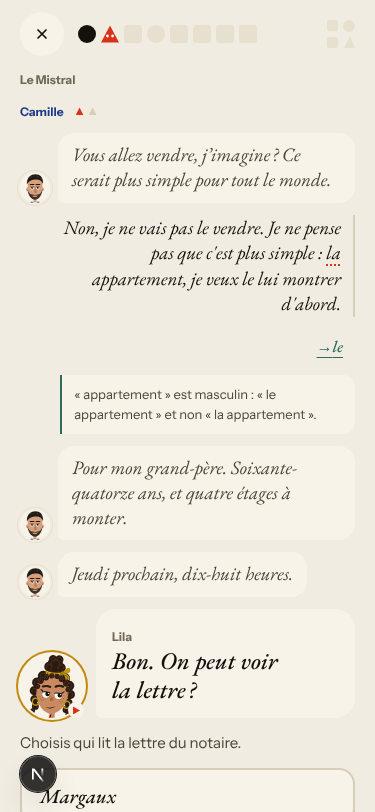
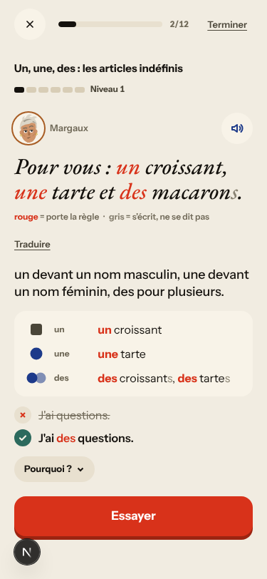
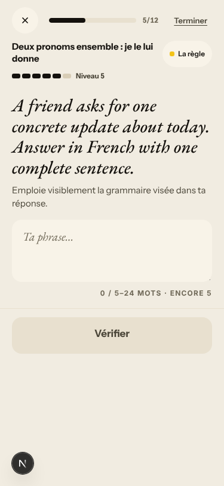
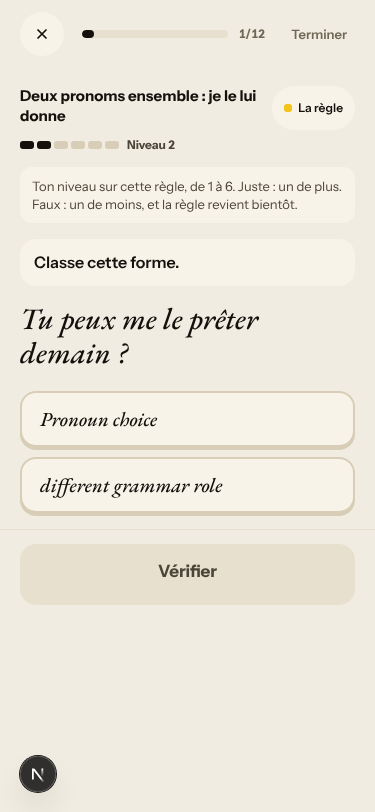
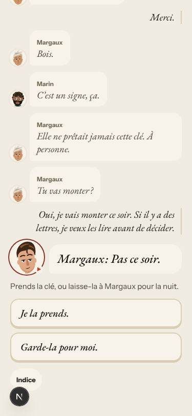
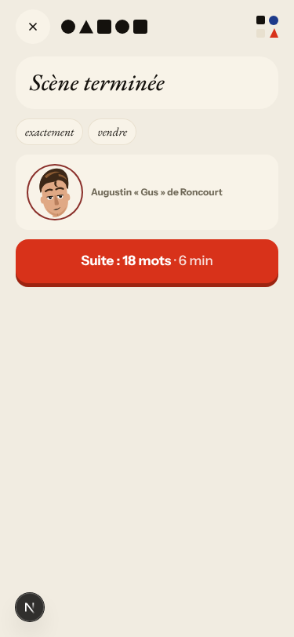

# Walk · 29 Oct 2026 · nightly explore walk

Main at `30032065`. It moved since the 28 Oct walk: #249 (Au comptoir, off), #312/#331/#363/#365/#366/#367 (Le Quartier, behind a flag),
#328 and #364 (Story: the learner's reasons, «Ton cap»), #329 (Forge accent judging, #295–#297) and #330 (Fortschritt).
Fake story provider, local stack, Chromium at phone size, one persona: `b1-fr-chrome` (`--native fr --level B1.1`).
Played day 1: teaser, sign-up, character, scene «Le mauvais accueil» with two free replies, the rule (deux pronoms), 6 recall drills
(one missed on purpose), the words, La Forge 5 of 12 (item 1 missed on purpose), Done. Day 2 (clock +1): scene «La lettre» with one
free reply, 4 recall drills, La Forge 3 of 12.

Live column: [live walk 29 Oct](../live-walks/2026-10-29.md) on production with the real model, account on day 17 (branch
`claude/live-walk-2026-10-29`; the link resolves once that report is on main). It filed #369 and #370 and saw #250, #348, #357,
#279/#143, #281, #350, #265, #359 and #316 again. #334 did not reproduce there (0 of 7). Its findings are not re-filed here.

## Scores (rubric `docs/ops/walk-rubric.md`)

| # | question | 29 Oct b1-fr (d1–2) | live 29 Oct |
|---|---|---|---|
| 1 | Where am I | 4 | 3 |
| 2 | What is at stake | 4 | 3 |
| 3 | What to do next | 4 | 3 |
| 4 | Scene reacts to my writing | fake | 4 |
| 5 | Story coherent | 3 | 3 |
| 6 | Characters consistent | 3 | 2 |
| 7 | Image, text, tone fit | 4 | 4 |
| 8 | Difficulty fits | 4 | 4 |
| 9 | Feedback explained | 3 | 3 |
| 10 | Right answers accepted | 4 | 2 |
| 11 | French correct | 3 | 3 |
| 12 | Clear goal today | 4 | 3 |
| 13 | Grammar practised | 3 | 4 |
| 14 | Earlier material returns | 4 | 3 |
| 15 | I produce French | 4 | 4 |
| 16 | Errors, dead ends | 3 | 2 |
| 17 | Varied, fun | 4 | 4 |
| 18 | Fast enough | 4 | 3 |
| 19 | App only | n/a | n/a |
| 20 | Satisfying end | 4 | 2 |
| 21 | Would come back | 4 | 3 |
| 22 | Time vs promise | 3 | 3 |

The recall drills were the best part. «les leur» was accepted as the corrected part, the miss explained the pronoun order, and the
counter stayed at 6. Day 2's recall brought back day 1's rule («Il me en a parlé.»), so Q14 is 4. Q6 is 3 because Gus speaks a line
labelled «Margaux:». Q11 is 3 because of the false «la → le» correction. Q13 is 3 because La Forge drilled «Un, une, des» at Niveau 1
on day 2 for a B1 learner. Q22 is 3 because Home promised «16 mots» and the scene end said «Suite : 18 mots».

## Findings, by root cause

No new issue tonight. Every finding repeats an open one.

### #250 corrections are never checked
- **#318 (again, fr B1, new main)** «…la appartement, je veux le lui montrer…» gets `la → le` and «« appartement » est masculin : « le appartement »». «Si il y a des lettres» on day 1 gets no correction. «Bien que je suis fatiguée» and «les clés qu'elle m'a donné» get none either. The model-free pass has no subjunctive or agreement rule, so it says nothing, which is better than saying something wrong. PR #327 is still open. 

### #146 content and feedback not driven by one concept
- **#318 / #169 (again)** Day 2's La Forge drills «Un, une, des : les articles indéfinis» at Niveau 1, a rule pulled in by the false correction. This is the fourth persona in four nights. 

### #144 register and chrome language
- **#196 (again)** In French chrome, La Forge classify buttons read «Pronoun choice», «Preposition choice» and «different grammar role» (PR #344 is still open). The free-text prompts are English («A friend asks for one concrete update about today. Answer in French…», «Message received: … Reply naturally in French.») and come from the English `fallback` in `app/services/atelier.py` ~2249. Sign-up says «Vos réponses et votre voix…» next to tu copy.  

### #145 the scene has no state of who said what
- **#349 (reproduced on the fake provider)** After the second reply, Gus's bubble says «Margaux: Pas ce soir.». No model is involved, so the label leak is in how lines are stored or rendered. PR #353 is still open. 

### #333 a failed or empty model call is shown as a result
- **#334 (again on the fake provider)** The free-text La Forge item ends «Réponse enregistrée, pas encore vérifiée. Relecture interrompue.» and the level still goes up to Niveau 6. PR #340 is still open. Tonight's live walk did not reproduce it.

### #143 the day's progress has no single source of truth
- **#281 (again)** A missed classify item at Niveau 2 stays at Niveau 2, under the line «Faux : un de moins».
- **#279 (again)** Home says «16 mots», and the scene's end card says «Suite : 18 mots». 

### Not filed
- La Forge item «Corrige l'erreur dans la phrase» for «Je vois Marc demain.», which has no error: the task is to replace «Marc» with «le». The label is wrong for a transform, but the hint makes the task clear.
- Tiles offer the non-word distractor «prêters». The tiled answer is stored as «Tu peux me le prêter demain?», without the space before «?».
- After `/clock +1` the dates still read 29 Oct (Home, and the Forge end sheet «29 · 10 · 26»), as on 28 Oct. This looks like the harness clock not reaching the browser.

## Re-tests

- #329 (Forge accent judging, #295–#297): its issues are closed. No accentless free answer came up tonight, so this was not re-tested on the fake provider.
- #328 and #364 (story) are story-engine changes and are left to the live walk.
- #318, #196, #349, #334, #281 and #279 still reproduce. Their fixes are in open PRs (#327, #344, #353, #340), not on main.

## Scripted walk

The Browser walk passed on 28 Oct, on `72e4571f`. It has not run yet on `30032065`.
