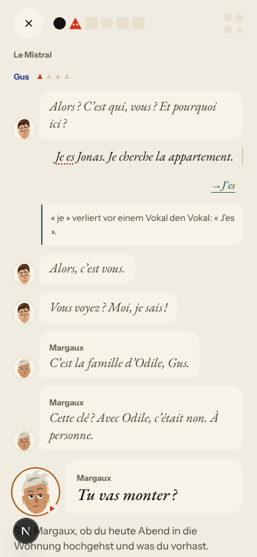
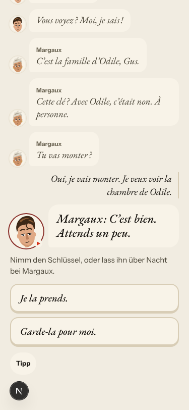
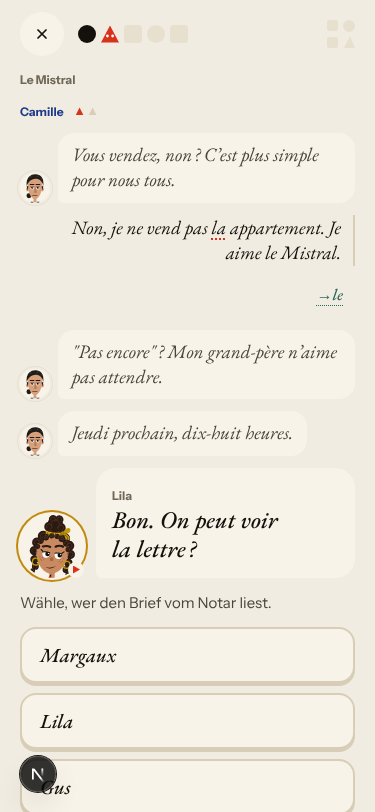
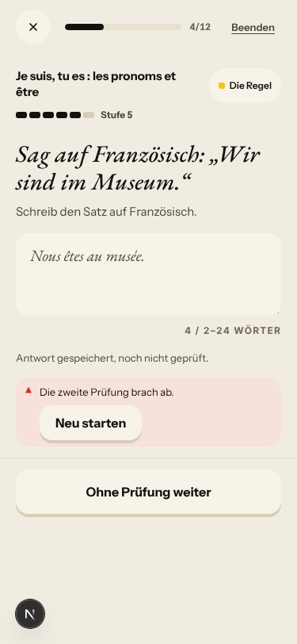
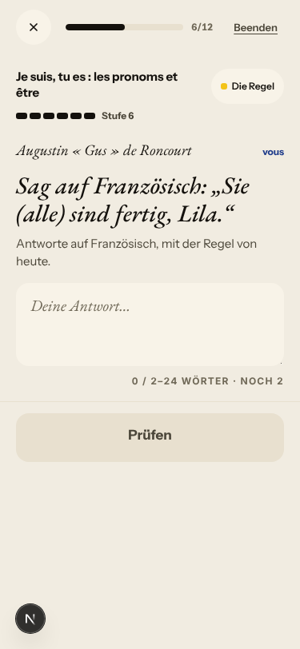

# Walk · 30 Oct 2026 · nightly explore walk

Main at `0e4cf24c`. It moved since the 29 Oct walk: #368 (Le Quartier forge, behind a flag) and #372 (the learner walk's frozen clock).
Fake story provider, local stack, Chromium at phone size, one persona: `a1-de-fresh` (`--native de`).
Played day 1: teaser, sign-up («Neu im Französischen · A1»), character, scene «Le mauvais accueil» with two free replies and one choice,
the rule (Subjektpronomen und être), 2 recall drills (one missed on purpose), the words, La Forge 6 of 12 (four free-text items), Done.
Day 2 (clock +1): scene «La lettre» with one free reply and one choice, 5 recall drills, La Forge 3 of 12 (item 1 missed on purpose).

Live column: [live walk 30 Oct](../live-walks/2026-10-30.md) on production with the real model, account on day 18 (branch
`claude/live-walk-2026-10-30`; the link resolves once that report is on main). It filed #378 to #382. Its findings are not re-filed here.

## Scores (rubric `docs/ops/walk-rubric.md`)

| # | question | 30 Oct a1-de (d1–2) | live 30 Oct |
|---|---|---|---|
| 1 | Where am I | 4 | 3 |
| 2 | What is at stake | 4 | 3 |
| 3 | What to do next | 4 | 3 |
| 4 | Scene reacts to my writing | fake | 2 |
| 5 | Story coherent | 3 | 2 |
| 6 | Characters consistent | 3 | 2 |
| 7 | Image, text, tone fit | 4 | 4 |
| 8 | Difficulty fits | 4 | 4 |
| 9 | Feedback explained | 2 | 2 |
| 10 | Right answers accepted | 3 | 2 |
| 11 | French correct | 2 | 3 |
| 12 | Clear goal today | 4 | 2 |
| 13 | Grammar practised | 3 | 4 |
| 14 | Earlier material returns | 4 | 3 |
| 15 | I produce French | 4 | 4 |
| 16 | Errors, dead ends | 3 | 3 |
| 17 | Varied, fun | 4 | 4 |
| 18 | Fast enough | 4 | 3 |
| 19 | App only | n/a | n/a |
| 20 | Satisfying end | 3 | 2 |
| 21 | Would come back | 4 | 3 |
| 22 | Time vs promise | 3 | 2 |

The rule matched the day this time: La Forge on day 1 drilled «Je suis, tu es» and nothing else, and day 2's recall brought être back
next to avoir, so Q13 and Q14 are better than on most a1 nights. Q9 and Q11 are 2 because the first correction a new A1 learner sees is
«Je es» → «J'es», with a note that explains it as elision. Q10 is 3 because no free-text Forge answer was checked (4 of 4). Q20 is 3
because the Done screen has counts and no open question (#359). Q22 is 3 because Home promised «16 Wörter» and Done counted 19 (#279).

## Findings, by root cause

One new issue: #384.

### #250 corrections are never checked
- **#318 (worse tonight)** «Je es Jonas. Je cherche la appartement.» gets «→ J'es» and «« je » verliert vor einem Vokal den Vokal: « J'es ».» A form that does not exist is taught as a rule, and ten minutes later the recall teaches «je suis, tu es…». Day 2: «la appartement» → «le» again. The elision rule in `app/services/correction_contract.py` ~709 glues «je» to any vowel-initial word. PR #327's branch gives «Je suis Jonas.», «J'ai faim» and «l'appartement» (checked locally). 

### #145 the scene has no state of who said what
- **#349 (again)** Gus's bubble reads «Margaux : C'est bien. Attends un peu.» PR #353 is still open. 
- **#132 (again, fake)** Day 2: a clear «Non, je ne vend pas…» is answered «"Pas encore" ? Mon grand-père n'aime pas attendre.» 

### #333 a failed or empty model call is shown as a result
- **#334 (again, 4 of 4)** Every free-text La Forge item ends «Antwort gespeichert, noch nicht geprüft. Die zweite Prüfung brach ab.» «Neu starten» does nothing. A wrong «Nous êtes au musée.» gets no feedback, the level goes from 5 to 6 on an unchecked answer, and the day-2 recap lists «Elles sont au Mistral, Marin.» as if I had written it. PR #340 is still open. 

### #144 register and address
- **#384 (new)** La Forge German prompts «Sie (alle) sind fertig, Lila.» and «Sie (alle) sind im Mistral, Marin.» read as «you all, Lila». I answered «Vous êtes…» both times; the item wanted ils/elles. #202 fixed the bare «Sie sind …» but not the vocative shape that #126 was filed for. `queue:ready`, `lane:code`, `size:S`. 

### #143 the day's progress has no single source of truth
- **#281 (again)** A missed judgement item at Stufe 2 stays at Stufe 2, under «Falsch: eine runter». The end sheet shows être at «Stufe 6 · Weiterhin in Übung».
- **#279 (again)** Home says «16 Wörter»; Done counts 19.

### #146 content and feedback not driven by one concept
- **#318 / #169 (again)** Day 2's La Forge pulls in «Un, une, des : les articles indéfinis» at Stufe 1 after the false «la → le» correction. This is the fifth persona in five nights.

### Drills
- **#357 (reproduced on the fake provider)** In «Finde den Fehler», «Prüfen» stays disabled after typing the fix; only Enter commits it.

### Not filed
- «J ai froid» (no apostrophe) is accepted as «Richtig» with no note. That leniency is deliberate at A1 (`_elision_slip` in `answer_acceptance.py`).
- The teaser's second line becomes «Bienvenue au Mistral !» while the task still says «Grüß zurück.». The right answer stays obvious.
- «de Odile» in a scene reply gets no correction. Nothing wrong was taught.
- After `/clock +1` the dates still read 30 Oct. This is the harness clock, as on 28 and 29 Oct.

## Re-tests

- #368 and #372 are a flagged 3D prototype and a test harness change; neither is on the a1-de path.
- #318, #349, #334, #281, #279, #357 and #132 still reproduce. The fixes for #318, #349 and #334 are in open PRs (#327, #353, #340), not on main.

## Scripted walk

The Browser walk passed on 29 Oct, on `0e4cf24c`.
