# Walk · 31 Oct 2026 · nightly explore walk

Main at `a8b0bff5`. It moved since the 30 Oct walk: the backlog merges #390 (20 fix PRs), #391 (18 reports), #392 (11 conflicting fix PRs and #304 reworked), #393 and #394.
Fake story provider, local stack, Chromium at phone size, one persona: `a2-en` (`--native en --level A2.1`), answering off-script on purpose.
Played day 1: onboarding, scene «Le mauvais accueil» with two free replies and one choice, the rule (passé composé avec avoir), 7 recall drills (one missed on purpose), 18 words, La Forge 12 of 12 (one free-text item), Done, the Courrier (one reply to Lila).
Day 2 (clock +1): scene «La lettre» with two free replies and one choice, 9 recall drills, 18 words, La Forge 10 of 13 (five free-text items, then «Stop here»), Done.

Live column: [live walk 31 Oct](../live-walks/2026-10-31.md) on production with the real model, account on day 19 (branch `claude/live-walk-2026-10-31`, PR #399). It filed #395 to #398. Its findings are not re-filed here.

## Scores (rubric `docs/ops/walk-rubric.md`)

| # | question | 31 Oct a2-en (d1–2) | live 31 Oct |
|---|---|---|---|
| 1 | Where am I | 4 | 3 |
| 2 | What is at stake | 4 | 3 |
| 3 | What to do next | 3 | 3 |
| 4 | Scene reacts to my writing | fake | 4 |
| 5 | Story coherent | 3 | 3 |
| 6 | Characters consistent | 4 | 2 |
| 7 | Image, text, tone fit | 4 | 4 |
| 8 | Difficulty fits | 4 | 4 |
| 9 | Feedback explained | 3 | 3 |
| 10 | Right answers accepted | 3 | 4 |
| 11 | French correct | 3 | 3 |
| 12 | Clear goal today | 3 | 4 |
| 13 | Grammar practised | 4 | 4 |
| 14 | Earlier material returns | 4 | 4 |
| 15 | I produce French | 3 | 5 |
| 16 | Errors, dead ends | 3 | 3 |
| 17 | Varied, fun | 4 | 4 |
| 18 | Fast enough | 4 | 3 |
| 19 | App only | n/a | n/a |
| 20 | Satisfying end | 2 | 2 |
| 21 | Would come back | 3 | 3 |
| 22 | Time vs promise | 2 | 3 |

Q20 is 2 because the day ends on «Tomorrow · Ton billet de retour est pour mercredi», which is a statement and not a hook, under counts that disagree (#396). Q22 is 2 because the word count goes 16 → 18 → 20 on day 1 and 16 → 18 → 22 on day 2 (#396).
Q15 is 3 because none of the six free-text La Forge items could be checked on this stack (#401). Q3 is 3 because Home's «New letter» row opens the document upload (#400).
The best of the night: the passé composé was anchored in a scene line («Il a dit ça ?»), the day-1 miss came back as day 2's first drill, the key I left with Margaux carried into day 2, and «un poster» was accepted for «une affiche».

## Findings, by root cause

Four new issues: #400, #401, #402 and #403, all `queue:ready`, `lane:code`, `size:S`.

### #143 the day's progress has no single source of truth
- **#396 (again, now on the fake stack after #392)** Words: Home «16», scene end «18», review 0/18, Done «20». On day 2, Home flashes «22 words — done» on the way to La Forge. The review URL is still `?day=1`. 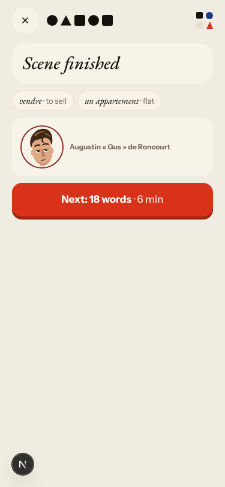 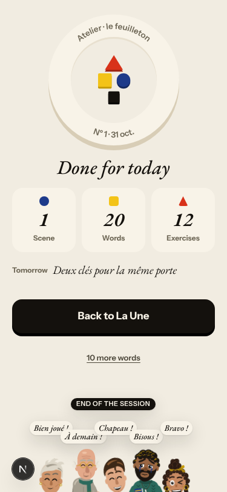
- **#402 (new)** The La Forge legend says «Wrong: down one», but a miss keeps the level (owner decision #88). Passé composé avec avoir is Level 5 on day 1's end sheet and Level 4 at day 2's first item. Day 2 labels the item's own sentence «You wrote this earlier». 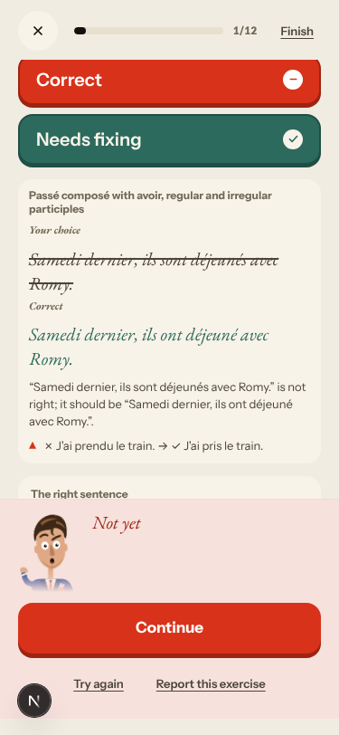 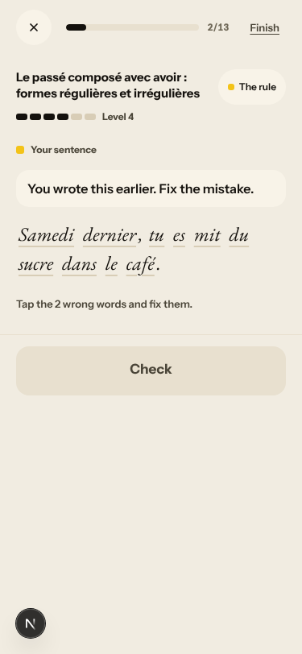
- **#400 (new)** Home's «New letter ≈ 4 min» opens `/missions?intake=1` (paste a text / take a photo) while «Un mot de Lila» waits in the Courrier tab. 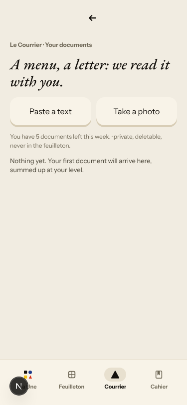 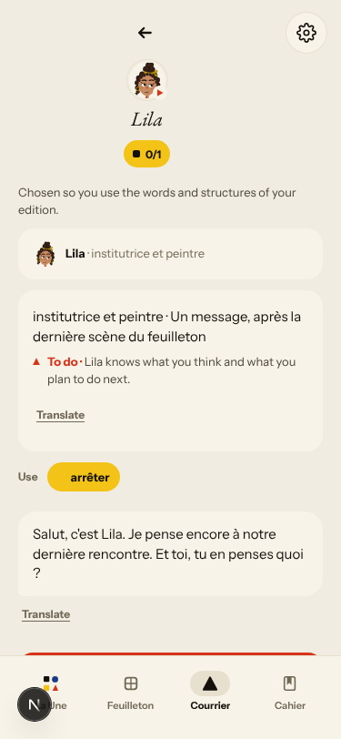

### #333 a failed or empty model call is shown as a result
- **#401 (new)** With no correction model, every free-text La Forge item ends «I could not check this answer», even «Hier, elle a écrit un message à Romy.», which is the item's own answer. The local check (`app/services/atelier.py` ~5611) decides only a test-out. #340 holds: the level does not move and the recap does not list the line. 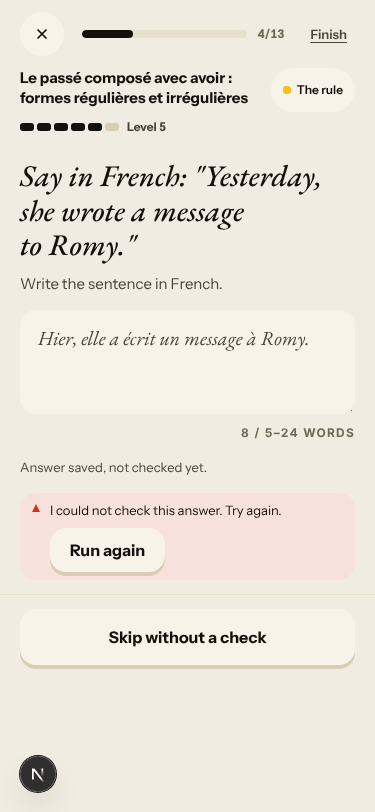
- **#397 (again, fake)** Courrier: «No corrections found» on «mon travail a Londres». 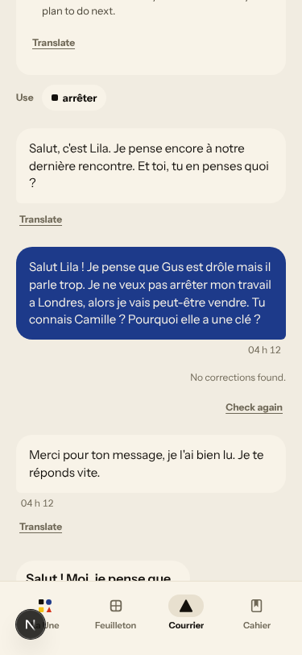

### #146 content and feedback not driven by one concept
- **#169 (again)** «Forge today's rule» alternates the day's passé composé with «Un, une, des» from item 2 on, starting at Level 1 (6 of 12 items). This is the sixth persona in six nights. 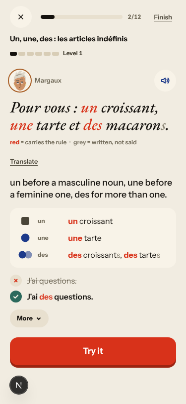
- Not filed: a judgement item's correction miss («Il est restée») shows only the right sentence, with no word about agreement. Day 2's rule (passé composé avec être) appears only in La Forge; the pre-scene drills were all day-1 material.

### #174 a right answer is judged against one stored string
- Not filed separately: «un appart» is rejected for «flat, apartment», and the fix reads «un appart → appartement», dropping the article. 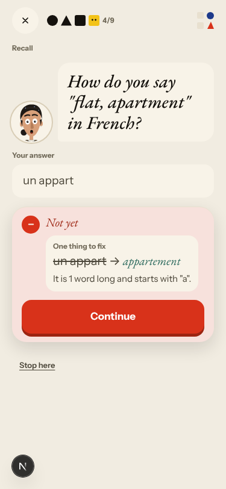

### #145 scene state (fake provider)
- **#129 (again)** Day 2: Camille's «Jeudi prochain, dix-huit heures.» has nothing that says what happens then.
- Fake: «j ai lis la lettre» gets no correction. My question to Margaux about Solvel and my asking for a coffee are answered by the authored key hand-over («Tiens.»).

### No shared cause
- **#403 (new)** Day 2 shows day 1's title «Le mauvais accueil» on panel 1 and on the scene-finished card. 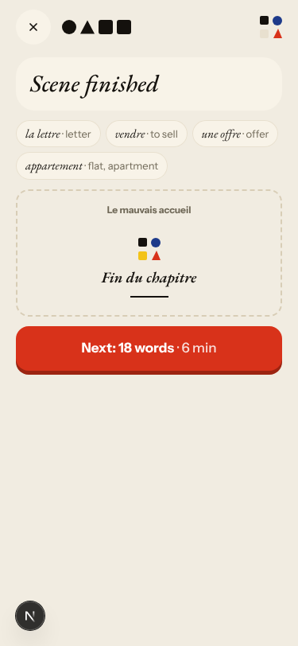

## Re-tests

- #357: «Check» in «Find the mistake» now enables after typing the fix (already closed).
- #334 / #340: an unchecked answer no longer raises the level and is not listed in the recap (already closed). The «could not check» itself is now #401.
- #318: day 1's elision correction is right («de Odile» → «d'Odile»), with no false «J'es»-style form (already closed).
- #349 and #108: not reproduced on the fake path tonight (Gus's bubbles are clean; Lila does not turn down her own offer). Both are story findings; they are left to the live walk.
- #129 and #169 still reproduce (commented).

## Scripted walk

The Browser walk passed on 30 Oct, on `0e4cf24c`. On #392 (now main) all four browser walks and the learner walk were green on 30 Oct.
