# Walk · 1 Nov 2026 · nightly explore walk

Main at `244379ba`. It moved since the 31 Oct walk (`a8b0bff5`): the night-shift fixes #406, #408, #411, #415, #417, #418 and #419; #174 (one accept-list), #147 (one cast registry), #155, #167, #196, #119, #381, #384 and #398; the gold-transcript tooling; the story author's level guard.
Fake story provider, local stack, Chromium at phone size, one persona: `b1-fr-chrome` (`--fresh --native fr --level B1.1`), signed up through the UI.
Played day 1: teaser, sign-up, character, scene «Le mauvais accueil» with two free replies and one choice («Garde-la pour moi»), the rule (deux pronoms ensemble), 6 recall drills (one missed on purpose), 20 words, La Forge 12 of 12 (one miss on purpose, one free-text item unchecked), Done, Home, the Courrier (one reply to Romy), Cahier, Feuilleton.
Day 2 (clock +1): scene «La lettre» with two free replies and one choice, the rule (pour, sans, avant de + infinitif), 4 recall drills, 20 words, La Forge 9 of 9, Done, Home, the Courrier's new letter.

Live column: [live walk 1 Nov](../live-walks/2026-11-01.md) on production with the real model, account on day 20 → 21 (branch `claude/live-walk-2026-11-01`, PR #446). It filed #443, #444 and #445. Its findings are not re-filed here.

## Scores (rubric `docs/ops/walk-rubric.md`)

| # | question | 01 Nov b1-fr (d1–2) | live 01 Nov | 31 Oct a2-en (d1–2) | live 31 Oct |
|---|---|---|---|---|---|
| 1 | Where am I | 4 | 3 | 4 | 3 |
| 2 | What is at stake | 4 | 3 | 4 | 3 |
| 3 | What to do next | 4 | 2 | 3 | 3 |
| 4 | Scene reacts to my writing | fake | 3 | fake | 4 |
| 5 | Story coherent | 3 | 3 | 3 | 3 |
| 6 | Characters consistent | 3 | 2 | 4 | 2 |
| 7 | Image, text, tone fit | 4 | 4 | 4 | 4 |
| 8 | Difficulty fits | 3 | 3 | 4 | 4 |
| 9 | Feedback explained | 3 | 4 | 3 | 3 |
| 10 | Right answers accepted | 4 | 4 | 3 | 4 |
| 11 | French correct | 2 | 4 | 3 | 3 |
| 12 | Clear goal today | 4 | 3 | 3 | 4 |
| 13 | Grammar practised | 3 | 2 | 4 | 4 |
| 14 | Earlier material returns | 4 | 3 | 4 | 4 |
| 15 | I produce French | 4 | 5 | 3 | 5 |
| 16 | Errors, dead ends | 3 | 3 | 3 | 3 |
| 17 | Varied, fun | 4 | 4 | 4 | 4 |
| 18 | Fast enough | 4 | 3 | 4 | 3 |
| 19 | App only | n/a | n/a | n/a | n/a |
| 20 | Satisfying end | 2 | 3 | 2 | 2 |
| 21 | Would come back | 3 | 3 | 3 | 3 |
| 22 | Time vs promise | 4 | 3 | 2 | 3 |

Q11 is 2 because La Forge offers invented forms as options («prêters», «encores», «peuxs», «J'économises», #448). Q20 is 2 because day 2's «La suite demain» is cut to «Ton billet de retour est…» on both Done and Home (#450). Q13 is 3 because three of day 2's nine Forge items practise place prepositions under «Pour, sans, avant de» (#447). Q8 is 3 because a B1 learner gets fill-the-word-from-the-scene drills and single-pronoun swaps.
Q22 went up from 2 to 4. The word count is one number now: 20 on Home, on the scene end, in the review (0/20 → 20/20) and on Done, both days (#396 fixed). Q3 went up from 3 to 4. Home's letter row opens the day's letter (#400 fixed), and the scene end card shows the right title (#403 fixed).
The best of the night: «Forger la règle du jour» stayed on the day's rule from Niveau 2 (#169 fixed). The day-1 miss «Je lui vois demain.» came back on day 2 as «Ta phrase · Tu as écrit ça plus tôt» at the end sheet's Niveau 5 (#402 fixed). Margaux handed back the key I had left with her. Camille's «Jeudi prochain, dix-huit heures» now says why (#129 fixed).

## Findings, by root cause

Six new issues: #447, #448, #449 and #452 are `queue:ready`; #450 and #451 are `queue:owner`. Two repeats are back in `queue:ready`: #196 and #397.

### #146 content and feedback not driven by one concept
- **#447 (new, medium)** La Forge's fallback rewrite items are keyed by a broad profile, not the concept. «Pour, sans, avant de + infinitif» gets «Il habite à cette rue.», «Je vais au bureau de Marie.» and «Nous parlons ce projet.». Each right answer raises its level, and the end sheet lists «Nous parlons de ce projet.» under it. On day 1 «Deux pronoms» gets single-pronoun swaps labelled «Corrige l'erreur dans la phrase» on sentences with no error. `app/services/atelier.py` ~4170–4240. 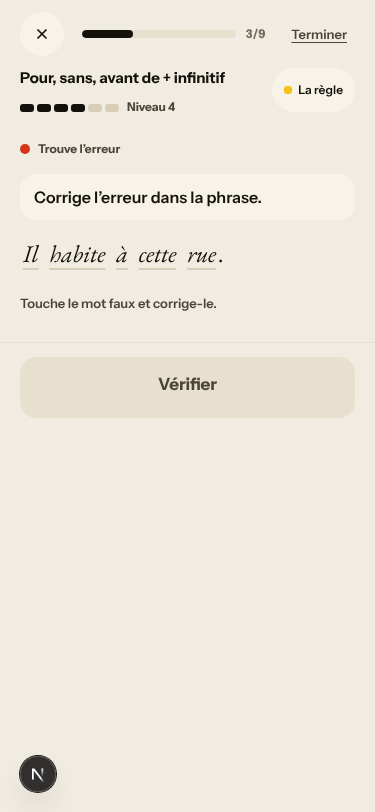 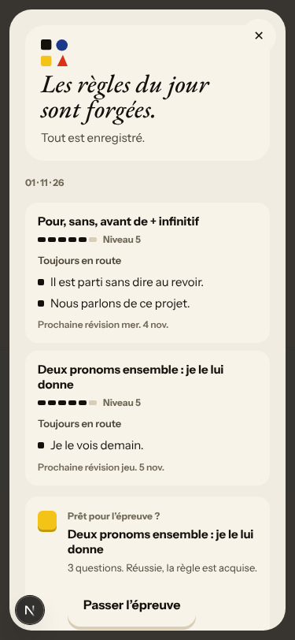 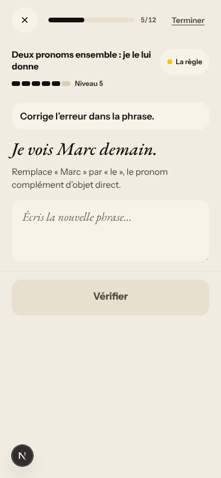
- **#448 (new, medium)** Invented distractors («prêters», «encores», «peuxs», «J'économises»), «autrement» in every bank, and a fill item that tests «peux» instead of the rule. Its end-sheet line reads «Tu peux_ me le prêter demain ?». `app/services/atelier.py` ~3955 and ~4069 (`f"{token}s"`). 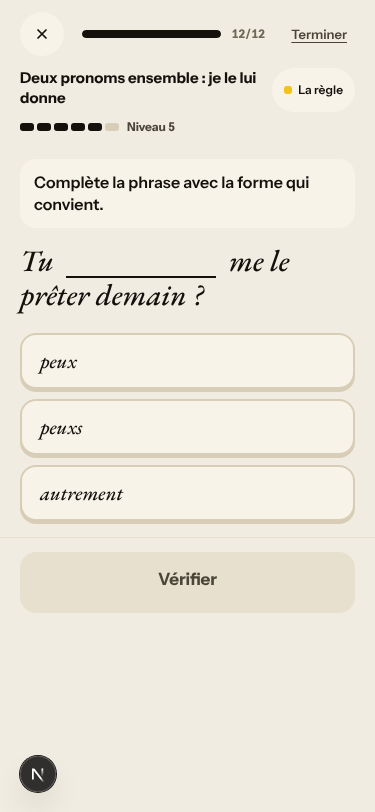 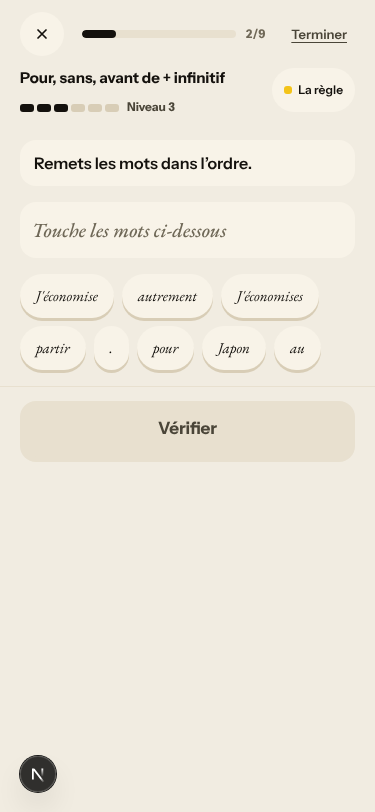 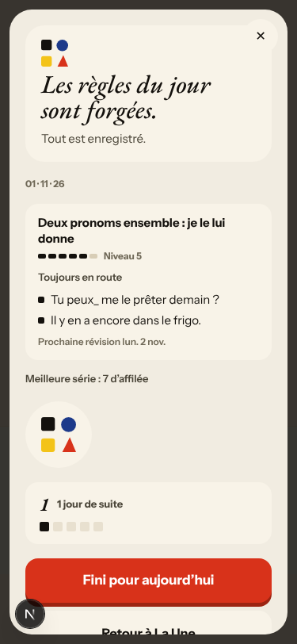
- **#449 (new, medium)** The miss «Je lui vois demain.» (COD/COI) is explained with the pronoun-order card. A missed correction step («il m'en a parle») shows only «La bonne phrase» and does not mark «parlé». 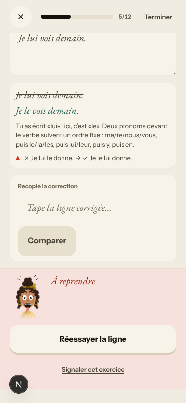 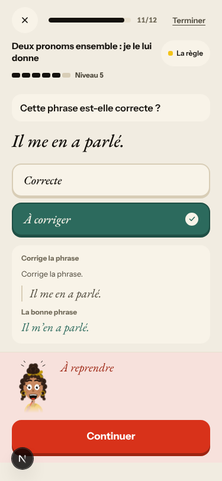
- Not filed: the first recall drill each day copies the rule card's Faux/Juste pair word for word (#110, closed, had this in part).

### #144 register (closed root cause; its guard misses two files)
- **#196 (again, back to `queue:ready`)** The La Forge fallback task is French and uses tu now (fixed by #435). Still vous: the sign-up line «Vos réponses et votre voix… pour vous corriger et vous répondre» (`web-frontend/lib/legal.ts:87`), the Courrier label «Votre dépêche» (`app/services/missions.py:3574`), and the stock reply «Je vous réponds rapidement». #144's guard test does not scan these files.

### #333 a failed or empty model call is shown as a result
- **#397 (again, back to `queue:ready`)** On the fake stack the #411 parts pass: newest mission, and a real note on «a → à» instead of «No corrections found». Romy still answers with the stock «Merci pour votre message, je l'ai bien lu.», and the live walk saw the old thread and the unordered stamps on production. 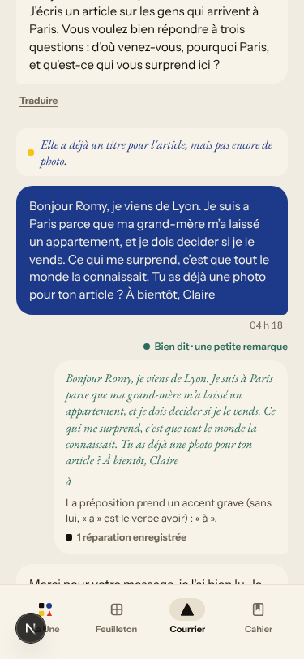
- Not filed (expected without a model): the open free-text Forge task («Une amie te demande une nouvelle concrète…») ends «Je n'ai pas pu vérifier cette réponse», with «Passer sans évaluation». It came up three times in two days. #401's case (an answer equal to the item's own answer) did not come up, so #401 was not re-tested.

### #145 scene state (fake provider)
- Fake: «Oui, je vais monter ce soir» is answered with Margaux's authored «Pas ce soir.». «je ne suis pas sûre que je veux» and «avant que Camille revient» get no correction. «que vous me expliquez» is corrected to «m'expliquez» only, so the subjunctive error stays. Romy's letter says «on s'est vus au Mistral», but she was not in the scene. Left to the live walk (#250, #147).

### No shared cause
- **#450 (new, medium, `queue:owner`)** `teaserHint` cuts the 8-word case finale to «Ton billet de retour est…» (the 7-word rule, owner 2026-10-18). Since #359 the Done screen prints the same short line. 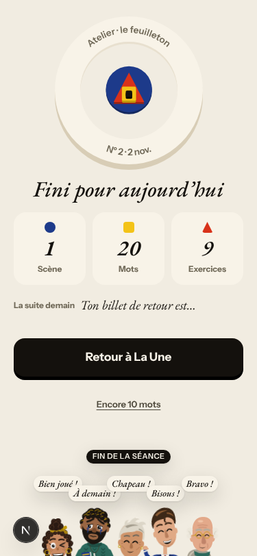 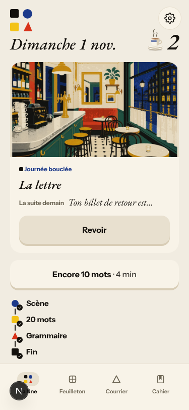
- **#451 (new, low, `queue:owner`)** With French chrome, the Lexique cards ask in English («exactly», «to sell»). The scene's «Traduire» answers «Aucune traduction disponible». Product decision. 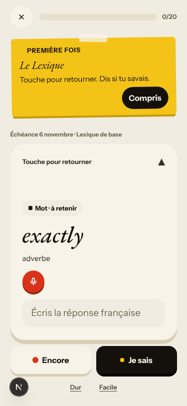
- **#452 (new, low)** French typography: «La phrase à corriger:», «Forme corrigée:», «lui» with no spaces.
- Not filed: the panel counter jumps («Planche 1 sur 6» → «14/14», «1 sur 4» → «19/19»). The live walk tracks it under #194. After `/clock +1`, Home still says «Dimanche 1 nov.» and the review URL is `?day=1`, while Done says «Nº 2 · 2 nov.»: the harness clock does not reach the browser, as on earlier nights.

## Re-tests

- **#402 closed:** the legend reads «Faux : le niveau reste», a miss kept Niveau 5, and day 2's review item opened at the end sheet's Niveau 5. 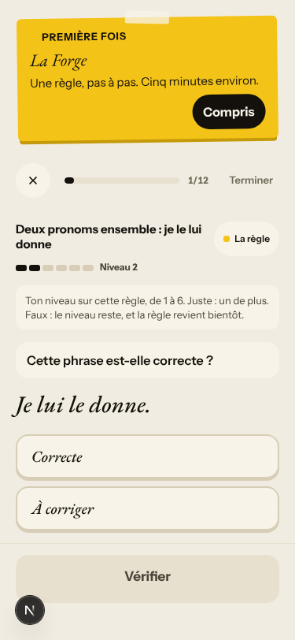 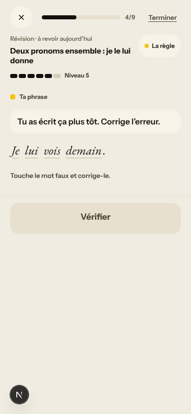
- **#169 confirmed fixed** (already closed): 12 of 12 items on «Deux pronoms», starting at Niveau 2, never «Un, une, des». Day 2's off-rule items are a different mechanism (#447).
- **#396 confirmed fixed for words** (already closed): 20 everywhere, both days, and the day chip moves only at Done. 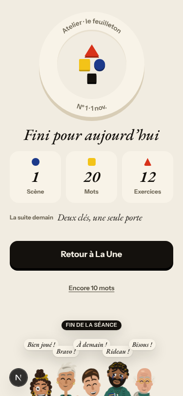
- **#400 confirmed fixed** (already closed): Home's «Nouvelle lettre» and `/missions` open the same, newest letter. 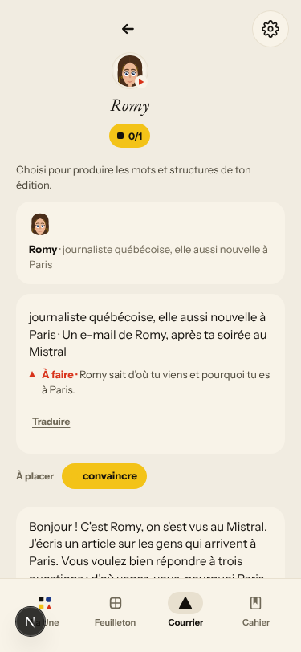
- **#403 confirmed fixed** (already closed): «Chapitre · Le mauvais accueil / La lettre». 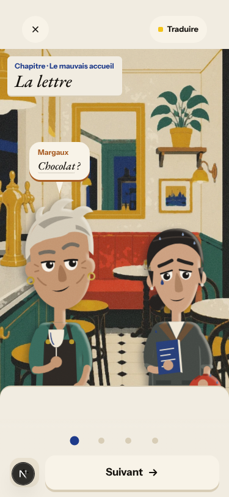 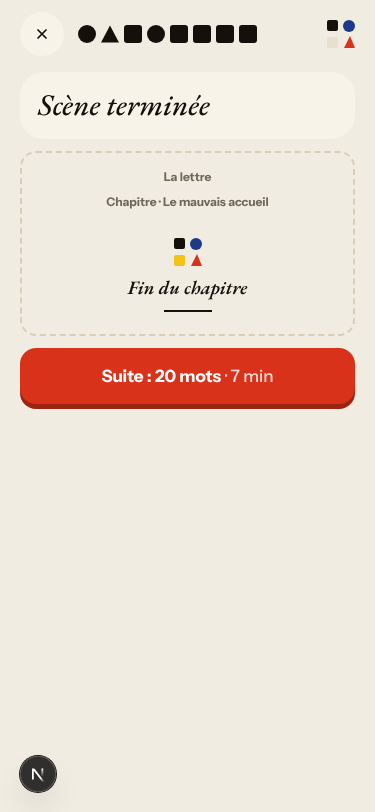
- **#129 confirmed fixed on the fake path** (already closed): «Jeudi prochain, dix-huit heures. Je viens visiter l'appartement.» 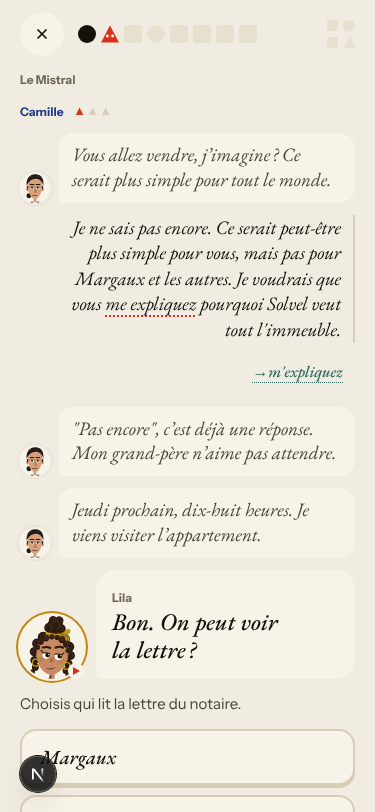
- **#397 and #196** still reproduce in part (see above). Both are back in `queue:ready`.
- #395 and #401: no «Find the mistake» miss and no closed free-text Forge item came up, so they were not re-tested.

## Scripted walk

The Browser walk passed on 31 Oct (run 20, on `8e1d0763`, the #404 merge). It has not run yet on `244379ba`.
