# Walk · 2 Nov 2026 · nightly explore walk

Main at `078e9664`. It moved since the 1 Nov walk (`244379ba`): #461 (hook hints up to 9 words, fixes #450), #463 (day order scene → La Forge → words, written once), #462 (vocab cards translate with their example, no cloze, an unturned card shows only «Antwort zeigen»), #465 (scene words first, nouns with their article), #438, #464.
Fake story provider, local stack, Chromium at phone size, one persona: `a1-de-fresh` (`--fresh --native de`, A1), signed up through the UI.
Played day 1: teaser, sign-up, character, onboarding, cast intro, scene «Le mauvais accueil» with two free replies and two choices, the rule (Ich bin, du bist: être), 3 recall drills (one missed on purpose), La Forge 9 of 12 (one miss on purpose; it ended early on its 5-minute budget), 20 words, Done, Home, the Courrier (one reply to Gus), Cahier, Feuilleton.
Day 2 (clock +1): scene «La lettre» with one free reply and one choice, two rules (être again, then Avoir), 9 recall drills (one miss), La Forge 13 of 24 (one miss, stopped with «Hier aufhören»), 21 words, Done, Home.

Live column: [live walk 2 Nov](../live-walks/2026-11-02.md) on production with the real model, account on day 21 (branch `claude/live-walk-2026-11-02`, PR #468). It filed #466 and #467 and commented on #443, #167, #397, #398, #378, #143 and #145. Its findings are not re-filed here.

## Scores (rubric `docs/ops/walk-rubric.md`)

| # | question | 02 Nov a1-de (d1–2) | live 02 Nov | 01 Nov b1-fr (d1–2) | live 01 Nov |
|---|---|---|---|---|---|
| 1 | Where am I | 4 | 3 | 4 | 3 |
| 2 | What is at stake | 4 | 3 | 4 | 3 |
| 3 | What to do next | 3 | 3 | 4 | 2 |
| 4 | Scene reacts to my writing | fake | 4 | fake | 3 |
| 5 | Story coherent | 3 | 3 | 3 | 3 |
| 6 | Characters consistent | 3 | 3 | 3 | 2 |
| 7 | Image, text, tone fit | 4 | 4 | 4 | 4 |
| 8 | Difficulty fits | 3 | 4 | 3 | 3 |
| 9 | Feedback explained | 3 | 4 | 3 | 4 |
| 10 | Right answers accepted | 4 | 4 | 4 | 4 |
| 11 | French correct | 4 | 3 | 2 | 4 |
| 12 | Clear goal today | 4 | 3 | 4 | 3 |
| 13 | Grammar practised | 3 | 2 | 3 | 2 |
| 14 | Earlier material returns | 4 | 4 | 4 | 3 |
| 15 | I produce French | 4 | 5 | 4 | 5 |
| 16 | Errors, dead ends | 4 | 3 | 3 | 3 |
| 17 | Varied, fun | 3 | 4 | 4 | 4 |
| 18 | Fast enough | 4 | 3 | 4 | 3 |
| 19 | App only | n/a | n/a | n/a | n/a |
| 20 | Satisfying end | 3 | 2 | 2 | 3 |
| 21 | Would come back | 3 | 3 | 3 | 3 |
| 22 | Time vs promise | 3 | 3 | 4 | 3 |

Q14 is scored on day 2 only (n/a on day 1). No question scored 1 or 2 tonight.
Q20 went up from 2 to 3. The hook is whole on Done and Home: «Morgen · Ton billet de retour est pour mercredi» (#450 fixed by #461). It is still a statement, not a question. Q11 went up from 2 to 4. No invented distractor came up in two days of La Forge (the #448 fix is not merged yet, so A1 être/avoir items may just not hit that path). Q16 is 4: no error, dead end or empty screen in two days.
Q3 went down to 3. The first grammar drill after the rule card is introduced as «Die Wörter · Kurze Wortübungen» (#469). Q22 is 3 because Home's day card promises «+ Wörter ≈ 9 s» over a plan row that says «21 Wörter … 7 Min.» (#470). Q17 is 3 because from Stufe 5 on, La Forge is a row of «Sag auf Französisch» items: five in a row on day 1, ten on day 2, three of them «Ich bin 69 / 57 / 54 Jahre alt». Q8, Q9 and Q13 are 3 on the fake provider: La Forge saved 13 of 22 answers unchecked, and one unchecked answer still raised the level (#471).
The best of the night: the new day order reads clearly («Szene, dann Grammatik, dann deine Wörter») and the end-of-scene sticker says so. Day 1's être came back on day 2 as a known rule on the scene's own line and as «Wiederholung · heute fällig» items inside La Forge. The day-2 recall miss «Je suis vingt ans.» got a clear one-line why. Word cards turn as #462 promises, with the scene line and its German translation on «vendre».

## Findings, by root cause

Six new issues, all `queue:ready`: #469, #470, #471, #472, #473, #474. Two repeats stay in `queue:ready`: #449 and #397. #280 commented (partly better, stays `queue:owner`). #319 reopened and raised to `sev:medium`, `queue:ready`.

### #143 the day's progress has no single source of truth
- **#470 (new, medium)** Home day 2: «8 Min. · + Wörter ≈ 9 s» on the card, «21 Wörter · 20 neu · 1 zum Wiederholen · 7 Min.» in the plan under it. `_today_time_estimate` counts only due cards (`word_drill_seconds(due)`, 1 × 9 s). The plan counts the day deck. `app/services/daily_journey.py:1238-1240`. 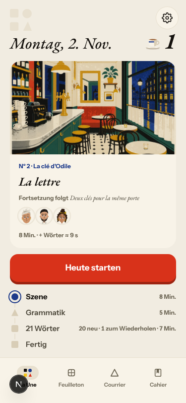

### #333 a failed or empty model call is shown as a result
- **#471 (new, medium)** La Forge «Ich bin klug» → «je suis intelligente»: «Antwort gespeichert, noch nicht geprüft», and Stufe 5 → 6. After one day the rule sits at Stufe 6 of 6, and day 2's end sheet offers «Bereit für die Prüfung?». The unchecked answers included the rule's own canonical mistakes («Il es au Mistral.», «Il est faim ce soir.»). 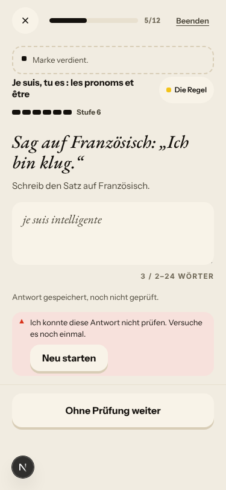 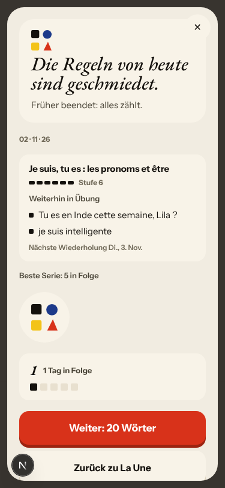 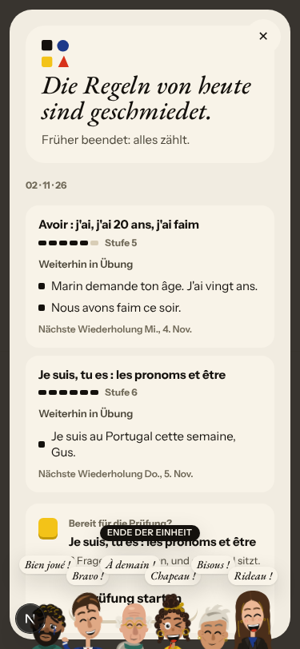
- **#397 (again)** On the fake stack the letter is the right one and the correction is real, but Gus answers with the stock «Merci pour votre message, je l'ai bien lu. Je vous réponds rapidement.», stamped «04 h 15» at 05:15 Berlin.

### #146 content and feedback not driven by one concept
- **#449 (again)** «Je ai» (an elision slip) is explained with the avoir card («✗ Je suis 20 ans. → ✓ J'ai 20 ans.») and «Du hast „Je ai“ gewählt» for a typed answer. 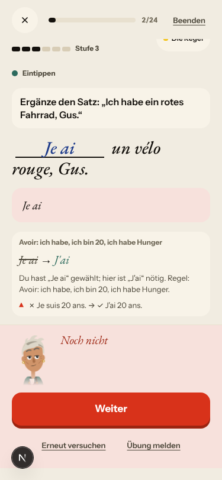

### #147 the cast is not one registry
- **#473 (new, low)** The day-2 rule card names the speaker «Camille marchand» and prints her line twice. `web-frontend/lib/rule-card.ts:455-460` formats unknown cast ids itself instead of reading the registry. 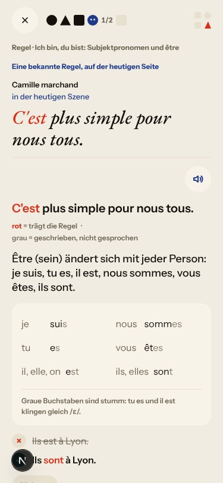

### #145 scene state (fake provider, left to the live walk)
- Fake: Camille answers my «Je sais pas. C'est qui, Solvel ?» with «"Pas encore" ? Mon grand-père n'aime pas attendre.», a line I never said. After choosing Lila to read the letter, Lila asks «Avant Solvel, on visite l'appartement ? Toi et moi ?» and answers for me at once: «Tu n'entres pas ? Je comprends.» 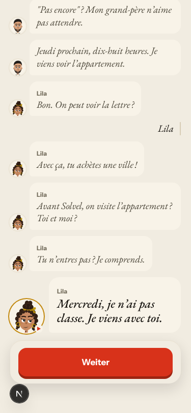 «Oui je monte» still gets Margaux's authored «Pas ce soir.». The first reply's correction catches «d'Odile» only, not «le petit-fille» or «la apartement». Not filed (#145, #171, #250).

### No shared cause
- **#469 (new, medium)** Since #463 the first in-scene recall drill opens with the sticker «Die Wörter – Kurze Wortübungen», while it is a drill on the rule just shown. The header over the rule card and its drills reads «Szene · Schritt 4/5/6 von 6». `web-frontend/lib/first-steps.ts:100-103` keys the sticker by step kind from before the reorder. 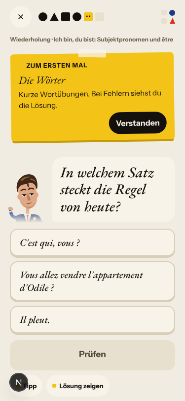
- **#472 (new, low)** Scene words lose their scene line: «la clé» (said twice in the scene) has no example. «la lettre» quotes the episode title «La lettre» (`app/services/scene_deck.py` `_found_in_texts` searches the title too). 17 of 20 and 19 of 21 cards have no example at all. 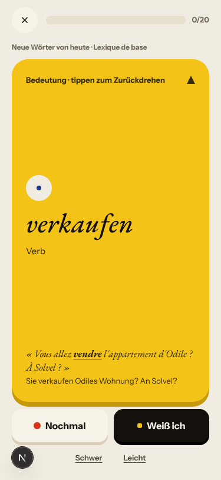
- **#474 (new, low)** Recall 5/9 shows «la lettre · Was bedeutet das?», then 8/9 asks «lettre · Maskulin oder feminin?». Since #465 the article is on every noun, so the gender drill tests nothing. 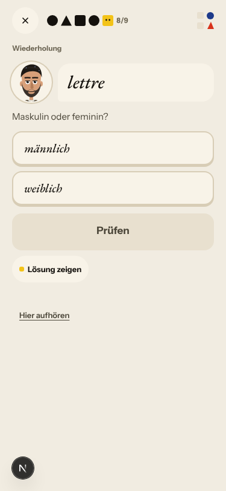
- **#319 (reopened, medium)** CI guard `forge-miss-correction-above-the-sheet` failed once each on #339 (25 Oct), #463 and #465 (1 Nov, en A1 day 2), and passed on a re-run each time. Structural flaw: on a miss two scroll owners race. `keepCardAboveSheet` scrolls smoothly at about 32 ms and realigns only on size changes. `clearTheSheet` (#282) jumps instantly at 150 ms and 600 ms toward a different target. The walk's 400 ms quiet window can land between them. The direction is one scroll owner and a guard that waits for `scrollend`. Code-sized: `queue:ready`, `size:M`.
- Not filed: «Grammatik· 5 Min.» looks unspaced in the text dump but is spaced on screen. The day-2 «Worum es geht» says «…was über dem Mistral liegt, und das Feuer darunter», which reads oddly in German. After `/clock +1` Home still says «Montag, 2. Nov.» and the Forge end sheet «02 · 11 · 26», as on earlier nights (the harness clock does not reach the browser). The `mf` lexicon nouns (joueur, visiteur…) did not appear in the decks.

## Re-tests

- **#450 confirmed fixed** (closed by #461): «Ton billet de retour est pour mercredi» whole on Done and Home. 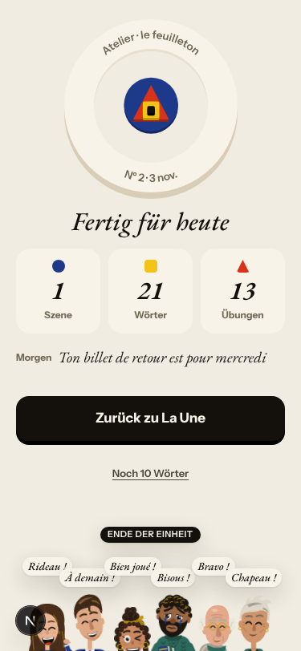
- **#463 works**: onboarding says «1 Die Geschichte · 2 La Forge · 3 Deine Wörter», and both days ran scene → rule → La Forge → words → Done. 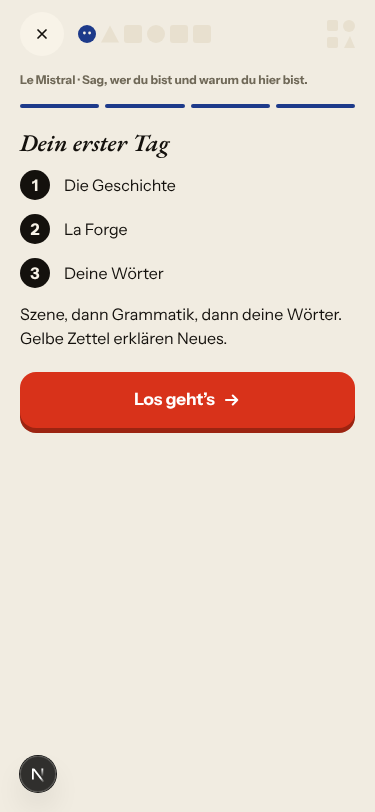 (The sticker copy did not follow: #469.)
- **#462 works**: an unturned card shows only «Antwort zeigen». «Nochmal / Weiß ich / Schwer / Leicht» appear after the turn, every grade moved on at once, and no cloze card came up in 41 cards. 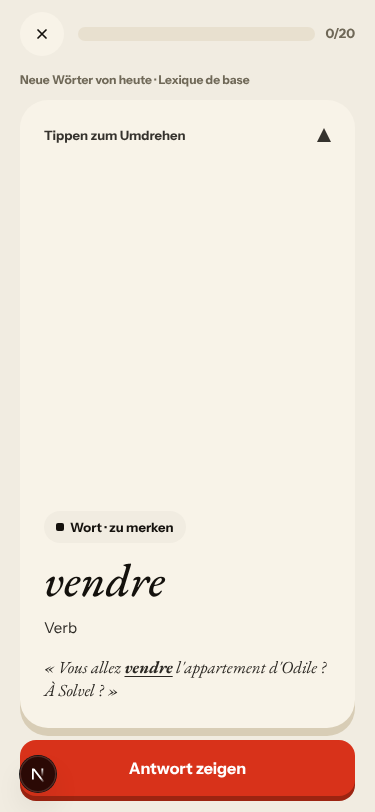
- **#465 works in part**: nouns carry their article («l'appartement (m.)», «la clé», «la lettre»), and the scene's words come first. Only 3 of 20 day-1 words and 1 of 21 day-2 words are from the scene (#280), and their examples are uneven (#472).
- **#461 works**: the 7-word hook is printed whole.
- No other `queue:pr` code-lane fix merged since the last walk, so none was re-tested. Story-engine and live-only findings (#466, #467, #443, #378, #145) are left to the live walk.

## Scripted walk

The Browser walk passed on 1 Nov (run 21, on `404f0764`, the #453 merge). It has not run yet on `078e9664`.
