# Walk · 3 Nov 2026 · nightly explore walk

Main at `b0a8ee4f`. It moved since the 2 Nov walk (`078e9664`): #487 (word deck: the scheduler's due words first, scene words a third of the new slots), #490 and #493 (after the day's words, «5 more new words» up to 50 a day, extras resume after a reload, the goal line, gold only through graded answers), #486 (gold for admin accounts only), #485 and #491 (#174: a wrong article is named on the hit, keyed rungs keep the relecture's corrections), #488 (Le Quartier talk asks what the person said last), the acts series #489, #492, #494–#499 (a day of one to three acts, «Le soir» / «À côté», a planche per act, the story counted on Fertig and in the weekly dossier), and #475 (last night's report).
Fake story provider, local stack, Chromium at phone size, one persona: `a2-en` (`--native en --level A2.1`), answering off-script on purpose (my own story, contradicting the scene, questions back).
Played day 1: Home, onboarding, cast intro, scene «Le mauvais accueil» with two free replies and two choices, the rule (passé composé avec avoir), 9 recall drills (one miss on purpose), La Forge 8 of 12 (one miss on purpose, three free-production items unchecked on the fake stack, then «Finish»), 20 words, «5 more new words» (two answered, a reload, three more), Done, Home, Courrier (one reply to Margaux), Cahier, Feuilleton.
Day 2 (clock +1): scene «La lettre» with two free replies and one choice, 8 recall drills, La Forge 6 of 12 (passé composé avec être, one miss, then a «Review · due today» item on yesterday's rule), 23 words (3 due, 20 new), Done, Home.

Live column: [live walk 3 Nov](../live-walks/2026-11-03.md) on production with the real model, account on day 22 (branch `claude/live-walk-2026-11-03`, PR #502, left open for tomorrow). It filed #500 and #501 and commented on #443, #444, #397, #445, #250, #398, #143, #466, #145 and #146. Its findings are not re-filed here. The 2 Nov live walk's PR #468 was merged tonight.

## Scores (rubric `docs/ops/walk-rubric.md`)

| # | question | 03 Nov a2-en (d1–2) | live 03 Nov | 02 Nov a1-de (d1–2) | live 02 Nov |
|---|---|---|---|---|---|
| 1 | Where am I | 4 | 3 | 4 | 3 |
| 2 | What is at stake | 4 | 3 | 4 | 3 |
| 3 | What to do next | 3 | 2 | 3 | 3 |
| 4 | Scene reacts to my writing | fake | 5 | fake | 4 |
| 5 | Story coherent | 3 | 3 | 3 | 3 |
| 6 | Characters consistent | 3 | 3 | 3 | 3 |
| 7 | Image, text, tone fit | 4 | 4 | 4 | 4 |
| 8 | Difficulty fits | 4 | 4 | 3 | 4 |
| 9 | Feedback explained | 3 | 3 | 3 | 4 |
| 10 | Right answers accepted | 3 | 4 | 4 | 4 |
| 11 | French correct | 4 | 4 | 4 | 3 |
| 12 | Clear goal today | 4 | 3 | 4 | 3 |
| 13 | Grammar practised | 3 | 2 | 3 | 2 |
| 14 | Earlier material returns | 4 | 3 | 4 | 4 |
| 15 | I produce French | 4 | 5 | 4 | 5 |
| 16 | Errors, dead ends | 4 | 2 | 4 | 3 |
| 17 | Varied, fun | 3 | 4 | 3 | 4 |
| 18 | Fast enough | 4 | 3 | 4 | 3 |
| 19 | App only | n/a | n/a | n/a | n/a |
| 20 | Satisfying end | 3 | 3 | 3 | 2 |
| 21 | Would come back | 3 | 3 | 3 | 3 |
| 22 | Time vs promise | 3 | 3 | 3 | 3 |

Q14 is scored on day 2 only (n/a on day 1). No question scored 1 or 2 tonight.
Q10 went down from 4 to 3. La Forge's «Copy the correction» field says «Type the corrected line…», and it refuses the whole corrected line («Il a invité Romy au cinéma samedi dernier.»). Only the gap passes, on both days (#503). The drills themselves accepted «j'ai pris le train» (lowercase, straight apostrophe, no stop) and «une lettre» with its article. Q8 went up to 4: passé composé with avoir, then with être, fit an A2 learner. Q3 is 3 because the rule card still sits under «Scene · Step 4 of 12» and its first drill under «The words · Quick word drills» (#469, PR #476 open). Q13 is 3: day 1's rule got a card and 4 drills in the scene. Day 2's 8 recall drills were all vocabulary, and the être rule appeared only in La Forge. Three free-production items per day could not be checked on the fake stack, and one still raised the level (#471). Q17 is 3: La Forge turns into a row of «Say in French: "…, Margaux."», and day 1's new words were 14 adverbs and verbs from the base list, with near-twins back to back («sûrement / certainement», «emmener / amener»). Q22 is 3: Home promises «10 min · + words ≈ 27 s» over a plan saying «23 words · 7 min» (#470).
The best of the night: the word deck does what #487 promises. Day 2 opened with the 3 due words, and the scene words came as every third card (cards 3, 6 and 9 on day 1; 6 and 9 on day 2), with the day's total kept at its intake. «5 more new words» after the deck works as #490 and #493 describe. The goal line reads «At 25 words a day, you'll have the A2 vocabulary about 8 days sooner.», and the three unanswered extras came back after a reload. No gold appears anywhere for a learner account (#486). The scene carried my day-1 choice: I left the key with Margaux, and day 2 asked me to get it back from her. Day 2's La Forge brought back yesterday's rule as «Review · due today».

## Findings, by root cause

Four new issues, all `queue:ready`: #503, #504, #505, #506. #119 failed its re-test and is back in `queue:ready`. Repeats commented: #471, #470 and #474 (stay `queue:ready`), #469 and #397 (stay `queue:pr`, their PRs #476 and #482 are open). #174 re-tested and advanced (stays open).

### #174 a right answer is judged against one stored string
- **#503 (new, medium)** After a keyed miss, «Copy the correction» («Type the corrected line…») refuses the whole corrected line and passes only the gap: «Il a invité Romy au cinéma samedi dernier.» → «Not quite — try the line again.», «Il a invité» → «Line copied». Day 2 did the same with «Hier, Lila est sortie avec des amis.». `record_micro_repair` (`app/services/atelier.py:4866-4878`) compares `_normalize(typed) == _normalize(target)` on keyed rounds. It uses the line readings only on model-judged rounds. 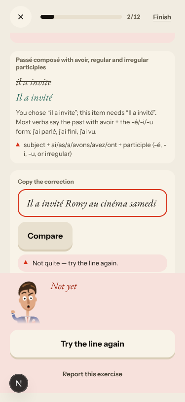 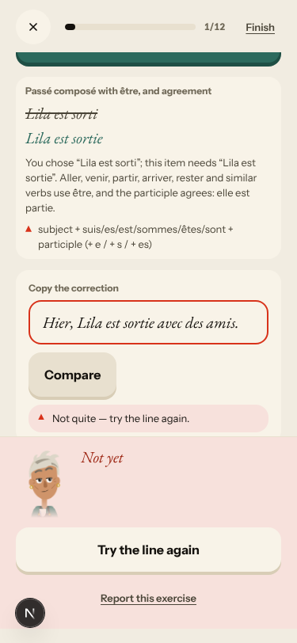

### #146 content and feedback not driven by one concept
- **#119 (re-test failed, back to `queue:ready`)** The scene correction «de Odile → d'Odile» is filed under «Un, une, des : les articles indéfinis», which turns that rule «practising · shaky in practice» on day 1 (`user_errors.concept_id = 4`, `FR2_A11_UN_UNE`). The #119 fix reached only the Courrier: `missions.py:4338` asks `elides_an_article`. Scene, recall and Journal corrections go through the keyword inference in `error_memory.py:932-951`, where «de» counts as a determiner and the article family's first concept wins. Two classifiers decide the concept of one correction. 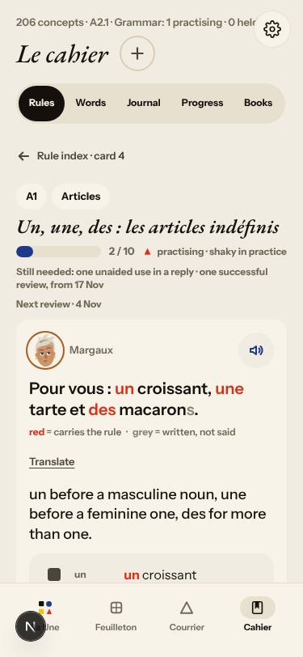

### #143 the day's progress has no single source of truth
The word deck now has a plan of its own (due, scene slot, new, extra), but the screens around it read other numbers.
- **#504 (new, low)** After «5 more new words», Done says «1 Scene · 20 Words · 7 Exercises» and Home «20 words — done» for a day of 25 answered cards. The tally reuses `dealt_deck()`, which leaves the extras out on purpose (`app/services/daily_session.py:220`, `:278`, `:461-464`). 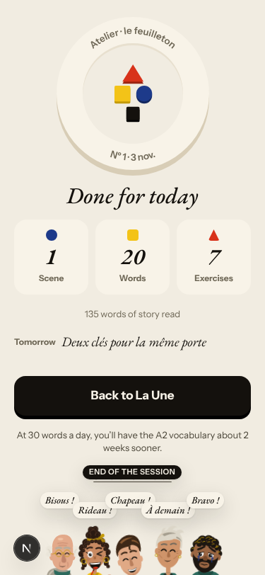
- **#505 (new, low)** Card headers: the 3 due reviews say «Word of the day», and today's scene words say «Due 9 November» / «Due 6 November» on 4 Nov (`pages/vocabulary/review.tsx:424-428`, `:1115`). 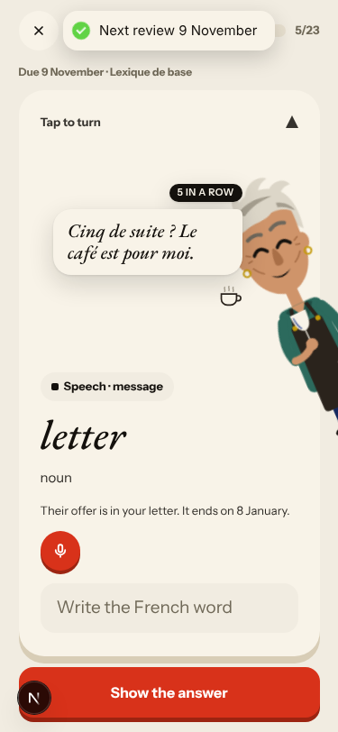
- **#470 (again)** Home day 2: «10 min · + words ≈ 27 s» on the card, «23 words · 20 new · 3 to review · 7 min» in the plan. 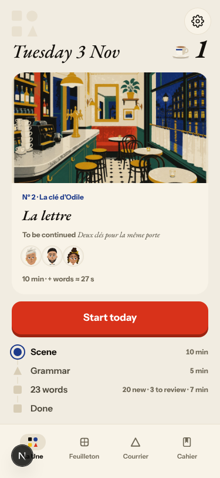

### #333 a failed or empty model call is shown as a result
- **#471 (again)** The unchecked state now offers «Run again» / «Skip without a check», but the level still moves: «Hier, nous avons dansé avec Marin.» → «I could not check this answer.» and Level 5 → 6. The end sheet lists that sentence, and day 2's sheet offers «Ready for the test?». 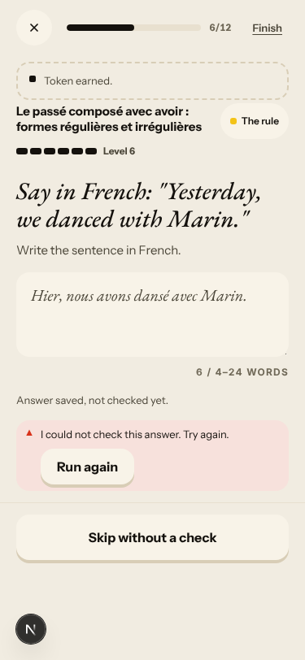 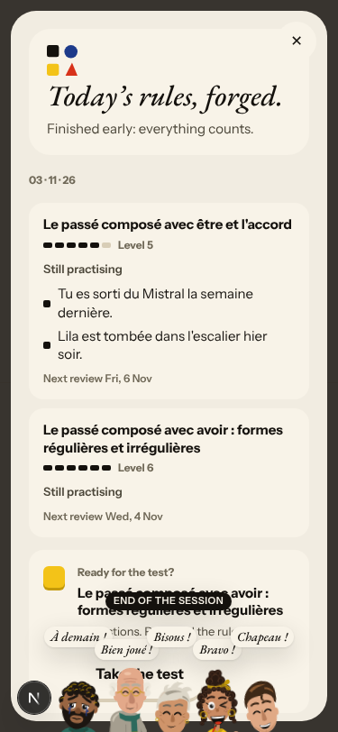
- **#397 (again, PR #482 open)** Margaux's letter is answered with the stock «Merci pour votre message, je l'ai bien lu. Je vous réponds rapidement.», stamped «04 h 16» at 05:16 Berlin. 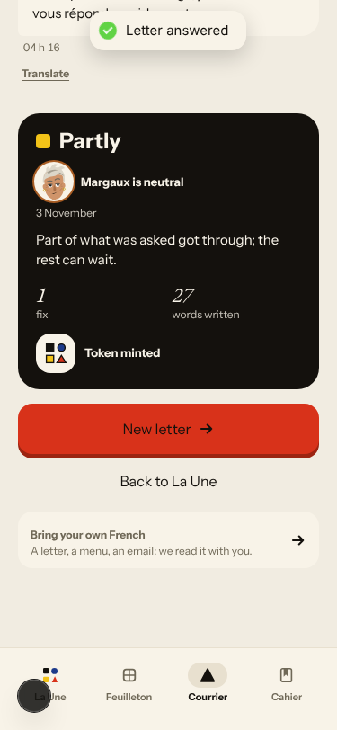

### #147 the cast is not one registry
- **#506 (new, low)** Margaux says «Tu vas monter ?» in the scene, and her first letter the same evening says «Vous avez oublié votre écharpe». `_first_letter` (`app/services/missions.py:5350-5353`) takes the register from the Courrier thread, which is empty on a first letter. The authored `opening_message_tu` is never chosen.

### No shared cause
- **#474 (again)** Now back to back: «un appartement · What does it mean?» at 7/9, then «appartement · Masculine or feminine?» at 8/9. On day 2, «une offre» at 1/8, then «offre · Masculine or feminine?» at 6/8. 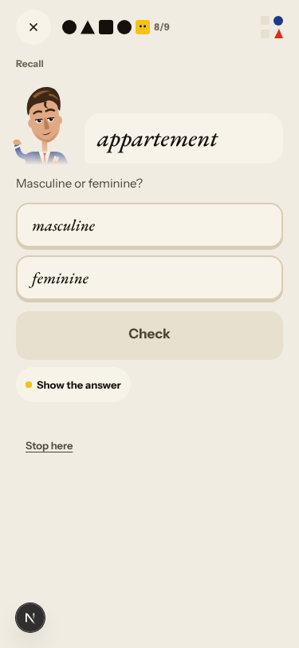
- **#469 (again, PR #476 open)** «Scene · Step 4 of 12» over the rule card, «The words · Quick word drills» over its first drill, and Marin's line printed twice on the card (#473, same PR). 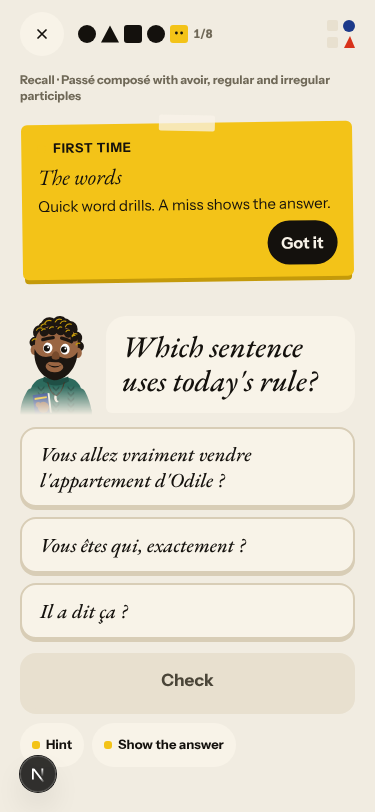

### Fake provider (left to the live walk)
- Fake: my question back to Gus («vous etes un ami de ma grand-mere ?») and to Camille («Pourquoi votre grand-pere veut tout l immeuble ?») got authored lines that ignore them. The scene corrections caught one slip per reply («d'Odile», «hôtel», «à») and left «etes», «J ai», «a l hotel», «cle» and «Tu as garde» uncorrected. La Forge's free production was «not checked yet» on every item. The Courrier verdict «Well said · one small note» came on a reply with six elision and accent slips. Not filed (#250, #333, #145).
- Not filed: «You chose “il a invite”» for a typed answer (#449, PR #481 open). A character pop-in («Tu as vu mes clés ? Non ? Bon.») covers La Forge's rule header and the word card for a few seconds (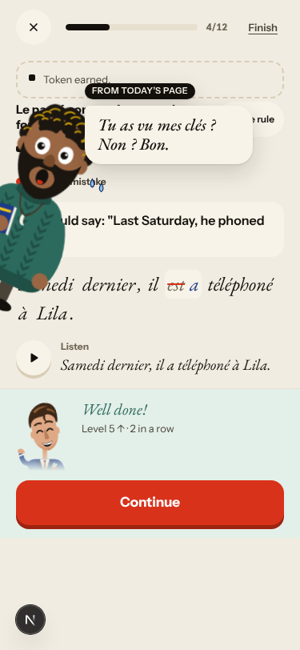). Day 2's La Forge rule card is illustrated by Romy, whom the learner has not met (#155). The Cahier header says «Grammar: 1 practising» over a map that says «2 practising». An «Again» extra (adresse) did not come back after the reload. The browser clock stays on «Tuesday 3 Nov» after `/clock +1`, as on earlier nights (the harness clock does not reach the browser). The acts (#489–#499) are off by default (`ATELIER_STORY_ACTS`), so the fake stack plays one page a day. Fertig's «135 words of story read» shows the story count works, but no act and no weekly dossier was reachable. Le Quartier (#488) is not on the walk's path.

## Re-tests

- **#487 works**: due reviews first (adresse, ranger, appartement on day 2), scene words every third card, the total at the day's intake (20 + 3 due). 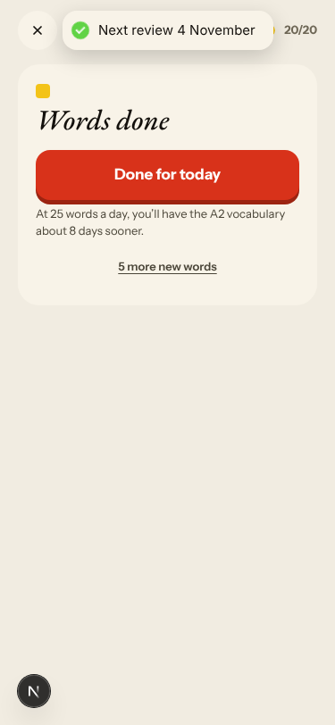
- **#490 / #493 work**: «Words done · Done for today · At 25 words a day… · 5 more new words» after the deck and on Fertig and Home. After a reload mid-extras the deck resumed «0/3» with the three unanswered extras. Done's tally leaves the extras out (#504). Gold for extras is not visible on a learner account, so it could not be checked.
- **#486 works**: no gold pill, rim or «D'où vient ton or» anywhere for a learner account.
- **#174 / #485 / #491**: no right answer was refused by a drill verdict («j'ai pris le train», «une lettre», a tile build). #485's named article and #491's relecture were not reachable on the fake stack. New child #503. Stays open.
- **#119 not fixed** on the scene path (above), back to `queue:ready`.
- No other code-lane fix merged since the last walk (#476, #481 and #482 are still open). Story-engine and live-only findings (#500, #466, #467, #445, #443, #378, #145) are left to the live walk.

## Scripted walk

The Browser walk passed on 2 Nov (run 22, on `570787d9`, the #475 merge). It has not run yet on `b0a8ee4f`.
