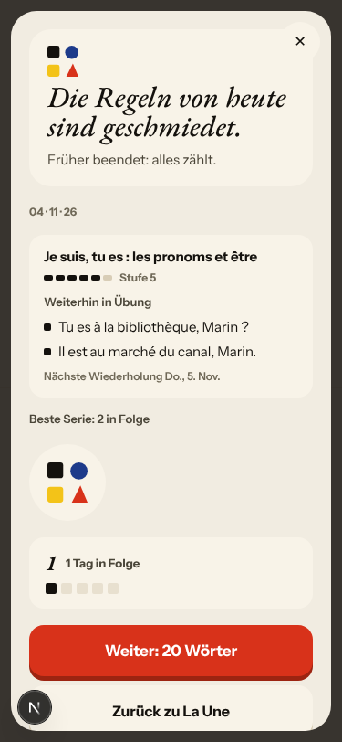
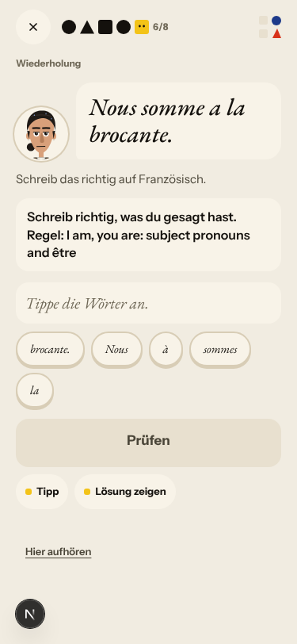
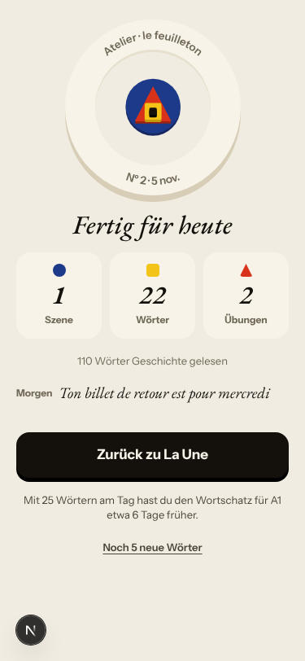
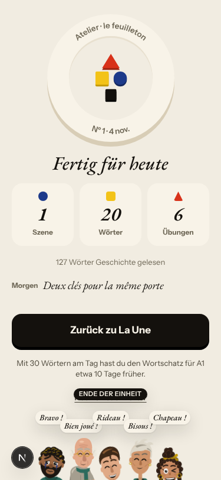
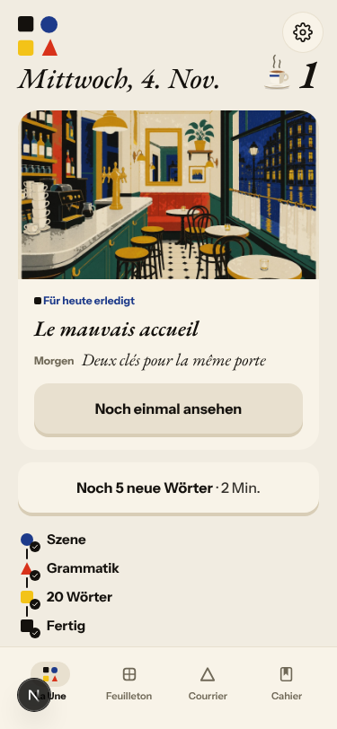
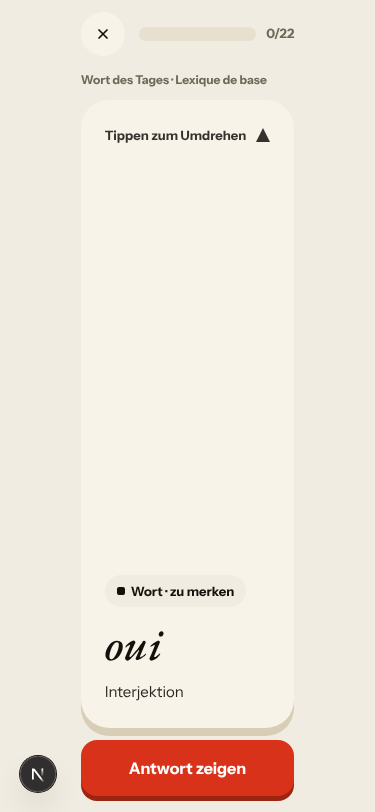
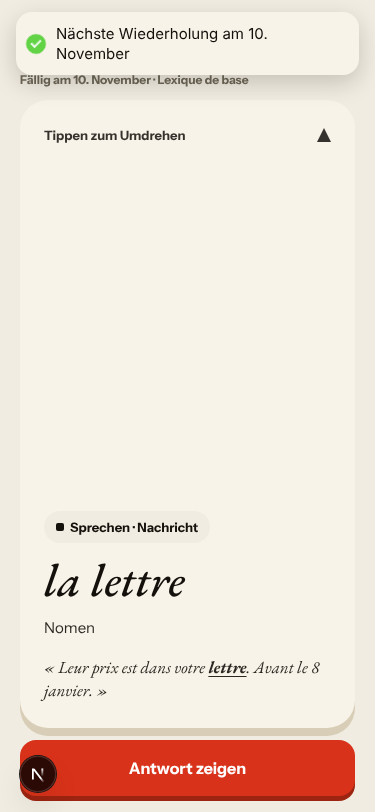
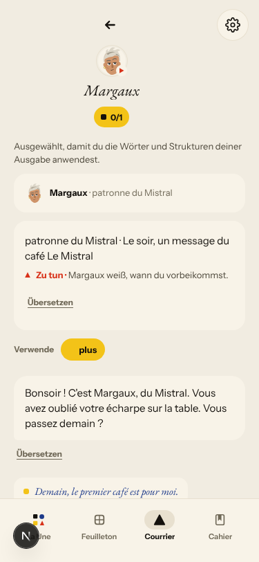
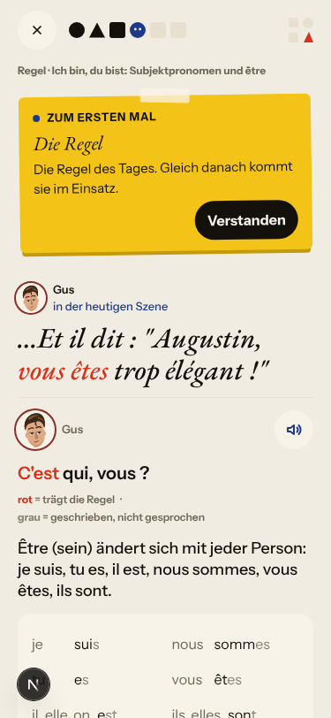

# Walk · 4 Nov 2026 · nightly explore walk

Main at `12a4055a`. Since the 3 Nov walk (`b0a8ee4f`), main has moved only through two report merges: #507 (walk report 3 Nov) and #468 (live walk 2 Nov). No app code changed (`git diff b0a8ee4f 12a4055a -- . ':!docs'` is empty), so no code-lane fix needs a re-test tonight.
Fake story provider, local stack, Chromium at phone size, one persona: `a1-de-fresh` (`--fresh --native de`, A1), signed up through the UI, answering short with real beginner mistakes.
Played day 1: teaser, sign-up, character, onboarding, cast intro, scene «Le mauvais accueil» with two free replies and two choices, the rule (Ich bin, du bist: être), 3 recall drills (one miss), La Forge 6 of 12 (one miss on purpose, two free-production items unchecked on the fake stack, then «Beenden»), 20 words, «Noch 5 neue Wörter» (all five), Done, Home, Courrier (one reply to Margaux), Cahier, Feuilleton.
Day 2 (clock +1): scene «La lettre» with one free reply and one choice, two rules (être again, then Avoir), 8 recall drills (one miss), La Forge 2 items (one miss on purpose, then «Beenden»), 22 words (2 due, 20 new), Done, Home.
The container restarted after the walk ended. The evidence was already copied into this folder, so nothing was replayed.

Live column: [live walk 4 Nov](../live-walks/2026-11-04.md) on production with the real model, account on day 23 (branch `claude/live-walk-2026-11-04`, PR #521, left open for tomorrow). Headline: **the day cannot be finished**. La Forge serves one item on the wrong rule, the only button is «Finish», and Home keeps «Grammar — next» (#517). It filed #517–#520 and commented on #443, #504, #397, #500, #445, #466, #167 and #398. Its findings are not filed again here. The 3 Nov live walk's PR #502 is merged tonight.

## Scores (rubric `docs/ops/walk-rubric.md`)

| # | question | 04 Nov a1-de (d1–2) | live 04 Nov | 03 Nov a2-en (d1–2) | live 03 Nov |
|---|---|---|---|---|---|
| 1 | Where am I | 4 | 3 | 4 | 3 |
| 2 | What is at stake | 4 | 3 | 4 | 3 |
| 3 | What to do next | 3 | 2 | 3 | 2 |
| 4 | Scene reacts to my writing | fake | 3 | fake | 5 |
| 5 | Story coherent | 3 | 3 | 3 | 3 |
| 6 | Characters consistent | 3 | 3 | 3 | 3 |
| 7 | Image, text, tone fit | 4 | 4 | 4 | 4 |
| 8 | Difficulty fits | 4 | 4 | 4 | 4 |
| 9 | Feedback explained | 3 | 4 | 3 | 3 |
| 10 | Right answers accepted | 4 | 4 | 3 | 4 |
| 11 | French correct | 4 | 4 | 4 | 4 |
| 12 | Clear goal today | 4 | 3 | 4 | 3 |
| 13 | Grammar practised | 4 | 2 | 3 | 2 |
| 14 | Earlier material returns | 4 | 4 | 4 | 3 |
| 15 | I produce French | 4 | 5 | 4 | 5 |
| 16 | Errors, dead ends | 4 | 1 | 4 | 2 |
| 17 | Varied, fun | 3 | 4 | 3 | 4 |
| 18 | Fast enough | 4 | 3 | 4 | 3 |
| 19 | App only | n/a | n/a | n/a | n/a |
| 20 | Satisfying end | 3 | 2 | 3 | 3 |
| 21 | Would come back | 3 | 3 | 3 | 3 |
| 22 | Time vs promise | 3 | 2 | 3 | 3 |

Q14 is scored on day 2 only (n/a on day 1). No fake-walk question scored 1 or 2 tonight. The live walk's 1s and 2s have their own findings (#517, #518, #443).

**Q13 went up to 4.** The être rule got its card, 3 drills in the scene and 6 La Forge items. Day 2 brought être back as «Eine bekannte Regel», introduced Avoir with a card and 6 drills, and asked me to repair my own day-1 La Forge slip («Nous somme a la brocante.»).
**Q10 went back to 4.** The whole corrected line was accepted under «Schreib die Korrektur ab» on a rewrite item. «j ai froid» (no apostrophe) and «la lettre» with its article were accepted too. #503 was not on the path tonight: no gap item asked for a copy.
**Q9 stays at 3.** The La Forge miss now names the slip: «Die Endung stimmt nicht: Du hast «somme» geschrieben, hier steht «sommes».» It does not mention the missing accent in «a → à». A typed «Il as» is answered «Du hast „Il as“ gewählt» (#449, PR #481 open).
**Q3 is 3.** The rule card sits under «Szene · Schritt 4 von 6», and the first drill of a brand-new rule is titled «Wiederholung» (#469, PR #476 open). An unchecked answer offers «Neu starten», which reads as starting the whole séance again.
**Q17 is 3.** Day 1's deck is the base list in order: plus, très, bien, aussi, alors, beaucoup, d'abord… Day 2's is a run of verbs and numbers (faire, aller, venir, dire, voir, savoir, pouvoir, vouloir, devoir, prendre, cinq, être, six, avoir, sept…). Only «la lettre» came from the scene (#280).
**Q22 is 3.** Home day 2 says «8 Min. · + Wörter ≈ 18 s» above a plan row that says «22 Wörter · 20 neu · 2 zum Wiederholen · 7 Min.» (#470, PR #508 open).

The best of the night: La Forge's «Beenden» works on the fake stack. After 6 items on day 1, and after 2 on day 2, it ended on «Früher beendet: alles zählt» with «Weiter: 20/22 Wörter», and Home marked «Grammatik — erledigt». So the live blocker #517 needs the live conditions: a séance on the wrong rule that ends after one item (comment on #517). An unchecked free answer no longer raises the level: Stufe 5 stayed 5 across two «Ohne Prüfung weiter». #471 did not reproduce on this path (PR #509 open). Day 2's recall turned my own day-1 slip into a repair exercise.

## Findings, by root cause

Two new findings and one new root cause: #522 (root cause), #523, #524, all `queue:ready`. In German chrome, #504, #505 and #506 reproduced, with a comment on each. Other repeats are listed below without new comments, because their PRs are open. Nothing closed tonight (no fix merged).

### #522 (new root cause) learner-facing text taken from a stored field has no locale contract
In one German day, the same rule had three names: German on the rule card, French in La Forge, English in the repair drill. Each call site picks its own field. At least five private helpers render a concept's title (`atelier._concept_title_for`, `missions._concept_title`, `graphic_novel._concept_title`, `unified_srs._concept_titles`, `journey_errata._rule_title`). Children: #523 (new), #196 and #451 (French chrome, `queue:owner`, linked by comment). Direction: one accessor per kind of stored text, in the learner's chrome language, never English for de/fr. The guard test renders every payload that carries a rule title for a de and a fr learner.
- **#523 (new, low)** Day 2 repair drill: «Schreib richtig, was du gesagt hast. Regel: I am, you are: subject pronouns and être». `journey_errata._rule_title` (`app/services/journey_errata.py:184-190`) returns `concept.name`. Only the «Regel:» prefix is localized (`journey_planner.py:1191-1194`). 

### #143 the day's progress has no single source of truth
- **#524 (new, low)** Day 2's Done says «1 Szene · 22 Wörter · 2 Übungen» after 8 recall drills and 2 La Forge items. Day 1 said 6 for 4 recall drills and 6 La Forge items. `daily_session.exercises_today` (`app/services/daily_session.py:347-359`) counts `AtelierAttempt` rows (La Forge) only. 
- **#504 (again, in German; PR #508 open)** After «Noch 5 neue Wörter», all five answered, Done says «20 Wörter» and Home «20 Wörter — erledigt» for 25 cards. The goal line under them says «Mit 30 Wörtern am Tag…».  
- **#505 (again, in German; PR #515 open)** Day 2: the due reviews «oui» and «aussi» say «Wort des Tages». The scene word «la lettre», answered in the recall minutes earlier, says «Fällig am 10. November». On day 1, with nothing due, the first new card says «Wort des Tages». Every card names its source «Lexique de base», scene words included.  
- **#470 (again; PR #508 open)** Home day 2: «8 Min. · + Wörter ≈ 18 s» over «22 Wörter · 7 Min.».

### #147 the cast is not one registry
- **#506 (again, in German)** Margaux says «Tu vas monter ?» in the scene. Her letter says «Vous avez oublié votre écharpe…» under the card title «Brief der Woche · Ton écharpe au Mistral», which mixes tu and vous on one screen. Attempt 1 (#516) failed review, so it stays `queue:ready`. 

### No shared cause
- **#469 / #473 (again; PR #476 open)** «Szene · Schritt 4 von 6» over the rule card, and «Wiederholung» over the first drill of a new rule. Day 2's card says «Camille marchand» and prints her line twice. 
- **#449 (again; PR #481 open)** A typed «Il as» is answered «Du hast „Il as“ gewählt».

### Fake provider (left to the live walk)
- Fake: «oui je monte ce soir» gets Margaux's authored «Pas ce soir.». My question back to Camille («c est qui, nous tous ?») gets «"Pas encore" ? Mon grand-père n'aime pas attendre.», a line I never said. After I choose Lila, she asks «Avant Solvel, on visite l'appartement ? Toi et moi ?» and at once answers for me: «Tu n'entres pas ? Je comprends.» (seen 2 Nov, #145/#171). The scene corrected «grand-mère» only and left «la apartement», «c est», «sur» and the missing «ne» uncorrected (#250). The three free-production items in La Forge were «noch nicht geprüft». The Courrier answered with the stock «Merci pour votre message…» stamped «04 h 11» at 05:11 Berlin (#397, PR #482 open; #333).
- Not filed: Romy illustrates the Avoir card and «Romy lächelt dich an» after a drill, though the learner has not met her (#155). The browser date stays «Mittwoch, 4. Nov.» after `/clock +1`, and so does La Forge's «04 · 11 · 26» (harness clock). Day 2's «Bisher» is only the last panel's line («Deux clés pour la même porte. À suivre…»), and «Morgen» on Done is that same line, not a question (Q20). La Forge's French title in German chrome is covered by #522.

## Re-tests

- No app code merged since the last walk. Every code-lane fix is still in an open PR (#476, #481, #482, #508, #509, #513, #514, #515), so nothing was re-tested to be closed, and nothing re-tested on 3 Nov was repeated.
- Data points, not re-tests: #517 (live blocker) does not reproduce on the fake stack (comment). #471's level rise on an unchecked answer did not appear on this path.
- Story-engine and live-only findings (#518, #500, #445, #466, #378, #145) are left to the live walk.

## Scripted walk

The Browser walk passed on 3 Nov (run 23, on `12a4055a`, this walk's base).
