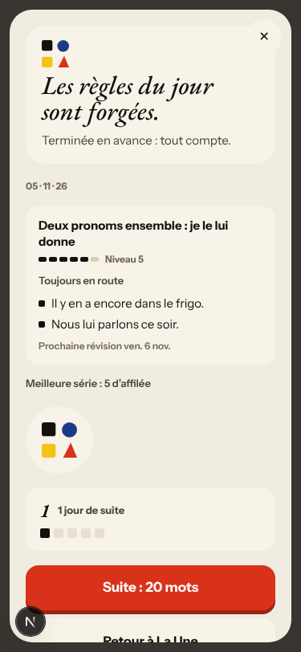
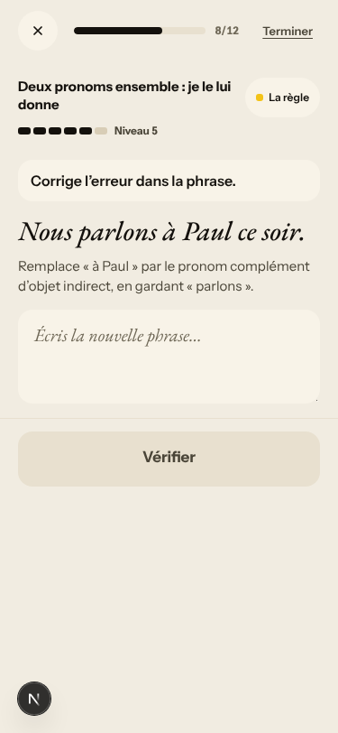
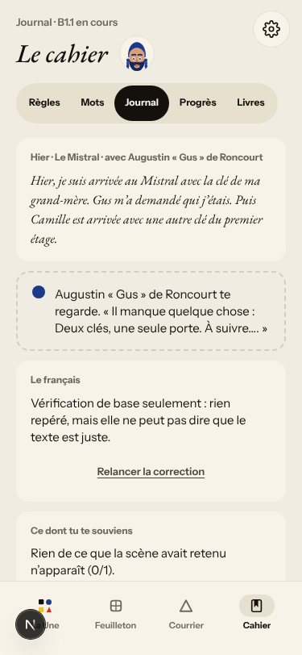
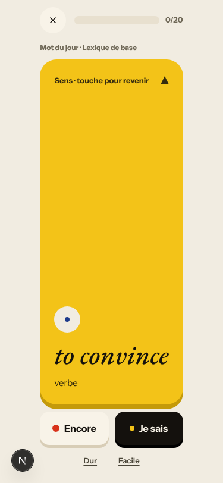
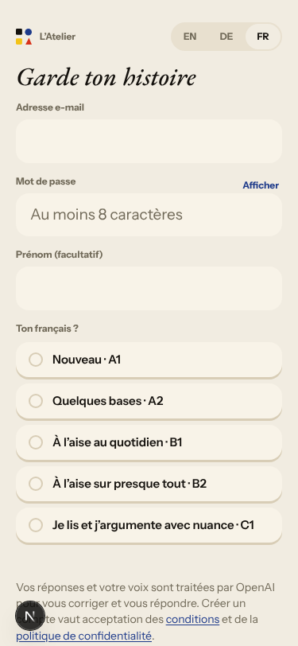
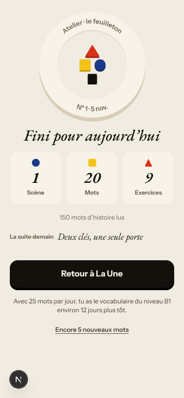
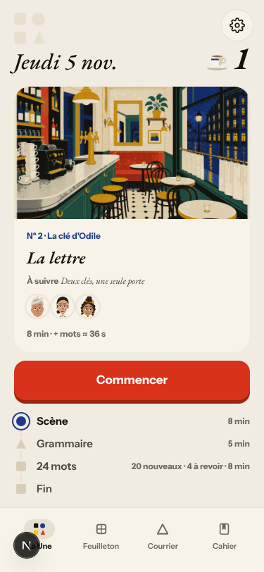
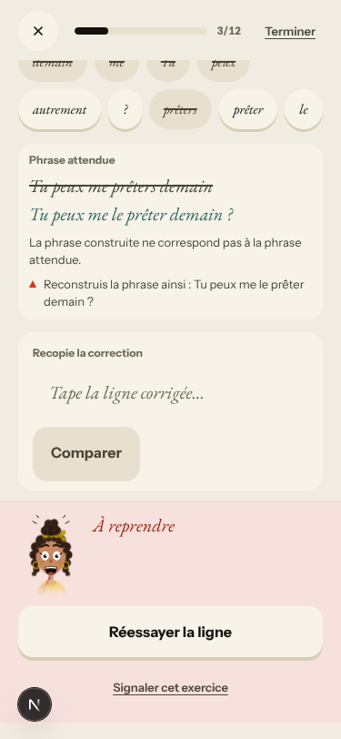
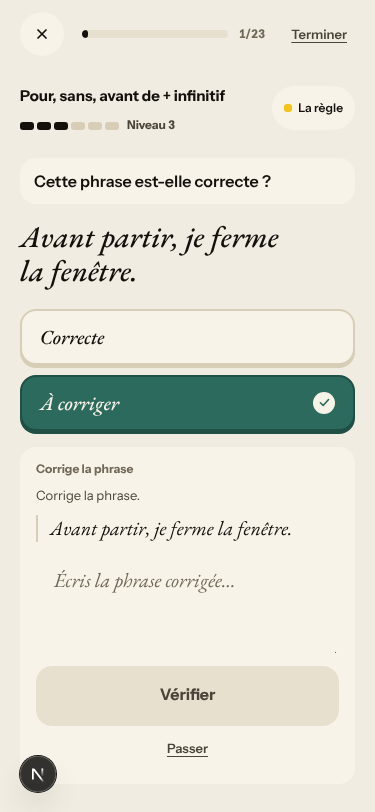

# Walk · 5 Nov 2026 · nightly explore walk

Main at `364644a9`. Since the 4 Nov walk (`12a4055a`), main moved through #441 (Le Quartier forge: the notary's office over the boulevard, Quartier data and kit only), #531 (nightly autonomy: the routines merge their own report PRs; verified story-engine, `app/core` and size M fixes may merge) and the two report merges #525 (walk 4 Nov) and #502 (live walk 3 Nov). Neither #441 nor #531 closes or references a walk finding, and no `queue:pr` issue's PR merged in that window. So no code-lane fix needed a re-test tonight. Walk mechanics follow #531: this report PR merges itself once its checks are green.
Fake story provider, local stack, Chromium at phone size, one persona: `b1-fr-chrome` (`--fresh --native fr --level B1.1`). Signed up through the UI and played in French chrome, answering in B1 French with a few real slips and some off-script lines.
Day 1: teaser, sign-up, character, onboarding, cast intro, scene «Le mauvais accueil» (two free replies and one choice), the rule «Deux pronoms ensemble : je le lui donne», 6 recall drills (one miss), La Forge 9 of 12 (two misses, one free-production item unchecked on the fake stack, then «Terminer»), 20 words, Done, Home, Courrier (one reply to Gus), Cahier (Règles, Mots, Journal), Feuilleton.
Day 2 (clock +1): scene «La lettre» (one off-script free reply, one choice), the rule «Pour, sans, avant de + infinitif», 5 recall drills (one miss; day 1's rule came back), La Forge 6 of 23 (one miss, a review item on day 1's rule, my own day-2 slip as «Ta phrase», then «Terminer»), 24 words (4 due, 20 new), Done, Home, Journal entry.

Live column: [live walk 5 Nov](../live-walks/2026-11-05.md) on production with the real model, account on day 24 (branch `claude/live-walk-2026-11-05`, PR #541, left open for tomorrow). Headline: **the day finished for the first time since 3 Nov and ran on one concept (possessives)**: #443 and #517 fixed and closed. The scene gave one reply only (#378). It filed #535–#540 and commented on #378, #397, #471 and #524. Its findings are not filed again here. The 4 Nov live walk's PR #521 is merged tonight.

## Scores (rubric `docs/ops/walk-rubric.md`)

| # | question | 05 Nov b1-fr (d1–2) | live 05 Nov | 04 Nov a1-de (d1–2) | live 04 Nov |
|---|---|---|---|---|---|
| 1 | Where am I | 4 | 3 | 4 | 3 |
| 2 | What is at stake | 4 | 3 | 4 | 3 |
| 3 | What to do next | 3 | 3 | 3 | 2 |
| 4 | Scene reacts to my writing | fake | 2 | fake | 3 |
| 5 | Story coherent | 3 | 3 | 3 | 3 |
| 6 | Characters consistent | 3 | 3 | 3 | 3 |
| 7 | Image, text, tone fit | 4 | 4 | 4 | 4 |
| 8 | Difficulty fits | 4 | 3 | 4 | 4 |
| 9 | Feedback explained | 3 | 3 | 3 | 4 |
| 10 | Right answers accepted | 4 | 2 | 4 | 4 |
| 11 | French correct | 3 | 3 | 4 | 4 |
| 12 | Clear goal today | 4 | 4 | 4 | 3 |
| 13 | Grammar practised | 4 | 4 | 4 | 2 |
| 14 | Earlier material returns | 4 | 4 | 4 | 4 |
| 15 | I produce French | 4 | 5 | 4 | 5 |
| 16 | Errors, dead ends | 4 | 3 | 4 | 1 |
| 17 | Varied, fun | 3 | 4 | 3 | 4 |
| 18 | Fast enough | 4 | 3 | 4 | 3 |
| 19 | App only | n/a | n/a | n/a | n/a |
| 20 | Satisfying end | 3 | 3 | 3 | 2 |
| 21 | Would come back | 3 | 3 | 3 | 3 |
| 22 | Time vs promise | 3 | 3 | 3 | 2 |

Q14 is scored on day 2 only (n/a on day 1). No fake-walk question scored 1 or 2 tonight. The live walk's 2s have their own findings (#378, #535, #536).

**Q11 went down to 3.** La Forge's word banks offer invented forms on both days («prêters», «encores», «J'économises», and «autrement» in every bank; #448, PR #460 open). The rule card's «Comment la construire» addresses the learner in vous («Remplacez… Rangez… Placez…», commented on #196). The Journal quotes «À suivre….» with a double full stop (#539).
**Q3 stays at 3.** In La Forge, «Corrige l’erreur dans la phrase.» sits over «Je vois Marc demain.» and «Nous parlons à Paul ce soir.», two correct sentences to be rewritten with a pronoun (new #543). The rule card still sits under «Scène · Étape 4 sur 9», and the first grammar recall drill opens with the «Les mots · De courts exercices» coach mark (#469, PR #476 open).
**Q9 stays at 3.** Day 2's misses were explained well: «Bon mot, autre forme : « dire », pas « dit ».» and «Les bons mots sont là, mais ils ne sont pas assemblés dans l’ordre attendu.» On day 1, a judge miss only restated the right sentence, and a build miss with an invented form said «La phrase construite ne correspond pas à la phrase attendue.» without naming the missing «le» (#449, PR #481 open).
**Q10 is 4.** Whole corrected lines were accepted where the placeholder said «La partie corrigée suffit», and so were curly apostrophes («Il m’en a parlé.», «J’économise…»). Typing the whole line under «Recopie la correction» was accepted too, so #503 was not on the path.
**Q14 is 4.** Day 2 brought day 1's rule back three ways: a recall drill («Je leur les donne.»), a La Forge review item, and the mastery-test offer («Prêt pour l’épreuve ? … 3 questions»). My own day-2 slip came back as «Ta phrase · Tu as écrit ça plus tôt.»
**Q17 is 3.** Both decks are the base list (convaincre, évidemment, néanmoins, toutefois, notamment…). Only «la valise» came from the scene, and it is labelled «Lexique de base» (#280, #505).
**Q22 is 3.** Home day 2 says «8 min · + mots ≈ 36 s» above «24 mots · 20 nouveaux · 4 à revoir · 8 min» (#470, PR #508 open).

French chrome check (this persona's job): everything the learner reads in the day path is French, with three exceptions. Word cards gloss in English («convaincre → to convince», reverse cards «exactly», «to sell»; #451). The sign-up line and the rule card's steps say vous (#196). Next's 404 page is English («This page could not be found.»), but I only reached it through a mistyped URL, so it is not filed. Rule titles are French on every screen (#522 data point below).

## Findings, by root cause

One new finding and one new root cause: #542 (root cause), #543. Both are `queue:ready`. Comments on #539 (reproduces on the fake provider), #196, #451, #522, #524, #517 and #519. Other repeats are listed below without new comments, because their PRs are open. Nothing closed tonight (no fix merged).

### #542 (new root cause) a drill's instruction is picked from the item's shape, not from the task it declares
The La Forge transform items declare `type: directed_rewrite | contrast_rewrite | repair_rewrite` (`app/services/atelier.py:516`, `:4184-4241`). `item_bank._goal_kind` (`app/services/item_bank.py:2654-2671`) ignores that and maps every item with `source` + `expected_answer` to the goal `repair`. So German and French chrome announce a rewrite as «fix the error»; English hides it by quoting the meaning. Children: #543 (new) and #519 (live 4 Nov, «vingt-un» under «Correct this sentence»; PR #529 fixes that item locally). Direction: the instruction comes from the item's declared kind via one kind × language table, and an «error» goal only for kinds whose source has an error. The guard test builds every fallback transform item in en/de/fr and fails when a non-repair item says «Corrige l’erreur» / «Korrigiere den Fehler» / «Correct this sentence».
- **#543 (new, medium)** Day 1, La Forge 7/12 and 8/12: «Corrige l’erreur dans la phrase.» over «Je vois Marc demain.» and «Nous parlons à Paul ce soir.». Only the hint below says «Remplace « Marc » par « le »…». Both items come from the generic `pronoun_choice` pool, not the day's double pronouns (#447, PR #460 open). 

### #145 the scene has no state of what was established
- **#539 (live 5 Nov; reproduces on the fake stack)** Day 2 Journal: my recap names the two keys, and the answer is «Augustin « Gus » de Roncourt te regarde. « Il manque quelque chose : Deux clés, une seule porte. À suivre…. »» and «Rien de ce que la scène avait retenu n’apparaît (0/1).». The scored fact is the episode's cliffhanger: `journal.scene_facts_for` takes `story_outcome.callback_fr` (`app/services/journal.py:264-275`). Now a child of #145. 

### #522 learner-facing text taken from a stored field has no locale contract
- **#522 / #523 in French chrome** Rule titles were French on the rule card, the recall headers, La Forge, the review item, the mastery-test offer and the Cahier. No recall repair with a «Règle :» line came up, so #523's path was not on screen. In French chrome the title field happens to be French, which hides the missing contract rather than proving it (comment on #522).
- **#451 (again)** «convaincre → to convince»; reverse cards ask «exactly», «to sell». 
- **#196 (again, new screen)** The sign-up line «Vos réponses et votre voix sont traitées… pour vous corriger» (`web-frontend/lib/legal.ts:87`), the Courrier composer label «Votre dépêche», and the rule card's stored steps «Remplacez chaque complément… Rangez-les… Placez le groupe…». 

### #143 the day's progress has no single source of truth
- **#524 (again, in French)** Done says «9 Exercices» after 6 recall drills and 9 La Forge items (day 1), and «5 Exercices» after 5 and 5 (day 2): only the La Forge count. PR #527 open. 
- **#505 (again; PR #515 open)** Day 1: a fresh card says «Échéance 10 novembre». Day 2: the due reviews say «Mot du jour». The scene word «la valise» is labelled «Lexique de base».
- **#470 (again; PR #508 open)** «8 min · + mots ≈ 36 s» over «24 mots · 8 min». 
- **#397 (again, not commented: the live walk did tonight)** The Courrier stamps «04 h 12» at 05:12 Berlin.

### #146 the day's content is not driven by one concept
- **#448 (again; PR #460 open)** «prêters», «encores», «J'économises», «autrement» in the word banks. 
- **#447 (again; PR #460 open)** The fallback rewrites on the double-pronoun day are single-pronoun items from the `pronoun_choice` pool.
- **#449 (again; PR #481 open)** A build miss says only «La phrase construite ne correspond pas à la phrase attendue.».

### No shared cause
- **#452 (again; PR #481 open)** «La phrase à corriger:» without the French space. 
- **#469 (again; PR #476 open)** «Scène · Étape 4 sur 9» over the rule card; the «Les mots» coach mark over the first grammar recall drill.

### Fake provider (left to the live walk)
- Fake: «Oui, je monte ce soir…» is answered with Margaux's authored «Pas ce soir.». The scene ends after 2 of 4 exchanges on day 1. On day 2, choosing who reads the letter shows «Toi : Margaux» as if I had said her name, and then «Huit janvier.» as a bare fragment. Gus answers in the Courrier with the stock «Merci pour votre message…» (#333). La Forge's free-production item was «pas encore vérifiée», and the level stayed at 5, so #471 did not reproduce on this path.
- Not filed: «Traduire» on the panels says «Aucune traduction disponible pour l’instant.» for a French-native learner, although the coach mark promises a translation «à un geste». That follows from the persona (native French), not from the app. Done's «La suite demain» is the last panel's line (#466, owner).

## Re-tests

- No app code that touches a walk finding merged since the last walk (`git diff 12a4055a 364644a9 -- app web-frontend/lib web-frontend/components web-frontend/pages` touches only `web-frontend/lib/quartier/`). Every code-lane fix is still in an open PR (#476, #481, #508, #509, #511, #513, #514, #515, #526–#529), so nothing was re-tested to be closed.
- **#517** (closed by the live walk tonight) does not reproduce here either: «Terminer» at 10/12 and at 6/23 led to «Suite : 20 mots» and «Suite : 24 mots», then Done, and Home showed «Grammaire — fait» (comment).
- **#522 / #523** French chrome: titles French everywhere (comment on #522).
- Story-engine and live-only findings (#378, #535, #538, #518, #500, #445, #466) are left to the live walk.

## Scripted walk

The Browser walk passed on 4 Nov (run 24, on `c1f6d6cd`). Tonight's scheduled run on main has not started yet.
