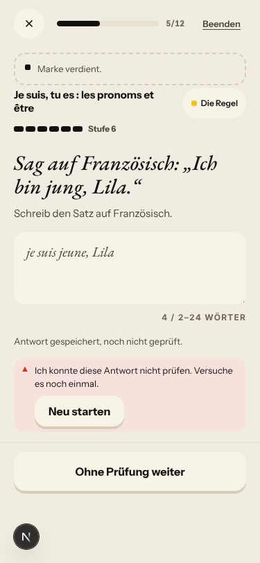
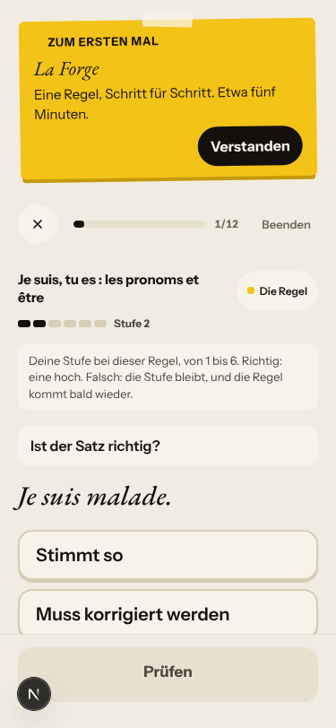
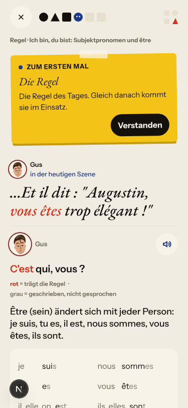
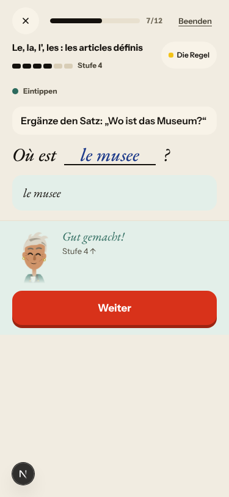
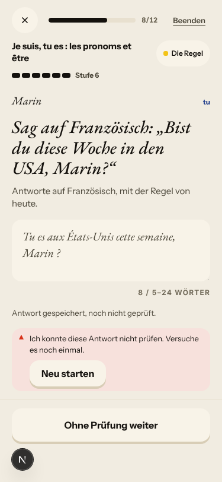
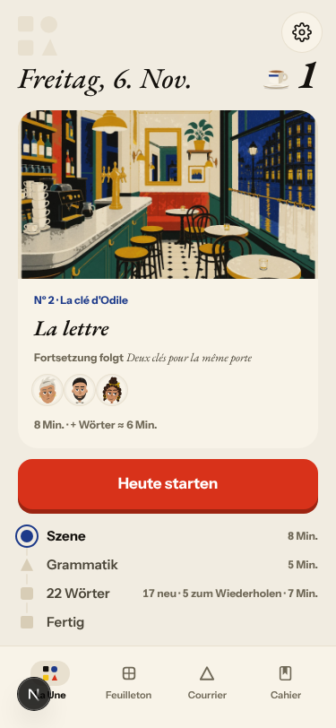
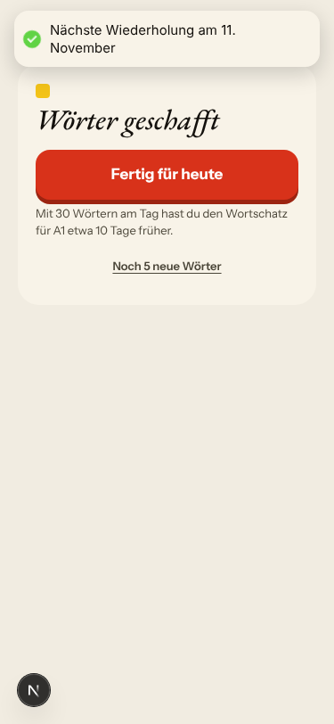
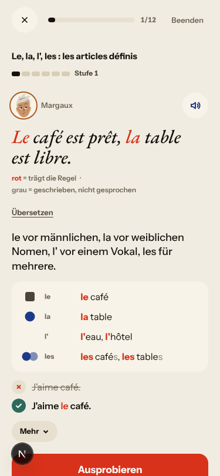
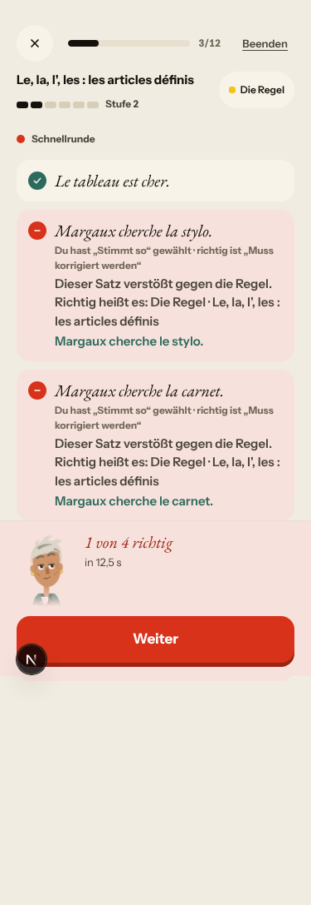

# Walk · 6 Nov 2026 · nightly explore walk

Main at `1c49d254`. Since the 5 Nov walk (`364644a9`), main moved through #534 (Le Quartier: Odile's flat), ten night-shift fixes: #508 (one count of the day's words; #470, #504), #509 (La Forge keeps key-accepted answers right, accepts the whole corrected line, files elisions under the l' rule; #471, #503, #119), #511 (La Forge miss scroll; part of #319), #513 (no gender drill after the noun was shown with its article; #474), #514 (dictation names the contraction rule; #501), #515 (word card header says why the card is in the deck; #505), #526 (Margaux's first letter says tu; #506), #527 (Done counts every exercise; #524), #528 (rule titles in the learner's language; #523, stage 1 of #522), #529 (number drill instruction; #519), the walk fix #551, and the report merges #544 and #521. Tonight this walk also merged the 5 Nov live walk's report (#541, `e0c8084e`, docs only).
Fake story provider, local stack, Chromium at phone size, one persona: `a1-de-fresh` (`--fresh --native de`, even day). Signed up through the UI at A1 and answered as a German beginner: short replies, missing accents and elisions, a «c'est qui ?» question, wrong picks on purpose.
Day 1: teaser (one wrong pick), sign-up, character, onboarding, cast intro, scene «Le mauvais accueil» (two free replies with «la appartement», one choice), the rule «Ich bin, du bist: Subjektpronomen und être», 3 recall drills (one miss), La Forge 7 of 12 on être (one miss copied as a whole line, four free sentences, ended at level 6), 20 words plus «Noch 5 neue Wörter» (one card), Done, Home, Courrier (Lila), Cahier (Regeln, Journal closed until tomorrow), Feuilleton.
Day 2 (clock +1): Home, scene «La lettre» (one free reply asking who Solvel is, one choice), the être rule card again, 9 recall drills (two misses), La Forge 12 of 12 on «Le, la, l', les» with two être review items (speed round 1 of 4, a build miss copied, five free sentences), 22 words (5 due, 17 new), Done, Home, Journal entry, Courrier (Margaux's first letter).

Live column: [live walk 6 Nov](../live-walks/2026-11-06.md), production with the real model, account on day 25 (branch `claude/live-walk-2026-11-06`, PR #560, left open for tomorrow). Headline: **the day can be finished again, #517 is confirmed fixed, and the scene reacted to four replies**; Q6 fell to 2 because the closing beats answer nothing the learner said and bring Marin and Lila into a scene they are not in (#558). It filed #556–#559, reopened #443 and commented on #378, #500, #539, #466, #540, #397, #280, #167, #155, #250 and #147. Its findings are not filed again here. The 5 Nov live walk's PR #541 is merged tonight.

## Scores (rubric `docs/ops/walk-rubric.md`)

| # | question | 06 Nov a1-de (d1–2) | live 06 Nov | 05 Nov b1-fr (d1–2) | live 05 Nov |
|---|---|---|---|---|---|
| 1 | Where am I | 4 | 3 | 4 | 3 |
| 2 | What is at stake | 4 | 3 | 4 | 3 |
| 3 | What to do next | 3 | 3 | 3 | 3 |
| 4 | Scene reacts to my writing | fake | 4 | fake | 2 |
| 5 | Story coherent | 3 | 3 | 3 | 3 |
| 6 | Characters consistent | 3 | 2 | 3 | 3 |
| 7 | Image, text, tone fit | 4 | 4 | 4 | 4 |
| 8 | Difficulty fits | 3 | 4 | 4 | 3 |
| 9 | Feedback explained | 3 | 4 | 3 | 3 |
| 10 | Right answers accepted | 2 | 4 | 4 | 2 |
| 11 | French correct | 4 | 4 | 3 | 3 |
| 12 | Clear goal today | 3 | 3 | 4 | 4 |
| 13 | Grammar practised | 4 | 2 | 4 | 4 |
| 14 | Earlier material returns | 4 | 4 | 4 | 4 |
| 15 | I produce French | 4 | 5 | 4 | 5 |
| 16 | Errors, dead ends | 3 | 3 | 4 | 3 |
| 17 | Varied, fun | 3 | 4 | 3 | 4 |
| 18 | Fast enough | 4 | 3 | 4 | 3 |
| 19 | App only | n/a | n/a | n/a | n/a |
| 20 | Satisfying end | 3 | 3 | 3 | 3 |
| 21 | Would come back | 3 | 3 | 3 | 3 |
| 22 | Time vs promise | 3 | 3 | 3 | 3 |

Q14 is scored on day 2 only (n/a on day 1). The one 2 tonight (Q10) has its findings (#471 reopened, #562).

**Q10 fell to 2.** Every free sentence the key accepts is shown as unchecked. Four times on two days («je suis jeune, Lila», «Elle est occupée.», «Tu es aux États-Unis cette semaine, Marin ?», «La valise est pratique, Gus.») the card said «Antwort gespeichert, noch nicht geprüft. Ich konnte diese Antwort nicht prüfen.» with «Neu starten / Ohne Prüfung weiter», while the header rose a level and said «Marke verdient.». The server stored each one `checked` / `correct`, and the client overrides that (#471, reopened). Accents are judged two ways: a gap takes «etes» and «le musee» without a word, a sentence sends «Israel» for «Israël» to «nicht geprüft» (#562).
**Q8 went down to 3.** Day 1 took the être rule from level 2 to 6 in seven items, and day 2's free sentences ask an A1 learner for «Heizkörper», «beschäftigt» and «in den USA». The first «Was ist richtig?» drill repeats the rule card's own example («Ils sont / Ils est à Lyon»).
**Q12 went down to 3.** Day 2's rule card was être again («Eine bekannte Regel, auf der heutigen Seite»), and «Weiter: Grammatik» opened «La Forge · Regel des Tages schmieden» on «Le, la, l', les», the rule of my day-1 slips (#443, seen on the fake stack too).
**Q16 went down to 3.** «Neu starten» on those unchecked cards posts `/ai-review` and gets a 400 («Die zweite Prüfung ist nicht verfügbar.»): a retry that cannot work.
**Q9 stays at 3.** Day 1's La Forge miss was explained well: «„es“ blieb stehen, ist aber falsch: Hier steht „est“. Die Endung stimmt nicht: Du hast „lent“ geschrieben, hier steht „lente“.» The speed round explains nothing: «Richtig heißt es: Die Regel · Le, la, l', les : les articles définis» (#564). «la téléphone → le téléphone» says only «hier ist „le téléphone“ nötig», not that «téléphone» is masculine.
**Q11 back to 4.** The app's own French was right on both days. The only misspelt French on screen was mine, printed back as right («Vous etes…», «Où est le musee ?», #562).
**Q22 stays at 3.** Home day 2 promises «8 Min. · + Wörter ≈ 6 Min.» above «22 Wörter · … · 7 Min.» (#470, reopened). Each day took me 10–13 minutes at agent speed.
**Fixed tonight and seen:** Done counts every exercise and every word card («10 Übungen», «21 Wörter» on day 1; «21 Übungen», «22 Wörter» on day 2). Due reviews say «Fällig». Margaux writes tu. Elisions go to the l' rule. The whole corrected line is accepted. The La Forge miss card settles above the sheet.

## Findings, by root cause

Four new findings (#561–#564), two re-tests reopened (#471, #470), one comment on a live finding seen on the fake stack (#443), and #522 moved back to `queue:ready` with its stage-1 result. All of them are `queue:ready` with a **Done when:** comment. No new root cause: every finding fits an open one.

### #522 learner-facing text taken from a stored field has no locale contract
- **#561 (new, medium)** German chrome. La Forge's header and end sheet say «Je suis, tu es : les pronoms et être», but the rule card, the recall headers and La Forge's own miss card say «Ich bin, du bist: Subjektpronomen und être». The Cahier rows are all French. La Forge still reads `title_fr` (#522 stage 2: `forge.py:1941`, `api/v1/endpoints/atelier.py:719`), and the Cahier uses `concept_title_fr`. 
- **#522 re-test** Stage 1 (#528) holds: the rule card, recall, the miss card and the «Regel:» line are German, so #523 is verified. Stages 2–5 remain, so #522 is back to `queue:ready`. 

### #174 a right answer is judged against one stored string
- **#562 (new, low)** One accent policy is missing. Gap items take «etes» and «le musee» with «Gut gemacht!» and print the misspelt sentence. The sentence item drops «Ils sont en Israel cette semaine.» (key «… Israël …») to «nicht geprüft». 

### #333 what the learner sees is not what was decided
- **#471 (reopened, medium)** The server half of #509 holds: unchecked answers stay `unavailable`, `counted: false`, and the level stays. A key-accepted answer is stored `checked` / `correct`, but the card says it could not be checked while the level rises. Cause found: `web-frontend/lib/seance-feedback.ts:12-14` (`legacyUnchecked`) reads `corrected_answer` plus `correction_debug.fallback_used` as unchecked and ignores `assessment_status: "checked"`. Nothing else in the queue re-derives the server's verdict on the client this way. 

### #143 the day's progress has no single source of truth
- **#470 (reopened, now low)** Home day 2: «+ Wörter ≈ 6 Min.» on the card, «7 Min.» on the plan row for the same 22 words. The card rounds with `formatDuration` (`journey-state.ts:294`); the row rounds differently. 
- **#563 (new, low)** «Noch 5 neue Wörter» serves one card («0/1»), then «Mit 30 Wörtern am Tag…». 
- **#443 (live; seen on the fake stack)** Day 2's La Forge «Regel des Tages» is «Le, la, l', les», not the rule card's être. All 12 items were served, so only the «not today's rule» half reproduces here. 
- **#397 (again; PR #548 open)** The Courrier stamps «04 h 13» at 05:13 Berlin.

### #146 the day's content and feedback are not driven by one concept
- **#564 (new, medium)** A speed-round miss reads «Dieser Satz verstößt gegen die Regel. Richtig heißt es: Die Regel · Le, la, l', les : les articles définis», with no reason. `ForgeDrills.tsx:472` joins the copy with a `rule` prop that the caller fills with the chip label (`pages/atelier.tsx:3938`). 
- **#449 (again; PR #481 open)** A build miss with one tile placed says only «Regel: Le, la, l', les: der, die, das.».
- **#280 (owner)** Both decks are the base list. The scene words «la lettre» and «vendre» carry «· Lexique de base» beside «Aus der Szene von heute».

### #147 the cast is not one registry
- **#473 (again; PR #476 open)** Day 2 rule card: «Camille marchand», with her line printed twice.

### #145 the scene has no state of what was established
- **#539 (again; PR #547 open)** The day-2 Journal scores my recap 1/1 against the cliffhanger «Deux clés pour la même porte».

### No shared cause
- **#469 (again; PR #476 open)** The rule card sits under «Szene · Schritt 4 von 6».

### Fake provider (left to the live walk)
- Fake: «oui je monte…» is answered with Margaux's authored «Pas ce soir.». Camille answers «non, je vend pas» with «"Pas encore" ?». Choosing who reads the letter shows «Du: Lila», and Lila then answers a question I was never asked («Tu n'entres pas ? Je comprends.»). Lila's and Margaux's Courrier letters are the same template, and Lila's reply is the stock «Merci pour ton message, je l'ai bien lu.» (#333). «fatigue», «grand-mere» and «Hier je suis au Mistral» went uncorrected (stub corrections).

## Re-tests

| issue | fix | result |
|---|---|---|
| #503 whole corrected line rejected | #509 | **fixed**: «Elle est lente, Lila.» accepted under «Schreib die Korrektur ab» ([shot](2026-11-06/forge-whole-line-accepted.png)) |
| #119 elisions not under the l' rule | #509 | **fixed**: Cahier «Le, la, l', les · 2 Fehler», «Un, une, des» untouched ([shot](2026-11-06/cahier-elision-le-la-rule.png)) |
| #471 level on an unchecked answer | #509 | **reopened**: the server is right; the screen calls key-accepted answers unchecked |
| #470 Home words minutes vs plan | #508 | **reopened**: 6 Min. vs 7 Min. (was 9 s vs 7 Min.) |
| #504 extras not counted | #508 | **fixed**: Done «21 Wörter», plan row «20 Wörter» ([shot](2026-11-06/done-d1-21-woerter-10-uebungen.png)) |
| #524 Done counts only La Forge | #527 | **fixed**: «10 Übungen» (3 + 7), «21 Übungen» (9 + 12) ([shot](2026-11-06/done-d2-22-woerter-21-uebungen.png)) |
| #474 gender drill after the article was shown | #513 | **fixed on this path**: «la lettre» meaning drill, no gender drill in the 9 after it ([shot](2026-11-06/recall-d2-la-lettre.png)) |
| #505 card header reason | #515 | **fixed**: «Fällig» for due reviews, «Aus der Szene von heute» for scene words ([shot](2026-11-06/word-card-faellig.png)) |
| #506 Margaux's letter in vous | #526 | **fixed**: «Et toi, tu en penses quoi ?» ([shot](2026-11-06/courrier-margaux-tu.png)) |
| #523 «Regel:» in English | #528 | **fixed**: «Regel: Le, la, l', les: der, die, das.» ([shot](2026-11-06/forge-miss-regel-german.png)) |
| #522 root cause (locale contract) | #528 stage 1 | stage 1 holds; open, back to `queue:ready`, new child #561 |
| #519 number drill instruction | #529 | not reached (no numbers day) |
| #501 dictation reason, Continue | #514 | not reached (no dictation drill) |
| #319 La Forge miss scroll | #511 (part) | the miss card settled above the sheet on every miss ([shot](2026-11-06/forge-miss-card-settled.png)); CI evidence still needed, stays `queue:pr` |

Already closed by their merges, so the fixed ones got a verifying comment with the screenshot and stay closed. Root causes: #143 (#470 reopened, #563 new, #559 live), #146, #147, #174, #333 and #522 all keep open children, so none closes. Story-engine and live-only findings (#378, #535, #538, #556–#558, #518, #500, #445, #466) are left to the live walk.

## Scripted walk

The last scheduled Browser walk on main passed on 5 Nov (run 25, on `492a7748`). Main's CI for `1c49d254`, including the browser release checks (#551 got the walk past La Forge «Build»), was green. Tonight's scheduled run had not started when this walk ended.
