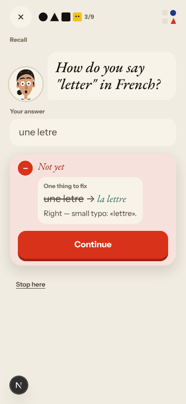
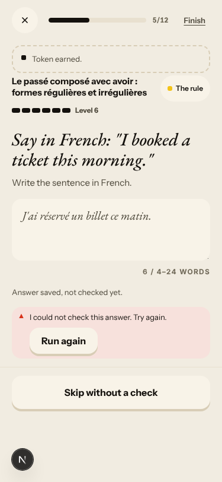
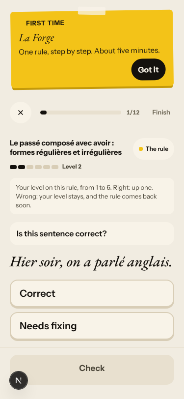
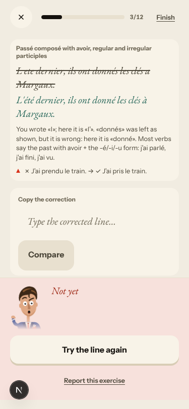
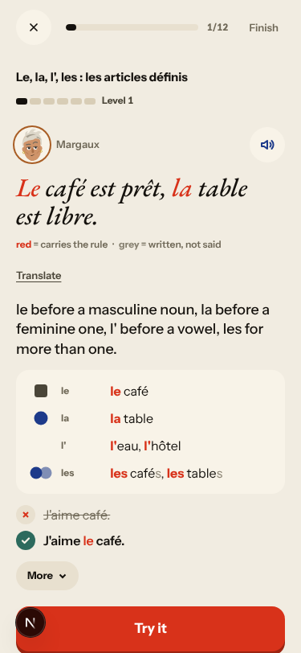
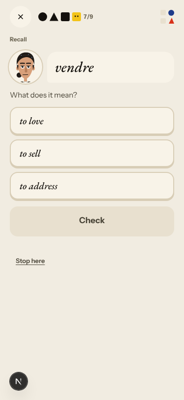
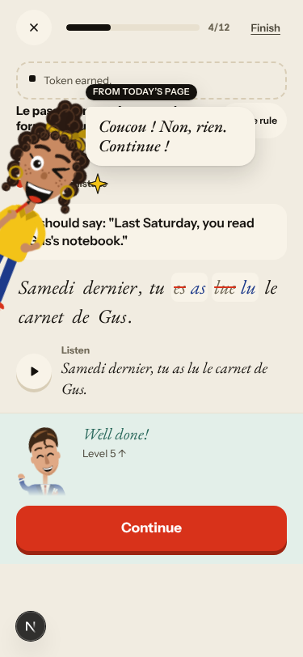
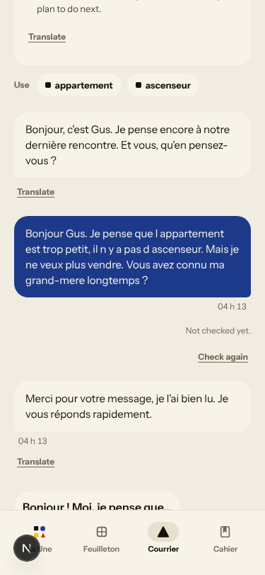

# Walk · 7 Nov 2026 · nightly explore walk

Main at `74989f8c` when walked. Its app code is the code of the 6 Nov walk (`1c49d254`): main moved only through the 6 Nov report merge (#565, docs), so there was no merged fix to re-test. Tonight this walk also merged the 6 Nov live walk's report (#560, `c87ab8c2`, docs only) before this report.
Fake story provider, local stack, Chromium at phone size, one persona: `a2-en` (`--native en --level A2.1`, odd day; `b1-fr-chrome` ran 5 Nov). I answered off-script on purpose: my own story (I am looking for my grandmother's cat, I no longer want to sell), contradicting the scene, and questions back.
Day 1: Home, onboarding, cast intro, scene «Le mauvais accueil» (two free replies, two choices), the rule «Passé composé with avoir, regular and irregular participles», 8 recall drills (one miss on purpose), La Forge 7 of 12 (one keyed miss with the whole line copied, three free sentences unchecked on the fake stack, then «Finish»), 20 words plus «5 more new words» (five cards), Done, Home, Courrier (one reply to Gus), Cahier, Feuilleton.
Day 2 (clock +1): Home, scene «La lettre» (two free replies, one choice), 9 recall drills (one typo), La Forge 5 of 12 on «Le, la, l', les» with one passé composé review item (one miss on purpose), 23 words (3 due, 20 new), Done, Home, Cahier.

Live column: [live walk 7 Nov](../live-walks/2026-11-07.md), production with the real model, account on day 26 (branch `claude/live-walk-2026-11-07`, PR #578, left open for tomorrow). Headline: **for the first time the scene reacted to all four replies** (Q4 2 → 4, #378 not reproduced), but **the day lost its single concept** (Q12 2, #576) and Courrier's friend Camille turned formal and asked for an address (Q6 2, #114). It filed #573–#577 and commented on #114, #520, #557, #397, #539, #466, #559, #500, #556 and #378. Its findings are not filed again here. The 6 Nov live walk's PR #560 is merged tonight.

## Scores (rubric `docs/ops/walk-rubric.md`)

| # | question | 07 Nov a2-en (d1–2) | live 07 Nov | 03 Nov a2-en (d1–2) | 06 Nov a1-de (d1–2) |
|---|---|---|---|---|---|
| 1 | Where am I | 4 | 3 | 4 | 4 |
| 2 | What is at stake | 4 | 3 | 4 | 4 |
| 3 | What to do next | 3 | 4 | 3 | 3 |
| 4 | Scene reacts to my writing | fake | 4 | fake | fake |
| 5 | Story coherent | 3 | 3 | 3 | 3 |
| 6 | Characters consistent | 3 | 2 | 3 | 3 |
| 7 | Image, text, tone fit | 4 | 4 | 4 | 4 |
| 8 | Difficulty fits | 3 | 3 | 4 | 3 |
| 9 | Feedback explained | 3 | 4 | 3 | 3 |
| 10 | Right answers accepted | 2 | 3 | 3 | 2 |
| 11 | French correct | 4 | 3 | 4 | 4 |
| 12 | Clear goal today | 2 | 2 | 4 | 3 |
| 13 | Grammar practised | 3 | 4 | 3 | 4 |
| 14 | Earlier material returns | 4 | 4 | 4 | 4 |
| 15 | I produce French | 4 | 5 | 4 | 4 |
| 16 | Errors, dead ends | 3 | 3 | 4 | 3 |
| 17 | Varied, fun | 3 | 4 | 3 | 3 |
| 18 | Fast enough | 4 | 3 | 4 | 4 |
| 19 | App only | n/a | n/a | n/a | n/a |
| 20 | Satisfying end | 3 | 4 | 3 | 3 |
| 21 | Would come back | 3 | 3 | 3 | 3 |
| 22 | Time vs promise | 3 | 3 | 3 | 3 |

The comparison column is the last walk with the same persona (3 Nov), beside last night's. Q14 is scored on day 2 only (n/a on day 1). The two 2s tonight (Q10, Q12) have their findings (#579 and #471; #443).

**Q12 fell from 4 to 2.** Day 1 had a clear A2 goal: the passé composé with avoir got its card, 4 drills and 7 La Forge items. Day 2 had **no rule card at all**. Recall was 7 vocabulary items and one rebuild of my day-1 slip, and «Next: grammar» opened «La Forge · Forge today's rule» on «Le, la, l', les : les articles définis» at Level 1, an A1 rule picked from my elision slips («de Odile», «L ete»). On 3 Nov the same persona's day 2 forged «passé composé avec être». The A2 rule planned for the day is gone, and the screen still calls the repair rule «today's rule» (#443, commented; live #576 tonight is the same family).
**Q10 fell from 3 to 2.** In recall, «une letre» for «letter» is «Not yet», counted as a miss, with «Right — small typo: «lettre».» printed inside the red card and a fix «une letre → la lettre» that swaps my right article (#579). On the repeat «une lettre» passed. In La Forge, «J'ai réservé un billet ce matin.» (the key sentence) raised the rule from Level 5 to 6 with «Token earned» while the card said «Answer saved, not checked yet. I could not check this answer.» (#471, as on 3 and 6 Nov).
**Q8 went down from 4 to 3.** The passé composé with avoir fits an A2 learner, but it went from Level 2 to 6 in five items, three of them unchecked, and day 2 put this A2 learner on an A1 article rule at Level 1.
**Q16 went down from 4 to 3.** «Run again» on an unchecked answer does nothing visible; once «Skip without a check» did not move on and needed «Finish», whose label turns into «Stop here?» and needs a second tap.
**Q9 stays at 3.** The La Forge miss names both slips: «You wrote «l»; here it is «l'». «donnés» was left as shown, but it is wrong: here it is «donné».» It fixes «ete → été» and «a → à» in green without a word. A typed «la billet» is answered «You chose “la billet”» (#449, PR open) and never says that «billet» is masculine. The recall card that says «Right» inside «Not yet» is #579.
**Q22 stays at 3.** Home's promise is consistent now in English: «8 min · + words ≈ 7 min» over «20 words · 7 min» on day 1, «10 min · + words ≈ 7 min» over «23 words · 20 new · 3 to review · 7 min» on day 2. Each day took me longer than that at agent speed.
**The best of the night.** The day carries my choices: I left the key with Margaux on day 1, and day 2 asked me to get it back from her. Day 2's recall turned my own La Forge slip into a rebuild («L'été dernier, ils ont donné les clés à Margaux.»), and La Forge brought yesterday's rule back as «Review · due today». The whole corrected line was accepted under «Copy the correction» (#503 holds). Done counts every card and item: «25 Words · 15 Exercises» (20 + 5 extras; 8 recall + 7 La Forge) on day 1, «23 Words · 13 Exercises» on day 2. «5 more new words» served all five cards (#563 did not reproduce with this persona). Day 2's new words were about the flat (stairs, floor, rent, landlord, suitcase, to move), a better fit than day 1's run of adverbs.

## Findings, by root cause

Two new findings (#579, #580), both `queue:ready` with a **Done when:** comment. Repeats with new evidence commented: #443, #561 and live #573 (re-triaged with a new **Done when:**). No new root cause: #579 joins #174, and #580 has no open root cause yet.

### #174 a right answer is judged against one stored string
- **#579 (new, medium)** Recall «How do you say "letter" in French?»: «une letre» → «Not yet», «One thing to fix · une letre → la lettre · Right — small typo: «lettre».», counter 3/8 → 3/9. Cause found: `evaluate_recall` decides `is_correct` with `answer_matches(...)` (`app/services/journey_learning.py:2248`), which calls `judge` without `article_optional`, and builds the note from a second `judge(..., article_optional=...)` (`:2267-2268`, note at `:2321`). Offline: `answer_matches("une letre", ["la lettre"])` is `False`, `judge("une letre", ["la lettre"], article_optional=True)` is `correct=True, note="typo"`. The same class as #562: two calls of the acceptance contract with different options decide one answer. Added to #174's children. 

### #333 what the learner sees is not what was decided
- **#471 (again, no new evidence, not commented)** Day 1 La Forge 5/12, «Say in French: "I booked a ticket this morning."» → «J'ai réservé un billet ce matin.» → «Answer saved, not checked yet», Level 5 → 6, «Token earned». The end sheet lists that sentence under «Still practising» at Level 6, and day 2's sheet offers «Ready for the test?» on the passé composé. 

### #522 learner-facing text taken from a stored field has no locale contract
- **#561 (again, commented: English chrome too)** La Forge's header and end sheet say «Le passé composé avec avoir : formes régulières et irrégulières», while the rule card, recall and La Forge's own miss card say «Passé composé with avoir, regular and irregular participles». Every Cahier rule row is French. So the open PR must cover `en`, not only `de`.  

### #143 / #146 the day's content is not driven by one concept
- **#443 (again, commented)** Day 2: no rule card; La Forge «Forge today's rule» on «Le, la, l', les» at Level 1 for an A2.1 learner, from elision slips. On 3 Nov this persona's day 2 forged the A2 rule «passé composé avec être». 
- **#280 (owner, not commented)** Day 1's deck is the base list in order, with near-twins one after the other: «sûrement / certainement», «emmener / amener». Scene words («vendre», «un appartement», «la lettre», «une offre») say «From today's scene · Lexique de base».

### No shared cause
- **#580 (new, low)** Day 2 recall 6/9 «Which French phrase means "to sell"?» (vendre / adresser / aimer), then 7/9 «vendre · What does it mean?» (to love / to sell / to address): the second drill's answer is printed by the first. Day 1 asked the same pair with one item between. `_repeats_the_day` (`app/services/journey_planner.py:4310`) lets two recognition formats on one target through; the #474 guard (`without_given_away_genders`, `:4273`) covers genders only. 
- **#573 (live; commented and re-triaged)** On screen, an edited «Find the mistake» token shows the old word struck through and the new one beside it («~~es~~ as», «~~lue~~ lu»); the live screenshot shows the same. The glue («esas», «luelu», «modernesmoderne») is only in the text layer and the accessible names, which is what a screen reader reads. New **Done when:** keeps the struck display and fixes the text. 

### Seen again, PRs open or owner's (not commented)
- #469 (PR #476): the rule card sits under «Scene · Step 4 of 11», and its first drill is introduced as «The words · Quick word drills». #473 (same PR): Marin's line «Il a dit ça ?» printed twice on the rule card.
- #449 (PR #481): «You chose “la billet”» for a typed answer.
- #155: a Lila pop-in («Coucou ! Non, rien. Continue !», tagged «From today's page», a line she never said in my scene) covers La Forge's rule header; La Forge's items cast Romy, whom this learner has not met.

### Fake provider (left to the live walk)
- Fake: my off-script replies got authored lines. «Non, ce soir je dors a l hotel. Mais pourquoi vous etes tous en colere contre moi ?» → Margaux «Pas ce soir.»; «Non, je ne vais pas vendre.» → Camille «Jeudi prochain, dix-huit heures. Je viens visiter l'appartement.»; my question about the cat was never answered. The stub corrected one slip per reply («a → à», «de Odile → d'Odile») and left «m appelle», «grand-mere», «etes», «cle» and «C est» alone. La Forge's free sentences were all «not checked yet», «commencer» for «commencé» included. Gus's Courrier letter is the generic «Je pense encore à notre dernière rencontre. Et vous, qu'en pensez-vous ?», and his reply the stock «Merci pour votre message, je l'ai bien lu. Je vous réponds rapidement.», stamped «04 h 13» at 04:13 UTC (#397, PR #548; the harness browser runs in UTC, so the time zone half cannot be judged here). 
- Not filed: the browser clock stays on «Saturday 7 Nov» and La Forge's sheet on «07 · 11 · 26» after `/clock +1` (the harness clock does not reach the browser, as on earlier nights). The Feuilleton prints «Archives du journal» twice.

## Re-tests

No app code merged since the 6 Nov walk, so no fix needed a re-test. On this persona's path:

| issue | state | tonight |
|---|---|---|
| #503 whole corrected line | closed | holds: «L'été dernier, ils ont donné les clés à Margaux.» accepted under «Copy the correction» |
| #504 / #524 Done counts | closed | hold: «25 Words · 15 Exercises», «23 Words · 13 Exercises» ([shot](2026-11-07/done-d1-25-words-15-exercises.png), [shot](2026-11-07/done-d2-23-words-13-exercises.png)) |
| #470 Home minutes vs plan | `queue:pr` | consistent in English on both days: «+ words ≈ 7 min» over «… · 7 min» ([shot](2026-11-07/home-d2-7-min.png)); not commented |
| #563 «5 more» serves one card | `queue:pr` | not reproduced: five cards, «0/5» to «5/5»; not commented |
| #119 elisions under the l' rule | closed | holds: Cahier «Le, la, l', les · 2 mistakes» |
| #471 level on an unchecked answer | `queue:ready` | reproduces (above) |

Story-engine and live-only findings (#378, #556–#558, #535, #518, #500, #445, #466, #114, #576, #577) are left to the live walk.

## Scripted walk

The last scheduled Browser walk on main passed on 6 Nov (run 26, on `74989f8c`). Tonight's scheduled run had not started when this walk ended. #560's CI on `c87ab8c2`'s parent, including the browser release checks, was green.
