# Walk · 8 Nov 2026 · nightly explore walk

Main at `7176a9a1`. Since the 7 Nov walk (`74989f8c`), main moved through #581 (the 7 Nov report) and #554, which merged thirteen PRs as one: #550 (the header names the day's blocks, the scene's last button saves the scene; #540), #548 and #482 (Courrier times on the learner's clock, no stock line as a reply, an old thread no longer blocks the day's letter; #397), #547 (the Journal recall check scores what the scene established; #539), #546 (La Forge announces a rewrite as a rewrite; #543, stage 1 of #542), #533 (Lexique swipeable flip cards), #532 (iPhone audio session), #481 (a La Forge miss names the slip, the correction step marks the differing word, French spacing; #449, #452), #459 (the Journal's «Yesterday» is the previous scene; #444), #458 (La Forge opens on the planned rule and does not end after one item; #443), #456 (the tutor's correction gate; #93, part of #174), #454 (pushes only from met characters, one alias table; part of #147, #124, #155) and #410 (the session survives a bad refresh; part of #386), plus `077ec6f6` (the follow-up marks no slip on an accepted answer). Tonight this walk also merged the 7 Nov live walk's report (#578, docs only) before this report.
Fake story provider, local stack, Chromium at phone size, one persona: `a1-de-fresh` (`--fresh --native de`, even day; `a2-en` ran 7 Nov). Signed up through the UI at A1 and answered as a German beginner: short replies, no accents, «la appartement», a «c'est qui ?» question, wrong picks on purpose.
Day 1: teaser (one wrong pick), sign-up, character, onboarding, cast intro, scene «Le mauvais accueil» (two free replies, one choice), the rule «Ich bin, du bist: Subjektpronomen und être», 3 recall drills (one miss), La Forge 8 of 12 (judge miss, speed round 3/4, a typo in a gap, two free sentences unchecked on the fake stack, then «Beenden»), 20 words plus «Noch 5 neue Wörter» (one card), Done, Home, Courrier (one reply to Margaux), Cahier, Feuilleton.
Day 2 (clock +1): Home, scene «La lettre» (two free replies, one choice), the être card as a review, 6 recall drills (one rebuild of my typo, one miss), La Forge 5 of 12 on «Le, la, l', les» with one être review item, 22 words (5 due, 17 new), Done, Journal entry, Courrier (Camille's letter).

Live column: [live walk 8 Nov](../live-walks/2026-11-08.md) (branch `claude/live-walk-2026-11-08`, PR #593, left open), production with the real model, account on day 27. Headline: **Courrier silently stopped answering** (two of three messages unanswered, the letter still ended «Promise kept», #590), and Camille agreed with the learner's «non» against her own proposal (#591); Q16 fell to 2 and Q4 to 3. It filed #590–#592 and commented on #558, #557, #466, #147, #576, #559, #577, #250, #167 and #155. Its findings are not filed again here. The 7 Nov live walk's PR #578 is merged tonight.

## Scores (rubric `docs/ops/walk-rubric.md`)

| # | question | 08 Nov a1-de (d1–2) | live 08 Nov | 06 Nov a1-de (d1–2) | 07 Nov a2-en (d1–2) |
|---|---|---|---|---|---|
| 1 | Where am I | 4 | 3 | 4 | 4 |
| 2 | What is at stake | 4 | 3 | 4 | 4 |
| 3 | What to do next | 3 | 3 | 3 | 3 |
| 4 | Scene reacts to my writing | fake | 3 | fake | fake |
| 5 | Story coherent | 3 | 3 | 3 | 3 |
| 6 | Characters consistent | 3 | 2 | 3 | 3 |
| 7 | Image, text, tone fit | 4 | 4 | 4 | 4 |
| 8 | Difficulty fits | 3 | 4 | 3 | 3 |
| 9 | Feedback explained | 2 | 3 | 3 | 3 |
| 10 | Right answers accepted | 2 | 3 | 2 | 2 |
| 11 | French correct | 4 | 4 | 4 | 4 |
| 12 | Clear goal today | 2 | 3 | 3 | 2 |
| 13 | Grammar practised | 4 | 3 | 4 | 3 |
| 14 | Earlier material returns | 4 | 4 | 4 | 4 |
| 15 | I produce French | 4 | 5 | 4 | 4 |
| 16 | Errors, dead ends | 3 | 2 | 3 | 3 |
| 17 | Varied, fun | 3 | 4 | 3 | 3 |
| 18 | Fast enough | 4 | 3 | 4 | 4 |
| 19 | App only | n/a | n/a | n/a | n/a |
| 20 | Satisfying end | 3 | 3 | 3 | 3 |
| 21 | Would come back | 3 | 3 | 3 | 3 |
| 22 | Time vs promise | 3 | 3 | 3 | 3 |

The comparison columns are the last walk with the same persona (6 Nov) and last night's. Q14 is scored on day 2 only (n/a on day 1). The three 2s tonight have their findings: Q9 (#594, #595, #596), Q10 (#471, #595), Q12 (#443, reopened).

**Q12 fell from 3 to 2: the owner's rule of 7 Nov does not hold yet.** Day 2's rule card was être, as a review («Eine bekannte Regel, auf der heutigen Seite»). «Weiter: Grammatik» opened «La Forge · Regel des Tages schmieden» on «Le, la, l', les» at Stufe 1, the rule of my day-1 slip «la appartement», and filed the card's rule as «Wiederholung · heute fällig» at item 4. The labels are the wrong way round: a slip rule took the «today's rule» slot and the planned rule became the review. #458 (merged) anchors the Forge on `plan_selection["introduction"]`, which a review-only card does not set; the open #587 (#576) also lets a review card «name nothing», so neither covers this day. #443 is reopened with a **Done when:** for one «card's rule» reader. Day 1 was clear: être on the card, in 3 drills and 8 La Forge items.
**Q9 fell from 3 to 2.** Three deterministic explanations were wrong, not just thin. In the scene my «toi» to Margaux («Tu vas monter ?») was corrected to «vous» because «Augustin « Gus » de Roncourt siezt dich» (#594). In recall, «Nous sommes a l hotel avec Lila.» got «… → sommes · 1 Wort, beginnt mit „s“», the one word I had right (#595). In La Forge, «Marin cherche le clé.» got the rule line and «✗ J'aime café», never that «clé» is feminine (#596). The speed round still says only «Richtig heißt es: Die Regel · Je suis, tu es : les pronoms et être» (#564, PR #568).
**Q10 stays at 2.** «Tu es gentil, Marin ?», the key sentence, was «Antwort gespeichert, noch nicht geprüft» while the rule rose from Stufe 5 to 6 and «Marke verdient» (#471, PR #585); the end sheet lists it and the right «Ils sont à l'école.» under «Weiterhin in Übung», and day 2 offers «Bereit für die Prüfung?» on être.
**Q8 stays at 3.** être went from Stufe 2 to 6 in eight items on day 1, two of them unchecked.
**Q22 stays at 3.** Home day 2 still says «8 Min. · + Wörter ≈ 6 Min.» over «22 Wörter · 17 neu · 5 zum Wiederholen · 7 Min.» (#470, PR #572).
**Fixed tonight and seen.** The session header names the block: «Regel · Schritt 4 von 6», «Wiederholung · Schritt 5 von 6» (#540). The Courrier stamps my reply «05 h 10» at 05:10 Berlin and stores no stock line as Margaux's turn (#397). The Journal asks about day 1's scene as «Gestern», with a neutral placeholder, and scores my recap 1/1 against what the scene established (#539, #444). The new Lexique is a clean flip card: the word alone on the front, the answer, example and translation on the back, «← Nochmal · wischen · Weiß ich →»; a «Nochmal» card comes back in the same round. Day 2's scene carries my day-1 choice («Bitte Margaux um den Schlüssel, den du bei ihr gelassen hast»), and recall rebuilt my La Forge typo. Done counts «21 Wörter · 11 Übungen» and «22 Wörter · 11 Übungen» (3 + 8 and 6 + 5).

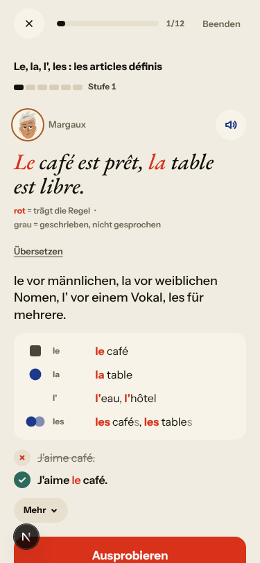

## Findings, by root cause

Five new findings (#594–#598), one re-test reopened (#443), comments with new evidence on #590, #573, #576 and #469, and verifying comments on the closed #397, #539, #444 and #540. All new and reopened findings are `queue:ready` with a **Done when:** comment. No new root cause: each finding fits an open one, and no two share an unnamed mechanism.

### #143 the day's progress has no single source of truth
- **#443 (reopened, medium)** Day 2: the rule card reviews être; La Forge «Regel des Tages schmieden» opens on «Le, la, l', les» (my slip rule, Stufe 1) and puts être under «Wiederholung · heute fällig». The séance half of #458 holds (it did not end after one item). Cause: `_planned_rule_id` (`app/services/daily_journey.py`) reads only the plan's introduction; a review-only card falls through to the picker, which puts the due erratum first.  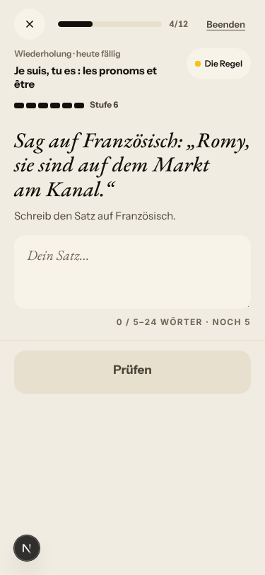
- **#576 (live; commented)** The same family on production; #587's «review card names nothing» leaves the fake-stack case open, so the two fixes need one reader.
- **#470, #563 (again, PR #572 open, not commented)** «+ Wörter ≈ 6 Min.» vs «7 Min.» ([shot](2026-11-08/home-d2-6-vs-7-min.png)); «Noch 5 neue Wörter» served one card, then «Mit 30 Wörtern am Tag…» ([shot](2026-11-08/words-extra-one-card.png)).

### #174 a right answer is judged against one stored string
- **#595 (new, medium)** Day 2 recall rebuild «Nous somes à l’hôtel avec Lila.»: «Nous sommes a l hotel avec Lila.» → «Noch nicht · … → sommes · Es ist 1 Wort lang und beginnt mit „s“». The fix names the word I got right and not the slips (a → à, l hotel → l'hôtel). Offline, `judge_repair` rejects even the correct whole sentence when the stored key is the part, and returns no note, so `evaluate_recall` shows `task.solution_fr` (`app/services/journey_learning.py:2248-2265`, `:2316-2340`). Sibling of #579 (PR #584). 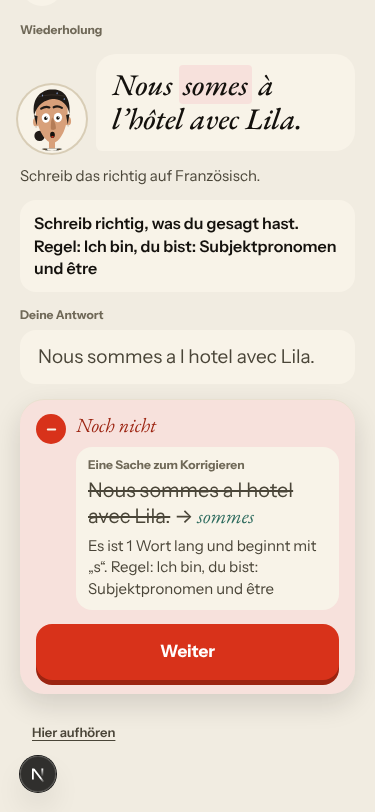

### #146 the day's content and feedback are not driven by one concept
- **#596 (new, medium)** «Marin cherche le clé.» → «hier ist „Marin cherche la clé.“ nötig. Regel: Le, la, l', les: der, die, das. ✗ J'aime café.» Nothing says that «clé» is feminine (der Schlüssel), nor that «Les lits» is plural. #481's `slip_category` covers object pronouns and elision only, so every other slip falls back to the rule card. 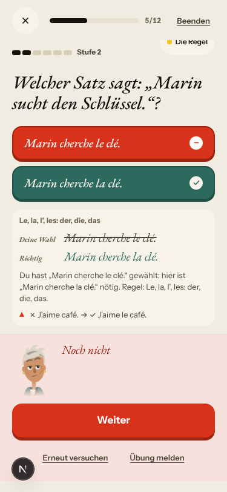
- **#564 (again, PR #568 open, not commented)** The speed-round miss still prints the rule chip's label as the reason. 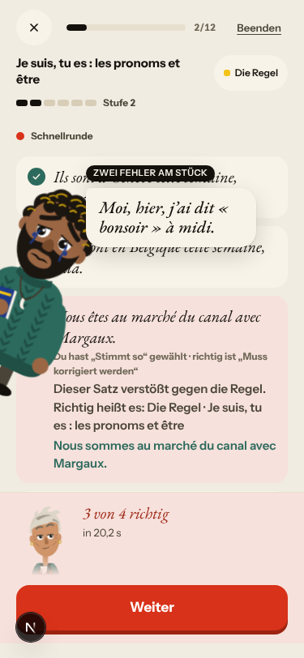

### #147 the cast is not one registry
- **#594 (new, medium)** Day 1, exchange 2: Margaux asks «Tu vas monter ?» (the authored turn says `"to": "margaux_barman"` and «Margaux uses tu with you at once»), the header says «Gus · Austausch 2 von 4», and my «toi» is corrected to «vous»: «Hier gilt „vous“: Augustin « Gus » de Roncourt siezt dich.» `expected_counterpart_register` (`app/services/journey_conversation.py:2686-2718`) takes the scene-wide declaration and the task's character, not the turn's addressee. The live walk's Camille (vous in the scene, tu in Courrier) is the same split: tu/vous belongs to the person. 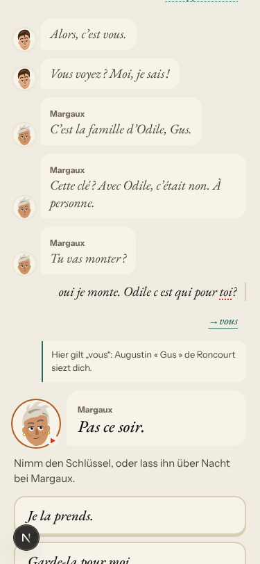
- **Romy in La Forge (commented on #147, not filed)** Day 1 «Ils sont à Genève cette semaine, Romy.», day 2 «Romy, sie sind auf dem Markt am Kanal.»: a character this learner has not met. #454 gates pushes on `cast_registry.has_met`; the Forge sentences do not ask it (same mechanism as #155).
- **#473 (again, PR #476 open, not commented)** Day 2 rule card: «Camille marchand», her line printed twice. 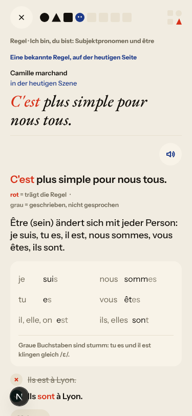

### #145 the scene has no state of what was established
- **#597 (new, low)** Day 2 opens with «Bisher · Deux clés pour la même porte. À suivre…», the closing caption, not what happened. #547 fixed the Journal's reader of `story_outcome.callback_fr` and named this one as the next. 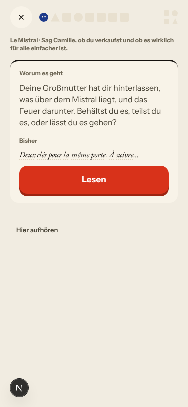

### #333 a failed or empty model call is shown as a result
- **#590 (live; commented with a fake-stack reproduction)** Margaux never answered my Courrier reply (no model on the fake stack; #482 stores no stock line and returns `pending`). The only sign is a toast that vanishes; my text stays in the composer under my posted message; «Beenden» closes the letter «Teilweise · Margaux ist neutral · Marke geprägt». So the live #590 can be tested deterministically. 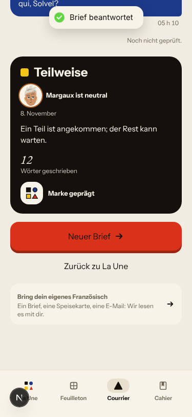
- **#471 (again, PR #585 open, not commented)** Key answer unchecked while the level rises. 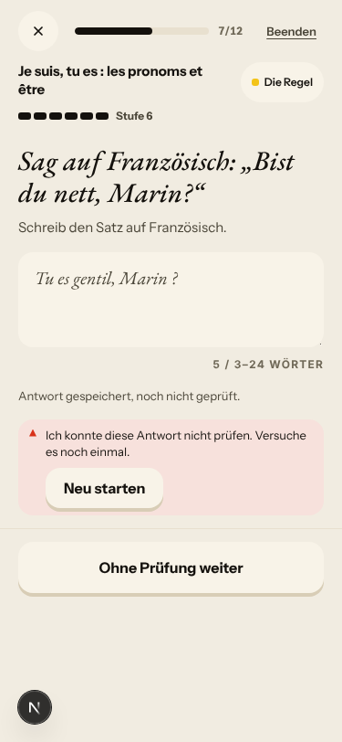

### No shared cause
- **#598 (new, low, story lane)** The German line of «Avant le 8 janvier.» is «Bis vor dem 8. Januar.» (`app/data/season/s1/levels_a.json:387`), shown on the «la lettre» word card.
- **#573 (live; commented)** «~~est~~ sont» is drawn with a space; only the text layer reads «estsont». 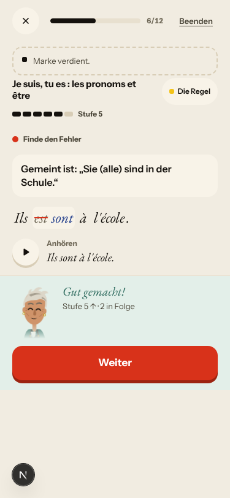
- **#469 (commented; PR #476 needs a rebase)** The header half is fixed by #550; the first grammar drill still opens with the coach mark «Die Wörter · Kurze Wortübungen». 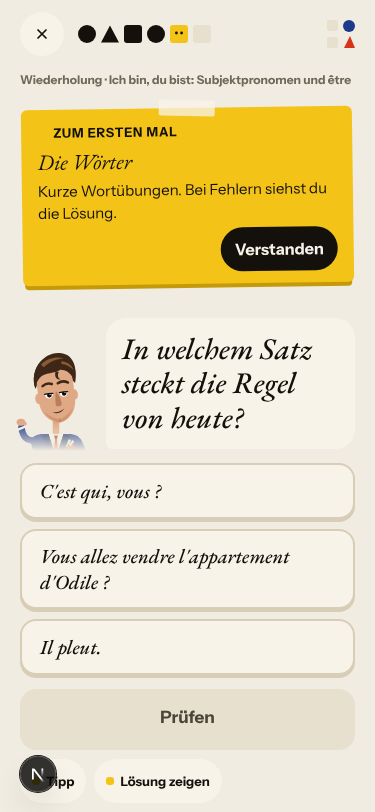

### Fake provider (left to the live walk)
- Fake: «oui je monte…» answered with Margaux's authored «Pas ce soir.»; «non, je ne vend pas. Solvel c est qui?» with Camille's «"Pas encore" ?», my question unanswered; choosing Lila to read the letter gives «Du: Lila» and her answer to a question I was not asked. The stub corrected «la appartement» and left «grand-mere», «c est», «je ne vend», «cle» alone. La Forge's free sentences were all «noch nicht geprüft», a wrong «Nous est gentil.» included, and «Neu starten» did nothing visible.
- Not filed: the browser clock stays on «Sonntag, 8. Nov.» and La Forge's sheet on «08 · 11 · 26» after `/clock +1` (harness, as on earlier nights).

## Re-tests

| issue | fix | result |
|---|---|---|
| #540 scene button / block header | #550 | **header fixed**: «Regel · Schritt 4 von 6», «Wiederholung · Schritt 5 von 6» ([shot](2026-11-08/rule-card-header-regel.png)); the «Szene speichern» screen was not reached; stays closed |
| #397 Courrier stamps, stock reply, old thread | #548, #482 | **fixed on the fake stack**: «05 h 10» at 05:10 Berlin, no stock turn, day 2 opens Camille's new letter ([shot](2026-11-08/courrier-stamp-berlin-0510.png)); the live walk confirms on the deployed release |
| #539 Journal scores a filler line | #547 | **fixed**: «Écris ce dont tu te souviens…», recap scored 1/1 against the scene ([shot](2026-11-08/journal-d2-recall-1of1.png)) |
| #444 Journal «Yesterday» | #459 | **holds**: «Gestern · Le Mistral · mit Gus», day 1's scene; the multi-day case not reached |
| #443 Forge on the day's rule, ends after one item | #458 | **reopened**: the séance half holds, the rule half fails on a review-card day (above) |
| #449 miss names the slip | #481 | object-pronoun and elision slips not reached; article gender and number fall back to the card (#596) |
| #452 French spacing | #481 | not reached (German chrome) |
| #543 rewrite announced as rewrite | #546 | not reached (no rewrite item tonight) |
| #469 rule card under «Szene» | #550 (part) | header fixed, coach mark not (commented, PR #476 open) |
| #93, #174 tutor gate | #456 | model-written path, not judgeable on the fake stack |
| #147, #155, #124 pushes from met characters | #454 | pushes not visible in the walk; La Forge still names unmet Romy (commented on #147) |
| #386 session refresh | #410 | CI evidence: main's CI on `7176a9a1`, including the browser release checks, is green |

Verifying comments were added to the closed #397, #539, #444 and #540. Root causes: #143 (#443 reopened), #145 (#597), #146 (#596), #147 (#594), #174 (#595) each got a comment; all keep open children, so none closes. #542's stage 1 (#546) was not reached in German chrome tonight. Story-engine and live-only findings (#378, #556–#558, #591, #535, #518, #500, #445, #466, #114) are left to the live walk.

## Scripted walk

The last scheduled Browser walk on main passed on 7 Nov (run 27, on `021e38f2`). Main's CI for `7176a9a1` (#554), including the browser release checks, was green. Tonight's scheduled run had not started when this walk ended.
