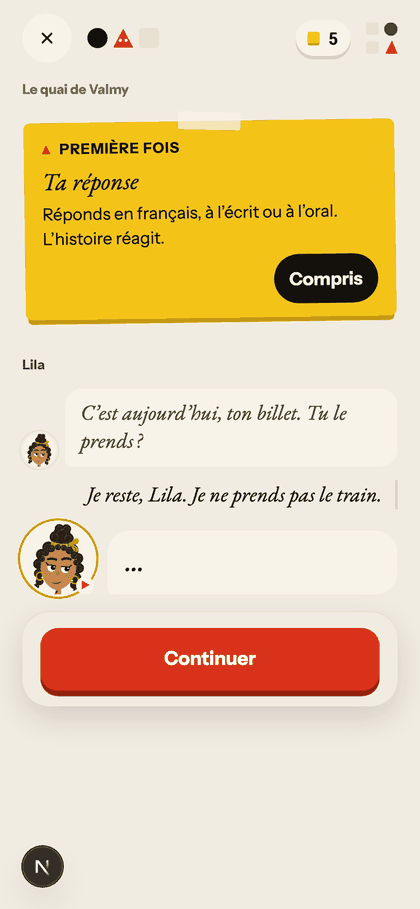

# Walk · 9 Nov 2026 · season end and rollover, real model

Two throwaway learners played the end of season 1 and across the rollover with the real models on a local stack, walked on `5a94ce3f`. Dates below are the test clock's, not today's. Production was not touched, and neither the owner's account nor the nightly walk account was used.

## The answer

1. **No learner can get a written next season on the values in `render.yaml`.** The writer's critic is refused every time, so an accepted draft is thrown away and every life falls back to the interlude and then to the reprise. OpenAI returns: `'messages' must contain the word 'json' in some form, to use 'response_format' of type 'json_object'`. The fake provider cannot see this, which is why no test caught it.
2. **The rollover wait is 40–66 s from the learner's last answer to the ending** (59 and 66 s on the first attempt, 51 and 40 s on the retry). The writer is 24–29 s of that. A working critic adds 5–10 s more (measured only on the bench), so expect up to about 75 s. Eight runs, with delays injected up to the writer's budget, never timed out or left a learner stuck. The closest run ended 0.67 s under the client's 90 s timeout.
3. **Yes, move the writer to a background job, but fix the critic first.** The wait alone would not force the move. The reasons are that the writer holds database locks across model calls, blocks unrelated requests, can run inside a polling `GET`, and gets only one attempt when 4 of 10 reviewed drafts are refused.
4. **A worse problem turned up on the way there.** The B1 learner spent three days in a row re-reading the ticket scene from day 65, after a 54 s wait each morning. A one-day-old change made most interlude beats unplayable, and a guard refuses correct French.
5. **The season's biggest decision gets no answer.** After «Je reste, Lila», she replies «…». Her authored reply exists but is dropped because it is an SMS.
6. **When it all works, it is the best thing in the run.** The written season on Opus reads like the authored season. The day after it («Camille arrête Marin sur le quai») is as good.
7. **Spend: US$3.71 of the US$6 cap** (Opus US$3.23, luna US$0.47).

## What ran

| | A1 learner | B1 learner |
|---|---|---|
| Language, level | German, A1.1 | English, B1.1 (instructions in French) |
| Season 1 ending | `garder` | `laisser_partir`, flat sold, Lila in Berlin |
| Played | days 58–65 authored, 12 generated days | days 58–65 authored, 17 generated days including 3 re-reads |
| Reached | named interlude, then reprise | named interlude, then reprise, then a written season (harness, see below) |

The stack is `scripts/season_end_walk_server.py`: production's story settings read from `render.yaml`, one worker, a throwaway Postgres, the test clock, a hard spend cap and an outbound allowlist. I wrote every answer as that learner, with an A1 learner's real mistakes.

**Limits of this walk:**
- Settings that exist only in the Render dashboard (for example `ATELIER_STORY_ACTS`) are unknown and were off.
- Art, audio and La Revue were off, so question 7 is `n/a`.
- Most days were read through the API. The browser (phone size) was used for the rehearsals and selected screens.
- Days 58 onward come from `jump_to_day`, so the learner has no history. Questions 12–14 on authored days say `seed`.
- `main` moved to `ec60ae44` during the walk (#634). I read that diff and the checked code: it does not touch the writer, the critic, the beats, `task_says_vous` or SMS replies. It does change what «Bisher» recaps, so those quotes may be out of date.

**Harness interventions, none of them in the product:**
- `critic_json_word` adds the word «JSON» to the critic's prompt, so the critic could be measured. It was on for the bench and for all of B1.
- `install_written` repeats the writer until one draft is accepted (2 attempts here) and installs it over a reprise no page had served. Both real lives ended on the reprise, so this was the only way to read a written season. The last two B1 days are therefore not a natural path.
- The Anthropic key arrived at 14:25, so the A1 pages are luna except day 75 and season 2 day 1.
- Bugs in my own prefetch made A1's days 66, 67, 70 and 71 open cold. Their times are real cold opens, but production would have had a page ready if its prefetch succeeded.

## The rollover

### Measured wait, real model

| Life | Rollover | Answer to ending | Before the writer | Writer | Critic | Lock held | Result |
|---|---|---|---|---|---|---|---|
| A1 | day 72, 24 Nov | **59.0 s** | 27 s | 29.4 s | 0.5 s, refused by OpenAI (400) | 30 s | named interlude to 8 Dec |
| A1 | retry, 8 Dec | **51.4 s** | not separated | 23.7 s | 0.4 s, refused by OpenAI (400) | 23 s | reprise |
| B1 | 28 Dec | **66.0 s** | 35 s | 27.8 s | not reached: `arc_id:odiles-key` | 27 s | named interlude to 11 Jan |
| B1 | retry, 13 Jan | **39.8 s** | 8 s | 29.2 s | not reached: `arc_id:unlabeled-key` | 28 s | reprise |

For comparison, an ordinary generated-day ending took 9–45 s, and a cold page opened in 15–57 s against the rubric's 15 s, behind «Deine Szene wird vorbereitet…» ([shot](2026-11-09-season-end/a1-home-preparing-scene.png)).

Across all 16 real drafts the writer took 22–37 s (mean 28.6). The critic took 5–10 s (mean 7.8, 10 reviews). Writer plus critic took 28–42 s on the bench. No real rollover reached a working critic, so the estimate of up to 75 s adds the bench figure to the longest measured wait.

### What the learner sees meanwhile

The screen depends on when they press «Weiter». The ending is written by a thread that takes the lock only after its earlier model calls.

| When | Screen | Quality |
|---|---|---|
| Before the lock | «Wie es weitergeht, wird gerade geschrieben…», polling every second ([shot](2026-11-09-season-end/rehearsal-s4-honest-wait.png)) | honest |
| After the lock | `POST /advance` blocks up to 89 s. Only the banner «Wird an den Server gesendet…» shows, with «Weiter» still on screen ([shot](2026-11-09-season-end/rehearsal-s2-advance-blocked.png)) | looks frozen |
| Opens Home meanwhile | `GET /today` blocked 27 s, because it writes the timezone to the locked user row | looks frozen |
| Reloads meanwhile | Home in 1.2 s, then «Heute fortsetzen» takes 13 s and lands on a stale screen. The third answer is gone and the box is empty. The false «Das kam nicht beim Server an. Deine Antwort blieb erhalten.» sits below the visible screen ([shot](2026-11-09-season-end/rehearsal-s3-after-reload.png)). Retrying after the writer gives a 409, then «Diese Szene hat sich geändert. Sie wurde für dich aktualisiert.», then the ending | confusing, not stuck |

### Can it time out or strand the learner?

Fake provider with injected delays, in the browser at phone size, at no cost:

| Injected | Result | Stuck? |
|---|---|---|
| Writer 30 s | `GET /today` 27.09 s | no |
| Writer 59 s + critic 29 s | `POST /advance` 87.38 s | no |
| Writer 59.9 s + critic times out | `POST /advance` **89.33 s, 0.67 s under the 90 s client timeout** (`web-frontend/services/api.ts:2063`) | no, narrowly |
| Reload during the writer | see above | no |
| Story lane 148 s, «Weiter» pressed before the lock | 86 polls. A stale-heal `GET` blocked 57.97 s at the 90 s mark. One writer only, and it ended fine | no |
| Writer refused, slow, or returning garbage | named interlude; next morning's Home says «Zwischen zwei Staffeln … Die Geschichte geht am <date> weiter.» ([shot](2026-11-09-season-end/rehearsal-s5-named-interlude-home.png)) | no |
| `kill -9` during the writer, then restart | «Erneut versuchen» replays. **Writer and critic ran inside the polling `GET` (25.10 s)**, although `settle_with_fallback` says "Free: never a model call" and `heal_stale_lane` says "(no paid call)" (`app/services/story_lanes.py:1687`, `:1755`). The learner gets a free fallback ending | no |

### Recommendation: move the writer to a background job

Do the critic fix first; it is one line and everything else depends on it. Then move the writer, for these reasons:

1. **It holds locks across model calls.** `settle_resolution` calls `roll_over_season`, which calls `draft_next_season` with the user and resolution rows locked (23–30 s measured, up to 89 s). The lane's own rule says otherwise: "no transaction stays open across the model calls" (`story_lanes.py:1836`).
2. **It blocks requests that have nothing to do with it**, such as Home.
3. **At the budget limit it reaches the client timeout.** The margin was 0.67 s, and that is before any network.
4. **It can run inside a polling `GET`.**
5. **It gets one attempt.** Of the 14 drafts not lost to the critic's 400, 6 were accepted (43 %). A refused draft costs the learner two weeks and the written season. A job could retry; three independent tries at that rate would land about 81 % of the time.

The ending would then be released at once, with no writer in the wait. The next morning shows the premiere if the season is ready and the named interlude if not, which already reads well. The night job that writes pages ahead is the natural place to look first. I did not design this further.

## Every real draft

| Outcome | Drafts | Where |
|---|---|---|
| Accepted by the critic | 6 | bench 5, `install_written` 1 |
| Refused by the critic | 4 | for example, the Lancry thread carried forward unchanged, or an Odile arc promising an answer the material does not hold |
| Lost to OpenAI's 400 on the critic | 2 | **both real A1 rollovers** |
| Refused: hyphen in an arc id | 2 | **both real B1 rollovers**. `_SLUG` allows only `[a-z0-9_]` (`season_writer.py:39`) and the prompt never says so |
| Refused: `ungrounded_arc` | 1 | bench |
| Refused: `invalid_story_output` | 1 | bench |

Each draft costs about US$0.0025, so retries are cheap.

## The named interlude and the reprise

**Named interlude: reads well, with rough edges.**
- «Entre-temps · 10 Tage ohne dich» with Margaux's «Ça fait longtemps ! Viens, assieds-toi, je te raconte.» is a warm return ([shot](2026-11-09-season-end/a1-entre-temps.png)).
- Home promises a date, which is honest. But the retry only fires when a chapter closes on or after that date, so the promise passes without anything happening: B1 was promised 11 Jan and its first season 2 day was 14 Jan. A1 was one day late. In the rehearsals, Home still announced the passed date for two more days.
- Home's headline echoes the learner's own text: «miel», «Merci Margaux. Je reste avec toi ce matin» ([shot](2026-11-09-season-end/a1-home-headline-miel.png)). Its eyebrow is in vous, «Votre prochain chapitre».

**Reprise: holds together, but does not feel like a new season.**
- The premiere card is fine as a screen, but says vous: «L'histoire reprend là où votre vie au quartier l'avait laissée.» ([shot](2026-11-09-season-end/a1-reprise-premiere.png)).
- Its arcs are titled «Les fils repris (1)» to «(5)».
- It reopens a question the learner answered. B1 sold the café and gets: «An old question of the group comes back in a new form: L'avenir du Mistral : le garder, le changer, ou le laisser partir ?». Season 1's threads stay `open` in `threads_archive` after the finale. The writer reads the same rows, and B1's first draft was «Un café qui change».
- Right after the premiere, Home is back to «Nº 20 · La clé d'Odile» with no sign of a new season ([shot](2026-11-09-season-end/a1-reprise-home-mme.png)).

**Written season, by contrast:** «Les choses qui restent · Une dernière boîte, une histoire à écouter et Lila à Berlin : tu apprends à rester proche sans retenir les autres.» It respects that Lila left, says tu, and grows from what this learner did ([Home](2026-11-09-season-end/written-season-home.png), [premiere](2026-11-09-season-end/written-season-premiere.png)).

## What went wrong, as the learner reads it

**Three mornings of the same scene (B1, 25–27 Dec).** After waiting 54.6, 53.6 and 53.0 s for the scene to be prepared, the learner reads:

> Aujourd'hui, on relit «Le billet», puis vous répondez. L'histoire n'avance pas aujourd'hui.
> Rappel : votre billet retour, aujourd'hui, 18 h 12.
> C'est aujourd'hui, ton billet. Tu le prends ?

The learner made that decision eight days earlier, and the app asks it again. «Je pars, finalement. Je rentre à Berlin ce soir.» gets «…», correctly with no effect, and then «Relecture de «Le billet». L'histoire n'a pas avancé aujourd'hui.» It ended on the fourth morning only because one draft happened to pass.

The causes, all confirmed in code or logs:
- **Off by one.** The brief deals the interlude beat from `chapters_total` (`living_story.py:5429`). That counter already moved on when the chapter opened, so the writer gets the next beat, not the chapter's own. B1's chapter stored `interlude_souvenir_partage` while the brief said `interlude_pluie_au_parc`. It also means one beat repeats until the chapter closes, hence three sock days in a row: «La chaussette dans le tiroir», «… dans le carnet», «… sous la table».
- **5 of the 8 beats are set where no page may be set, since 8 Nov.** Commit `3e8e19f3` limits pages to the 7 built places (`app/data/season/s1/stages.json`), but the beats still name `marche_canal`, `buttes_chaumont`, `marin_lila_flat`, `brocante` and `metro_platform`. The writer obeys and is refused: 8 drafts at `buttes_chaumont` on B1 alone.
- **`task_says_vous` refuses correct French**, 12 drafts on B1. It matches the word (`_TASK_VOUS`, `living_story.py:6631`), so a plural is refused: «Dis à Gus si tu préfères garder cette histoire entre vous, et pourquoi.», «Propose à Gus un nom pour votre souvenir de la table.», «Imagine avec Romy ce que vous feriez si le soleil revenait.»

This hit one life of two, so I cannot give a rate.

**Lila answers the ticket with «…» (both lives, confirmed in the browser).** 

The authored reply is «Bien. Quelqu'un doit garder le quartier. Dix-huit sur vingt.» It is sent as an SMS, and `reaction_lines` keeps only `speech` and `all` lines (`app/services/season/turns.py:557`). The response carries it in `stage.beats`, which only Le Quartier reads. I did not page backwards with «Précédent» to look for it. Two authored turns are affected (6 of 153 replies): `ep1.b.turn` and `ep3.b.turn`.

**Five of 26 generated days lost their ending** (the 3 re-read days are counted apart). The page is served and the conversation runs, then:

| Day | The learner reads | Cause |
|---|---|---|
| A1, 18 Nov | «Marin doit partir avant de répondre.», after 1 of 3 exchanges | `reply_repeats_thread` |
| A1, 26 Nov | «Marin doit partir. La conversation reprendra là où elle s'est arrêtée.» | critic, `gendered_address` |
| A1, 9 Dec | «Mme doit partir. …» and «Mme hat dir geantwortet» | tu against vous, invented knowledge |
| B1, 21 Dec | «Attends, on m'appelle — je reviens vers toi très vite, promis.» from a notary who says vous, then «Maître doit partir» and «Maître a été appelé ailleurs» about a woman | `invalid_story_output` in the turn |
| B1, 28 Dec | «Marin doit partir…», and in English in a French chrome: «Marin answered you, then had to go; the rest of the scene stays open and picks up next time.» | the last scene of the season, which does not stay open |

The first word of the name is used as the name: «Mme», avatar "M", «Mme diallo» ([shot](2026-11-09-season-end/a1-reprise-home-mme.png)).

**Instructions spoken by characters (luna only, none on Opus).**
- Marin: «Demande à Marin si son père est déjà à la gare.» ([rule card](2026-11-09-season-end/a1-d67-rule-card-demande-a-marin.png), [answer step](2026-11-09-season-end/a1-d67-answer-step-demande-a-marin.png))
- «Dis à Gus à quelle condition tu le laisses noter ton mot.» and «Explique à Romy pourquoi cette histoire compte pour toi.»
- «Gus te demande : «Tu vas où, après ?»»
- Truncated objective: «Begrüß Mme Diallo und sag ihr.»

**Continuity.**
- A1 day 61: «Je ne sais pas, je ne suis jamais allée à Berlin.», says Lila, from Berlin.
- A1 day 66 margin note: «Parce que vous avez dit à Gus « Lila je t'aime beaucoup. Tu me manque deja… »»: said to Lila, not Gus, in vous, and it quotes the mistake.
- A1 stays on the same quai for four days (22–25 Nov), and returns there on 8 Dec after a day in the café. Margaux repairs it nicely when challenged: «Oui, hier on est rentrés à pied.»
- **Rue de Lancry, the season's closing hook, is promised and never entered.** A1: «cette rue nous attend !», and the next page is a métro platform. B1: «on sonnera au troisième» at nine, then the pages stay on the quai and the visit is skipped. `rue_de_lancry` is not a built place, so a generated page cannot be set there; one B1 draft was refused for trying. The forge is meant to build named places overnight. It did not run on this stack, so I cannot say whether production gets there.
- «Worum es geht» shows the first-day premise («Behältst du es, teilst du es, oder lässt du es gehen?») every day after it was decided, season 2 included ([shot](2026-11-09-season-end/a1-bisher-mixed-languages.png)).
- «Et on se quitte comme ça ?» came up on three of B1's first six generated days, in the same words.

**Language.**
- «Bisher» mixes languages line by line: «Tu bleibst au Mistral…», «Du begrüßt Marins Vater…», «Margaux sitzt zum ersten Mal seit Odile…». #634 changed this recap, so re-check it.
- Wrong German in a summary: «Ihr wartet auf dem Bank am Mauer».
- «La table d'Odile : Maître a dû partir avant de répondre.» then stays in «Bisher» for days.

**A cost to know about.** An Opus page costs about US$0.54 and takes 52–78 s to write, usually two drafts in parallel. That is about US$16 a month for one daily learner, against the owner's US$100 of credits.

## What was good

- **Authored days 58–65 read very well in both lives.** Gus at the brocante: «Je suis Augustin de Roncourt.» / «Deux cent cinquante.» Lila at the train: «Tu peux m'en vouloir un peu. Merci de me le dire.» Romy: «Non ! Je vais pleurer.»
- **Corrections are mostly accurate and useful.** For example, «Für einen Zustand in der Vergangenheit passt hier das Imparfait; außerdem fehlt die Verneinung mit «ne».»
- **Generated replies pick up what the learner really wrote.** «Tous les matins ? Voilà une table qui a déjà retrouvé sa place.» An idea of the learner's became the day's ending: «Penser qu'Odile voulait seulement savoir s'il vivait encore me suffit pour ce soir.»
- **Opus pages are clearly stronger than luna.** Gus: «La table d'Odile ? Six étages, seul. Si cette table parlait, elle dirait mon nom. Non : elle le chanterait.» Marin: «Avant, c'est Lila qui ouvrait les cartons. Moi, je pleurais devant.»
- **The grammar arrives inside the story.** «Quand je suis repassé à la brocante hier, quelqu'un avait déjà acheté les chaises.» carries the plus-que-parfait rule on B1 day 66.

## Scores (rubric `docs/ops/walk-rubric.md`)

This report is named so that `scripts/loop/rubric_trend.py` skips it. It reads one life stage that the nightly walks never reach, and mixing it in would distort the trend.

Summary, as means of the per-day scores below, with the previous real-model walk beside them. A dash means nothing was scored.

| # | question | A1 authored | B1 authored | generated, luna (A1 + B1) | generated, Opus (A1 + B1) | re-read days | live 09 Nov (d28) |
|---|---|---|---|---|---|---|---|
| 1 | Where am I | 4.1 | 4.0 | 2.9 | 4.5 | 2.0 | 3 |
| 2 | What is at stake | 4.1 | 4.2 | 2.8 | 4.0 | 1.0 | 3 |
| 3 | What to do next | 4.0 | 4.0 | 3.0 | 3.7 | 2.0 | 3 |
| 4 | Scene reacts to my writing | 3.4 | 4.1 | 3.8 | 4.0 | 1.0 | 4 |
| 5 | Story coherent | 3.6 | 4.2 | 2.9 | 4.3 | 1.0 | 2 |
| 6 | Characters consistent | 3.5 | 4.5 | 3.5 | 4.2 | 1.0 | 2 |
| 7 | Image, text, tone fit | – | – | – | – | – | 3 |
| 8 | Difficulty fits | 4.0 | 4.0 | 3.5 | 3.7 | 3.0 | 3 |
| 9 | Feedback explained | 4.1 | 4.0 | 3.9 | 3.8 | 1.0 | 4 |
| 10 | Right answers accepted | 4.0 | 4.0 | 3.9 | 3.8 | 2.0 | 4 |
| 11 | French correct | 5.0 | 5.0 | 3.4 | 4.5 | 4.0 | 3 |
| 12 | Clear goal today | – | – | 3.2 | 3.7 | 3.0 | 2 |
| 13 | Grammar practised | – | – | 3.6 | 4.0 | 4.0 | 2 |
| 14 | Earlier material returns | – | – | 3.0 | 3.0 | 3.0 | 4 |
| 15 | I produce French | 4.0 | 4.0 | 4.8 | 5.0 | 2.0 | 5 |
| 16 | Errors, dead ends | 4.5 | 4.6 | 3.4 | 4.3 | 1.0 | 2 |
| 17 | Varied, fun | 4.1 | 4.4 | 3.2 | 5.0 | 1.0 | 4 |
| 18 | Fast enough | 3.8 | 4.0 | 2.1 | 3.2 | 1.0 | 3 |
| 19 | App only | – | – | – | – | – | n/a |
| 20 | Satisfying end | 4.4 | 4.4 | 3.0 | 3.7 | 1.0 | 3 |
| 21 | Would come back | 4.4 | 4.6 | 2.8 | 4.5 | 1.0 | 3 |
| 22 | Time vs promise | – | – | – | – | – | 3 |

**A1, authored epilogue (days 58–65)**

| # | question | 58 | 59 | 60 | 61 | 62 | 63 | 64 | 65 |
|---|---|---|---|---|---|---|---|---|---|
| 1 | Where am I | 4 | 4 | 4 | 4 | 5 | 4 | 4 | 4 |
| 2 | What is at stake | 4 | 5 | 4 | 4 | 4 | 4 | 4 | 4 |
| 3 | What to do next | 4 | 4 | 4 | 4 | 4 | 4 | 4 | 4 |
| 4 | Scene reacts to my writing | 4 | 4 | 4 | 2 | 3 | 4 | 5 | 1 |
| 5 | Story coherent | 4 | 4 | 4 | 2 | 4 | 4 | 4 | 3 |
| 6 | Characters consistent | 4 | 4 | 4 | 1 | 4 | 4 | 5 | 2 |
| 7 | Image, text, tone fit | n/a | n/a | n/a | n/a | n/a | n/a | n/a | n/a |
| 8 | Difficulty fits | 4 | 4 | 4 | 4 | 4 | 4 | 4 | 4 |
| 9 | Feedback explained | 4 | 4 | 4 | 4 | 4 | 4 | 5 | 4 |
| 10 | Right answers accepted | 4 | 4 | 4 | 4 | 4 | 4 | 4 | 4 |
| 11 | French correct | 5 | 5 | 5 | 5 | 5 | 5 | 5 | 5 |
| 12 | Clear goal today | seed | seed | seed | seed | seed | seed | seed | seed |
| 13 | Grammar practised | seed | seed | seed | seed | seed | seed | seed | seed |
| 14 | Earlier material returns | seed | seed | seed | seed | seed | seed | seed | seed |
| 15 | I produce French | 4 | 4 | 4 | 4 | 4 | 4 | 4 | 4 |
| 16 | Errors, dead ends | 5 | 5 | 5 | 4 | 5 | 5 | 5 | 2 |
| 17 | Varied, fun | 4 | 5 | 4 | 4 | 4 | 4 | 5 | 3 |
| 18 | Fast enough | 4 | 4 | 4 | 3 | 3 | 4 | 4 | 4 |
| 19 | App only | n/a | n/a | n/a | n/a | n/a | n/a | n/a | n/a |
| 20 | Satisfying end | 4 | 4 | 4 | 5 | 5 | 4 | 4 | 5 |
| 21 | Would come back | 4 | 5 | 4 | 5 | 5 | 4 | 4 | 4 |
| 22 | Time vs promise | n/a | n/a | n/a | n/a | n/a | n/a | n/a | n/a |

**A1, generated (days 66–75, the retry, season 2 day 1)**

| # | question | 66 | 67 | 68 | 69 | 70 | 71 | 72 ⟳ | 73 | 74 | 75 O | 8 Dec ⟳ | S2.1 O |
|---|---|---|---|---|---|---|---|---|---|---|---|---|---|
| 1 | Where am I | 3 | 3 | 3 | 3 | 2 | 2 | 2 | 2 | 3 | 4 | 2 | 3 |
| 2 | What is at stake | 3 | 3 | 3 | 4 | 2 | 2 | 2 | 2 | 2 | 3 | 2 | 3 |
| 3 | What to do next | 2 | 2 | 3 | 3 | 3 | 3 | 2 | 3 | 3 | 4 | 3 | 2 |
| 4 | Scene reacts to my writing | 2 | 4 | 4 | 4 | 3 | 4 | 4 | 5 | 3 | 3 | 4 | 3 |
| 5 | Story coherent | 3 | 3 | 4 | 3 | 2 | 2 | 2 | 2 | 3 | 4 | 2 | 3 |
| 6 | Characters consistent | 2 | 2 | 4 | 4 | 4 | 4 | 3 | 4 | 3 | 4 | 3 | 2 |
| 7 | Image, text, tone fit | n/a | n/a | n/a | n/a | n/a | n/a | n/a | n/a | n/a | n/a | n/a | n/a |
| 8 | Difficulty fits | 3 | 3 | 3 | 3 | 3 | 3 | 3 | 3 | 3 | 3 | 3 | 3 |
| 9 | Feedback explained | 4 | 4 | 4 | 4 | 4 | 3 | 4 | 4 | 4 | 4 | 4 | 4 |
| 10 | Right answers accepted | 4 | 4 | 4 | 4 | 4 | 4 | 4 | 3 | 4 | 4 | 4 | 4 |
| 11 | French correct | 3 | 2 | 3 | 3 | 3 | 3 | 2 | 3 | 3 | 4 | 3 | 3 |
| 12 | Clear goal today | 3 | 3 | 3 | 3 | 3 | 3 | 3 | 3 | 3 | 3 | 2 | 3 |
| 13 | Grammar practised | 4 | 4 | 4 | 4 | 4 | 3 | 3 | 4 | 4 | 4 | 2 | 4 |
| 14 | Earlier material returns | 3 | 3 | 3 | 3 | 3 | 3 | 3 | 3 | 3 | 3 | 2 | 3 |
| 15 | I produce French | 3 | 5 | 5 | 5 | 5 | 5 | 5 | 5 | 5 | 5 | 5 | 5 |
| 16 | Errors, dead ends | 2 | 3 | 4 | 3 | 4 | 4 | 3 | 4 | 2 | 4 | 3 | 2 |
| 17 | Varied, fun | 3 | 3 | 3 | 3 | 3 | 3 | 3 | 4 | 4 | 5 | 3 | 5 |
| 18 | Fast enough | 2 | 3 | 4 | 2 | 2 | 2 | 1 | 3 | 2 | 3 | 1 | 2 |
| 19 | App only | n/a | n/a | n/a | n/a | n/a | n/a | n/a | n/a | n/a | n/a | n/a | n/a |
| 20 | Satisfying end | 1 | 3 | 4 | 4 | 3 | 3 | 3 | 3 | 1 | 4 | 3 | 1 |
| 21 | Would come back | 3 | 3 | 4 | 4 | 2 | 2 | 2 | 3 | 2 | 4 | 2 | 3 |
| 22 | Time vs promise | n/a | n/a | n/a | n/a | n/a | n/a | n/a | n/a | n/a | n/a | n/a | n/a |

**B1, authored epilogue (days 58–65)**

| # | question | 58 | 59 | 60 | 61 | 62 | 63 | 64 | 65 |
|---|---|---|---|---|---|---|---|---|---|
| 1 | Where am I | 4 | 4 | 4 | 4 | 4 | 4 | 4 | 4 |
| 2 | What is at stake | 5 | 5 | 4 | 4 | 4 | 4 | 4 | 4 |
| 3 | What to do next | 4 | 4 | 4 | 4 | 4 | 4 | 4 | 4 |
| 4 | Scene reacts to my writing | 5 | 5 | 4 | 4 | 5 | 4 | 5 | 1 |
| 5 | Story coherent | 5 | 5 | 4 | 4 | 4 | 4 | 4 | 4 |
| 6 | Characters consistent | 5 | 5 | 5 | 5 | 5 | 4 | 5 | 2 |
| 7 | Image, text, tone fit | n/a | n/a | n/a | n/a | n/a | n/a | n/a | n/a |
| 8 | Difficulty fits | 4 | 4 | 4 | 4 | 4 | 4 | 4 | 4 |
| 9 | Feedback explained | 4 | 4 | 4 | 4 | 4 | 4 | 4 | 4 |
| 10 | Right answers accepted | 4 | 4 | 4 | 4 | 4 | 4 | 4 | 4 |
| 11 | French correct | 5 | 5 | 5 | 5 | 5 | 5 | 5 | 5 |
| 12 | Clear goal today | seed | seed | seed | seed | seed | seed | seed | seed |
| 13 | Grammar practised | seed | seed | seed | seed | seed | seed | seed | seed |
| 14 | Earlier material returns | seed | seed | seed | seed | seed | seed | seed | seed |
| 15 | I produce French | 4 | 4 | 4 | 4 | 4 | 4 | 4 | 4 |
| 16 | Errors, dead ends | 5 | 5 | 5 | 5 | 5 | 5 | 5 | 2 |
| 17 | Varied, fun | 5 | 5 | 4 | 4 | 5 | 4 | 5 | 3 |
| 18 | Fast enough | 4 | 4 | 4 | 4 | 4 | 4 | 4 | 4 |
| 19 | App only | n/a | n/a | n/a | n/a | n/a | n/a | n/a | n/a |
| 20 | Satisfying end | 5 | 5 | 4 | 4 | 4 | 4 | 5 | 4 |
| 21 | Would come back | 5 | 5 | 4 | 4 | 5 | 5 | 5 | 4 |
| 22 | Time vs promise | n/a | n/a | n/a | n/a | n/a | n/a | n/a | n/a |

**B1, generated (18 Dec – 15 Jan, by date)**

| # | question | 18/12 O | 19 | 20 | 21 | 22 O | 23 | 24 | 25 R | 26 R | 27 R | 28 ⟳ | 29 | 11/1 | 12 | 13 ⟳ | 14 O S2 | 15 O S2 |
|---|---|---|---|---|---|---|---|---|---|---|---|---|---|---|---|---|---|---|
| 1 | Where am I | 5 | 3 | 3 | 4 | 5 | 3 | 3 | 2 | 2 | 2 | 4 | 3 | 4 | 3 | 3 | 5 | 5 |
| 2 | What is at stake | 4 | 4 | 4 | 3 | 4 | 2 | 3 | 1 | 1 | 1 | 2 | 3 | 3 | 3 | 3 | 5 | 5 |
| 3 | What to do next | 4 | 3 | 4 | 2 | 4 | 2 | 2 | 2 | 2 | 2 | 4 | 4 | 4 | 4 | 4 | 4 | 4 |
| 4 | Scene reacts to my writing | 5 | 5 | 4 | 2 | 5 | 4 | 4 | 1 | 1 | 1 | 3 | 4 | 4 | 4 | 4 | 4 | 4 |
| 5 | Story coherent | 5 | 3 | 4 | 3 | 5 | 3 | 3 | 1 | 1 | 1 | 3 | 3 | 3 | 3 | 3 | 5 | 4 |
| 6 | Characters consistent | 4 | 4 | 4 | 2 | 5 | 4 | 4 | 1 | 1 | 1 | 3 | 4 | 4 | 4 | 4 | 5 | 5 |
| 7 | Image, text, tone fit | n/a | n/a | n/a | n/a | n/a | n/a | n/a | n/a | n/a | n/a | n/a | n/a | n/a | n/a | n/a | n/a | n/a |
| 8 | Difficulty fits | 4 | 4 | 4 | 4 | 4 | 4 | 4 | 3 | 3 | 3 | 4 | 4 | 4 | 4 | 4 | 4 | 4 |
| 9 | Feedback explained | 4 | 4 | 3 | 4 | 4 | 4 | 4 | 1 | 1 | 1 | 4 | 4 | 4 | 4 | 4 | 4 | 3 |
| 10 | Right answers accepted | 4 | 4 | 3 | 4 | 4 | 4 | 4 | 2 | 2 | 2 | 3 | 4 | 4 | 4 | 4 | 4 | 3 |
| 11 | French correct | 5 | 4 | 4 | 3 | 5 | 4 | 4 | 4 | 4 | 4 | 4 | 4 | 4 | 4 | 4 | 5 | 5 |
| 12 | Clear goal today | 4 | 4 | 4 | 4 | 4 | 3 | 3 | 3 | 3 | 3 | 4 | 4 | 2 | 4 | 4 | 4 | 4 |
| 13 | Grammar practised | 4 | 4 | 4 | 4 | 4 | 3 | 3 | 4 | 4 | 4 | 4 | 4 | 2 | 4 | 4 | 4 | 4 |
| 14 | Earlier material returns | 3 | 3 | 3 | 3 | 3 | 3 | 3 | 3 | 3 | 3 | 3 | 3 | 3 | 3 | 3 | 3 | 3 |
| 15 | I produce French | 5 | 5 | 5 | 3 | 5 | 5 | 5 | 2 | 2 | 2 | 5 | 5 | 5 | 5 | 5 | 5 | 5 |
| 16 | Errors, dead ends | 5 | 4 | 4 | 2 | 5 | 4 | 4 | 1 | 1 | 1 | 2 | 4 | 4 | 4 | 4 | 5 | 5 |
| 17 | Varied, fun | 5 | 3 | 4 | 3 | 5 | 3 | 3 | 1 | 1 | 1 | 3 | 4 | 4 | 3 | 2 | 5 | 5 |
| 18 | Fast enough | 3 | 2 | 3 | 2 | 3 | 2 | 2 | 1 | 1 | 1 | 1 | 2 | 2 | 2 | 2 | 4 | 4 |
| 19 | App only | n/a | n/a | n/a | n/a | n/a | n/a | n/a | n/a | n/a | n/a | n/a | n/a | n/a | n/a | n/a | n/a | n/a |
| 20 | Satisfying end | 4 | 4 | 4 | 1 | 4 | 3 | 4 | 1 | 1 | 1 | 1 | 4 | 4 | 3 | 4 | 5 | 4 |
| 21 | Would come back | 5 | 4 | 4 | 2 | 5 | 3 | 3 | 1 | 1 | 1 | 2 | 3 | 3 | 3 | 2 | 5 | 5 |
| 22 | Time vs promise | n/a | n/a | n/a | n/a | n/a | n/a | n/a | n/a | n/a | n/a | n/a | n/a | n/a | n/a | n/a | n/a | n/a |

**How to read the columns:** `O` is a page written on Opus, everything else generated is luna. `⟳` is a rollover attempt. `R` is a re-read day. `seed` means a jumped learner has no history to judge. `S2` is season 2.

**Not scored:** question 7 (art off), question 19 (no app or simulator), question 22 (played through the API, so no human day was timed). The Home card promised 12 + 5 + 7 minutes on the written season's first day.

**Why the 1s and 2s:**
- Questions 4, 5, 6, 16 and 20 on 18 Nov, 26 Nov, 9 Dec, 21 Dec and 28 Dec: the lost endings.
- Questions 4, 6 and 16 on day 65: Lila's «…». Day 61: the Berlin line.
- All low scores on 25–27 Dec: the re-read days.
- Questions 1, 2, 5 and 21 on the A1 interlude days: the same quai, nothing at stake («Open no arc» is the beat's instruction), the promised street dropped. On B1's 13 Jan, question 17 and 21: the third sock.
- Questions 3 and 11: instructions spoken by characters.
- Questions 12–14 on 8 Dec, and 12–13 on 11 Jan: the first day back after an absence has no rule and no drills (`scene respond resolution`). This may be a deliberate easing back in.
- Question 18: the waits above, against 3 s for loading and 15 s for story generation.

## Proposed findings, for the owner to decide

Nothing has been fixed or filed.

| # | Finding | Evidence | Where | Size |
|---|---|---|---|---|
| 1 | The critic is always refused: its prompt lacks the word «JSON» | 2 of 2 real attempts; 10 of 10 with the word added | `season_writer.py:204`, `living_story.py:1500` | one line, plus a test the fake provider cannot give |
| 2 | Interlude days stall into repeated re-reads | B1, 25–27 Dec | three fixes: beat index (`living_story.py:5429`), beats in unbuilt places (`serial_arc_planner.py`), `task_says_vous` on plurals (`living_story.py:6631`) | small each |
| 3 | SMS replies are dropped, so Lila answers «…» | both lives, browser | `season/turns.py:557` | small |
| 4 | Move the writer out of the settle transaction, with retries | see recommendation | `story_lanes.py`, `living_story.py:4729`, `:11036` | medium |
| 5 | Arc ids with a hyphen refuse the whole season | 2 of 2 real B1 attempts | `season_writer.py:39`: normalise, or state it in the prompt | one line |
| 6 | The answered question stays open for the writer and the reprise | B1 `threads_archive`, «Un café qui change» | `living_story.py:4769` | small to medium |
| 7 | Reprise copy: vous on the card and the re-read note, numbered arc titles | quoted above | `season_writer.py:416`, `season/reprise.py:78` | small |
| 8 | Lost endings: 5 of 26 days, and the fallback text promises a continuation, splits names and breaks language | table above | `living_story.py:10732` | medium |
| 9 | Luna puts the task in a character's mouth | 4 days | writer prompt or a guard | small |
| 10 | Home after the rollover: a passed date, the headline echoing the learner, vous, no sign of season 2 | quoted above | `JourneyTodayCard.tsx`, `SeasonPages` | small each |
| 11 | Rue de Lancry can never be entered unless the forge builds it | both lives | owner's call: forge it, or stop promising it | decision |
| 12 | A2 is hard-coded in the writer and critic, against the rule that difficulty follows the learner's level | prompts | `season_writer.py:201`, `:206` | small |
| 13 | The writer is called "director-class", but `story_route` sends it to luna | calls log | docstring, or try Opus (about US$0.08 a draft at the same length) | decision |
| 14 | Lila «jamais allée à Berlin»; a margin note quoting a mistake to the wrong person | A1 days 61, 66 | reply choice, margin note | small |

## Spend

| Model | Calls | Cost |
|---|---|---|
| `claude-opus-5-5` | 14 (3 refused before the key arrived, unbilled; 6 pages) | US$3.23 |
| `gpt-6-luna` | 424 | US$0.47 |
| **Total, both lives and the bench** | 438 | **US$3.71 of the US$6 cap** |

The rehearsals on the fake provider cost nothing. The cap never refused a call. These figures are the harness's ledger from the tokens each provider reported, not a provider invoice.

## Not checked

- A real rollover with a working critic: the wait is an estimate from the bench.
- More than two lives, so no rate can be given for the re-read stall.
- The forge building a named place, and generated art.
- The native app, audio, streaks across a re-read day, Courrier and the season wall.
- Whether anyone in production is past day 28. I did not look at production.

## Rerun

`scripts/season_end_walk_server.py` and `scripts/season_end_play.py` are the harness, and `web-frontend/e2e/lib/stack.mjs` gained a `WALK_API_SERVER` override so the browser stack can use it. The throwaway stack and database are gone.
