# Walk · 9 Nov 2026 · nightly explore walk

Main at `d86ed4bb`. Since the 8 Nov walk (`7176a9a1`), main moved through #599 (the 8 Nov report), #578 (the 7 Nov live walk), #555 (Le Quartier forge: the usual cup on Le Mistral's zinc), #609 (l'or shown to every pilot learner), #610 and #612–#617 (Le Quartier: scenes play where the story is, one register of places, the night writes at built places, story orders, the learner's named places built first; a custom Courrier letter keeps the register the learner asked for) and #618 (the walk's fake director sets a season page where it was offered, which made main's CI green again after #614). None of these PRs closes or references a `walk-finding` issue, and no `queue:pr` issue's PR merged in the window, so no code-lane fix needed a re-test tonight. The night shift's 8 Nov PRs #601 (#590) and #603 (#596) were closed after review; their issues are back in `queue:ready`.
Fake story provider, local stack, Chromium at phone size, one persona: `b1-fr-chrome` (`--fresh --native fr --level B1.1`, odd day; `a1-de-fresh` ran 8 Nov). Signed up through the UI at B1 and played in French chrome, answering in B1 French with real slips («je suis venu» as a woman, «je lui le rends», «Il m en a parlé» without the apostrophe) and some off-script lines.
Day 1: teaser (one wrong pick), sign-up, character, onboarding, cast intro, scene «Le mauvais accueil» (two free replies, two choices), the rule «Deux pronoms ensemble : je le lui donne», 6 recall drills (one miss, retried), La Forge 12 of 12 (two misses, one free sentence unchecked on the fake stack), 20 words, Done, Home, Courrier (one reply to Romy), Cahier, Feuilleton.
Day 2 (clock +1): Home, scene «La lettre» (one off-script reply with a rule slip, one choice), the rule «Pour, sans, avant de + infinitif», 4 recall drills (one miss on day 1's rule), La Forge 8 of 24 (one miss, two review items on day 1's rule, one free sentence unchecked, then «Arrêter ici»), 22 words (2 due, 20 new), Done, Journal entry, Courrier (Margaux's letter opened).

Live column: [live walk 9 Nov](../live-walks/2026-11-09.md) (branch `claude/live-walk-2026-11-09`, PR #623, left open), production with the real model, account on day 28. Headline: **the scene reacted to everything written (Q4 up to 4), but its closing hook put words in the learner's mouth** («Tu as promis : « Je pense que je vais vendre la bouillotte… »», #620), the reading panels belonged to other scenes (#621), and La Forge was a dead end after one item on a Level-6 rule (#443, #576). Q5, Q12 and Q13 fell to 2. It filed #620–#622 and commented on #443, #556, #500, #577, #576, #114, #378, #590 and #381. Its findings are not filed again here. The 8 Nov live walk's PR #593 is merged tonight.

## Scores (rubric `docs/ops/walk-rubric.md`)

| # | question | 09 Nov b1-fr (d1–2) | live 09 Nov | 05 Nov b1-fr (d1–2) | 08 Nov a1-de (d1–2) |
|---|---|---|---|---|---|
| 1 | Where am I | 4 | 3 | 4 | 4 |
| 2 | What is at stake | 4 | 3 | 4 | 4 |
| 3 | What to do next | 3 | 3 | 3 | 3 |
| 4 | Scene reacts to my writing | fake | 4 | fake | fake |
| 5 | Story coherent | 3 | 2 | 3 | 3 |
| 6 | Characters consistent | 3 | 2 | 3 | 3 |
| 7 | Image, text, tone fit | 4 | 3 | 4 | 4 |
| 8 | Difficulty fits | 3 | 3 | 4 | 3 |
| 9 | Feedback explained | 2 | 4 | 3 | 2 |
| 10 | Right answers accepted | 2 | 4 | 4 | 2 |
| 11 | French correct | 3 | 3 | 3 | 4 |
| 12 | Clear goal today | 4 | 2 | 4 | 2 |
| 13 | Grammar practised | 4 | 2 | 4 | 4 |
| 14 | Earlier material returns | 4 | 4 | 4 | 4 |
| 15 | I produce French | 4 | 5 | 4 | 4 |
| 16 | Errors, dead ends | 3 | 2 | 4 | 3 |
| 17 | Varied, fun | 3 | 4 | 3 | 3 |
| 18 | Fast enough | 4 | 3 | 4 | 4 |
| 19 | App only | n/a | n/a | n/a | n/a |
| 20 | Satisfying end | 3 | 3 | 3 | 3 |
| 21 | Would come back | 3 | 3 | 3 | 3 |
| 22 | Time vs promise | 3 | 3 | 3 | 3 |

The comparison columns are the last walk with the same persona (5 Nov) and last night's. Q14 is scored on day 2 only (n/a on day 1). The two 2s tonight have their findings: Q9 (#624, #596, #595, #447) and Q10 (#625).

**Q9 fell from 3 to 2 (5 Nov) and stays at 2 (8 Nov).** Four miss explanations name something I did not get wrong. A free «phrase à toi» on day 1's rule, «Les photos de ma grand-mère, je lui les envoie demain.», was «fixed» into the rule card's example «Ton livre ? Je te le rends demain, et je lui en parle.» (#624). Recall «Je les lui donne.» (order right, «lui» for «leur») was struck whole and explained with the order (#595). A La Forge judge miss on «Il me en a parlé.» (elision) was shown with the order example «✗ Je lui le donne.» (#596). An off-rule «parler de» miss was explained with «Après pour, sans et avant de, on met l'infinitif» (#447). The transform path is now exact: «Nous le parlons ce soir.» got «« le » remplace un COD… c'est un COI, donc « lui »» (#449 holds in French chrome).
**Q10 fell from 4 to 2.** La Forge's «Ta phrase» served my recall answer «Je les lui donne.», a correct sentence on its own, as an error to fix, on day 1 and again as day 2's review; «Vérifier» stays off until I change a right word (#625). The free sentences in La Forge were «pas encore vérifiée» on the fake stack; this time «Passer sans évaluation» left the level where it was.
**Q12 back to 4: the owner's rule of 7 Nov held tonight.** Day 2's card introduced «Pour, sans, avant de»; «Suite : grammaire» opened «La Forge · Forger la règle du jour» on it, and day 1's «Deux pronoms ensemble», the rule of my slips, came only as «Révision · à revoir aujourd'hui». The 8 Nov case (a review-only card) did not occur; it stays with PR #602 (commented on #443).
**Q8 down to 3.** Both rules went from Niveau 2 to 5 in three items, on day 2 with an off-rule item («Il habite à cette rue.») among them; day 2's end sheet offers «Prêt pour l'épreuve ?» on day 1's rule.
**Q16 down to 3.** Romy's Courrier letter got no answer on the fake stack; the only sign is «Pas encore corrigé», my text stays in the composer, and «Terminer» closes «En partie · Romy reste neutre · Jeton frappé» (#590, seen in French chrome).
**Fixed and seen.** La Forge's rewrite items say «Récris la phrase.» over a correct sentence (#543), with French spacing (#452). The free-production prompt is French and tu: «Une amie te demande une nouvelle concrète de ta journée.» (part of #196). Home day 2 prints «8 min · + mots ≈ 7 min» over «22 mots · 20 nouveaux · 2 à revoir · 7 min». The Courrier stamps «05 h 12» at 05:12 Berlin. The Journal asks about day 1's scene as «Hier» and scores the recap 1/1.

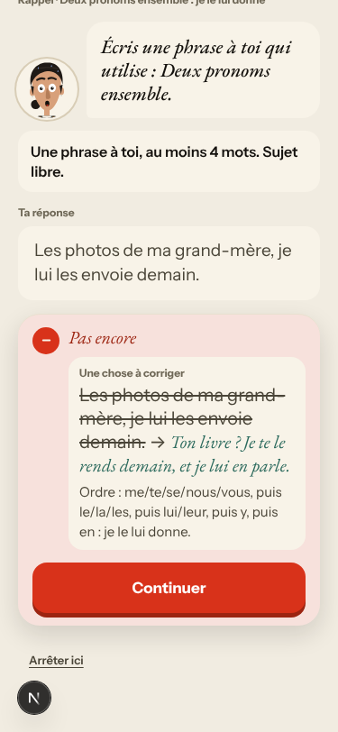

## Findings, by root cause

Three new findings (#624–#626), new evidence on #596, #595, #447, #443, #196 and #451, verifying comments on the closed #449 and #543, and child comments on #174 and #147. All new findings are `queue:ready` with a **Done when:** comment and linked as sub-issues of their root cause. No new root cause: #624 and #625 share #174's mechanism (a fix or a verdict from one stored string), #626 is #147's.

### #174 a right answer is judged against one stored string
- **#624 (new, medium)** Day 2 recall «Écris une phrase à toi qui utilise : Deux pronoms ensemble.» → «Les photos de ma grand-mère, je lui les envoie demain.» → «Pas encore · ~~…~~ → Ton livre ? Je te le rends demain, et je lui en parle.» The free sentence's `solution_fr` is the first model (`app/services/grammar_items.py:~990-1014`), and the miss path prints every miss as «learner → solution_fr». 
- **#625 (new, medium)** La Forge «Ta phrase · Tu as écrit ça plus tôt. Corrige l'erreur. *Je les lui donne.*» (day 1 item 3, day 2 item 4 as a review). It was wrong only against «Je leur les donne.»; the erratum keeps `original_text` and `correction` without the line it answered (`app/services/forge.py` `_mine_line` ~990-1035, `mine_payload_item` ~1042). 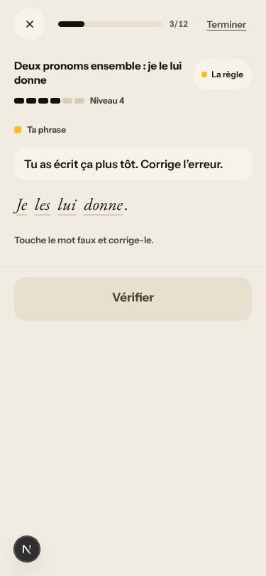 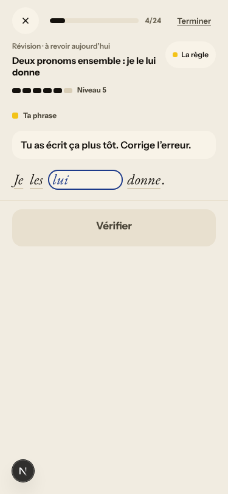
- **#595 (again, commented; PR #606 open)** «Je les lui donne.» for «Je leur les donne.»: whole sentence struck, the order rule as the reason. 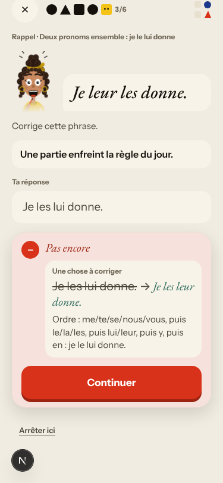

### #146 the day's content and feedback are not driven by one concept
- **#596 (again, commented, `queue:ready`)** The judge path still falls back to the card: «Il me en a parlé.» picked «Correcte» → «✗ Je lui le donne. → ✓ Je le lui donne.». Done when extended to the judge path. 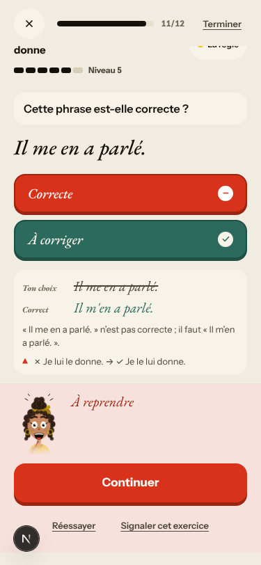
- **#447 (again, commented; PR #460 open)** Day 2's «Pour, sans, avant de» séance has «Il habite à cette rue.», «chez Marie», «parler de ce projet»; one raised the level 4 → 5, the «parler de» miss is explained with the infinitive rule, and the end sheet shows «Je vais chez Marie.» and «Il habite dans cette rue.» as the rule's proof under «Toujours en route». 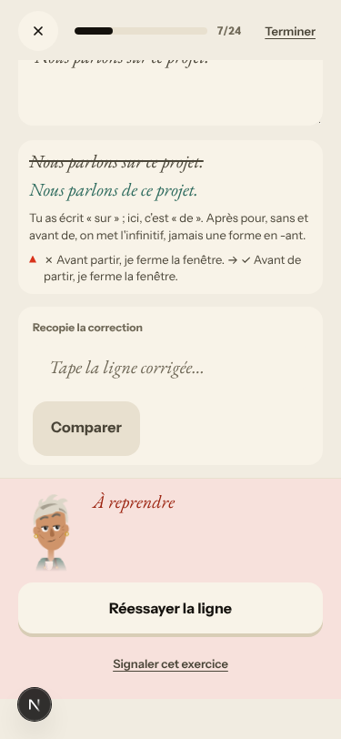 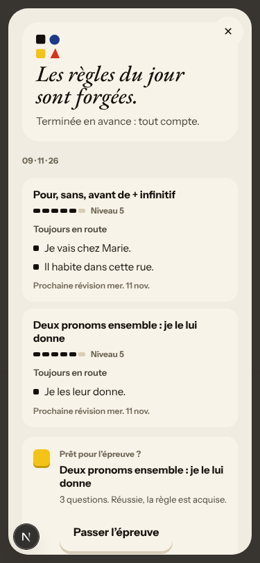
- **#448 (again, PR #460 open, not commented)** Word banks offer «prêters», «peuxs», «encores», «J'économises» and «autrement» in every bank. 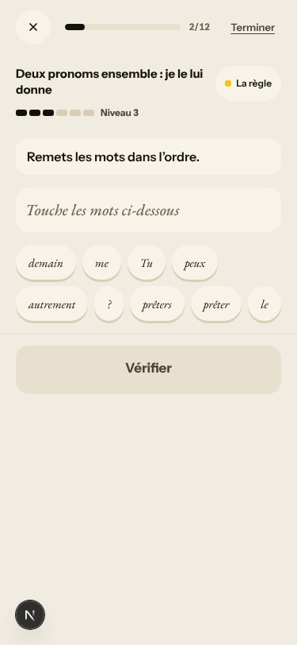

### #147 the cast is not one registry
- **#626 (new, medium)** Day 1 Courrier: «Trois questions de Romy · Salut ! C'est Romy, on s'est vus au Mistral.» Romy was not in the scene or the cast intro. The B1 `cast_first_letter` in `app/services/missions.py:~873-900` is picked by level and never asks `cast_registry.has_met`. 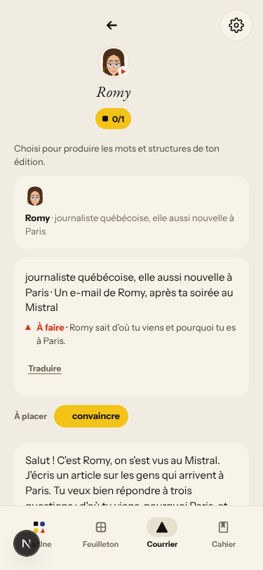
- **#594 (PR #604 open, not commented)** The scene header still says «Gus» while Margaux asks «Tu vas monter ?»; my tu reply to her got no vous correction tonight (no correction was shown in the scene on the fake stack).

### #333 a failed or empty model call is shown as a result
- **#590 (live; seen again on the fake stack, not commented)** Romy never answered; «Terminer» → «En partie · Romy reste neutre · Jeton frappé». 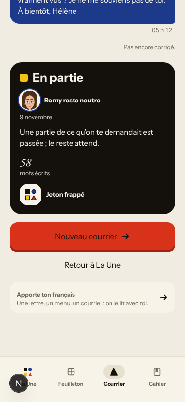

### #522 learner-facing text without a locale contract
- **#451 (again, commented, `queue:owner`)** Every Lexique card glosses in English in French chrome («convaincre · to convince»), and the scene words show English on the front («exactly», «to sell»). 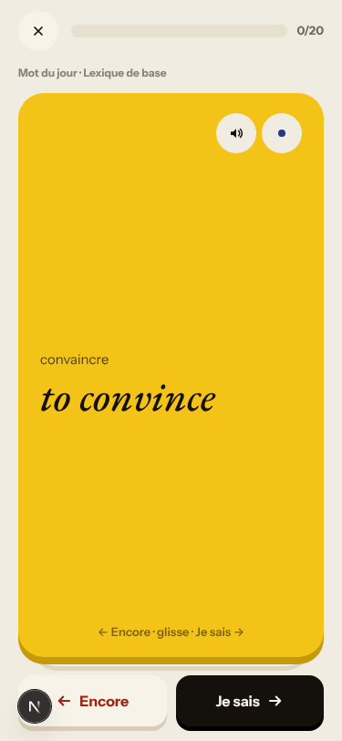
- **#196 (commented, `queue:owner`)** Vous left in French chrome: sign-up «Vos réponses… pour vous corriger», Courrier «Votre dépêche»; «Emploie visiblement la grammaire visée» reads as a translation.

### No shared cause, open PRs (not commented)
- **#469 (PR #476)** The first grammar recall drill opens with the coach mark «Les mots · De courts exercices». 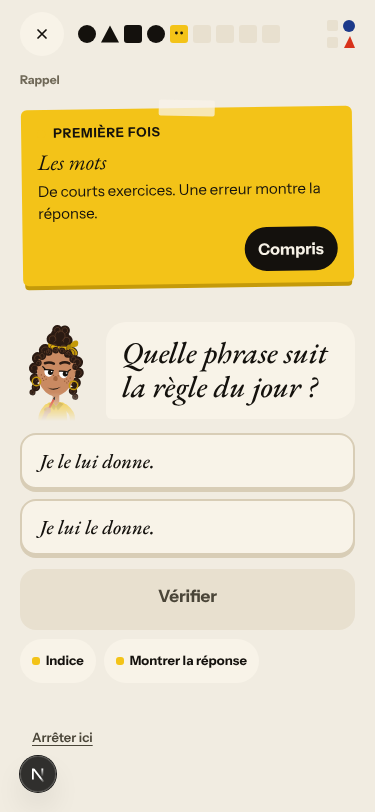
- **#597 (PR #605)** Day 2 «Précédemment : Deux clés, une seule porte. À suivre…».
- **#573** «luileur», «leen» in the text layer of find-the-mistake.
- **#577 (live)** Home day 2 «Nº 2 · La clé d'Odile» above the scene «La lettre». 

### Fake provider (left to the live walk)
- Fake: Margaux answers «Oui, je monte ce soir» with «Pas ce soir.»; Gus's «Qui êtes-vous ?» reply and my question «vous la connaissiez bien ?» get Lila's authored line; my day-2 «vous pouvez la me montrer ?» (the day-1 rule's own error) was not corrected in the scene; La Forge's free sentences «pas encore vérifiée», including «je lui le rends», the rule's textbook error; the Journal's basic check finds nothing in «m a», «j étais».
- Not filed: the browser clock stays on «Lundi 9 nov.» after `/clock +1` (harness, as on earlier nights). The B1 word deck is all «Lexique de base» with one scene word on day 2 («posséder»; #280, live, `queue:owner`).

## Re-tests

| issue | fix | result |
|---|---|---|
| (none) | #555, #609, #610, #612–#618 | no `walk-finding` referenced; nothing to re-test |
| #443 Forge on the day's rule | PR #602 (open) | holds on a day whose card introduces a rule (commented); the review-only-card case not reached |
| #449 miss names the slip | #481 (merged 7 Nov) | **holds in French chrome** for the transform path (verifying comment); the judge path is #596 |
| #452 French spacing | #481 | **holds**: «Ordre : …», «« le »» |
| #543 rewrite announced as rewrite | #546 | **fixed**: «Récris la phrase.» over «Je vois Marc demain.» (verifying comment) |
| #196 vous / English in French drills | (part) | La Forge prompt now French and tu; vous left on sign-up and Courrier (commented) |

Root causes: #174 (#624, #625 new children) and #147 (#626) got a comment; #146 advanced by evidence on #596 and #447. All keep open children, so none closes.

## Scripted walk

The last scheduled Browser walk on main failed (run 28, 8 Nov 09:03 UTC, on `76f69929`): all four jobs stopped at «Install backend» before the walk started, so it says nothing about the app. Main's CI for `d86ed4bb` (#618, run 982, attempt 2), including the 10-day season walk and the browser release checks, is green. On the 8 Nov live-walk report PR #593 tonight, «Walk · en + B1 × 3 days» failed once on a harness error (`Network.getResponseBody: No resource with given identifier`, B1 day 3) and was re-run.
