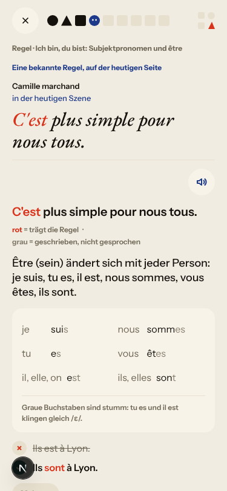
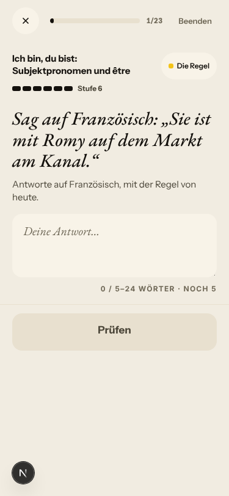
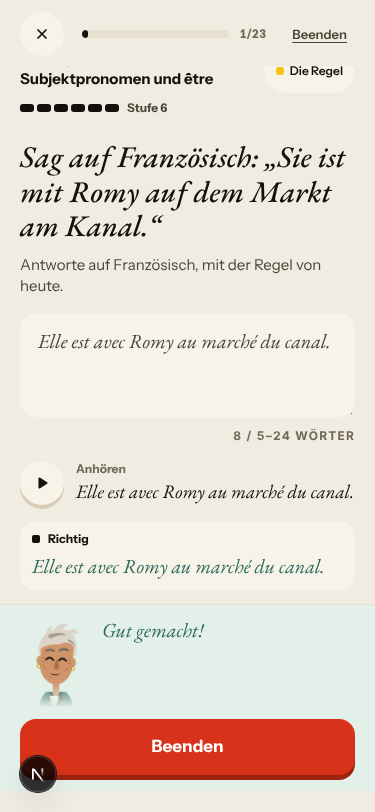
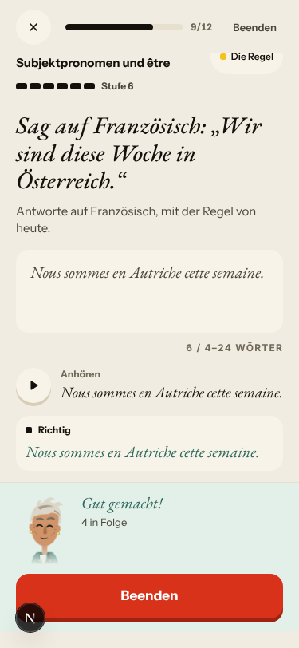
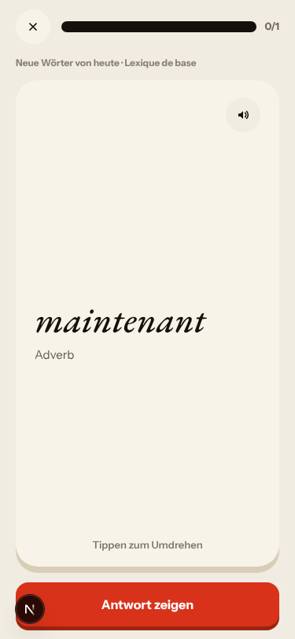
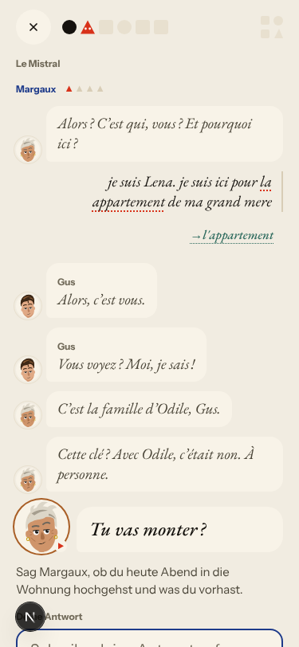
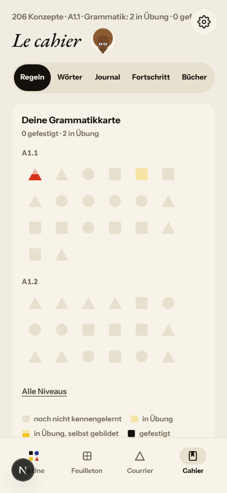
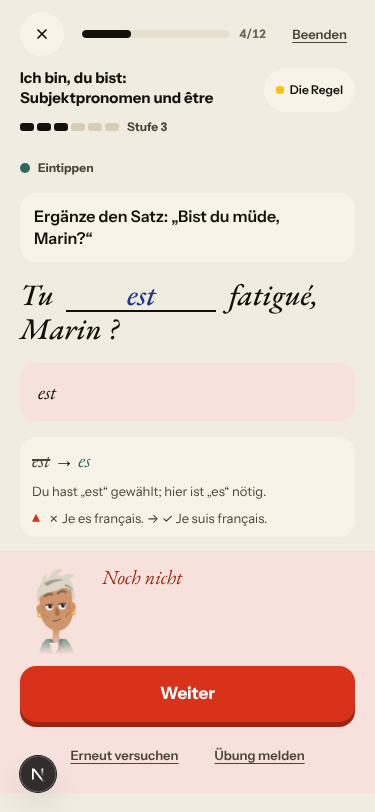
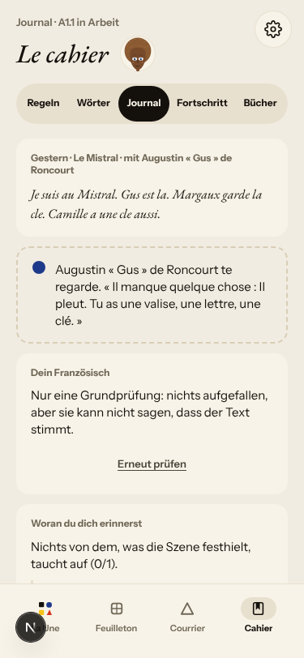

# Walk · 10 Nov 2026 · nightly explore walk

Main at `62603f99`. Since the 9 Nov walk (`d86ed4bb`), main moved through #627 (the 9 Nov report), #619 (Le Quartier forge: the roof over Le Mistral), #593 (the 8 Nov live walk), a night-shift workflow change (`5a94ce3f`, `13ccc000`), **#634**, which merged twelve night-shift fixes as one (#568 #564, #572 #470/#563, #588 #580, #602 #573 and #443, #604 #594, #605 #597, #566 #561, #586 #537/#575, #589 #536, #585 #471, #583 #559, #460 #447/#448) plus three batch commits (a German meaning that names the sex never accepts the other one; a gap that cannot be placed sends the line back to be retyped; the accent note keeps French spaces), and #663 (tonight's live walk report). Their issues were closed by the merge; this walk re-tested the code-lane ones it could reach. Tonight this walk also merged the 9 Nov live walk's report (#623, `f22e8da8`, docs only).
Fake story provider, local stack, Chromium at phone size, one persona: `a1-de-fresh` (`--fresh --native de`, even day; `b1-fr-chrome` ran 9 Nov). Signed up through the UI at A1 and answered as a German beginner: short replies, no accents, «la appartement» on purpose (to rebuild the 8 Nov review-only-card day), «c est qui ?» questions, wrong picks on purpose.
Day 1: teaser (one wrong pick), sign-up, character, onboarding, cast intro, scene «Le mauvais accueil» (two free replies, one choice: «Garde-la pour moi.»), the rule «Ich bin, du bist: Subjektpronomen und être», 3 recall drills (one miss, retried), La Forge 9 of 12 (judge miss, speed round 1/4 on purpose, a gap miss, one free sentence unchecked on the fake stack; the séance ended itself at 9/12), 20 words plus «Noch 5 neue Wörter» (one card), Done, Home, Courrier (one reply to Gus), Cahier, Feuilleton.
Day 2 (clock +1): Home, scene «La lettre» (two free replies with the same article slip, one choice), the être card as a review («Eine bekannte Regel, auf der heutigen Seite»), 6 recall drills (vocabulary, one miss), La Forge **1 of 23** on être (it ended itself), 22 words (5 due, 17 new), Done, Journal entry, Courrier (Camille's letter opened).

Live column: [live walk 10 Nov](../live-walks/2026-11-10.md) (#663, on main), production with the real model, release `ec60ae44` (#634 live), account on day 29. Headline: **Courrier is where it breaks**: Camille, a friend of three letters, answers a plain «non» with «On ne se connaît pas encore. Reformulez plus poliment, s'il vous plaît», asks for an address and invents a tracking number (#661); a second message got no reply and the letter still ended «Promise kept» (#590); the correction card contradicts its own note (#662). La Forge forged «être» at Level 6 while the pre-scene cards taught «Ne…pas» and adjectives, and ended after one item. Q9, Q10, Q11 and Q12 fell. It filed #661 and #662 and commented on #590, #114, #520, #591, #558, #500, #622, #576, #443, #577, #466 and #167. Its findings are not filed again here.

## Scores (rubric `docs/ops/walk-rubric.md`)

| # | question | 10 Nov a1-de (d1–2) | live 10 Nov | 08 Nov a1-de (d1–2) | 09 Nov b1-fr (d1–2) |
|---|---|---|---|---|---|
| 1 | Where am I | 3 | 3 | 4 | 4 |
| 2 | What is at stake | 4 | 3 | 4 | 4 |
| 3 | What to do next | 3 | 3 | 3 | 3 |
| 4 | Scene reacts to my writing | fake | 3 | fake | fake |
| 5 | Story coherent | 3 | 3 | 3 | 3 |
| 6 | Characters consistent | 3 | 2 | 3 | 3 |
| 7 | Image, text, tone fit | 4 | 4 | 4 | 4 |
| 8 | Difficulty fits | 3 | 4 | 3 | 3 |
| 9 | Feedback explained | 2 | 2 | 2 | 2 |
| 10 | Right answers accepted | 3 | 2 | 2 | 2 |
| 11 | French correct | 4 | 3 | 4 | 3 |
| 12 | Clear goal today | 4 | 2 | 2 | 4 |
| 13 | Grammar practised | 3 | 3 | 4 | 4 |
| 14 | Earlier material returns | 4 | 4 | 4 | 4 |
| 15 | I produce French | 4 | 5 | 4 | 4 |
| 16 | Errors, dead ends | 3 | 2 | 3 | 3 |
| 17 | Varied, fun | 3 | 4 | 3 | 3 |
| 18 | Fast enough | 4 | 3 | 4 | 4 |
| 19 | App only | n/a | n/a | n/a | n/a |
| 20 | Satisfying end | 3 | 3 | 3 | 3 |
| 21 | Would come back | 3 | 3 | 3 | 3 |
| 22 | Time vs promise | 2 | 3 | 3 | 3 |

The comparison columns are the last walk with the same persona (8 Nov) and last night's. Q14 is scored on day 2 only (n/a on day 1). The two 2s have their findings: Q9 (#596) and Q22 (#443, #563).

**Q12 up from 2 to 4: the owner's rule of 7 Nov held on the day that broke it on 8 Nov.** I slipped on the articles three times («la appartement» in both scenes and the Courrier; Cahier «Le, la, l', les · 2 Fehler»). Day 2's card only reviewed être. «Weiter: Grammatik» opened `/atelier?mode=forge&concept=1&from=day`, «La Forge · Regel des Tages schmieden» on **être**, the card's rule; the slip rule did not take the slot and did not appear at all. On 8 Nov the same day opened on «Le, la, l', les» Stufe 1. Day 1 (card introduces être) also opened on être.  
**Q22 down to 2, Q13 to 3: «5 Min.» of grammar was one item.** Day 2's séance on être (already Stufe 6) showed 1/23; after one right sentence the only button was «Beenden» and the sheet said «Früher beendet: alles zählt». Day 1's séance ended itself the same way at 9/12 once être reached Stufe 6. This is the live shape of 9 and 10 Nov (Level 6, only Finish), now reproduced on the fake stack (#443, back to `queue:ready`). On day 1, «Noch 5 neue Wörter · 2 Min.» dealt one card (#563, reopened).
**Q9 stays at 2.** A gap miss «Tu est fatigué» was answered «hier ist „es“ nötig» and then with the rule card's example «✗ Je es français. → ✓ Je suis français.», which crosses out the form it just asked for (#596, owner's verdict package). The speed round now explains every miss with the corrected sentence (#564 fixed).
**Q10 up from 2 to 3.** «il est vieux margaux» (no capitals, no comma) and «la letre» (typo) were accepted. The Journal still scored a correct retell («Margaux garde la clé. Camille a une clé aussi.») 0/1 against the opening narration (#622, seen on the fake stack).
**Q1 down to 3.** After my first reply the scene's header moved to Margaux, and Gus's opening question «Alors ? C'est qui, vous ?» was redrawn with Margaux's face and name (#664, new).
**Q8 stays at 3.** Être went from Stufe 2 to 6 in five right items on day 1, so day 2's séance had almost nothing left to serve.

## Findings, by root cause

Two new findings (#664, #665), two reopened (#561, #563), #443 back to `queue:ready` with its remaining half, new evidence on #596 and #622, verifying comments on the closed #564, #573, #471, #470, #594, #597, #559 and #580, a fake-stack check on #576, and child comments on #143 and #147. All new and reopened findings are `queue:ready` with a **Done when:** comment. No new root cause: #443's finish half and #563 share a mechanism (a count shown to the learner is computed apart from what the dealer can serve), which is #143's; noted there.

### #143 the day's progress has no single source of truth
- **#443 (re-test: rule half holds, finish half reproduced, `queue:ready`)** La Forge 1/23 then only «Beenden»; 9/12 on day 1. `ForgeService.next_item` (`app/services/forge.py` ~1547-1583) retires a track when the top-up (`~815-850`, excluding the 7-day `served_fingerprints`) finds nothing at the rung, and finishes the séance; the counter's length comes from the time budget.  
- **#563 (reopened, low)** «Noch 5 neue Wörter» → 0/1, then «Mit 30 Wörtern am Tag». #572 made the label, grant and goal line read `next_extra_step` (`app/services/vocabulary_pace.py:167`), but the deck deals fewer cards than that count. 

### #147 the cast is not one registry
- **#664 (new, medium)** Gus's opening question drawn as Margaux's after the header follows the next addressee (#604, `app/services/daily_journey.py` ~5624 `addressee_fields`): the thread reads the opening line's speaker from the prompt, not from the line. 

### #522 learner-facing text without a locale contract
- **#561 (reopened, medium)** La Forge's header and end sheet are German now; the Cahier rule list is not: `web-frontend/pages/grammar.tsx:349` and `:587` put `title_fr` first (and `GrammarMap.tsx:242` for the Éclair pair). 

### #146 / verdict package (owner, 9 Nov)
- **#596 (again, commented, `queue:owner`)** «hier ist „es“ nötig» followed by «✗ Je es français.». 

### #145 the scene has no state of what the learner said
- **#622 (live; seen on the fake stack, commented)** Journal 0/1 on a correct retell; target «Il pleut. Tu as une valise, une lettre, une clé.». 

### No named root cause
- **#665 (new, medium)** The nightly Browser walk's season job fails `miss-action-above-the-sheet` (2 px under the sheet, season-en A2.1 day 8). Related to #319.

### Open PRs and owner items seen again (not commented)
- **#469 (PR #476)** The first grammar recall drill opens with «Die Wörter · Kurze Wortübungen».
- **#473** The day-2 rule card names «Camille marchand» and prints her line twice.
- **#577 (live)** Home day 2 «Nº 2 · La clé d'Odile» above the scene «La lettre».
- **#590 (live)** Gus's day-1 Courrier letter got no answer on the fake stack and closed «Teilweise».

### Fake provider (left to the live walk)
- Fake: Margaux answers my question «c est qui, Solvel ?» with «C'est bien. Attends un peu.»; Camille answers my «non, je vend pas» with «"Pas encore" ? Mon grand-père n'aime pas attendre.»; «je vend», «grand mere», «vous etes sur» were not corrected in the scene (only the article was); both Courrier letters are the same stock text («Je pense encore à notre dernière rencontre. Et vous, qu'en pensez-vous ?»); a La Forge free sentence «Margaux, ils est en suisse cette semaine» was «noch nicht geprüft».
- Not filed: the browser clock stays on «Dienstag, 10. Nov.» after `/clock +1` (harness). The teaser shows Margaux's next line above the old answer buttons after the right pick (cosmetic). Day 1's end sheet says «Die Regeln von heute sind geschmiedet.» for one rule.

## Re-tests

| issue | fix | result |
|---|---|---|
| #443 Forge on the day's rule | #602, #583 (via #634) | **rule half holds** on an introducing day and on a review-only card day (owner rule of 7 Nov); **finish half reproduced** on the fake stack: back to `queue:ready` |
| #576 one day, two rules | #602 | holds for the one-card review day on the fake stack; the live two-card day stays with the live walk (commented, `queue:pr`, PR #587 open) |
| #564 speed-round miss | #568 | **fixed** (verifying comment) |
| #573 find-the-mistake glued words | #602 | **fixed** («êtes ersetzt durch sommes») |
| #471 level raised on an unchecked answer | #585 | **fixed**: a right lower-case sentence accepted; an unchecked one left the level alone |
| #470 Home minutes | #572 | **fixed** («≈ 7 Min.» on card and plan) |
| #563 «Noch 5 neue Wörter» | #572 | **not fixed**: 0/1, «Mit 30 Wörtern»; reopened, `queue:ready` |
| #561 rule names in the learner's language | #566 | **half**: La Forge German, Cahier list French; reopened, `queue:ready` |
| #594 tu to Margaux corrected to vous | #604 | **fixed**; side effect #664 |
| #597 «Bisher» is the closing caption | #605 | **fixed** per its Done when (falls back to the episode title) |
| #559 Forge streak vs Home | #583 | holds («1 Tag in Folge» = chip 1) |
| #580 recall second direction | #588 | not reproduced |
| #536, #537, #575, #447, #448 | #589, #586, #460 | not reached (no possessives, no fallback set on the être rule); La Forge said tu throughout |

Root causes: #143 (two children back in the queue, shared sub-mechanism noted), #147 (#664 new child), #522 (#561 reopened), #146 and #145 advanced by evidence on #596 and #622. All keep open children, so none closes.

## Scripted walk

The last scheduled Browser walk on main, run 29 (9 Nov 09:52 UTC, `6f10d5cf`), no longer fails at «Install backend». Three jobs are green (en + B1, de, fr × 7 days); **«Walk · season × 10 days» failed one of 1663 checks**: `miss-action-above-the-sheet`, «Compare» bottom at 553 under a verdict sheet starting at 551 (season-en A2.1 day 8, field). Filed as #665. Run 30 (10 Nov) had not run when this report was written. The 3-day release checks on #623 tonight, including the season walk, were green.
