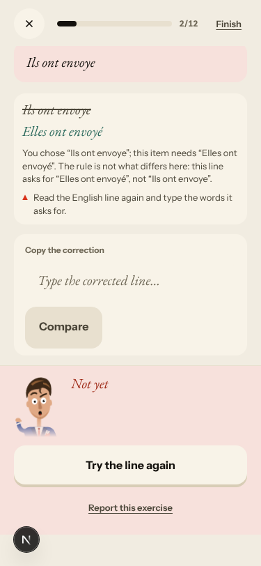
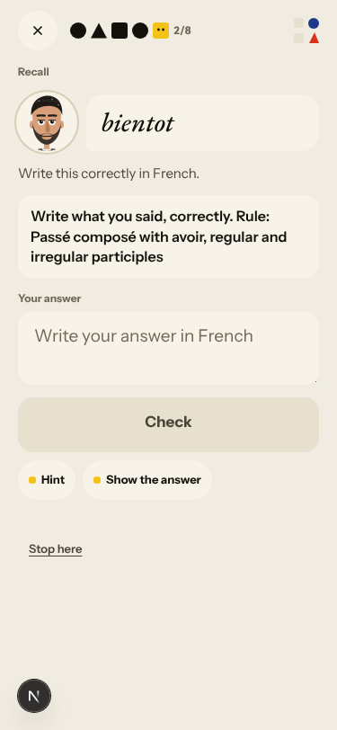
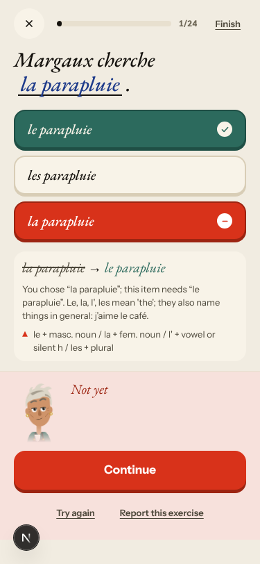
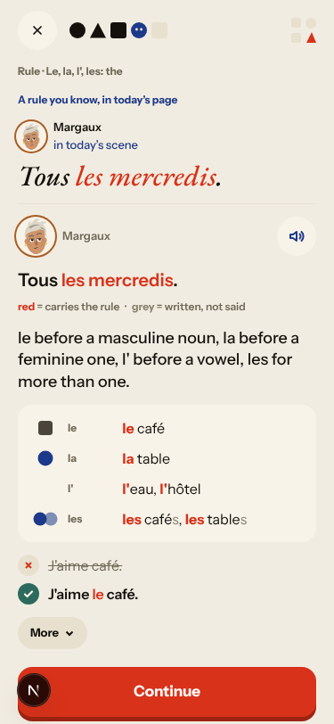
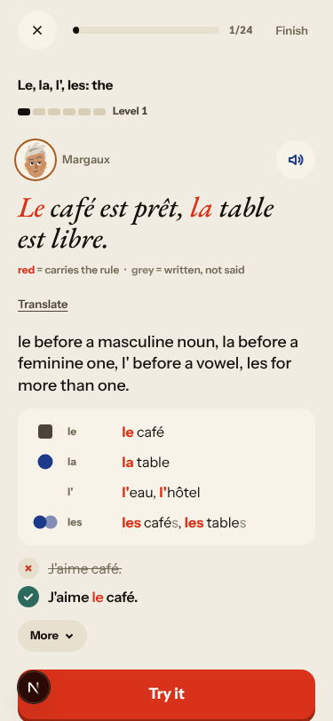
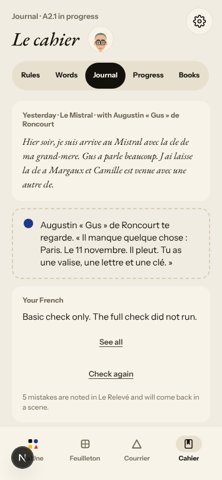
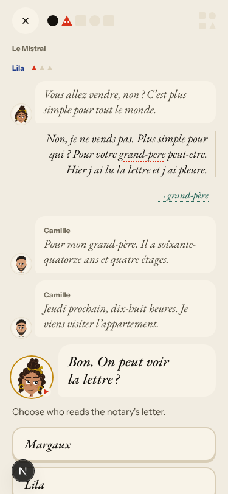
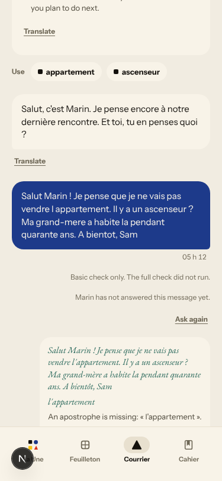
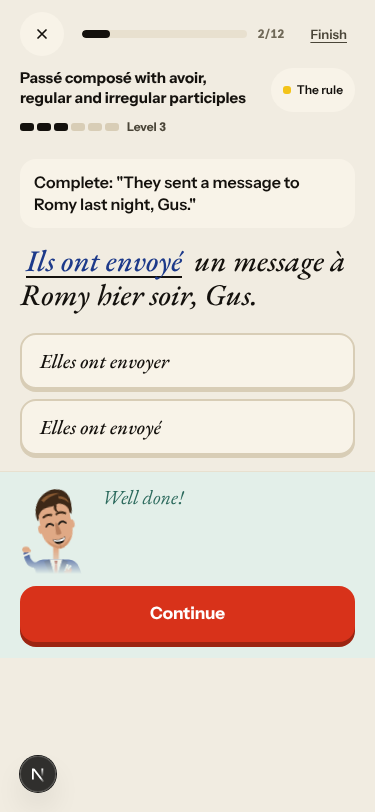

# Walk · 11 Nov 2026 · nightly explore walk

Main at `f0f41456`. Since the 10 Nov walk (`62603f99`), main moved through the 10 Nov report, five night-shift fixes (#674 → #563, #671 → #665, #668 → #561, #630 → #624, #584 → #579), **Package V stage 1 and 2** (#688: the verdict stack with the rule pass, valid spellings left alone, «Check again» limited per learner and day, cut-over migration `f2b4d6e8a0c1`; #689: one judge, the verdict ledger `verdict_records`, migration `a3c5e7f9b1d2`, a replay gate), S4/S5 work (#682, #683, #684, #685: mail outbox, rollover state, writer job), S6 (#679, #681), #680 (midnight in the learner's zone), the Quartier forge for Marin and Lila's flat (#692) and `walk.yml` (#687: a pull request plays one browser walk, not four). `alembic upgrade heads` ran cleanly on a scratch database before the walk (one head, `a3c5e7f9b1d2`), and again in the harness.
Fake story provider, local stack, Chromium at phone size, one persona: `a2-en` (`--fresh --native en --level A2.1`, odd day; `b1-fr-chrome` ran 9 Nov). Signed up through the UI at «I know some basics · A2» and played off-script: I am Odile's grandson, I will not sell, I sleep at the hotel tonight, «who is Solvel?», no accents.
Day 1: teaser (one wrong pick), sign-up, character, onboarding, cast intro, scene «Le mauvais accueil» (two free replies, one choice: «Garde-la pour moi.»), the rule «Passé composé with avoir», 8 recall drills (one order miss, repeated), La Forge 8 of 12 (an accent miss on a gap, a find-the-mistake with two fixes, four free sentences: two «Right», two «not checked yet» on the fake stack), 20 words plus «5 more new words», Done, Home, Courrier (one reply to Marin), Cahier, Journal (closed on day 1), Feuilleton.
Day 2 (clock +1): Home, scene «La lettre» (two free replies, one choice: «Personne»), the card «Le, la, l', les» as «A rule you know, in today's page», 8 recall drills, La Forge 9 of 24 (a gender miss on purpose, a correction, two «Review · due today» items on the passé composé, both unchecked), 23 words (3 due, 20 new), Done, Journal retell, Courrier (letter finished unanswered).

Live column: [live walk 11 Nov](../live-walks/2026-11-11.md) (PR #695, open), production with the real model, release `cbaedd4a` (before the verdict stack), account A1.1 on day 30. Headline: **Q9, Q10 and Q20 up by one; the Courrier still breaks**. A third message got no reply and «Ask again» did nothing (#693), Lila answered a «non» with a refund-desk line (#538), and the Done screen printed French in English chrome (#694). It filed #693 and #694 and commented on #538, #114, #558, #576, #443, #577, #500 and #381. Its findings are not filed again here. Yesterday's live report (#663) is already on main.

## Scores (rubric `docs/ops/walk-rubric.md`)

| # | question | 11 Nov a2-en (d1–2) | live 11 Nov | 07 Nov a2-en (d1–2) | 10 Nov a1-de (d1–2) |
|---|---|---|---|---|---|
| 1 | Where am I | 4 | 3 | 4 | 3 |
| 2 | What is at stake | 4 | 3 | 4 | 4 |
| 3 | What to do next | 3 | 3 | 3 | 3 |
| 4 | Scene reacts to my writing | fake | 3 | fake | fake |
| 5 | Story coherent | 3 | 3 | 3 | 3 |
| 6 | Characters consistent | 3 | 2 | 3 | 3 |
| 7 | Image, text, tone fit | 4 | 4 | 4 | 4 |
| 8 | Difficulty fits | 3 | 4 | 3 | 3 |
| 9 | Feedback explained | 2 | 3 | 3 | 2 |
| 10 | Right answers accepted | 3 | 3 | 2 | 3 |
| 11 | French correct | 4 | 3 | 4 | 4 |
| 12 | Clear goal today | 3 | 2 | 2 | 4 |
| 13 | Grammar practised | 3 | 3 | 3 | 3 |
| 14 | Earlier material returns | 4 | 4 | 4 | 4 |
| 15 | I produce French | 4 | 5 | 4 | 4 |
| 16 | Errors, dead ends | 3 | 2 | 3 | 3 |
| 17 | Varied, fun | 3 | 4 | 3 | 3 |
| 18 | Fast enough | 4 | 3 | 4 | 4 |
| 19 | App only | n/a | n/a | n/a | n/a |
| 20 | Satisfying end | 3 | 4 | 3 | 3 |
| 21 | Would come back | 3 | 3 | 3 | 3 |
| 22 | Time vs promise | 3 | 3 | 3 | 2 |

The comparison columns are the last walk with the same persona (7 Nov) and last night's. Q14 is scored on day 2 only (n/a on day 1). The one 2 (Q9) has its findings (#696, #697; #596 again).

**Q10 up from 2 to 3: the verdict stack accepts more right answers and never moves a level on an unread one.**
- Accepted: «Ce matin, on a fermé la valise.» for «we closed» («Right», Level 5 → 6), «J ai pris le train» on a correction item, «Ou est la lampe ?» («What changes: Ou → Où»), and a lower-case «les billets» on a gap.
- Left alone: the free sentences the fake stack cannot read («Hier, ils ont nager avec Romy.», «L ete dernier, vous avez trouve les cles.») said «Answer saved, not checked yet. It doesn't count yet.» and the level stayed at 6. On 7 Nov the same kind of answer raised it (#471, fixed). «Run again» now says «Second check started.».
- What keeps it at 3: one missing accent still gets three outcomes in one séance (#562, commented): «Not yet» on a gap, «Well done!» with the accent named on a correction, «not checked yet» on a free sentence that is the key sentence minus one accent.

**Q9 down from 3 to 2: the worst screen explained the wrong thing.** On the gap «They sent a message to Romy…» I typed «Ils ont envoye». The card said «this item needs “Elles ont envoyé”. The rule is not what differs here… Read the English line again». The English says «they»; on the retry «Ils ont envoyé» was «Well done!». The real slip, the -é of the day's rule, was never named, and the slip was saved as «Ils → Elles» (#696). Day 2's recall tagged my Courrier accent slip «bientot» with «Rule: Passé composé with avoir», and the right «bientôt» counted as a passé composé review (#697). «la parapluie» still never says the noun is masculine (#596). Good: «From “vraiment” on, the order is off.» on a reorder miss, and «Ou → Où».
**Q12 up from 2 to 3, and the owner's rule of 7 Nov.** Day 1 was clear: one A2 rule, its card, recall and La Forge. Day 2 had no planned rule (`introduction: null`). The only card was «Le, la, l', les» as «A rule you know, in today's page». La Forge opened on it as «Forge today's rule» at Level 1 for 24 items. Yesterday's rule, due today, got two «Review · due today» items and was left «due, untouched (due_target_cap_reached)» in the plan. **The owner's rule holds in its letter**: no planned rule lost its card, and the slip rule came with a review label. **In spirit it does not**: «Le, la, l', les» was never on a card for this learner. It was «introduced» by my one scene slip («de Odile»), because any evidence stamps `introduced_at`. So the page review calls it «a rule you know», and La Forge then calls it «today's rule» (#698). On 7 Nov the same day had no card at all.
**Q8 stays at 3.** An A1 article rule from Level 1 to 6 in six items, for an A2.1 learner whose A2 rule from yesterday was due.
**Q16 stays at 3.** On the fake stack the Courrier now never answers: «Marin has not answered this message yet», and two «Ask again» taps did nothing visible (live #693 on the fake stack, commented). After a retried typed gap, two choice cards I was never offered appeared under «Well done!», one of them «Elles ont envoyer» (#699).
**Q6 stays at 3.** After my first reply, the previous question is redrawn with the next speaker's name on both days: Gus's line as Margaux's, Camille's as Lila's (#664, PR #672 open; commented).
**The best of the night.**
- La Forge, the rule card, recall and every Cahier row now share one English rule name (#561 fixed for `en`).
- «5 more new words» dealt all five (#563 fixed).
- The day-1 deck put scene words with their scene line («vendre», «l'appartement», «la clé»).
- An unanswered letter ends «No answer… nothing is counted.», not «Promise kept» (#590 holds on the fake stack).
- «Find the mistake» reads «es replaced by as» (#573 holds).

## Findings, by root cause

Four new findings (#696–#699), all `queue:ready` with a **Done when:** comment. Repeats with new evidence commented: #595, #596, #625, #622, #562, #664 and live #693. No new root cause: #696 joins #174 (the same sub-mechanism as #625, a miss diffed against the stored key, and that diff saved as the slip). #697 joins #146 and #698 joins #143.

### #174 a right answer is judged against one stored string
- **#696 (new, medium)** La Forge fill item «They sent…» (key «Elles ont envoyé»): «Ils ont envoye» → «this item needs “Elles ont envoyé”. The rule is not what differs here…», then «Ils ont envoyé» is accepted on the retry. The erratum is stored as «Ils ont envoye → Elles ont envoyé». Cause: `app/services/atelier.py:6291-6324` diffs against the stored key (`slip_note(token_diff(learner, target))`, `_miss_outside_the_rule`), not against the closest accepted answer: #579's class, on the Forge fill path. 
- **#625 (owner, commented)** Tonight's #696 erratum is the same shape: a right «Ils» saved as an error, which will come back as «Ta phrase».
- **#595 (PR #606 open, commented)** Re-tested offline after the verdict stack: `judge_repair` still rejects even the fully correct «Nous sommes à l'hôtel avec Lila.» against part «sommes». #606 predates the one judge.
- **#562 (PR #606 open, commented)** One missing accent, three outcomes in one séance (see Q10).

### #146 the day's learning content and feedback are not driven by one concept
- **#697 (new, medium)** The Courrier's rule pass fixed «A bientot → A bientôt» (category spelling). The erratum got `concept_id` 39 (the letter's rule, passé composé), so day 2's recall read «bientot · … Rule: Passé composé with avoir». My right «bientôt» set `produced_independent` on the passé composé and moved its review from 12 to 15 Nov. Cause: `app/services/missions.py:4359-4362` falls back to `mission.selected_concept_ids[0]` for any erratum without an `external_id`. 
- **#596 (owner, commented)** «la parapluie → le parapluie» never says «parapluie» is masculine; the rule table is printed under it now. 

### #143 the day's progress has no single source of truth
- **#698 (new, medium)** A slip «introduces» a rule (`app/services/concept_life.py:151-156`: «First evidence on any surface introduces the unit»). The tentpole page review (`app/services/daily_journey.py:4958-4995`) takes any rule with `introduced_at < today` in the page's order, so «Le, la, l', les» became «A rule you know» and La Forge's «today's rule» at Level 1, while yesterday's card rule stayed due. Done when: «introduced» means a card was shown.  
- **#443 (not commented)** The finish half again: at Level 6 the only button is «Finish» (9/24 on day 2, 8/12 on day 1); the sheet says «Finished early: everything counts».

### #145 the scene has no state of what the learner said
- **#622 (live; commented: reproduced on the fake stack)** The Journal's retell target on day 2 is the scene's opening stage line «Paris. Le 11 novembre. Il pleut. Tu as une valise, une lettre et une clé.» (0/1), and Gus «quotes» it in the prompt. My retell named the key left with Margaux and Camille's second key. This is the `setup_fr` fallback, so the fix can be proven without the model. 

### #147 the cast is not one registry
- **#664 (PR #672 open, commented)** The previous question takes the next speaker's name on both days (Gus → Margaux, Camille → Lila). 

### #333 a failed or empty model call is shown as a result
- **#693 (live; commented: reproducible on the fake stack)** The fake provider's reply is the stock one, which `_character_reply_turn` drops. So every Courrier message stays «not answered yet», and «Ask again» returns `pending` with no visible change. 

### No named root cause
- **#699 (new, low)** After «Try the line again» on a typed gap, «Well done!» shows the item's choice cards, never offered, one of them «Elles ont envoyer». 

### Seen again, PRs open or owner's (not commented)
- #469 (PR #476): the first recall drill's first-time hint is still «The words · Quick word drills» under «Recall · Passé composé…». #473 (same PR): Marin's «Il a dit ça ?» printed twice on the rule card.
- #449 (PR #481): «You chose “Ils ont envoye”» and «You chose “la parapluie”» for answers, one of them typed.
- #280 (owner): the day-1 deck still pairs «sûrement / certainement» and «emmener / amener»; day 2's deck is about the flat.

### Fake provider (left to the live walk)
- My off-script replies got authored lines: «Mais qui est Solvel ?» was never answered, Camille announced «Je viens visiter l'appartement» after I said I would not sell, and the stub fixed one slip per reply («de Odile → d'Odile», «a → à», «grand-pere → grand-père», «cle → clé»).
- Free La Forge sentences outside the key variants were «not checked yet», «Ce matin, elles ont dansé avec Lila.» included.
- The Journal's basic check fixed five accents and apostrophes but printed «laisse la cle → laisse la clé», keeping the unaccented participle of the day-1 rule inside the fix. It is labelled «Basic check only», and the live walk judges the full check.
- Not filed: Done counts a retried item as an exercise (17 on day 1 for 8 recall + 8 La Forge items with one retry; 18 on day 2). The browser clock stays on «Wednesday 11 Nov» after `/clock +1`.

## Re-tests

| issue | fix | result |
|---|---|---|
| #563 «5 more new words» | #674 | **fixed**: 5/5 cards, «At 30 words a day» after 30 (comment, screenshot) |
| #561 one rule name in the learner's language | #668 | **fixed for `en`**: header, sheet, card, recall and Cahier agree; `de` covered by its guard, not walked (comment, screenshot) |
| #579 recall typo with a swapped article | #584 | guard passes on main after the judge; not reached in the browser (comment); same class open on La Forge as #696 |
| #624 «phrase à toi» miss fixed to the card's example | #630 | guard passes on main; B1 format, not reached (comment) |
| #665 miss action above the sheet (CI) | #671 | `miss-layout.test.mjs` passes; the next scheduled Browser walk on main has not run since the merge |
| #590 «Promise kept» with replies missing | #688 | holds on the fake stack («No answer… nothing is counted»); live re-test stays with the live walk |
| #471 level moved on an unchecked answer | #585 | holds: two unchecked sentences left Level 6 alone |
| #595, #596, #625, #622 (verdict-judge watch) | #688, #689 | **none fixed**: #595 still rejects the right sentence offline; #596 no gender reason; #625 same shape from La Forge (#696); #622 reproduced on the fake stack. All commented, labels unchanged |

Root causes: #174 (#696 new; #595, #625, #562 advanced), #146 (#697 new; #596 again), #143 (#698 new), #145 (#622 now provable on the fake stack), #147 (#664 again), #333 (#693 provable on the fake stack). All keep open children, so none closes.

## Scripted walk

The last scheduled Browser walk on main is run 30 (10 Nov 09:55 UTC, `05d4baf3`, before tonight's merges): **green**, all jobs. Tonight's scheduled run on `f0f41456` had not started when this report was written. #687 changes pull requests to one browser walk; the nightly schedule still plays all of them.
