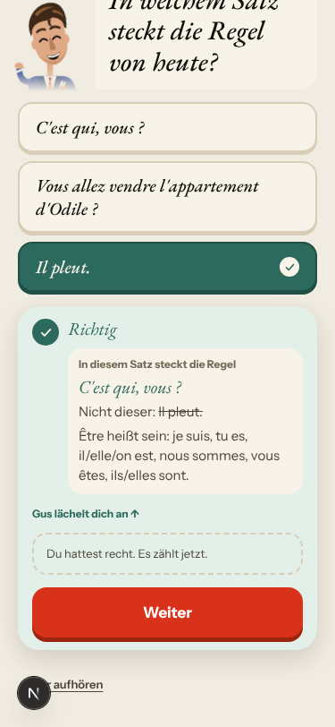
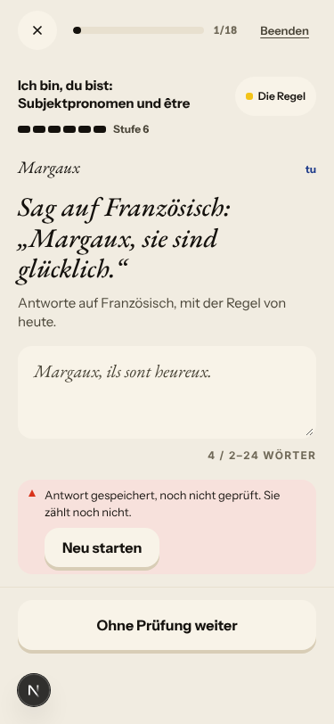
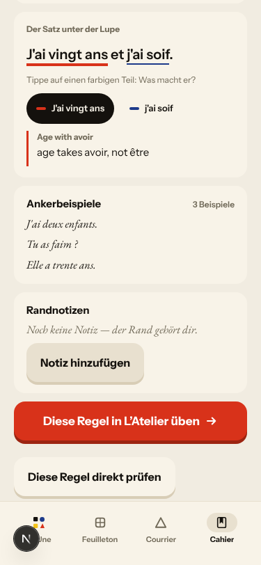
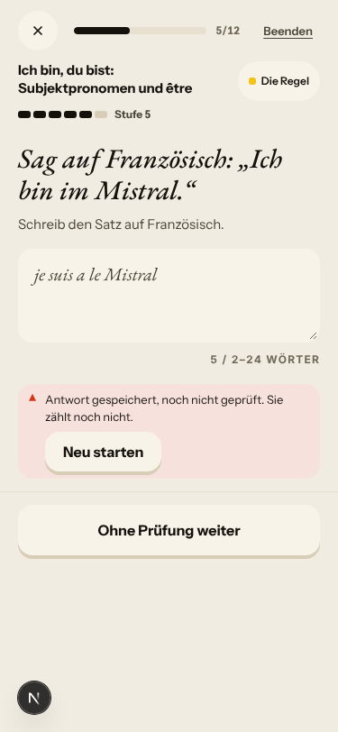
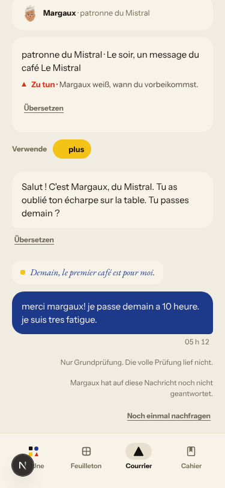
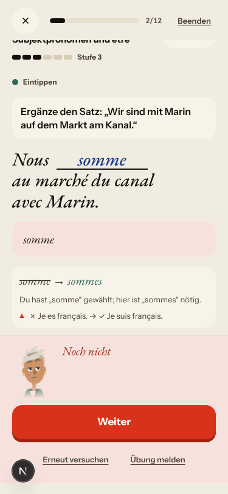
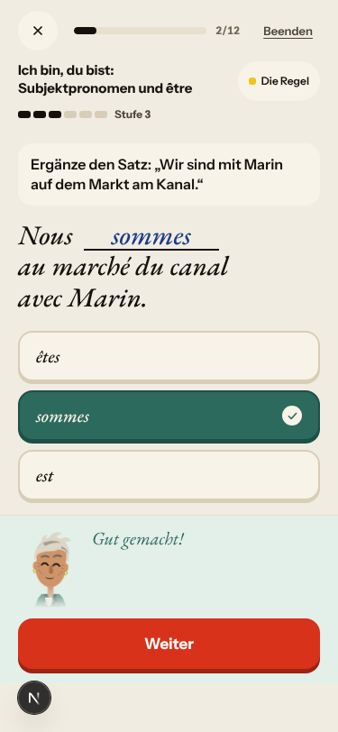

# Walk · 12 Nov 2026 · nightly explore walk

Main at `377db210`. Since the 11 Nov walk (`f0f41456`), main moved through the 11 Nov report (#700), **Package V stages 3 to 5** (#691: answers saved unread are checked later; #709: the memo of judged answers, migration `c5e7a9b1d3f4`; #711: the appeal «I think this is right», migration `d7f9b1c3e5a6`), **story truth** (#710: the scene record behind `STORY_SCENE_RECORD`, on in `render.yaml`, with the Courrier, cast, closing and Journal parts), the Courrier and scene fixes merged with it (#701 «Ask again» spinner, #702, #703, #706), browser-walk and CI changes (#690, #712, #713, #714, #716, #719, #720, #721: walks no longer hold the deploy), the Quartier forge (#722, La gérance Marchand) and the live reports of 11 Nov (#695) and 12 Nov (#726). No night-shift fix PR merged since the last walk. `alembic upgrade heads` ran cleanly on a scratch database before the walk (one head, `d7f9b1c3e5a6`), and again in the harness.
Fake story provider, local stack, Chromium at phone size, one persona: `a1-de-fresh` (`--fresh --native de`, odd day after `a2-en`). Signed up through the UI at «Neu im Französischen · A1» and played as a German beginner: short answers, no accents, «de Odile», «je veux vender l apartement», «c est qui camille?», «somme» for «sommes».
Day 1: teaser (one wrong pick), sign-up, character, onboarding, cast intro, scene «Le mauvais accueil» (two free replies, two choices: «Merci.», «Je la prends.»), the rule «Ich bin, du bist: Subjektpronomen und être», 3 rule drills (one miss, appealed), La Forge 8 of 12 (one gap miss, two free sentences «not checked», then «Beenden»), 20 words, Done, Home, Courrier (one reply to Margaux), Cahier (rule page, Journal closed), Feuilleton.
Day 2 (clock +1): Home, scene «La lettre» (one free reply, one choice: «Lila»), être as «Eine bekannte Regel», 7 word drills plus a scene-line rebuild and two repeats, La Forge 3 of 18 (two free sentences «not checked», one right), 18 words, Done, Journal retell, Courrier (letter closed), Cahier.

Live column: [live walk 12 Nov](../live-walks/2026-11-12.md) (PR #726, merged), production with the real model, release `950921607b45` (includes #710 and Package V), account A1.1 on day 31. Headline: **Q9 up, Q4 down to 2: three stock «Oh. …» scene replies; La Forge's free check never ran and «Run again» is dead (#724); a recall rebuild accepted «Im» (#723); the Courrier still never answers (#693)**. It filed #723, #724, #725 and commented on #693, #171, #622, #576, #694. Its findings are not filed again here.

## Scores (rubric `docs/ops/walk-rubric.md`)

| # | question | 12 Nov a1-de (d1–2) | live 12 Nov | 11 Nov a2-en (d1–2) | 10 Nov a1-de (d1–2) |
|---|---|---|---|---|---|
| 1 | Where am I | 4 | 3 | 4 | 3 |
| 2 | What is at stake | 4 | 3 | 4 | 4 |
| 3 | What to do next | 3 | 3 | 3 | 3 |
| 4 | Scene reacts to my writing | fake | 2 | fake | fake |
| 5 | Story coherent | 3 | 3 | 3 | 3 |
| 6 | Characters consistent | 4 | 2 | 3 | 3 |
| 7 | Image, text, tone fit | 4 | 4 | 4 | 4 |
| 8 | Difficulty fits | 3 | 4 | 3 | 3 |
| 9 | Feedback explained | 2 | 3 | 2 | 2 |
| 10 | Right answers accepted | 3 | 2 | 3 | 3 |
| 11 | French correct | 4 | 3 | 4 | 4 |
| 12 | Clear goal today | 3 | 2 | 3 | 4 |
| 13 | Grammar practised | 3 | 3 | 3 | 3 |
| 14 | Earlier material returns | 4 | 4 | 4 | 4 |
| 15 | I produce French | 4 | 5 | 4 | 4 |
| 16 | Errors, dead ends | 3 | 2 | 3 | 3 |
| 17 | Varied, fun | 3 | 4 | 3 | 3 |
| 18 | Fast enough | 4 | 3 | 4 | 4 |
| 19 | App only | n/a | n/a | n/a | n/a |
| 20 | Satisfying end | 3 | 3 | 3 | 3 |
| 21 | Would come back | 3 | 3 | 3 | 3 |
| 22 | Time vs promise | 3 | 3 | 3 | 2 |

The comparison columns are last night's walk and the last walk with this persona (10 Nov). Q14 is scored on day 2 only. The one 2 (Q9) has its findings (#729, #596 again).

**Q6 up from 3 to 4: a line keeps its speaker (#710).** After my first reply, Gus's opening question stays Gus's on day 1, Camille's stays Camille's on day 2 (#664 closed). What keeps it from 5 is fake-provider text: «Apartement ? Ah bon.» throws my misspelling back, Camille «Je viens voir l'appartement» after my «non».
**Q9 stays at 2: the first appeal walked contradicts its own card.** The rule drill «In welchem Satz steckt die Regel von heute?»: I picked «Il pleut.», «Noch nicht», tapped «Ich glaube, das ist richtig». The fake upheld it: «Richtig · Du hattest recht. Es zählt jetzt.», with «Nicht dieser: Il pleut.» still under it, and the item came back as «Noch einmal» (#729, new root cause #728 with #715). La Forge's «somme → sommes» explains with «✗ Je es français.», never «nous → sommes» (#596 again). Good: the word drill «„hier“ bedeutet „gestern“» and the rule card itself.
**Q10 stays at 3.** Right and checked: «Je suis intelligent.», «Il est occupé, Lila.», «Nous sommes avec Marin à la banque.» (the German word order, in the key). Left «nicht geprüft»: «Margaux, ils sont heureux.» for «Margaux, sie sind glücklich.», because the key only has the name last (#731), and «Je suis a la banque, Gus.», the key minus one accent (#562).
**Q12 at 3 (10 Nov a1-de: 4).** Day 1 is clear: one A1 rule (être), its card, three drills, La Forge on the same rule. Day 2 has no new rule; être returns as «Eine bekannte Regel», La Forge forges it again at Level 6 with free sentences only, and the words are the base list (`plus`, `très`, `quatre`, `cinq`; #280).
**Q16 stays at 3.** Two dead buttons, both known: La Forge's «Neu starten» does nothing on the fake stack now (#724, live, commented), and the Courrier's «Noch einmal nachfragen» after #701 still shows nothing (#693, commented).
**Q22 at 3 (10 Nov: 2).** Day 1 ran as promised in order (scene, rule, La Forge «etwa fünf Minuten», words); La Forge stops at Level 6 with only «Beenden» (8/12, 3/18; #443).
**The owner's rule of 7 Nov held, in letter and spirit.** No slip rule took «today's rule»: day 1 card and Forge were être; day 2's card was yesterday's être and La Forge forged être. The mechanism of #698 is still there: my scene slip «de Odile» put «Le, la, l', les» at «in Übung · 1 Fehler» in the Cahier without a card (commented on #698).
**The best of the night.**
- The rule drills open as «Die Regel im Einsatz», the card header reads «Regel» (#469 not reproduced, commented).
- The Journal's retell target follows the scene: «Du hast alles wiedergefunden … (2/2)» (#622 passes on the fake stack; live still fails).
- One A1 rule on day 1, at the learner's level, with the scene's own line «C'est qui, vous ?» on the card.
- The day-1 words include the scene's «l'appartement», «vendre», «la clé».

## Findings, by root cause

Three new findings (#729, #730, #731), all `queue:ready` with a **Done when:** comment, and one new root cause (#728). Repeats commented: #724, #693, #697, #596, #715 (now `queue:owner`). Re-tests commented: #622, #698, #469; #664 closed.

### #728 (new) an appeal is offered and settled by the verdict's outcome alone
Flaw: `appealOffered` (`web-frontend/components/atelier-v2/journey/journey-state.ts:385`) and `appealable` (`app/services/verdict_appeal.py:146`) look only at `not_yet` / `partly`, never at the item's format; and «upheld» turns only the verdict (`feedbackAfterAppeal`, `journey-state.ts:400`), not the reveal or the repeat queue. An upheld appeal also writes the memo. Two findings share it, so it is named; it needs the owner's decision on which formats can be appealed (#715 asked first). Done when includes a table test over every recall format.
- **#729 (new, medium)** Upheld appeal on a single-key choice: «Il pleut.» green and «Richtig», the reveal still «Nicht dieser: Il pleut.», then the same item as «Noch einmal». The fake upholds every appeal (`scripts/dev_story_engine_server.py:393`); the contradictory screen is the app's. 
- **#715 (browser walk, commented, now `queue:owner`)** A pairs drill offers the appeal and gets 404. Tonight a word drill («hier») offered it too.

### #174 a right answer is judged against one stored string
- **#731 (new, medium)** La Forge «Margaux, sie sind glücklich.»: keys «Ils sont heureux, Margaux.» / «Elles sont heureuses, Margaux.» only, so «Margaux, ils sont heureux.» is «nicht geprüft»; a moved place phrase is in the key («Nous sommes avec Marin à la banque.» right). 
- **#562 (PR open, not commented)** «Je suis a la banque, Gus.» (the key minus «à») unchecked.

### #522 learner-facing text from a stored field has no locale contract
- **#730 (new, medium)** The Cahier's «Der Satz unter der Lupe» shows «Subject verb · je takes suis» and «Age with avoir · age takes avoir, not être» under German chrome: the catalogue column `xray_marks` is English only, and `xrayRoleLabel` (`web-frontend/lib/rule-card.ts:189`) turns the key into English words. 

### #333 a failed or empty model call is shown as a result
- **#724 (live; commented: reproduced on the fake stack)** Four La Forge free sentences ended «Antwort gespeichert, noch nicht geprüft»; «Neu starten» does nothing (11 Nov it still said «Second check started»), and the German label reads as «restart the exercise». 
- **#693 (live; commented: not fixed by #701)** «Margaux hat auf diese Nachricht noch nicht geantwortet.»; «Noch einmal nachfragen» shows no spinner and no line. 

### #146 the day's learning content and feedback are not driven by one concept
- **#697 (commented)** The Courrier's «tres → très» is filed under être («Neue Fehler: « tres » → très, « somme » → sommes»).
- **#596 (owner, commented)** «somme → sommes» explained with «✗ Je es français. → ✓ Je suis français.», not with nous. 

### #143 the day's progress has no single source of truth
- **#698 (PR open, commented)** The owner's rule held; a slip still marks «Le, la, l', les» «in Übung» without a card.
- **#443 (PR open, not commented)** At Level 6 the only button is «Beenden» (8/12 on day 1, 3/18 on day 2).

### Seen again, PRs open (not commented)
- #699: after «Erneut versuchen» on the typed gap, «Gut gemacht!» shows the choice cards «êtes / sommes · richtig / est», never offered. 
- #449: «Du hast „somme“ gewählt» for a typed answer.
- #280 (owner): day 2's 12 new words are the base list («maintenant», «dernier», «quatre», «cinq», «être», «avoir»), one from the scene («la lettre»).

### Fake provider (left to the live walk)
- Scene replies echo my words as keywords: «Apartement ? Ah bon.» (my misspelling), «Oui. Camille, bien.», «Non, alors. Solvel : c'est noté.»; «Mais qui est Solvel ?» is never answered; the stub fixes one slip per reply («d'Odile», «c'est»), not «vender», «l apartement», «je ne vend».
- The Courrier's basic check fixed «à» and «très» but not «fatigue → fatigué» or «10 heure».
- Not filed: the Forge sheet and the browser keep «12 · 11 · 26» / «Donnerstag, 12. Nov.» after `/clock +1` (harness clock); the Journal tab reads «Heute gibt es nichts zu erzählen» right after day 2's retell, probably the same browser clock.

### For the owner (not filed)
- Day 2 at A1, Lila's line after «Avant Solvel, on visite l'appartement ? Toi et moi ?» is «Tu n'entres pas ? Je comprends.» (`app/data/season/s1/levels_a.json`, key `957dc126ff8b`), with no learner turn between: it says I refused. Its B2 form is the intended «En tout cas, pas comme ça.»; the A1 simplification changes the meaning. Is the A1 wording intended too?

## Re-tests

| issue | fix | result |
|---|---|---|
| #664 previous question redrawn under the next speaker | #710 | **fixed** on both days; closed with screenshot (PR #672 now redundant) |
| #693 Courrier «Ask again» does nothing | #701 | **not fixed** on the fake stack; commented, stays `queue:ready` |
| #622 Journal retell target is the setup line | #710 | passes on the fake stack (2/2); live still 0/1 (#726); commented, open |
| #698 / owner rule of 7 Nov | (none) | rule held; mechanism still there; commented |
| #469 rule drills introduced as «Die Wörter» | (unknown, PR #476 open) | not reproduced; commented, open |
| #443 La Forge opens on today's rule | (PR open) | day 1 and 2 opened on être; the «Beenden»-only half remains |

Root causes: #728 opened (#729, #715); #174 (#731), #522 (#730) advanced; #333 (#724, #693), #146 (#697, #596) and #143 (#698) seen again. None closes.

## Scripted walk

«Browser walk on main» (walk-main.yml, which no longer holds the deploy): run 2 on `95092160` **green**; run 3 on `5b3c603e` (tonight's live report) **failed** `no-english-on-french-b1` («Done for todayBack to La Une» on an en B1 day-1 Home), which filed #727 (`queue:ready`); run 4 on `377db210` was still running when this report was written.
