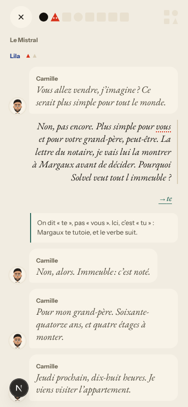
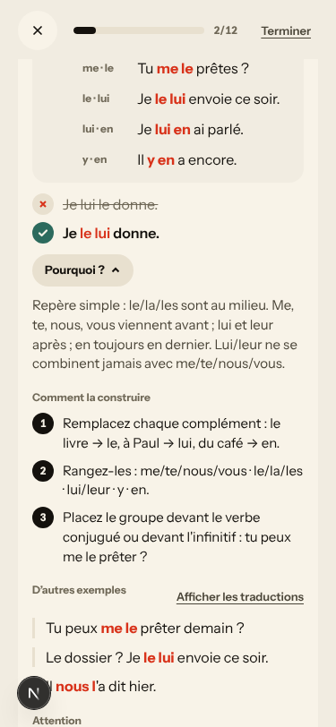
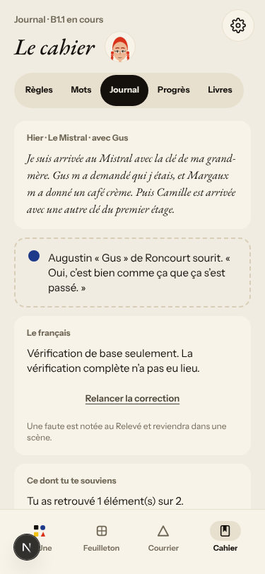
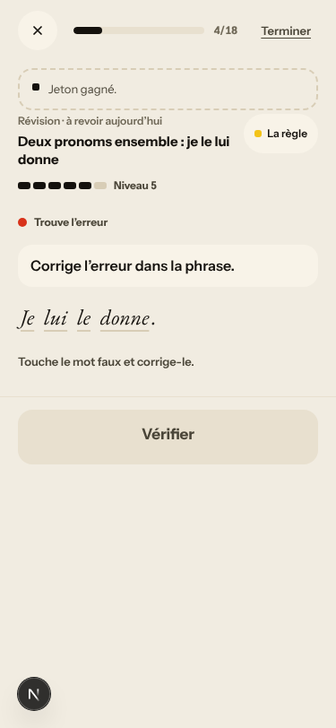
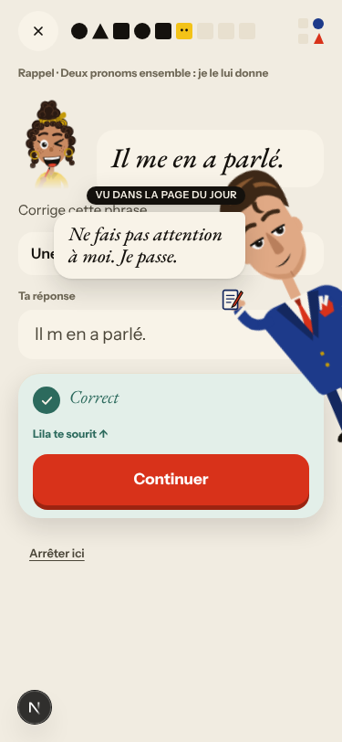
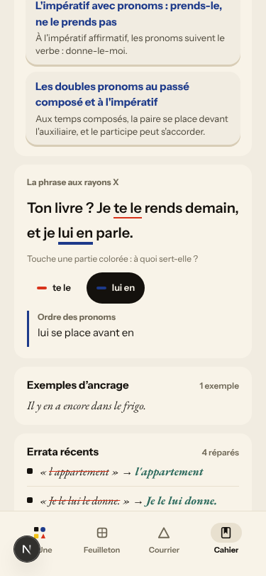
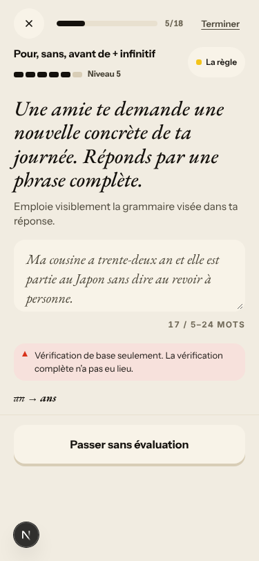
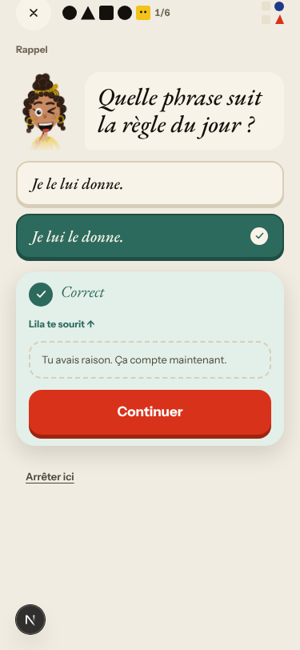

# Walk · 13 Nov 2026 · nightly explore walk

Main at `02ca9c46`. Since the 12 Nov walk (`377db210`), main moved through the 12 Nov report (#732), three night-shift fixes, **#735** (La Forge: an unread free sentence gets the rules' check, no dead retry, a name may stand first; fixes #724, #731), **#739** (an upheld appeal makes the item right everywhere; fixes #729) and **#742** (the Cahier x-ray box in German and French; fixes #730), the Quartier forge **#744** (La rue de Lancry) and tonight's live report **#751**. `alembic upgrade heads` ran cleanly on a scratch database before the walk (one head, `d7f9b1c3e5a6`), and again in the harness.
Fake story provider, local stack, Chromium at phone size, one persona: `b1-fr-chrome` (`--fresh --native fr --level B1.1`; last played 9 Nov). Signed up through the UI at «À l'aise au quotidien · B1» and played in French chrome, checking that nothing falls back to English or German, answering in B1 French with real slips («je suis venu» as a woman, «je vous le rends» for the key, «je vais lui la montrer», «l immeuble», «m a», «j étais») and some off-script lines (I refuse to sell, I give the letter to nobody).
Day 1: teaser, sign-up, character, onboarding, cast intro, scene «Le mauvais accueil» (two free replies, two choices: «Je n'ai rien commandé.», «Je la prends.»), the rule «Deux pronoms ensemble : je le lui donne», 6 recall drills (one appealed miss, one real miss retried), La Forge 12 of 12 (one free sentence, unavailable check), 20 words (2 «Encore»), Done, Home, Courrier (one reply to Lila), Cahier (fiche, x-ray, errata, Journal closed), Feuilleton.
Day 2 (clock +1): Home, scene «La lettre» (one off-script reply, one choice: «Personne»), the rule «Pour, sans, avant de + infinitif», 5 recall drills (one miss retried, one free sentence on day 1's rule), La Forge 12 of 18 (two free sentences with the basic check, day 1's rule as «Révision», then «Arrêter ici ?»), 22 words (2 due, 20 new), Done, Journal retell, Courrier (Margaux's letter), Cahier (Progrès), Feuilleton.

Live column: [live walk 13 Nov](../live-walks/2026-11-13.md) (PR #751, merged), production with the real model, release `faa14974a939`, account A1.1 on day 32. Headline: **Q4 up to 4 (the scene and its recap carried an off-script parrot story), Q16 and Q20 up; but «l'oiseau» and «les oeufs» are rejected (#745, #746), Lila answers for Marin (#750), and a Courrier colleague nobody introduced uses vous (#747)**. It filed #745–#750 and commented on #171, #500, #167, #155, #694, #725, #723, #520. Its findings are not filed again here.

## Scores (rubric `docs/ops/walk-rubric.md`)

| # | question | 13 Nov b1-fr (d1–2) | live 13 Nov | 12 Nov a1-de (d1–2) | 09 Nov b1-fr (d1–2) |
|---|---|---|---|---|---|
| 1 | Where am I | 4 | 3 | 4 | 4 |
| 2 | What is at stake | 4 | 3 | 4 | 4 |
| 3 | What to do next | 3 | 3 | 3 | 3 |
| 4 | Scene reacts to my writing | fake | 4 | fake | fake |
| 5 | Story coherent | 3 | 3 | 3 | 3 |
| 6 | Characters consistent | 3 | 2 | 4 | 3 |
| 7 | Image, text, tone fit | 4 | 4 | 4 | 4 |
| 8 | Difficulty fits | 3 | 4 | 3 | 3 |
| 9 | Feedback explained | 2 | 3 | 2 | 2 |
| 10 | Right answers accepted | 3 | 2 | 3 | 2 |
| 11 | French correct | 4 | 3 | 4 | 3 |
| 12 | Clear goal today | 4 | 3 | 3 | 4 |
| 13 | Grammar practised | 4 | 3 | 3 | 4 |
| 14 | Earlier material returns | 4 | 4 | 4 | 4 |
| 15 | I produce French | 4 | 5 | 4 | 4 |
| 16 | Errors, dead ends | 3 | 3 | 3 | 3 |
| 17 | Varied, fun | 3 | 4 | 3 | 3 |
| 18 | Fast enough | 4 | 3 | 4 | 4 |
| 19 | App only | n/a | n/a | n/a | n/a |
| 20 | Satisfying end | 3 | 4 | 3 | 3 |
| 21 | Would come back | 3 | 3 | 3 | 3 |
| 22 | Time vs promise | 3 | 3 | 3 | 3 |

The comparison columns are last night's walk and the last walk with this persona (9 Nov). Q14 is scored on day 2 only. The one 2 (Q9) has its findings (#752, #596 and #595 again).

**Nothing fell back to German; English is still the fallback for every gloss (#451, owner).** Every screen of both days was French and tu, apart from three places: the word help («valise → suitcase»), the rule card's «Afficher les traductions» and the Lexique (English fronts «exactly», «to sell» for the scene words, «convaincre · to convince»). Vous remains in the sign-up consent line (#196) and, new tonight, in the rule cards' «Comment la construire» steps at A1, B1 and C1 (#753).
**Q9 stays at 2: the worst feedback of the night was the register check.** On day 2 Camille says «Vous allez vendre, j'imagine ?»; my «Plus simple pour vous» was «corrected» to «te» with «Ici, c'est « tu » : Margaux te tutoie», under a header that read «Lila» (#752, high). The drills' explanations still name the rule card's example rather than my slip: «Je les lui donne» (order right, «lui» for «leur») explained with the order rule (#595); «pour de gagner» explained with «on emploie l'infinitif»; «dit» for «dire» followed by «✗ Avant partir…» (#596). Good: «fenetre → fenêtre» named as the only change, and the free-sentence basic checks («an → ans», «avant → avant de», «j ai → j'ai»).
**Q10 up from 2 (9 Nov) to 3.** A partial answer («sans dire»), a curly apostrophe («m'en»), a missing accent with a note and a correct free sentence on day 1's rule («Les photos de ma grand-mère, je les lui montrerai demain.», #624 did not repeat) were all right. Still: «Ta phrase» served the correct «Je les lui donne.» as an error (#625), and «Il m en a parlé.» was plain «Correct» on an elision item (#562, commented).
**Q12 and Q13 at 4: one rule a day, practised, and the owner's rule of 7 Nov held.** Day 1: card, recall and La Forge on «Deux pronoms ensemble». Day 2: the card introduced «Pour, sans, avant de», La Forge forged it as «la règle du jour», and day 1's rule came only as «Révision · à revoir aujourd'hui» and as one recall free sentence. No slip rule took «today's rule»; my scene and Courrier slips put nothing «en route» in the Cahier (only the day's rule), so #698's mechanism did not fire either.
**Q16 stays at 3.** No 500, no blank screen. Two dead buttons on the fake stack: the Journal's «Relancer la correction» (#754, new) and the Courrier's «Demander à nouveau» (#693, owner).
**Q17 at 3.** La Forge reuses the card's four sentences: «Je lui le donne.» five times in two days, «Il me en a parlé.» four times, and the free prompt «Une amie te demande une nouvelle concrète de ta journée» twice in day 2's séance and once on day 1, on two different rules. Not filed: no rule says how often an item may repeat.
**Q6 down from 4 (12 Nov) to 3.** #752, and the fake's «Oui. Demain, bien. Pas ce soir.» to my «je monte ce soir».
**The best of the night.**
- All three night-shift fixes hold (re-tests below): the free sentence gets the rules' check, an upheld appeal leaves no reveal and no repeat, the x-ray box speaks French.
- One rule a day, at B1, with the scene's place and people; day 2 opens on «L'enjeu» and the scene's own question.
- The Courrier's basic check named both missing apostrophes («2 apostrophes»).
- The first Courrier letter came from Lila, who was in the scene (#626 not reproduced).

## Findings, by root cause

Four new findings (#752–#755), all `queue:ready` with a **Done when:** comment and linked as sub-issues of their root cause. No new root cause: each fits an open one. Repeats commented: #196, #451, #625, #697, #596, #562; #626 not reproduced. Re-tests commented: #724, #729, #730 (all hold).

### #147 the cast is not one registry
- **#752 (new, high)** Day 2, «La lettre», turn `b.turn1` to `camille_marchand` (vous): my «pour vous» corrected to «te», «Margaux te tutoie», header «Lila». The register check reads its addressee through `expected_counterpart_register` (`app/services/journey_conversation.py:2686`) → `addressee_of` (`app/services/season/runtime.py:948`); the page's other turn `b.key` is to Margaux (tu), and the fallback is the page's first speaker. #594 fixed day 1 only. 

### #522 learner-facing text from a stored field has no language contract
- **#753 (new, medium)** The French rule cards' «Comment la construire»: «Remplacez… Rangez-les… Placez…», «Vérifiez… Choisissez… Ajoutez…». Counted in `app/data/rule_cards/`: A1 29, B1 41, C1 47 step lines in vous; A2 and B2 none. 
- **#451 (owner, commented)** English glosses under French chrome: «suitcase», «Can you lend it to me tomorrow?», «exactly», «to convince».
- **#196 (owner, commented)** The sign-up consent line in vous (`web-frontend/lib/legal.ts:87`).

### #333 a failed or empty model call is shown as a result
- **#754 (new, medium)** Journal retell with «m a» ×2, «j étais»: «Vérification de base seulement», no correction shown, «Une faute est notée au Relevé», and «Relancer la correction» does nothing. `JournalTab.tsx:479-523` counts `errata_recorded` but draws only `correction.foreground`, and offers the retry without asking whether a model exists (La Forge stopped doing that in #735). 
- **#693 (owner, not commented)** «Lila/Margaux n'a pas encore répondu», «Demander à nouveau» shows nothing (the fake answers no letter; live answered every message tonight).

### #542 a drill's instruction is picked from the item's shape, not its task
- **#755 (new, low)** «Trouve l'erreur» on «Je lui le donne.», «Je leur les donne.», «Il me en a parlé.»: «Touche le mot faux» (one word) where the fix needs two edits. `fix_words` is set by `item_bank.py:3496` and `forge.py:1110` only, not where `forge_drills.py:473` picks the spot drill. 

### #174 a right answer is judged against one stored string
- **#625 (owner, commented)** «Ta phrase» asks me to correct «Je les lui donne.», a correct sentence.
- **#562 (PR open, commented)** «Il m en a parlé.» plain «Correct» on the elision item. 
- **#595 (PR open, not commented)** «Je les lui donne. → Je les leur donne.» explained with the order rule.

### #146 the day's content and feedback are not driven by one concept
- **#596 (owner, commented)** «dit» for «dire» followed by the card's «✗ Avant partir…»; «pour de gagner» explained with «l'infinitif».
- **#697 (commented)** The Courrier's «l appartement» is listed in the errata of «Deux pronoms ensemble». 

### Seen again, PRs open or owner (not commented)
- #577: Home day 2 «Nº 2 · La clé d'Odile» over the scene «La lettre».
- #466: both Done screens end on a statement («Deux clés, une seule porte», «Ton billet de retour est pour mercredi prochain»), no question.
- #280: day 1's words are «Lexique de base» adverbs («néanmoins», «toutefois», «notamment», «désormais», «aussitôt»); day 2 had «l'immeuble», «l'étage», «posséder» from the scene.

### Fake provider (left to the live walk)
- Scene replies echo keywords: «Vendre ? Ah bon.», «Non, alors. Immeuble : c'est noté.»; Margaux «Oui. Demain, bien. Pas ce soir.» after «je monte ce soir»; Lila «Sa petite… son petit…» after I said «petite-fille». My «je vous le rends» (la clé) got only the register fix, «je suis venu» (a woman) nothing.
- The Journal's recall target is the fake's stock line: «Tu as retrouvé 1 élément(s) sur 2 · Oui. Demain, bien. Pas ce soir.» (#622 family; on the fake stack the record holds the stub's reply).
- Not filed: Home and the Forge sheet keep «Vendredi 13 nov.» / «13 · 11 · 26» after `/clock +1` (harness clock).

### For the owner (not filed)
- The persona's premise: a learner with French chrome gets English glosses and «Aucune traduction disponible» on «Traduire». #451 has waited for a decision since 1 Nov (French definitions, no gloss, or English).

## Re-tests

| issue | fix | result |
|---|---|---|
| #724 La Forge free check «not checked yet», dead «Run again» | #735 | **holds** on the fake stack: «Vérification de base seulement · an → ans» (Done when's exact case), or «La vérification n'est pas disponible…» when the rules find nothing; no dead retry. Verifying comment on the closed issue.  |
| #729 upheld appeal keeps the miss reveal and repeats | #739 | **holds** in French chrome: «Correct · Tu avais raison. Ça compte maintenant.», no reveal, the item never came back. Verifying comment.  |
| #730 Cahier x-ray in English under de chrome | #742 | **holds** under fr chrome: «Ordre des pronoms · te se place avant le». German not walked. Verifying comment.  |
| #731 vocative name first unchecked | #735 | not reached (no vocative item tonight) |
| owner rule of 7 Nov (#698) | (none) | **held**: day 2's «règle du jour» was the new rule; day 1's came as «Révision» only; no slip rule marked «en route» |
| #626 unmet Romy's first letter | (none) | not reproduced (Lila, then Margaux); commented, left open |

Root causes advanced: #147 (#752), #522 (#753), #333 (#754), #542 (#755). None closes.

## Scripted walk

«Browser walk on main» (walk-main.yml): run 9 on `faa14974` **green**, run 10 on `02ca9c46` (tonight's main) **green**. The scheduled «Browser walk» (walk.yml) last ran on `baef0d4f` (12 Nov) **green**. #727 (`no-english-on-french-b1`, en B1 Home) did not fail again on these runs.
