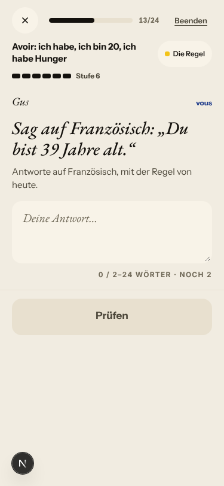
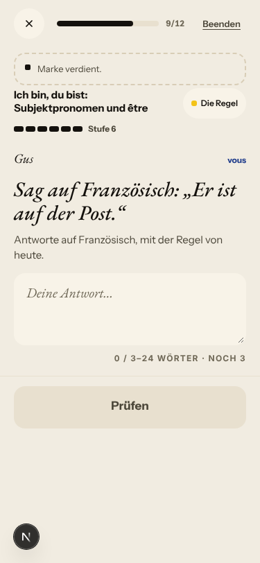
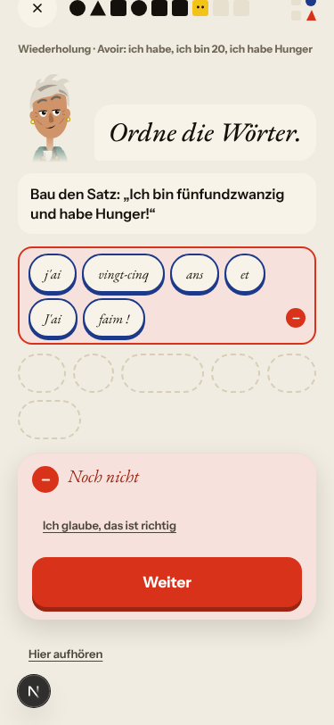
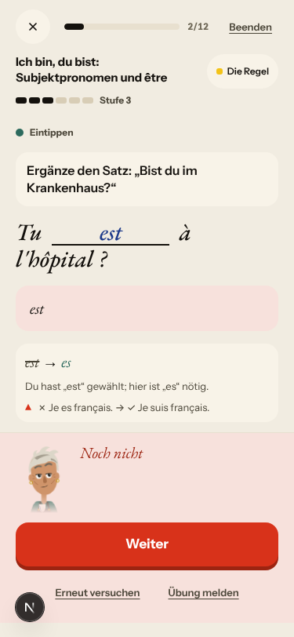
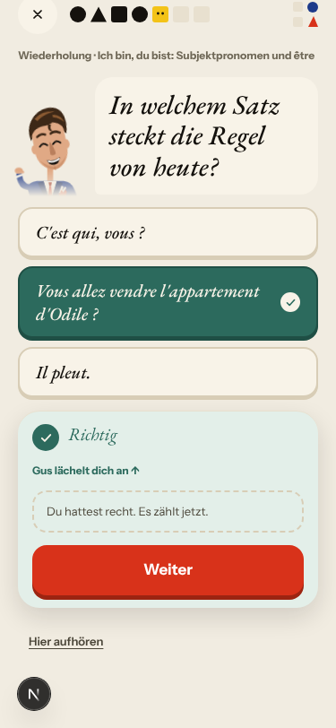
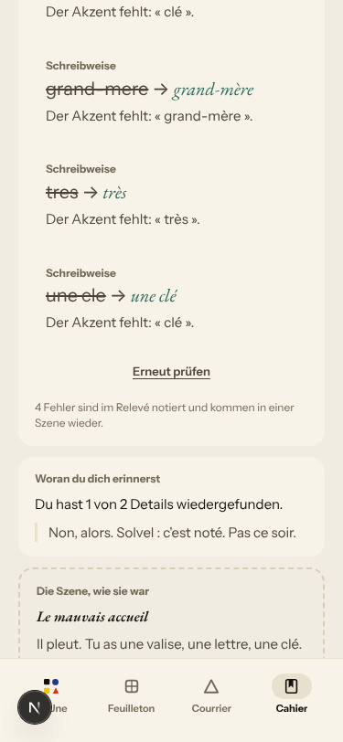
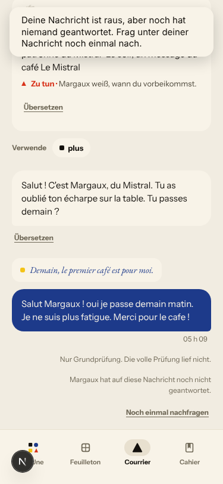
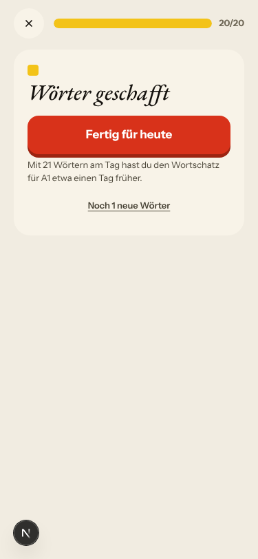
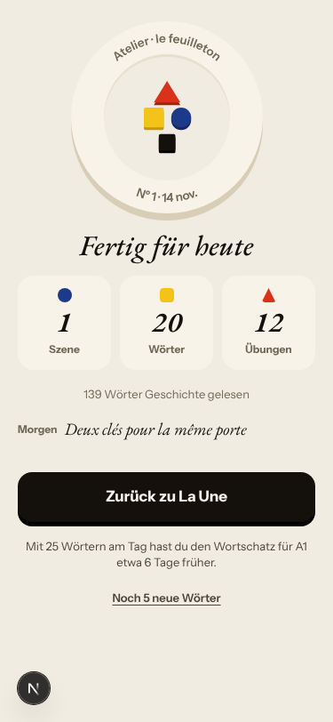
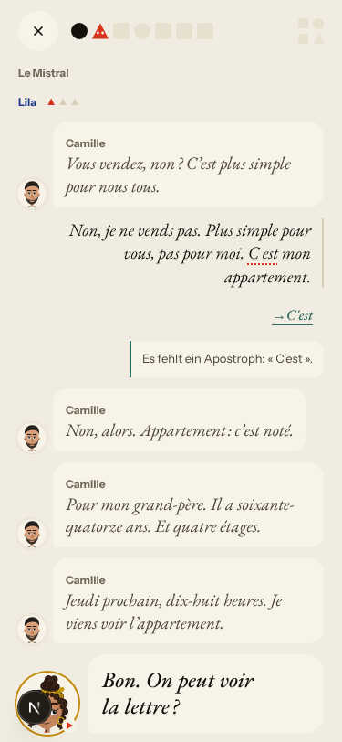

# Walk · 14 Nov 2026 · nightly explore walk

Main at `aeb060bc`. Since the 13 Nov walk (`02ca9c46`), main took in:
- the 13 Nov report (#756);
- four night-shift fixes: **#757** (a vous to someone who says vous is no longer corrected to «te»; fixes #752), **#762** (French rule cards in tu; fixes #753), **#765** (every «Trouve l'erreur» says how many words to touch; fixes #755) and **#760** (the line to say aloud never asks for a thing the learner refused; fixes #748);
- **#743** (no vocative in the «Say in French» build items, for #731);
- the Quartier forge **#766** and **#769**;
- tonight's live report **#778**, which also wrote TREND.md.

`alembic upgrade heads` ran cleanly on a scratch database before the walk (one head, `d7f9b1c3e5a6`).

Fake story provider, local stack, Chromium at phone size, one persona: `a1-de-fresh` (`--fresh --native de`; last played 12 Nov). I signed up through the UI at «Neu im Französischen · A1» and played in German chrome. I answered as a beginner with real slips («le petit fils de Odile», «le appartement», «c est», «Tu est», «elle est content», «Je suis trente-six ans», «j ai», «cle», «tres») and asked «c'est qui, Solvel ?» when lost.

Day 1:
- teaser (Margaux, «Un café, s'il vous plaît»), sign-up, character, onboarding, cast intro;
- scene «Le mauvais accueil»: two free replies, one choice («Garde-la pour moi.»);
- rule «Ich bin, du bist: Subjektpronomen und être», 2 recall drills (one miss, appealed);
- La Forge 9 of 12, ended early at Stufe 6;
- 20 words, Done, Home, Courrier (one reply to Margaux), Cahier (rules, Journal closed), Feuilleton.

Day 2 (clock +1):
- Home, scene «La lettre»: two free replies, one choice (Lila reads the letter);
- rule «Avoir», 5 recall drills (two misses, retried);
- La Forge 13 of 24: avoir as «Regel des Tages», être as «Wiederholung · heute fällig»;
- 20 words, Done, Journal retell, Courrier (Margaux's «Un mot»), Cahier (rules).

Live column: [live walk 14 Nov](../live-walks/2026-11-14.md) (PR #778, merged), production with the real model, release `fab6303a208d`, account A1.1 on day 33. Headline: **Q10 up to 4, Q16, Q12, Q13 up; Q4 down to 3 (the scene gave one exchange, #776) and Q9 down to 2 (a Forge note quotes words never written, #772; a recall note misses the elision, #774)**. It filed #772–#777 and commented on #622, #378, #694, #754, #747. Its findings are not filed again here.

## Scores (rubric `docs/ops/walk-rubric.md`)

| # | question | 14 Nov a1-de (d1–2) | live 14 Nov | 13 Nov b1-fr (d1–2) | 12 Nov a1-de (d1–2) |
|---|---|---|---|---|---|
| 1 | Where am I | 4 | 3 | 4 | 4 |
| 2 | What is at stake | 4 | 3 | 4 | 4 |
| 3 | What to do next | 3 | 3 | 3 | 3 |
| 4 | Scene reacts to my writing | fake | 3 | fake | fake |
| 5 | Story coherent | 3 | 3 | 3 | 3 |
| 6 | Characters consistent | 3 | 3 | 3 | 4 |
| 7 | Image, text, tone fit | 4 | 4 | 4 | 4 |
| 8 | Difficulty fits | 3 | 4 | 3 | 3 |
| 9 | Feedback explained | 2 | 2 | 2 | 2 |
| 10 | Right answers accepted | 3 | 4 | 3 | 3 |
| 11 | French correct | 4 | 3 | 4 | 4 |
| 12 | Clear goal today | 4 | 4 | 4 | 3 |
| 13 | Grammar practised | 4 | 4 | 4 | 3 |
| 14 | Earlier material returns | 4 | 4 | 4 | 4 |
| 15 | I produce French | 4 | 5 | 4 | 4 |
| 16 | Errors, dead ends | 3 | 4 | 3 | 3 |
| 17 | Varied, fun | 3 | 3 | 3 | 3 |
| 18 | Fast enough | 4 | 3 | 4 | 4 |
| 19 | App only | n/a | n/a | n/a | n/a |
| 20 | Satisfying end | 3 | 3 | 3 | 3 |
| 21 | Would come back | 3 | 3 | 3 | 3 |
| 22 | Time vs promise | 3 | 3 | 3 | 3 |

The comparison columns are last night's walk and the last walk with this persona (12 Nov). Q14 is scored on day 2 only. The one 2 (Q9) has its findings (#781, #596 again).

**Q12 and Q13 up from 3 (12 Nov) to 4. One rule a day, practised, and the owner's rule of 7 Nov held.**
- Day 1: the card, recall and La Forge were all on être.
- Day 2: the card introduced avoir, and La Forge forged it as «Regel des Tages». Day 1's être came only as «Wiederholung · heute fällig» (three items) and as a second block on the closing sheet.
- My scene slips («de Odile», «le appartement») put «Le, la, l', les» «in Übung · 2 Fehler» in the Cahier. It never took today's slot in the card, the recall or La Forge. Day 3 was not played, so whether it is picked as the next new rule was not seen (#698's mechanism).

**Q9 stays at 2: the explanations still come from the card, not from my slip.**
- «Tu est» was answered «hier ist „es" nötig», then the card's trap «✗ Je es français. → ✓ Je suis français.», which crosses out the form I was just told is right (#596).
- A tiles answer that differed only by the capital («j'ai vingt-cinq ans et J'ai faim !») got a bare «Noch nicht», with no reason and no right sentence (#781, new).
- Good: the free-sentence basic check named «Je suis → J'ai» on «Je suis trente-six ans», and «a → à», «bibliotheque → bibliothèque», «j ai → j'ai». The recall miss «Je suis vingt ans. → J'ai vingt ans.» came with the avoir explanation it needed.

**Q10 at 3.**
- Accepted: exact keys, a curly apostrophe («J'ai deux frères.»), a lowercase start in a typed gap («tu as»), and a «Finde den Fehler» fix.
- Not accepted: the capital-only tiles miss (#781).
- Sent to «nur Grundprüfung» instead of being matched to the key with a note: an accent-only difference against the key («Ils sont au theatre avec Lila.») (#562 family).

**Q6 at 3 (12 Nov: 4): the cast badge does not fit the task.**
- La Forge put plain «Sag auf Französisch» items under «Gus · vous». Gus never says a line, and «Du bist 39 Jahre alt.» is a tu task.
- Under the same badge, «Sie (alle) sind groß» is keyed only «Ils sont grands.» (#780, new).
- The fake's echoes as on every fake night: «Non, alors. Solvel : c'est noté.», «Oui. Plaît, bien.».
- The register itself held: no tu/vous slip in any German screen, and Camille's vous was not «corrected» (#752 re-test).

**Q8 at 3.** Day 1's séance went from Stufe 2 to 6 in nine items, five of them free translations in a row («Sag auf Französisch: „Sie ist zufrieden."» …). On the fake stack two of those «zählt nicht». Day 2 was gentler (gap, burst, typed gap, spot, then free).

**Q16 at 3.** No 500, no blank screen. Still:
- the Journal's «Erneut prüfen» does nothing (#754, commented);
- Margaux never answers on the fake stack (#693, owner);
- after «Senden» the Courrier keeps the sent text in the box (#782, new);
- the appeal is offered under every closed-choice miss, and on day 1 the fake upheld a wrong pick (#728, commented).

**Q20 at 3 (day 1), 4 on day 2.** Day 1's Done screen shows «Morgen · Deux clés pour la même porte», today's last panel and a statement (#466). Day 2 ends on a real question: «Et demain, qu'est-ce qu'on fait au Mistral ?».

**The best of the night.**
- The cast intro and «Wo du bist» on day 1, and «Worum es geht» on day 2. Day 2's scene picks up day 1's choice: «Bitte Margaux um den Schlüssel, den du bei ihr gelassen hast.»
- Day 1's words now include the scene's (l'appartement, vendre, la clé), and day 2's include la lettre (#280 is better at A1).
- The Journal's basic check now lists its errata under «Alle ansehen» (cle, grand-mere, tres).

## Findings, by root cause

Five new findings (#780–#784), all `queue:ready` with a **Done when:** comment. The three with a root cause are sub-issues of it (#147, #174, #522); #782 and #783 have no shared cause. No new root cause opened. Repeats commented: #596, #728, #754. Re-tests commented: #752, #753, #731 (all hold).

### #147 the cast is not one registry
- **#780 (new, medium)** La Forge free-use items:
  - 9/12 day 1: «Gus · vous» over «Sag auf Französisch: „Er ist auf der Post."»;
  - 13/24 day 2: over «„Du bist 39 Jahre alt."»;
  - 8/24 day 2: over «„Sie (alle) sind groß."», keys only «Ils sont grands.»/«Elles sont grandes.»;
  - the cue «Antworte auf Französisch, mit der Regel von heute.» also appears on the être review (12/24).

  Why: `_with_serial_conversation` (`app/api/v1/endpoints/atelier.py:298`) puts the beat's character on every plain conversation item. Its guard `item_problems` reads only a French prompt, so an English or German cue passes in any register. The cue comes from the round (`forge.conversation`, `app/services/item_bank.py:2576`), not from the task (#542).  

### #174 a right answer is judged against one stored string
- **#781 (new, medium)** Day 2 recall, avoir tiles with both `j'ai` and `J'ai`. My answer was right in words and order but had the lowercase tile first. It got «Noch nicht» with no note and no right sentence, and a Margaux pop-up («Zwei Fehler am Stück») covered the task (#155). The same day a typed gap took a lowercase «tu as» at the start of the sentence. 
- #562 (PR open, not commented): «theatre» (accent only, against the key) went to «Nur Grundprüfung … Ohne Prüfung weiter» instead of «right, with a note».

### #146 the day's content and feedback are not driven by one concept
- **#596 (owner, commented)** «Tu est» → «hier ist „es" nötig» followed by «✗ Je es français. → ✓ Je suis français.». The trap is the card's first, not the one about my slip. 

### #728 an appeal is settled by the verdict's outcome alone
- **#728 (owner, commented)** Day 1 recall «In welchem Satz steckt die Regel von heute?». The wrong pick «Vous allez vendre l'appartement d'Odile ?» was appealed and upheld by the fake stub: «Du hattest recht. Es zählt jetzt.». `appealable()` reads the outcome only. The item is also ambiguous: the rule says «Subjektpronomen und être» and the distractor has a subject pronoun. 

### #522 learner-facing text has no locale (and register) contract
- **#784 (new, low)** Found while re-testing #753: one French correction note is still in vous, `app/services/correction_contract.py:874` («gardez le même temps»). No guard covers the correction notes.

### #333 a failed or empty model call is shown as a result
- **#754 (queue:ready, commented)** The Journal retell now lists its four basic-check errata under «Alle ansehen», but «Erneut prüfen» still does nothing on the fake stack. 

### No shared cause
- **#782 (new, low)** Courrier: after «Senden» the reply box still holds the sent text and «Senden» stays on. 
- **#783 (new, low)** «Noch 1 neue Wörter» (and «Encore 1 nouveaux mots», «1 more new words»): `more_words(n)` in `web-frontend/lib/day-session.ts` has no singular. 

### Seen again, PRs open or owner (not commented)
- #577: Home day 2 «Nº 2 · La clé d'Odile» over the scene «La lettre».
- #466: day 1's Done «Morgen · Deux clés pour la même porte» (statement, today's last panel). 
- #384: «Sie (alle) sind 51 Jahre alt.» / «Sie (alle) sind in der Bibliothek.»: «you all» or «they».
- #155: a Margaux pop-up over the recall tiles after two misses.
- #699: after «Erneut versuchen» on a typed gap, «Gut gemacht!» shows three choice cards (est / suis / es).

### Fake provider (left to the live walk)
- Scene replies echo keywords: «Appartement ? Ah bon.», «Non, alors. Solvel : c'est noté.», «Oui. Plaît, bien.». My «c'est qui, Solvel ?» was not answered, and Camille comes to see the flat «jeudi prochain» after my «non».
- Free La Forge sentences that the rules find nothing in «zählen nicht» («elle est content», «elle est dans le Mistral», «Vous êtes grands.»).
- The Journal's recall target is the fake's own line: «Non, alors. Solvel : c'est noté. Pas ce soir.» (#622 family).
- Not filed: Home keeps «Samstag, 14. Nov.» after `/clock +1` (harness clock).

### Re-tests

| issue | fix | result |
|---|---|---|
| #752 vous to Camille corrected to «te» | #757 | **holds**: day 2 «La lettre», exchange 1 to Camille, «Plus simple pour vous, pas pour moi.» gets only «C'est», no register note, nothing stored; `tests/test_register_752.py` passes. Verifying comment.  |
| #753 French rule cards in vous | #762 | **holds in the data**: the guard passes, no vous imperative in `fr2_*.json`; French screen not walked (German chrome). One French vous line left outside the cards: #784. Verifying comment. |
| #731 vocative name first unchecked | #735, #743 | **holds where reachable**: none of 13 free «Sag auf Französisch» items had a vocative; the exact item was not served; its test passes. Verifying comment. |
| #755 «Trouve l'erreur» one-word hint on a two-word fix | #765 | not reached: both spot drills tonight («Il es» → est, «Tu a» → as) were one word, rightly «Tipp auf das falsche Wort»; the test passes |
| #748 line to say aloud after a refusal | #760 | not reached: neither fake scene showed the «line to say aloud» panel; the test passes |
| owner rule of 7 Nov (#698) | (none) | **held**: day 2's «Regel des Tages» was the new avoir; être only as «Wiederholung»; the slip rule «Le, la, l', les» is «in Übung» in the Cahier but took no slot |

Root causes advanced: #147 (#780), #174 (#781), #522 (#784). None closes.

## Scripted walk

«Browser walk on main» (walk-main.yml) is **red**:
- run 18 on `fab6303a` failed `day-plays-its-plan` in de, fr and en-B1 (the grammar step is played but the plan stays on «grammar», so the day never reaches /fertig), filed by CI as #770;
- run 19 on `aeb060bc` (tonight's main) failed too, and CI filed #779 (`miss-action-above-the-sheet`) beside #770 and #771 (`a-way-forward`).

The scheduled «Browser walk» (walk.yml) last ran on `6f411d5b` (13 Nov) and failed. In tonight's explore walk both days reached Fertig through «Früher beendet» and «Weiter: 20 Wörter», so the failure did not show in the hand-played path.
