# Walk · 15 Nov 2026 · nightly explore walk

Main at `6f07aff3`. Since the 14 Nov walk (`aeb060bc`), main took in:
- the 14 Nov report (#785);
- night-shift fixes **#786** (a plain «Say in French» item goes out with no character, and its cue never says «today's rule»; fixes #780), **#792** (the Courrier box empties after a send; fixes #782), **#796** (Journal: validated fixes only, no dead retry; fixes #754), **#798** (corrections quote only the learner's words; the week-later Journal answer is checked; #772, #622) and **#799** (a La Forge miss is explained by its slip, and the card never crosses out the right answer; fixes #596);
- **#801** (a La Forge line to a person the learner has met);
- tonight's live report **#806**, which also wrote TREND.md.

`alembic upgrade heads` ran cleanly on a scratch database before the walk (one head, `d7f9b1c3e5a6`).

Fake story provider, local stack, Chromium at phone size, one persona: `a2-en` (`--fresh --native en --level A2.1`; last played 11 Nov). I signed up through the UI at «I know some basics · A2» and played off-script on purpose:
- I am Sam, Odile's grandson, I do not work for M. Marchand, «who are you, and why does everyone talk about Solvel?»;
- I sleep at the hotel tonight, «were you friends with her, Margaux?»;
- day 2: I read the letter, I will not sell, I want to open a bookshop upstairs, «simpler for whom?»;
- in the Courrier: the scarf is not mine, maybe it is Gus's; to the internet company: I am not at home, give me my money back.

School-French slips throughout: no accents or apostrophes («j ai», «l ete», «c est a»), «tu as écrivé», «ils ont expliquer», «il a invite».

Day 1:
- teaser (Margaux, «Un café, s'il vous plaît»), sign-up, character, onboarding, cast intro;
- scene «Le mauvais accueil»: two free replies, one choice («Je la prends.»);
- rule «Passé composé with avoir, regular and irregular participles», 10 recall drills (two misses on purpose);
- La Forge 10 of 12, ended early at Level 6;
- 20 words, Done, Home, Courrier (one reply to Margaux), Cahier (rules, Journal closed), Feuilleton.

Day 2 (clock +1):
- Home, scene «La lettre»: one free reply, one choice (Gus reads the letter);
- the card «Le, la, l', les» as «A rule you know, in today's page», 8 recall drills;
- La Forge 8 of 24 on «Le, la, l', les» as «Forge today's rule» (Level 1 → 4), passé composé as «Review · due today»;
- 22 words, Done, Journal retell, Courrier (Assistance Fibre).

Day 7 not played.

Live column: [live walk 15 Nov](../live-walks/2026-11-15.md) (PR #806, merged), production with the real model, release `fe4f0db31f80`, account A1.1 on day 34. Headline: **Q9 up to 3; Q10 down to 2 («une» → «one» marked wrong, #804), Q5 and Q20 down to 2 (the closing panels ignore a «non» and bring in Marin, #558/#750; tomorrow's line is a statement, #466)**. It filed #804 and #805 and re-tested #443 (half fixed, back to queue:ready). Its findings are not filed again here.

## Scores (rubric `docs/ops/walk-rubric.md`)

| # | question | 15 Nov a2-en (d1–2) | live 15 Nov | 14 Nov a1-de (d1–2) | 11 Nov a2-en (d1–2) |
|---|---|---|---|---|---|
| 1 | Where am I | 4 | 3 | 4 | 4 |
| 2 | What is at stake | 4 | 3 | 4 | 4 |
| 3 | What to do next | 3 | 3 | 3 | 3 |
| 4 | Scene reacts to my writing | fake | 3 | fake | fake |
| 5 | Story coherent | 3 | 2 | 3 | 3 |
| 6 | Characters consistent | 3 | 3 | 3 | 3 |
| 7 | Image, text, tone fit | 4 | 4 | 4 | 4 |
| 8 | Difficulty fits | 3 | 4 | 3 | 3 |
| 9 | Feedback explained | 2 | 3 | 2 | 2 |
| 10 | Right answers accepted | 3 | 2 | 3 | 3 |
| 11 | French correct | 4 | 3 | 4 | 4 |
| 12 | Clear goal today | 3 | 4 | 4 | 3 |
| 13 | Grammar practised | 4 | 4 | 4 | 3 |
| 14 | Earlier material returns | 4 | 4 | 4 | 4 |
| 15 | I produce French | 4 | 5 | 4 | 4 |
| 16 | Errors, dead ends | 3 | 3 | 3 | 3 |
| 17 | Varied, fun | 3 | 3 | 3 | 3 |
| 18 | Fast enough | 4 | 3 | 4 | 4 |
| 19 | App only | n/a | n/a | n/a | n/a |
| 20 | Satisfying end | 3 | 2 | 3 | 3 |
| 21 | Would come back | 3 | 3 | 3 | 3 |
| 22 | Time vs promise | 3 | 3 | 3 | 3 |

The comparison columns are last night's walk and the last walk with this persona (11 Nov). Q14 is scored on day 2 only. The one 2 (Q9) has its findings (#807, #809, #810; #697 again).

**Q9 stays at 2: on a passé composé day the checks never name a participle.**
- With no model, every free sentence falls to the basic check. It listed every missing apostrophe and accent and **never the participle**: «il a invite», «ils ont expliquer» (the card's own trap, «j'ai manger»), «tu as appele», and in the Journal «je suis arrive», «m a demande», «m a donne» (#807, new).
- La Forge misses that #799 does not reach still get the card's text (#809, new): a judged «Margaux cherche la téléphone.» → «✗ J'aime café»; «tu as écrivé» → «-é/-i/-u», the regular rule that made the slip; «La bague est neuve.» → «Determiner choice», the article I had fixed.
- The Courrier's basic check prints a «corrected» reply that is still wrong in three places («pas a moi», «c est», «d écharpe»; #810, new).
- Day 2 recall «est a — Write what you said, correctly. Rule: Passé composé with avoir» for my Courrier accent slip (#697 again).
- Good: #799 works on the gap it was built for: «la restaurant» → ««restaurant» is masculine in French». Recall misses show the pair and a one-line reason («Most verbs say the past with avoir…» on «j'ai manger»; «feminine → un appartement»).

**Q10 at 3.**
- Accepted: «l'appareil photo» for «the camera», a lowercase unpunctuated «on cherche le carnet Lila», a curly apostrophe, «reservé» in a spot fix (with the right form shown).
- Rejected while right: the whole corrected line in «Copy the correction» after a typed-gap miss: only the gap's words pass, though the box asks for «the corrected line» (#808, new); «La bague est neuve.» (#809).
- Accepted while wrong, with no note: «l appareil photo» on the rule «l' before a vowel», then listed as a practised sentence in the séance summary; «j ai pris» in recall (#562 again, now with the apostrophe).

**Q12 at 3 (14 Nov: 4): the owner's rule of 7 Nov holds in its letter, not in its spirit (#698 again).**
- Day 1 was clear: one A2 rule (passé composé), its card, recall and La Forge.
- My first scene reply had «de Odile». The Cahier then showed «Le, la, l', les · practising · 1 mistake» with no card ever shown.
- Day 2 planned no new rule. The only card was that slip rule, as «A rule you know, in today's page». «Next: grammar» opened La Forge on it as «Forge today's rule», Level 1, 1/24, an A1 rule for an A2 learner. Yesterday's rule came only as «Review · due today».
- No planned rule lost its slot and the card is labelled a review, so the letter of the rule holds; La Forge's «today's rule» does not. The fix is PR #708, open since 12 Nov.

**Q13 up from 3 (11 Nov) to 4.** Both days practised a rule in La Forge with every item type (judge, gap, build, spot, free). Day 2's recall had no item on either rule apart from the mislabelled fragment.

**Q5, Q6 at 3 (fake provider).**
- The authored beats answered my off-script lines by keyword: «Solvel ? Bonne question.» (not answered), «Non, alors. Amies : c'est noté.», and Camille «Jeudi prochain … Je viens visiter l'appartement.» after my «non».
- «Plus simple pour qui ?» drew a fitting «Pour mon grand-père.».
- Day 2's last panel «Ton billet de retour est pour mercredi» ignores my «I want to stay and open a bookshop».
- Register held everywhere (Gus and Camille vous, Margaux and Lila tu).

**Q20 at 3.** Day 2's scene ends on a real question («Tu le gardes, tu le partages, ou tu le laisses partir ?»). Both Done screens show a statement as «Tomorrow» («Deux clés pour la même porte», «Ton billet de retour est pour mercredi», #466).

**The best of the night.**
- The A2 day 1 card took its example from the scene («Il a dit ça ?»), and La Forge climbed from Level 2 to 6 in ten varied items.
- Day 2's words were the scene's world: l'immeuble, l'étage, le loyer, le propriétaire, l'offre, l'escalier.
- The recall rebuilt my own wrong tile answer («dernier, elle travaillé à rédaction.») as «Write what you said, correctly.».

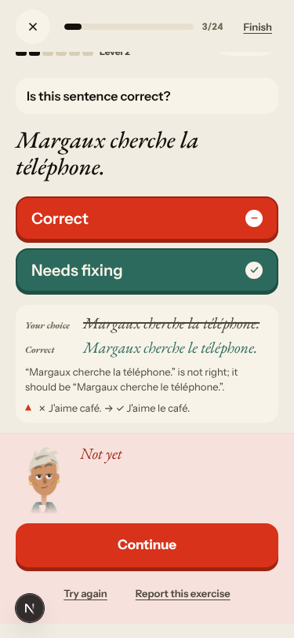

## Findings, by root cause

Four new findings (#807–#810), all `queue:ready` with a **Done when:** comment. #807 and #809 are sub-issues of #146, #808 of #174; #810 has no shared cause. No new root cause opened. Repeats commented: #697, #562, #698. Re-tests commented: #780, #782, #754, #596 (all hold).

### #146 the day's content and feedback are not driven by one concept
- **#807 (new, medium)** The basic check names no participle on a passé composé day. It lists every missing apostrophe and accent, and never these:
  - La Forge: «il a invite», «ils ont expliquer», «tu as appele»;
  - Journal: «je suis arrive», «m a demande», «m a donne».

  Why: `app/services/correction_contract.py`. `FR_ACCENT` only repairs non-words, and «invite», «donne», «expliquer» are valid forms. `_participle()` (line 1954) only *recognises* a participle; no rule reads «auxiliary + a verb form that is not a participle». 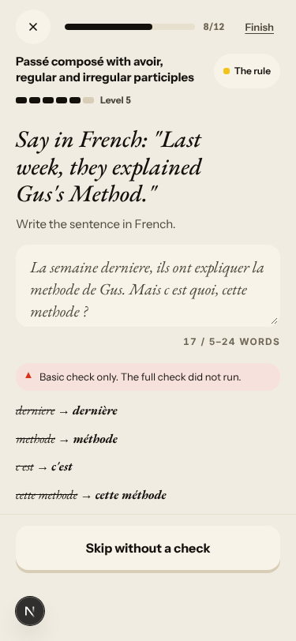 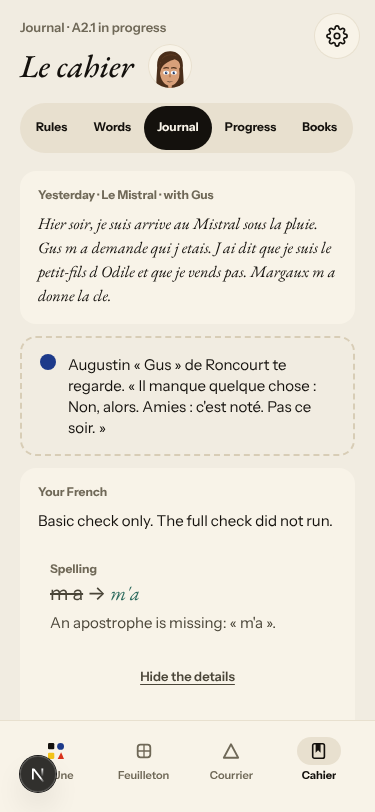
- **#809 (new, medium)** Three La Forge misses still fall back to the rule card after #799:
  - the judged «Margaux cherche la téléphone.» → «✗ J'aime café»;
  - «tu as écrivé» → «Most verbs … -é/-i/-u»;
  - «La bague est neuve.» → «Determiner choice».

  Why: `slip_kind` (`app/services/forge_grading.py:252`) has no participle kind. On a judge item it is fed the label «Correct», not the sentence, so `authored_repair` (`app/services/grammar_feedback.py:250-262`) returns the card's first trap.  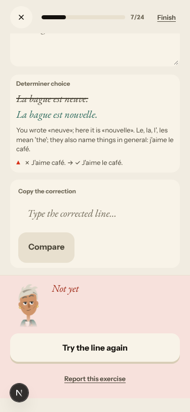
- **#697 (owner, commented)** My Courrier accent slip «est a» came back in day 2 recall labelled «Rule: Passé composé with avoir». 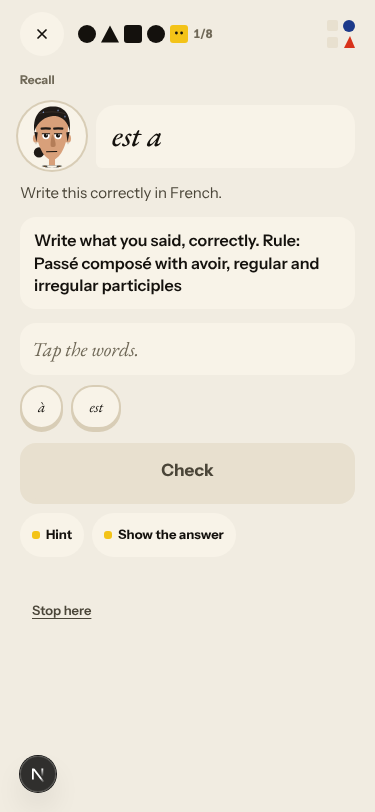

### #174 a right answer is judged against one stored string
- **#808 (new, medium)** «Copy the correction» after a typed-gap miss says «Type the corrected line…». It rejects «L'été dernier, tu as écrit un article.» three times with no reason and takes only «tu as écrit». Why: `web-frontend/pages/atelier.tsx:4372` compares with `issue.corrected_target`, the gap's answer, and the placeholder is one string for every item kind. 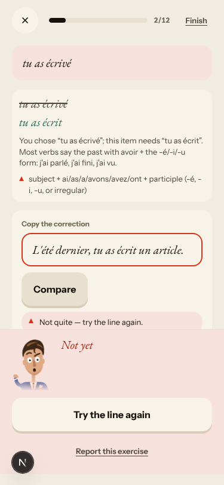
- **#562 (PR open, commented)** «l appareil photo» was a plain «Right» on the rule «l' before a vowel», and the summary lists «Où est l appareil photo, Margaux ?» as practised. 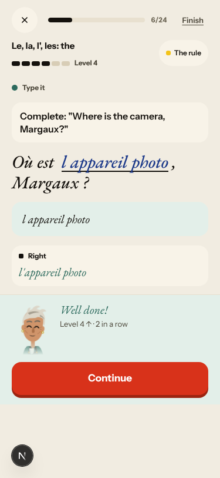 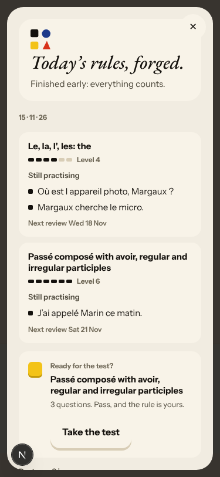

### #143 the day's progress has no single source of truth
- **#698 (PR #708 open, commented)** The slip rule «Le, la, l', les» became day 2's «A rule you know» and La Forge's «today's rule» at Level 1 (the owner's rule of 7 Nov, see Q12). 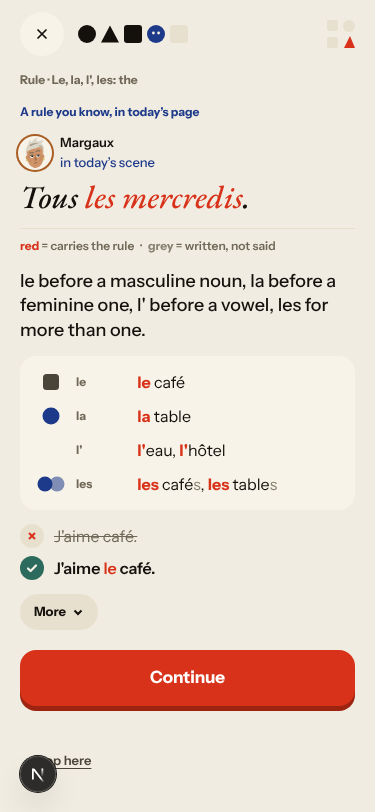 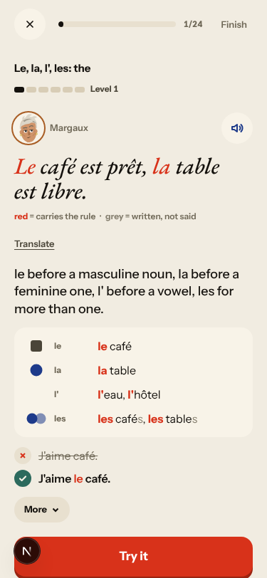

### No shared cause
- **#810 (new, low)** The Courrier basic check fixes «a» → «à» after «est» or «dors» but not after a negation, and prints the half-fixed line:
  - day 1: «ce n'est pas a moi. Peut-être c est à Gus», «d écharpe»;
  - day 2: «je suis pas a la maison».

  `FR_A_GRAVE` (`app/services/correction_contract.py:2226-2247`) reads only the word right before «a». 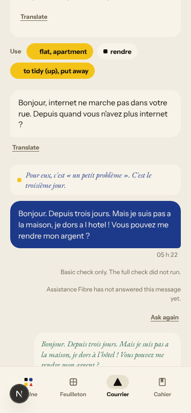

### Seen again, PRs open or owner (not commented)
- #466: both Done screens end on a statement as «Tomorrow». 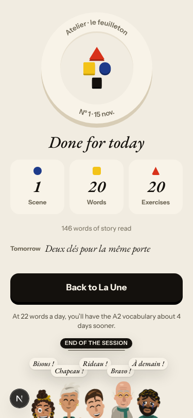
- #577: Home day 2 «Nº 2 · La clé d'Odile» over the scene «La lettre».
- #725: word cards «to sell», «letter» front in English («From today's scene»).
- #693: neither Margaux nor Assistance Fibre answered on the fake stack; «Ask again» shown.
- #728: «I think this is right» under the closed-choice recall miss («j'ai manger»).

### Fake provider (left to the live walk)
- Scene echoes:
  - «Non, alors. Amies : c'est noté.» and «Non, alors. Exactement : c'est noté.»;
  - «Solvel ? Bonne question.» answers nothing;
  - Camille comes to see the flat after my «non»;
  - the last panel sends me home on Wednesday after I said I would stay.
- Free La Forge sentences with no rule hit: «Checking is not available right now, so this answer does not count.» («nous avons entendu Marin chanter», «ils ont dit bonjour a Margaux»).
- The Journal's recall target is the fake's own line: «Il manque quelque chose : Non, alors. Amies : c'est noté. Pas ce soir.» (#622 family).
- Not filed: Home keeps «Sunday 15 Nov» and La Forge «15 · 11 · 26» after `/clock +1` (the harness clock).
- Not filed: the Courrier's «Use» chips show English glosses on day 2 («flat, apartment», «to give back…») where day 1 showed «ailleurs».

### Re-tests

| issue | fix | result |
|---|---|---|
| #780 «Gus · vous» over plain «Say in French» items | #786 | **holds**: no badge on five free «Say in French» items (day 1) nor on «Review · due today» (day 2); the review cue reads «with this rule». Verifying comment. 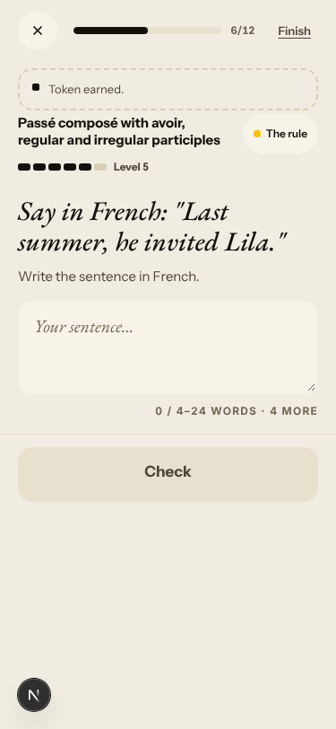 |
| #782 Courrier box keeps the sent text | #792 | **holds**: box empty and «Send» disabled after both sends. Verifying comment. 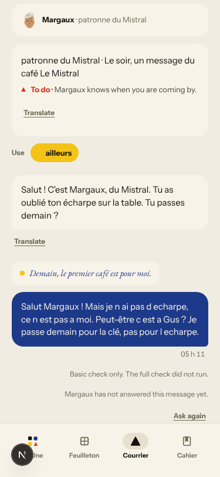 |
| #754 Journal basic check, dead «Check again» | #796 | **holds**: fixes listed, «5 mistakes noted» = 5 shown, no «Check again», «The full check is not available right now.». Participles not named: #807. Verifying comment.  |
| #596 an article miss never names the gender | #799 | **holds on the gap**: «la restaurant» → «restaurant is masculine», no card trap. Judge item, participle and changed-word paths: #809. Verifying comment. 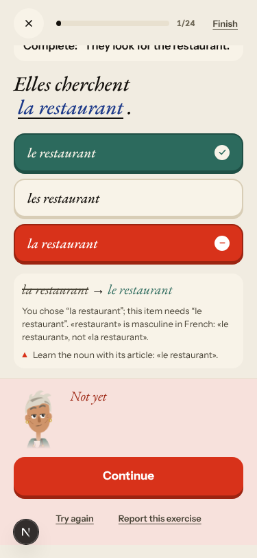 |
| owner rule of 7 Nov (#698) | (PR #708 open) | **holds in letter, not in spirit**: no planned rule displaced; the slip rule is day 2's card («A rule you know») and La Forge's «today's rule» |

Root causes advanced: #146 (#807, #809), #174 (#808). None closes.

## Scripted walk

- «Browser walk on main» (walk-main.yml) run 28 on `fe4f0db3` failed in «de × 7 days» only (season 1–5, 6–10, fr, en + B1 green); CI filed it beside the open `Main walk fails` issues (#802, #794, #779, #771, #770).
- Run 29 on tonight's main `6f07aff3` was still running when this walk started.
- The scheduled «Browser walk» (walk.yml) last passed on `7c7de302` (14 Nov).
- In tonight's explore walk both days reached Done through «Finish» early and «Next: N words».
