# Walk · 16 Nov 2026 · nightly explore walk

Main at `ac053d76`. Since the 15 Nov walk (`6f07aff3`), main took in:
- the 15 Nov report (#811);
- **#816** (Courrier «New letter» is a situation not played this month, with its own words; fixes #777);
- **#708** (La Forge: today's rule is a rule you were *taught*, «Finish» comes on the counter's last item, a retried typed gap stays typed; fixes #443, #698, #699);
- tonight's live report **#823**.

`alembic upgrade heads` ran cleanly on a scratch database before the walk (one head, `d7f9b1c3e5a6`).

Fake story provider, local stack, Chromium at phone size, one persona: `a1-de-fresh` (`--fresh --native de`; last played 14 Nov). I signed up through the UI at «Neu im Französischen · A1» and played as a German beginner with real slips, on purpose on a rule nobody had taught me yet:
- day 1 scene: «Je suis Jonas, le petit-fils de Odile. Je suis ici pour la appartement.», «Oui, je monte. Je suis fatigue. Je veux voir le appartement.»;
- day 1 Courrier: «Je suis tres fatigue, je ne pas oublie plus.»;
- day 2 scene: «Non, je ne vend pas. C est pas simple pour moi, la appartement est de Odile.».

Day 1:
- teaser (Margaux, «Bonjour !», «Un café, s'il vous plaît»), sign-up, character, onboarding, cast intro;
- scene «Le mauvais accueil»: two free replies, one choice («Je la prends.»);
- rule «Ich bin, du bist: Subjektpronomen und être», 2 recall drills (one miss) and a retry;
- La Forge 7 of 7 on être (Level 2 → 6), one typed-gap miss and retry;
- 20 words, Done, Home, Cahier, Courrier (one reply to Margaux), Feuilleton.

Day 2 (clock +1):
- Home, scene «La lettre»: one free reply, one choice (Lila reads the letter);
- cards «Eine bekannte Regel, auf der heutigen Seite: être» and the new «Avoir: ich habe, ich bin 20, ich habe Hunger»; 8 recall drills;
- La Forge on Avoir as «Regel des Tages schmieden» (Level 2 → 5), être twice as «Wiederholung · heute fällig»; ended through the header at 8/10;
- 23 words, Done, Cahier.

Day 7 not played.

Live column: [live walk 16 Nov](../live-walks/2026-11-16.md) (PR #823, merged), production with the real model, release `3d3fa88d37bc` (= #708 live), account A1.1 on day 35. Headline: **the scene reacted to every reply (Q4 5), Q5/Q6/Q17/Q20/Q21 up to 4; Q12 down to 3 (card «Un, une, des», La Forge on «être», #576)**. It filed #821 and #822 and found #443 half fixed live. Its findings are not filed again here.

## Scores (rubric `docs/ops/walk-rubric.md`)

| # | question | 16 Nov a1-de (d1–2) | live 16 Nov | 15 Nov a2-en (d1–2) | 14 Nov a1-de (d1–2) |
|---|---|---|---|---|---|
| 1 | Where am I | 4 | 3 | 4 | 4 |
| 2 | What is at stake | 4 | 4 | 4 | 4 |
| 3 | What to do next | 3 | 3 | 3 | 3 |
| 4 | Scene reacts to my writing | fake | 5 | fake | fake |
| 5 | Story coherent | 3 | 4 | 3 | 3 |
| 6 | Characters consistent | 3 | 4 | 3 | 3 |
| 7 | Image, text, tone fit | 4 | 4 | 4 | 4 |
| 8 | Difficulty fits | 4 | 4 | 3 | 3 |
| 9 | Feedback explained | 2 | 3 | 2 | 2 |
| 10 | Right answers accepted | 3 | 3 | 3 | 3 |
| 11 | French correct | 4 | 3 | 4 | 4 |
| 12 | Clear goal today | 4 | 3 | 3 | 4 |
| 13 | Grammar practised | 4 | 4 | 4 | 4 |
| 14 | Earlier material returns | 4 | 4 | 4 | 4 |
| 15 | I produce French | 4 | 5 | 4 | 4 |
| 16 | Errors, dead ends | 3 | 3 | 3 | 3 |
| 17 | Varied, fun | 3 | 4 | 3 | 3 |
| 18 | Fast enough | 4 | 3 | 4 | 4 |
| 19 | App only | n/a | n/a | n/a | n/a |
| 20 | Satisfying end | 3 | 4 | 3 | 3 |
| 21 | Would come back | 3 | 4 | 3 | 3 |
| 22 | Time vs promise | 3 | 3 | 3 | 3 |

The comparison columns are tonight's live walk, last night's walk and the last walk with this persona (14 Nov). Q14 is scored on day 2 only. The one 2 (Q9) has its findings (#824, #825; #807 again).

**Q12 back to 4: the owner's rule of 7 Nov now holds in its spirit too (#698 after #708).**
- Day 1 taught one rule, être: card, recall, La Forge, all on être.
- My day 1 scene slips («de Odile», «la appartement», «le appartement») put «Le, la, l', les · in Übung · 2 Fehler» in the Cahier, with no card ever shown. 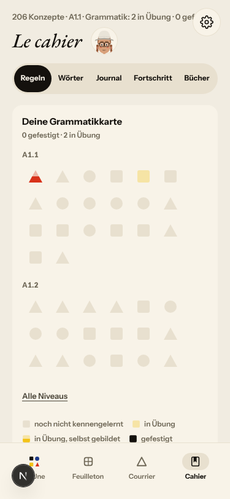
- Day 2's «Eine bekannte Regel» was **être**, the rule I was taught, and the new card was the planned **Avoir**. 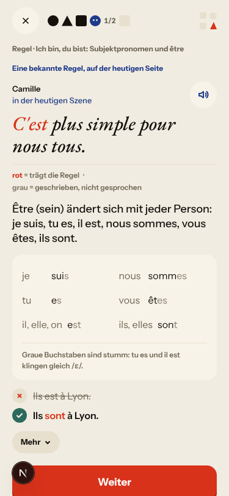 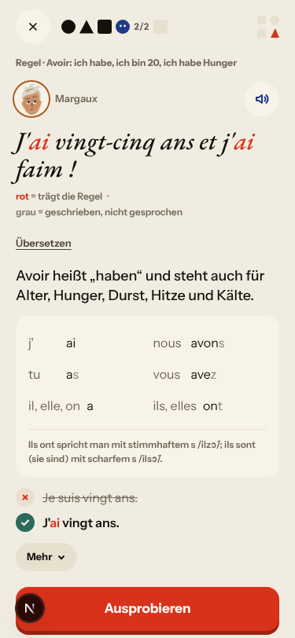
- La Forge «Regel des Tages schmieden» opened on **Avoir** (`concept=2`), with être twice as «Wiederholung · heute fällig». The slip rule did not appear anywhere on day 2. 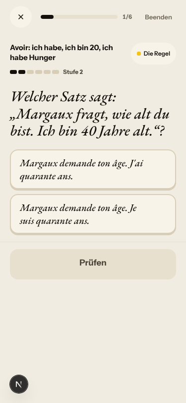
- Not reached: a day that plans no new rule (the 15 Nov case), where a slip rule could come only as a labelled extra.
- Not 5: day 2 shows two cards back to back, and the recall has no item on the review rule.

**Q9 stays at 2: with no model, the check does not know the day's rule.**
- La Forge «Hast du heute Abend Hunger?» → «Tu es faim ce soir ?», the avoir card's own «Falsch»: «Die Prüfung ist gerade nicht verfügbar, darum zählt diese Antwort nicht.» (#824, new). 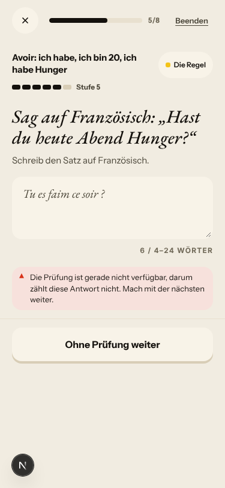
- The Courrier's basic check prints a wrong «corrected» reply: «je ne pas oublie plus» → «je n'oublie pas plus» (#825, new). 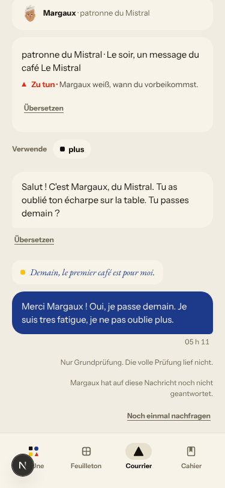
- A typed-gap miss says «Du hast „est“ gewählt» and the same thing again in the next sentence (#828, new). 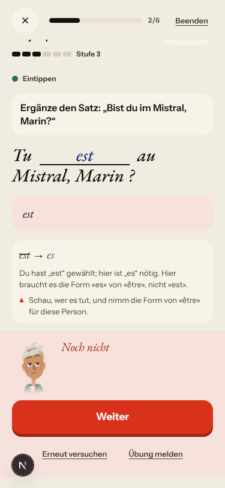
- Good: the gap miss names the form («est → es … die Form «es» von «être»»), recall shows the right sentence with a one-line rule, and the spot item with two wrong words («Je suis vingt et un ans» → «J'ai») worked word by word.

**Q10 at 3.**
- Accepted: «je suis vieux» lowercase with no full stop, «Tu es belle ?», «lettre» with no article, «Ils sont patients.».
- Accepted while wrong, with no note: «J ai» in a La Forge gap (the right «J'ai» shown), «J ai froid.» in recall, and «J ai soixante-quatre ans» listed as practised on the end sheet (#562 again). 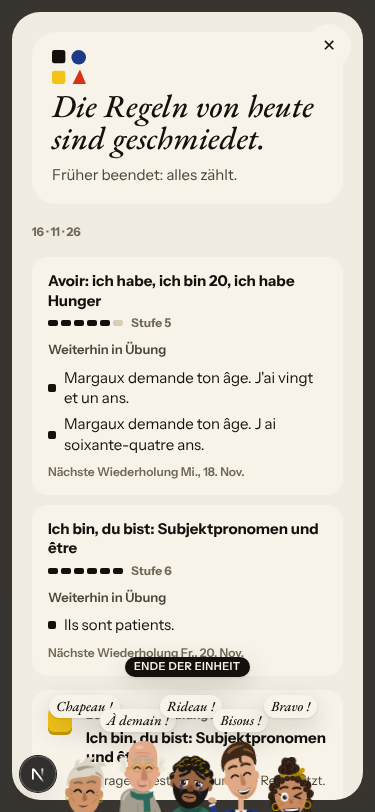
- Not counted while right: «Tu es fatigué ce soir ?» (fake provider, no rule hit).

**Q8 up to 4.** Être, then avoir, are the right first rules for a German beginner; La Forge climbed in small steps (judge, typed gap, tiles, spot, free). One review prompt asks «Seid ihr diese Woche im Iran?» (#829, new, low). 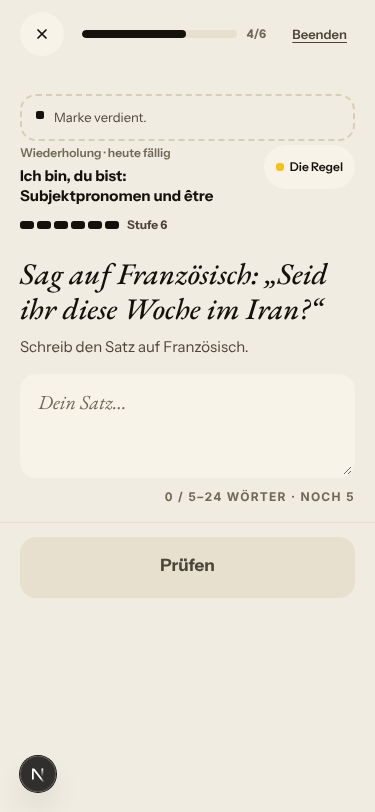

**Q3, Q16 at 3.**
- «Szene · Schritt 2 von 6» jumps to «Schritt 4 von 6» on day 1; day 2 counts «von 13».
- La Forge's counter grows with every unchecked answer: day 1 6/6 → 6/7; day 2 5/6 → 5/8 → 6/9 → 7/10. On the fake stack the séance never reaches its end; I left through the header «Beenden» (#826, new). 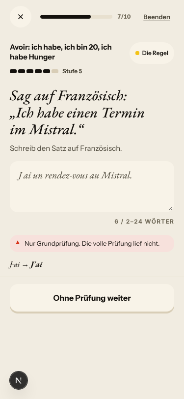
- Margaux never answered in the Courrier (#693, fake stack).

**Q5, Q6 at 3 (fake provider).** The authored beats answered by keyword: «Oui, je monte» → «Oui. Appartement, bien. Pas ce soir.»; «Non, je ne vend pas» → «Non, alors. Odile : c'est noté.» and Camille comes to see the flat on Thursday. Register held everywhere (Gus, Camille vous; Margaux, Lila tu; German UI du).

**Q20 at 3.** Both Done screens end on a statement as «Morgen» («Deux clés pour la même porte», «Ton billet de retour est pour mercredi», #466). Day 2's «Fin du chapitre» ends on «Ou tu dis au revoir à tout ça ?», the tail of the season question (#827, new). 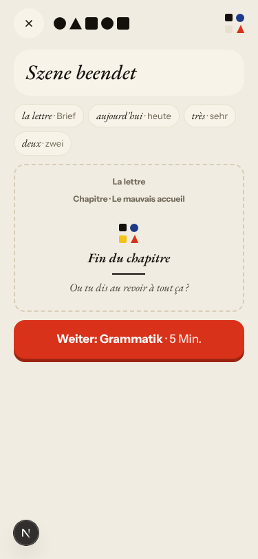

**The best of the night.**
- The fresh path is calm and clear: teaser in three taps, sign-up, figure, a four-card intro, a cast page that says who everyone is.
- Day 1's rule card took its example from the scene («C'est qui, vous ?»), and day 2's known-rule card took a new one from day 2's scene («C'est plus simple pour nous tous.»).

## Findings, by root cause

Six new findings (#824–#829), all `queue:ready` with a **Done when:** comment. #824 and #829 are sub-issues of #146, #826 of #143, #828 of #542; #825 and #827 have no shared cause. No new root cause opened. Repeats commented: #562, #807. Re-tests commented: #698, #443, #699 (all hold).

### #146 the day's content and feedback are not driven by one concept
- **#824 (new, medium)** With no model, La Forge does not check the avoir card's own trap: «Tu es faim ce soir ?» is «not checked, does not count». Why: the basic check (`app/services/correction_contract.py`) is a list of local patterns that does not read the rule of the item it checks; same mechanism as #807. Proposed guard: every A1 card's «Falsch» example runs through the basic check and must be flagged. 
- **#829 (new, low)** An A1 être review asks «Seid ihr diese Woche im Iran?». Place slots come from `app/data/grammar_templates/lexicon.json` (~line 10020) with no level or story filter. 
- **#807 (commented)** same mechanism, see #824.

### #143 the day's progress has no single source of truth
- **#826 (new, low)** La Forge's counter grows by one for every unchecked answer (6/6 → 6/7; 5/6 → 5/8 → 6/9 → 7/10). #708 made the counter a dry run of the composer, but the séance's minimum counts only checked answers, so the composer appends items after the fact. 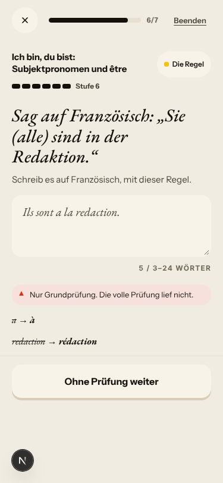 

### #542 a drill's instruction is picked from the item's shape, not its task
- **#828 (new, low)** A typed gap miss reads «Du hast „est“ gewählt; hier ist „es“ nötig. Hier braucht es die Form «es» von «être», nicht «est».» The line is the recognize round's `atelier.recognize.chose_requires` (`app/services/learner_copy.py:131-135`). 

### #174 a right answer is judged against one stored string
- **#562 (PR open, commented)** «J ai» right in a gap and in recall, and «J ai soixante-quatre ans» kept as practised. 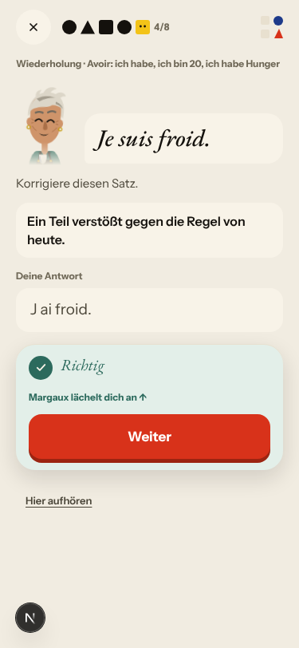

### No shared cause
- **#825 (new, medium)** The Courrier basic check «corrects» «je ne pas oublie plus» into «je n'oublie pas plus». `FR_NEGATION_ORDER` (`app/services/correction_contract.py:2111-2123`) moves «pas» behind the verb without looking at the words after it; `FR_DOUBLE_NEGATION` only fires on «pas plus» side by side. Sibling of #810. 
- **#827 (new, low)** «Fin du chapitre» prints «Ou tu dis au revoir à tout ça ?». `question_line` (`app/services/sentence_line.py:109-119`) keeps the last «?» sentence of the A1 season question, which is a chain of three alternatives; `colophonDigest` (`web-frontend/components/atelier-v2/journey/journey-recap-model.ts:294-302`) prints it when the chapter has no resolution. The Feuilleton's chapter line uses the same digest. 

### Seen again, PRs open or owner (not commented)
- #466: both Done screens end on a statement as «Morgen». 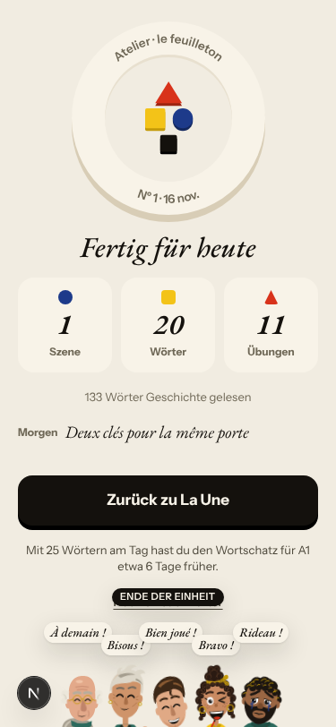
- #280: of 20 new words on day 1, four come from the scene (l'appartement, vendre, la clé, ici); on day 2, one of 20 (la lettre); the rest is the base list (deux, trois, faire, aller…).
- #693: Margaux did not answer on the fake stack; «Noch einmal nachfragen» shown.
- #577: Home day 2 «Nº 2 · La clé d'Odile» over the scene «La lettre».

### Fake provider (left to the live walk)
- Scene echoes: «Oui, je monte» → «Pas ce soir.»; «Non, je ne vend pas» → «Non, alors. Odile : c'est noté.»; Camille comes to see the flat after my «non»; the last panel books my return for Wednesday.
- The scene's correction names only «d'Odile», not «la appartement» (day 1, first reply; day 2) and «l'appartement» once.
- Free La Forge sentences with no rule hit «zählen nicht» («Tu es fatigué ce soir ?», right).
- Not filed: Home keeps «Montag, 16. Nov.» after `/clock +1` (the harness clock).

### Re-tests

| issue | fix | result |
|---|---|---|
| #698 a slip rule becomes the day's card and La Forge's today's rule | #708 | **holds in letter and spirit**: slip rule «Le, la, l', les» in practice after day 1, day 2 card = être (taught), new card = Avoir, La Forge on Avoir; the slip rule nowhere on day 2. Verifying comment.  |
| #443 La Forge on the day's rule, «Finish» only on the last item | #708 | **holds on fake**: first item on the card's rule both days; «Beenden» primary only on 7/7; Done «11 Übungen» = answers. Counter growth filed as #826. Verifying comment. 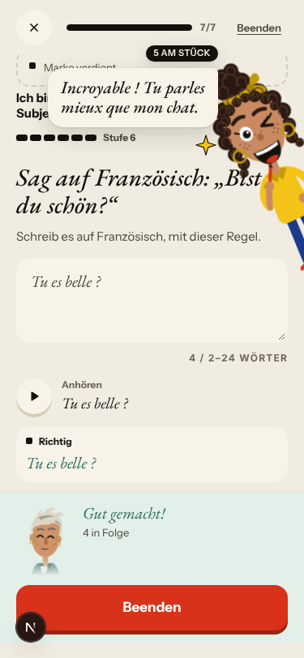 |
| #699 retried typed gap shows choice cards | #708 | **holds**: «est» → retry «es» → line, «Gut gemacht!», no cards. Verifying comment. 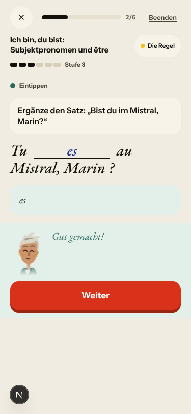 |
| #777 Courrier «New letter» repeats a played situation | #816 | not reached (needs a month of letters) |
| owner rule of 7 Nov (#698) | #708 | **holds** (see above) |

Root causes advanced: #146 (#824, #829), #143 (#826), #542 (#828). None closes.

## Scripted walk

- «Browser walk on main» (walk-main.yml) run 33 on tonight's main `ac053d76` **passed**, the first green run after runs 28–32 failed (run 32 on `3d3fa88d` failed).
- The scheduled «Browser walk» (walk.yml) run 35 on `3d3fa88d` passed (15 Nov).
- In tonight's explore walk day 1 reached Done through «Beenden» on 7/7, day 2 through the header «Beenden» at 8/10 (#826), then «Weiter: N Wörter».
