# Experience review — 17 Nov 2026

Two learners played on real model output, on main at `d1486e6c`, phone-sized browser, production's story settings from `render.yaml`, story writer switched to Sonnet 5.5.

- **Jonas, A1, app in German:** onboarding from the welcome screen, days 1–6, a four-day absence and the return day, a bad-connection pass, dark mode and large type.
- **Sarah, B1, app in English:** days 1–5, one edition of Le Papier, a three-day absence and the return day, then moved to season day 57 and played to day 68 (finale, the six-day epilogue, three days after it).
- **Writer comparison:** the same story day written by Sonnet 5.5, Opus 5.5 and Haiku 5.5, once for A1 and once for B1.

Spend: US$5.44 of the US$15 cap (A1 1.03, B1 2.97, comparison 1.44). Play logs with every line and item verbatim are in `2026-11-17-experience-review/logs/`.

## Verdict

Not ready for ten learners. The thing that makes this product different works: the story listens. A character quotes on day 5 what the learner wrote on day 3, accepts a counter-proposal, and reacts to a one-word «Rien.». The look is also strong and consistent. But a tester spends about five of twenty-five minutes in that story, and three things stand in the way:

1. **The teaching cannot be trusted.** Corrections miss the errors that matter, some are wrong French, one wrong correction was stamped on eight correct replies, and the app silently re-graded a B1 learner to A1.1.
2. **The day is too long and four fifths of it is generic practice.** One rule is taught three times in one sitting and drilled for four days with the same five sentences; the word deck is a self-graded frequency list in which a word the learner saved never came back.
3. **The story has no shape beyond today.** Generated pages are thin, hooks are dropped the next day, a choice is repeated back and praised but changes nothing, and the season ends without the learner being told.

None of these needs a rebuild before the pilot. They need about a week of trimming and repair, in the order given at the end.

## Corrections after reading the code (same day)

Five statements in the first version of this report were wrong or overstated. They are corrected in place below.

- **The Quartier is hidden by a launch flag** (`web-frontend/launch-flags.json`, `quartierVisible: false`); in a production build the page does not exist. The owner's decision of 17 Nov is that it is switched on and becomes a major part of the app, so the missing door, the notebook without story people and the mixed language are findings again, and it still has to be played properly.
- **The yellow first-time notes returning every day was the harness.** They are remembered on the device after «Verstanden»; every play session started with a fresh browser.
- **The blank page when opening offline is a browser artefact.** The iPhone build bundles its shell.
- **The audio-first scene on A1 day 3 is a designed listening day**, dealt every third day from a 20-minute budget; the learner's «listen first: off» setting does not override it.
- **The season's choice exists and was skipped by my jump.** The flat decision is a choice card on T7 day B, and the epilogue has three variants that follow it. Free text on a later day cannot change it. «Relecture» is the fallback for a day whose generation failed, not a finale design.

## What I could not play or see

- **Sound.** Text-to-speech was on, but nothing was heard. Dictation items were skipped with «show the answer».
- **Speaking and phone-call missions.** Off; no microphone.
- **Push notifications on a device.** I computed what the app would send (finding 13); the permission card after the first finished day exists in code but a browser never shows it.
- **The native shell.** Keyboard, safe areas, the TestFlight build.
- **Walking and talking in the Quartier.** The harness cannot touch the 3D canvas. Menus, notebook and map were seen.
- **A season rollover.** None happened up to story day 68.
- **Live news in Le Papier.** The local stack served three evergreen topics («un classique de saison»), sourced from Wikipedia.
- **Opus pages in play.** Opus was read only in the comparison.
- **An A1 season ending.** Only the B1 learner went to the end, and by then the app had re-graded her to A1.1.

Harness faults that are not product findings: days 1–2 ran on an older Next.js with the 3D library missing (fixed for all later days); the Home date did not follow the test clock; a La Forge «copy the correction» dead end on A1 day 1 was the harness typing into the wrong field.

## Findings

### 1. Corrections miss what matters, and some are wrong · rework · a few days

**Observed**

- **The same wrong correction on correct replies, eight times.** After one La Forge slip on day 3 («lui» for «leur»), scene replies were stamped «→ leur · On dit « leur », pas « lui »» on days 5, 6, 58 and 68, including a sentence about one person, and once reversed («leur → lui») on a correct plural.

  

- **Wrong French offered as the correction.** Journal: «beaucoup → beaucoup et». Scene, A1 return day: «pas avec lait» → «pas avec de lait». Day 1 told the B1 learner «la notaire» is wrong; on day 3 the story itself says «la notaire».
- **Wrong answers accepted.** La Forge, B1 day 2: «elle me le rend» for «la clé» → «Juste · Niveau 6 ↑». A1 day 5: «le valise» → «Richtig».

  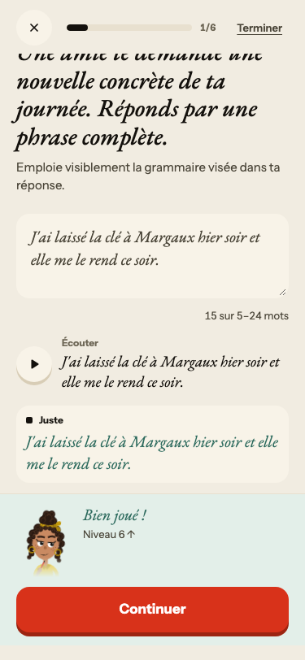

- **Right answers refused.** B1 day 4: «je le remercie» refused because the stored answer was «l'en». A1 day 6: «Ils vont dans le métro» refused because the item wanted an -er verb without saying so.
- **One correction per reply, and often not the one that counts.** On B1 day 4 the day's rule was the subjunctive; the learner wrote three missing subjunctives in the scene and one was flagged. Over days 3–5, of two deliberate errors a day, about one in three was caught, while apostrophes and elisions were flagged reliably.
- **Explanations that explain nothing.** «La forme correcte est « je veux que quelqu'un me dise »»; «Tu as choisi « j'avais déjà sortie » ; Règle : le plus-que-parfait».

**Why it matters.** A learner cannot tell a wrong correction from a right one. One «beaucoup et» and every later correction is doubted. This is the fastest way to lose a serious learner.

**What I would do.** Stop feeding stored faults into the scene's correction (the phantom «leur»). In scene replies, flag the error that matches the day's rule first, then the most serious one. From B1, show up to three. Never print a corrected line without passing it through the same check that judges learners. In La Forge, judge free answers against the rule, not a stored key.

### 2. The app silently re-graded a B1 learner to A1.1 · rework · an afternoon to switch off, a few days to do properly

**Observed.** After Sarah's 40th corrected answer the level was «measured» and stored as A1.1 (history row `atelier_session_complete`, error rate 0.48). Nothing told her. The interface switched from French to English, the next rule was «avoir» at Forge level 1, and scenes shrank to 15–55 words.

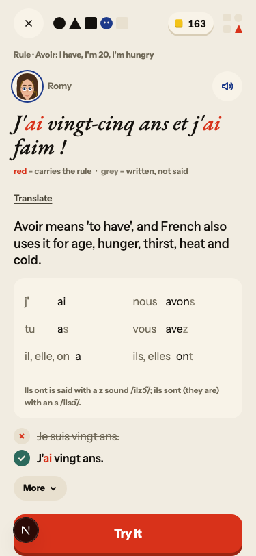

**Inference.** Our player makes deliberate mistakes, so the error rate is inflated. But a real B1 learner who errs on a third of items is normal, and the drop went straight to the lowest level, not one step down.

**Why it matters.** A tester who declared B1 and is handed «j'ai vingt ans» in week two will stop.

**What I would do.** For the pilot, never move a declared level down automatically; at most one sub-level, with a message and a way to refuse.

### 3. The day is 22–33 minutes and the practice half repeats itself · cut and rework · a few days

**Observed**

- **Measured days:** A1 25–33 min, B1 16–28 min, against 20–23 quoted on Home. The scene and its replies are 5–9 of those.
- **A1 day 1 teaches être three times in a row:** rule card, a «Wiederholung» block, then La Forge with seven items. Day 2 shows être again before avoir. On day 5 être is drilled again at level 6 and the exam is then passed 3 of 3; on the return day it comes back four more times.
- **B1 La Forge held one rule for four days** with five sentences. «Je lui le donne» appeared about eight times, «Il me en a parlé» six, the card «Une amie te demande une nouvelle concrète de ta journée» on four consecutive days. On day 4 the scene's rule was the subjunctive while La Forge still drilled pronouns.

  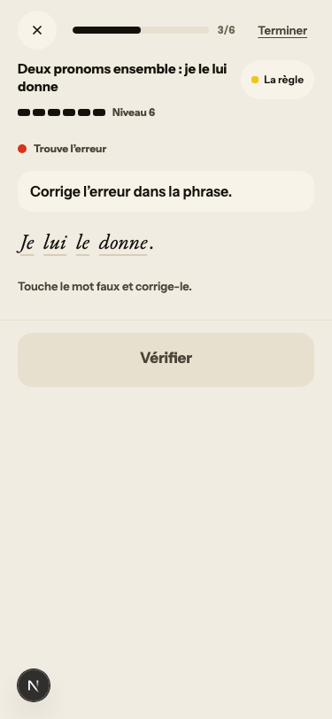

- **The drill around the scene shows the answer at once.** In «Rappel» / «Wiederholung» / «Vor der Szene» one wrong tap reveals the solution, and the item returns a few cards later with identical wording. La Forge itself does wait for a retry.

  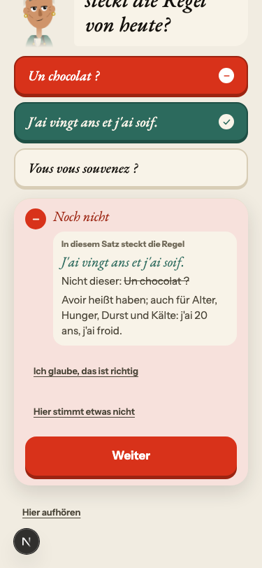

- **The second drill item is often the rule card's own wrong/right pair**, seen seconds earlier.
- **La Forge runs 9–13 items against «about five minutes»**; its counter grows while you play (6 → 11).

**Why it matters.** The promise is a serial you play a part in. The experience is a serial followed by twenty minutes of exercises that would look the same in any app. By day 4 both players were leaving La Forge early.

**What I would do.** One grammar step a day, not three: the rule card, then La Forge capped at six items, of which at least two are the learner's own sentences. Remove the separate «Rappel» block except for the learner's own past mistakes, which is its best use. A rule at level 6 leaves the daily rotation. Apply your «no solution before a retry» rule to the drill as well.

### 4. The word deck is a frequency list, and a saved word never came back · rework · a few days

**Observed**

- **Share of the day's deck that came from the scene:** A1 3 of 17, 1 of 21, 5 of 20; B1 2 of 19, 4 of 26, 4 of 23. The rest is «très, hier, deux, premier» at A1 and runs like «admettre, reconnaître, avouer, prétendre, supposer, envisager, constater, remarquer, souligner» at B1.

  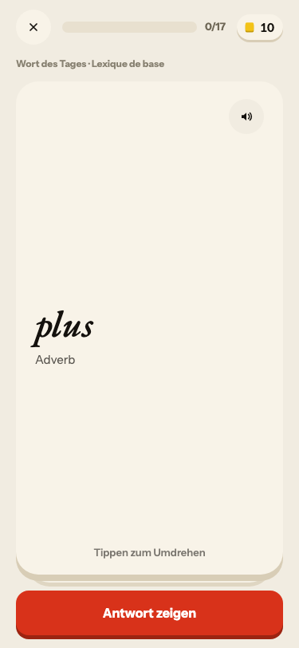

- **«valise», saved on day 1 with «Behalten — es kommt morgen wieder», was in no A1 deck on days 2–5.** It did appear in the Courrier.
- **Pure self-rating.** Tapping «Weiß ich» on everything gives full credit; nothing is typed, heard or used.
- **A wrong sense.** «frais — fresh; cool» for «les frais de changement du vol».
- **The banner «Mit 25 Wörtern am Tag … 6 Tage früher» and «Noch 5 neue Wörter» appear every day**, and the offer never ends; a B1 learner is told she reaches B1 twelve days sooner.
- **After an absence the deck explodes.** 100 cards on the A1 return day (80 reviews), 86 at B1 (69 reviews), on a day labelled «gentle restart».

  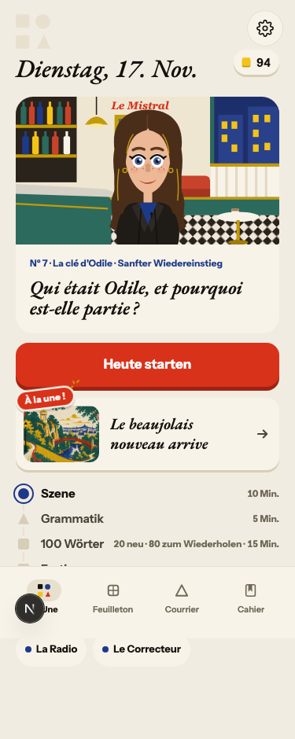

**Why it matters.** Words are a third of the day and the part least connected to the story. A learner cannot say what they learned from it.

**What I would do.** Make the daily deck the scene's words plus what the learner tapped, saved or got wrong, with a small top-up, ten in total. Ask for at least half by typing or by choosing in a sentence. Cap reviews after an absence at twenty. This questions your standing default of 20 new words a day: I think that number is itself the problem, because it creates both the generic filler and the review pile.

### 5. Generated pages are thin and do not hold yesterday's thread · rework · a few days

**Observed**

- **Length.** Days written by the writer are 5–6 panels of one or two short lines; several panels are only «Un silence.». The epilogue days ran 25–55 words.
- **Hooks dropped the next day.** «Que découvriras-tu en regardant la clé de plus près ?» (day 2) is never taken up; «Que décideras-tu pour ton vol ?» (day 3) is not asked on day 4; «Qu'est-ce que tu veux demander à Gus ?» (day 5) is replaced by Romy on the return day. On five days the Home hook and the scene's subject did not match.
- **«Précédemment» / «Bisher» still shows day 1's title on day 6**, plus one or two fact lines.
- **Days 3, 4 and 5 are all titled «Le Mistral».**
- **Day 2 (authored) ignores day 1.** The key left with Margaux, the refused coffee and the tiredness are not mentioned until a reply prompt. Carry-over starts when the writer takes over on day 3.
- **Unexplained lines at A1.** «Ton plan ? Sept sur vingt.», «La succession Ferrand. Bonjour.»
- **Mixed language in the end card.** «Marin heard what you said. The rest stays open.» in English under a French card.

**What works, and should be kept.** Replies. Lila on day 5: «Tu as dit : « Je ne peux pas partir sans savoir. » Alors voilà le numéro.» The story accepted an invitation plan, moved to Gus when asked, answered a question about the radiator and declined to call the police without derailing.

**Why it matters.** A serial lives on wanting to know what happens tomorrow. Here tomorrow rarely answers today's question, so the hook stops working by day 4.

**What I would do.** Make yesterday's hook a required input the page must answer in its first two panels. Build «Précédemment» from the last two days' end cards. Give every page its own title. Set a floor on page length by level. This is where the writer model matters least: all three models were given the same beat.

### 6. Choices are heard but change nothing, and the season ends without saying so · redesign · structural

**Observed**

- **The finale is not announced, and its first day was lost.** Season day 58 opened as «Relecture — Aujourd'hui, on relit «Huit heures» … L'histoire n'avance pas aujourd'hui». That is the app's fallback when a day's generation fails every attempt: the learner re-reads the last big scene. Day 59, «Ce qu'on garde», is the café's last day; Home says neither «finale» nor «last day».

  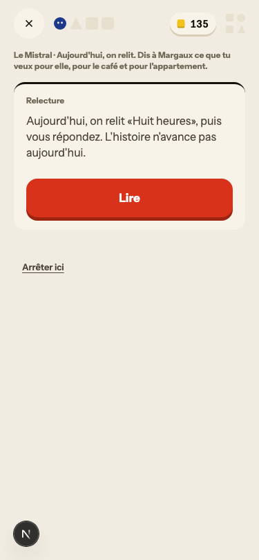

- **The season's question is printed on every day's start card**, including the days after the learner answered it.
- **A decision said in free text is praised, then contradicted.** The real choice is a card on T7 day B, which my jump filled with the default «sell»; nothing the learner writes later can change it. She said she gives the flat to Lila and Marin and goes home. Margaux: «Tu leur donnes l'appartement, alors ?» Camille: «C'est un beau geste pour Lila et Marin.» Then Lila on day 62: «L'appartement reste vide», and the hook on day 63: «Que deviendra l'appartement vide ?». No deed, no reaction from Lila or Marin, no reaction from the buyer.
- **The season ended internally on day 65** (`season_ended: via epilogue`). The learner saw «À suivre…» and on day 66 «Nº 16 · La clé d'Odile» as before. No end screen, recap, keepsake or new season. The Feuilleton tab says «Season 1 · 17 pages».

  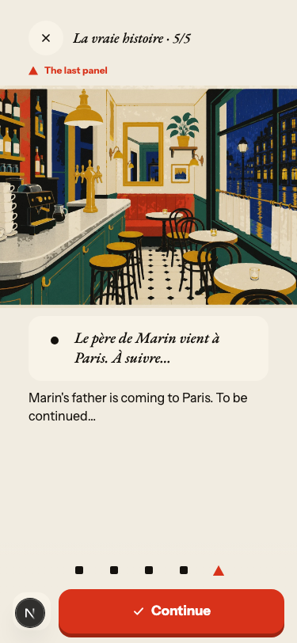

- **No thread was closed in what was played:** Odile's letter, the fire, the key, Solvel, the 1970 painter.
- **Day 68 ended on «What happens next is being written…» with no button.**

  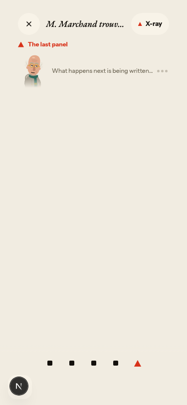

**Inference.** Most of the plot between day 6 and day 57 was filled in by the jump's defaults, including the season's choice itself, so I did not see the choice card or how well the three written endings follow it. The missing end page and payoff are not an effect of the jump. After the season ends the app keeps writing ordinary days until the chapter closes, then shows a 14-day «between two seasons» break; we stopped before it appeared.

**Why it matters.** For a one-week pilot the season's end is out of reach, so this does not block the pilot. It does decide whether anyone finishes a season. Within the pilot week the same weakness shows as «my answers are noted, but nothing happens because of them».

**What I would do.** Before the pilot: one visible consequence per week (a character does something on day 5 because of what the learner said on day 2 or 3, and says so). After the pilot: a real last day with the question put as the scene, three written outcomes, an end page with the season in ten lines and the learner's own best sentences, then a named break before season 2.

### 7. Courrier replies fall back to a stock line · quick fix · an afternoon

**Observed.** The reply call uses gpt-4o-mini with a 2-second timeout. Two of the first three calls timed out, and it recurred on day 3. The learner then reads «Je peux vous aider, mais il me manque un détail concret. Quel est le problème exact et que souhaitez-vous que je fasse ?» from Margaux, who said «tu» one message earlier, and the same sentence from the town hall.

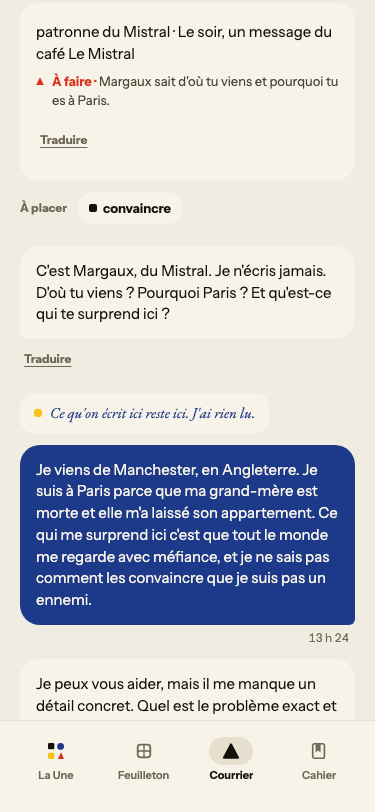

When the call succeeds the Courrier is good: it places words from the learner's own deck, corrects one thing well («After jusqu'à ce que, use the subjunctive: comprenne») and Lila makes a plan with the learner.

**What I would do.** Raise the timeout to 15 seconds with a visible «is writing…», retry once, and never show the help-desk line in a character's thread.

### 8. Too many rooms, and the best ones are hidden · cut · a few days

**Observed**

- **A day-1 learner can reach:** La Une, Le Papier, Au comptoir, La Radio, Le Correcteur, Courrier, «bring your own French», Feuilleton, trombinoscope, Cahier with five tabs, Journal, Dossier, La Carte, Répétition, a level check, a vocabulary check, «Le mur du Mistral», and settings 7,000 px long.
- **The Quartier is switched off for launch** (see corrections above), so testers will not meet it. For later: it looks good and knows the episode and the hook, but its notebook lists news places, not the story's people.

  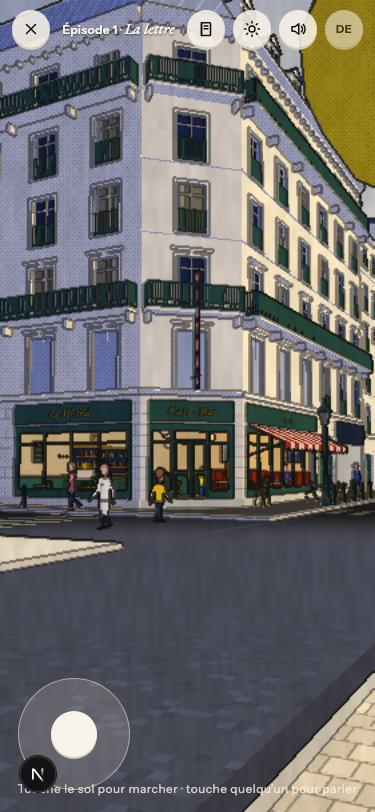

- **The Journal is the most original surface and Home does not point to it.** It asks for yesterday from memory in two to four sentences and knew the learner had said he was tired.
- **La Radio is the Papier's text read aloud plus one dictation.**
- **La Carte (a map of France for the Papier) and Répétition (rehearse a real situation) live in Settings.**
- **«Neuer Brief» opens the letter that arrived**, not a new letter.
- **«Noch einmal ansehen» opens only the end card**, not the scene.
- **The Cahier's rule list is about 23,000 px long**, 200 of 206 rows reading «noch nicht kennengelernt»; a B1 learner's word register starts at «le — the».

**Why it matters.** Each room is carefully made, and together they do not read as one product. A tester will find three of them and wonder what the rest are for.

**What I would do for the pilot.** Home shows the day, the Courrier and the Journal. Everything else is hidden behind the Cahier or switched off.

### 9. Interface language is mixed on almost every screen · rework · a few days

**Observed**

- **B1 with English as app language:** Home, scene, La Forge, deck and Cahier in French; Settings, quick settings, the vocabulary check and letter corrections in English; pace names «Calme/Rapide» on Home and «Easy/Fast» in Settings; a nav link «Settings» on French pages.

  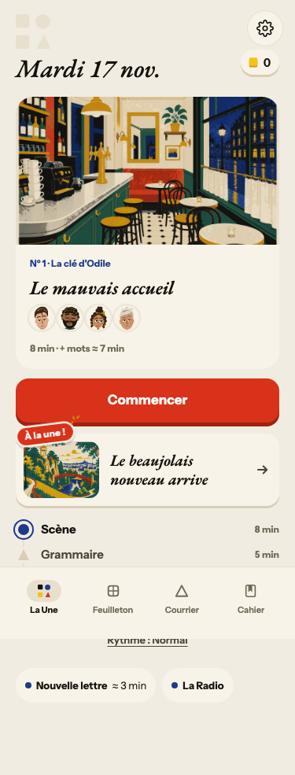

- **A1 in German:** «Or +9 · 9 / 20 vers la journée pleine» on the end screen, an English gloss «à la rédaction — at the newsroom» and «bague — ring», the Journal's instruction in French, tomorrow's teaser in French only.
- **La Forge build cards print the generator's instruction as the task:** «Construis la phrase : « Express a complete sentence in French using pronoun choice; use every target chip once. »»

  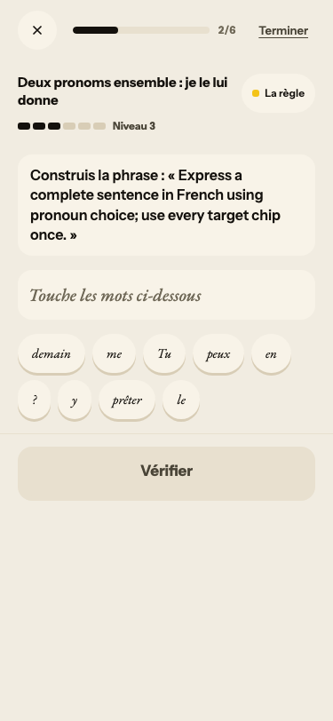

- **Internal wording leaks.** «a threshold still on trial», «Mode POV», the Help page's «[contact e-mail]».

**What I would do.** One rule, stated once: everything that is not fiction is in the learner's language until they choose French in Settings. Then sweep the screens against it.

### 10. Onboarding starts brilliantly, then explains the interface · cut · an afternoon

**Observed**

- **Good.** «Loslegen» goes straight into a scene with Margaux: first French in under twenty seconds, tap to translate, no account.
- **«Un café, merci» is refused without a reason.**
- **After sign-up, five cards** come before the first real scene, two of them about shapes and progress dots.

  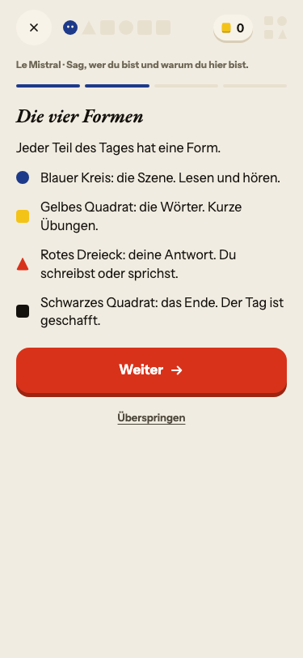

- **No question about time or goal**; pace is first offered on Home.
- **A1 day 3 was a listening day:** «Lesen» opened eight lines of hidden-text audio. This is dealt every third day by design, is not announced, and ignores the «Zuerst hören: aus» setting.

  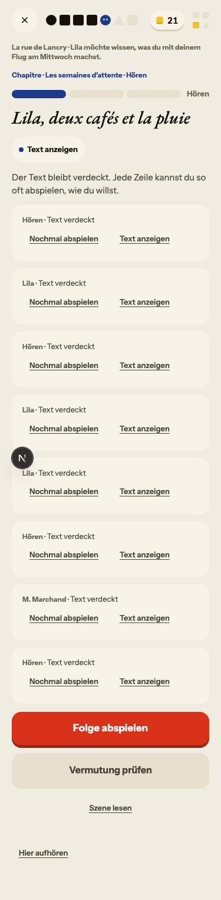

**What I would do.** Keep the mini scene and the premise card, drop the shape and progress cards, and hold the first listening day back until week two or announce it.

### 11. La Forge items ask for things never taught · rework · a few days

**Cause of the B1 repetition in finding 3, from the code:** only 4 B1 rules have sentence templates (38 at A1, 36 at A2). Every other B1 rule is served a fixed set of about fifteen items, and a rule stays the daily Forge rule until it is «held», which needs two free uses a week apart.

**Observed.** A1 day 1: «Wir sind mit Gus in der Redaktion» (rédaction) and «Ich bin im Laden» (magasin). Day 3: vestes, brocante, tartes, bague. Day 4: an article gap that needed «chiens». Vocatives are still in build items («…, Marin», «…, Lila», «…, Romy»). Hint chips on day 4 offered the learner's own wrong sentence from day 2, «Je es tranquille.». A Forge speech bubble invented that Lila hid the key in a book, against the story. In the copy step, a second change (dropping «avec») was required but only the first (the cedilla) was explained.

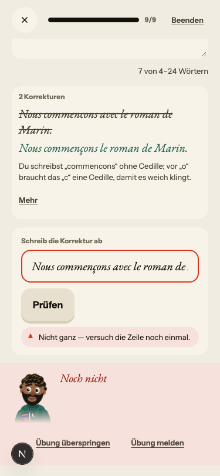

**What is good.** The loop itself: one fault at a time, in the learner's language, retry before the solution, and hints like «„Ring" ist deutsch: Welches französische Wort bezeichnet diesen Gegenstand?». It also re-serves the learner's own errors days later.

**What I would do.** Restrict item vocabulary to the scene's words and the learner's deck. Apply the no-vocative rule to generated items. Keep Forge bubbles out of the plot.

### 12. Waiting, and what a bad connection does · quick fixes · a few days

**Observed**

- **The night run returned «unavailable» three times in about twelve.** The learner then waited 40–60 s on «La scène se prépare…».
- **A day opened without the night run:** 30–35 s on «Deine Szene wird vorbereitet…». The page, written by the small live model, read no worse than Sonnet's day 3 (one A1 day).
- **End cards took 8–35 s with no indicator.** One reply stalled on «Ah. Attends, je réfléchis à ce que tu dis.» and never resolved.
- **Offline in a scene:** nothing typed is lost; the message is clear and in German. Good.

  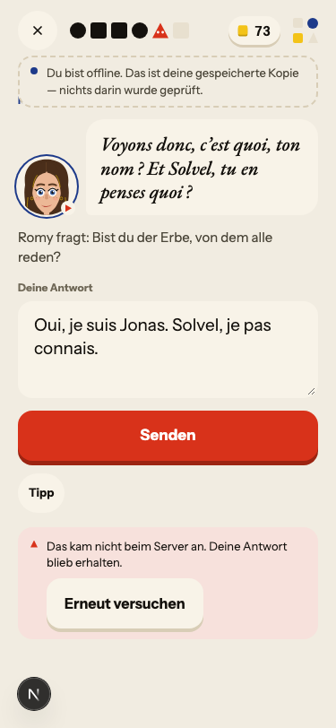

- **Offline in the word deck:** grades are dropped with a toast; the counter stays 0/40.
- **«Erneut versuchen» after a failed «Weiter»** threw the learner back a step and restarted the panels at 1/5.
- **Leaving mid-scene and returning** resumes at the exact exchange with the draft kept. Good.

### 13. Coming back after days away · rework · an afternoon

**Observed.** The streak vanished and restarted at 1 with no word. Home's only sign is the tag «Sanfter Wiedereinstieg». The scene opens with a good in-story card («Entre-temps · 4 Tage ohne dich», Margaux welcomes you), then reads as if no time had passed. The day is the heaviest of all because of the review pile (finding 4).

Pushes, computed from the app's own functions, not seen on a device: A1 morning, sender «Marin»: «Comment Marin peut-il t'aider avec ta peur de l'avion ?» — Marin speaking of himself in the third person, an inversion question, no German. Streak: «Tu viens ce soir ? 2 jours de suite, déjà !».

**What I would do.** Two German or English lines of «what you missed» on the return card, a capped deck, and for A1 a gloss under the push.

### 14. Counters nobody explains · cut · an afternoon

**Observed.** «Or +5 · 5 / 20 vers la journée pleine» after a day in which every step is ticked; then 18/20, 19/20, «Journée pleine (1 / 5)», 12/20. Step counters change daily («Schritt 1 von 6», «von 11», «Étape 4 sur 12» beside «2/8» that grows to «10/10»). «7 Exercices» after nine. La Forge level 6 is the cap, so «Juste : un de plus» means nothing from then on.

**What I would do.** One number on the end screen: the streak. Gold stays in the Cahier or goes.

### 15. Le Papier · leave out of the pilot for A1 and A2; optional at B1 · decision

**Observed.** One edition, about nine minutes: a short text, three cast opinions, find the false claim (Gus's «jusqu'en 1995», really 1985), write your own opinion, get one hint and a second try, then a newspaper page with your corrected sentence and a pin on a map of France. It is the best-made single feature at B1.

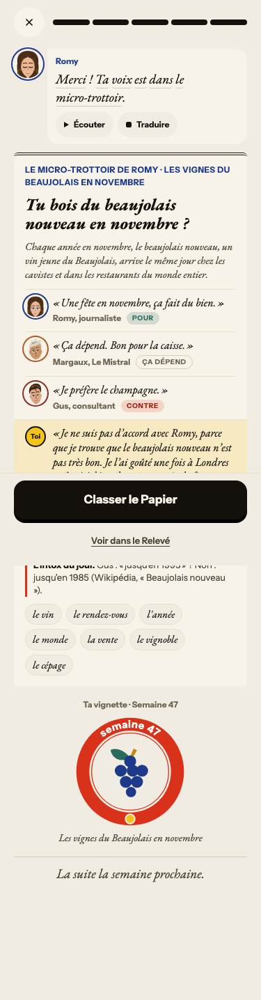

Weak points: the correct year in a full sentence was judged «Pas tout à fait»; Margaux's «La même chose ?» makes no sense there; nothing links it to Odile's story or to the day's rule; every edition follows the same five steps; no reward. It was also offered to the A1 beginner as the top card on Home, with «l'interprofession du Beaujolais» and «cavistes».

**My read.** Your decision to keep it out of the pilot is right for A-level learners. `render.yaml` still has `REVUE_ENABLED = true`, so today it would be served.

### 16. The writer model · decision

**Measured on the same story day**

| Writer | Cost per page | Time | Page |
|---|---|---|---|
| Opus 5.5 | about $0.37 | 77–193 s | Clearest: the notary's news is spoken; the B1 page gives a concrete caption to interpret |
| Sonnet 5.5 | about $0.19 ($0.26–0.33 with the critic in play) | 55–147 s | Good texture; one A1 page announced bad news and never stated it |
| Haiku 5.5 | about $0.02 | about 100 s | Asked «what did the notary say?» with the suggested answer «I don't know yet»; the B1 page failed three attempts |

All three stage the same authored beat. The weaknesses in finding 5 are in what the page is asked to do, so a dearer writer does not fix them. The one day the small live model wrote on demand was no worse than Sonnet's (one sample).

**My read.** For ten learners a week the difference is about US$13, so keep Opus for the pilot and remove the question. For scale, test Sonnet with one draft and the live model as writer, on twenty pages each, read blind.

### 17. Le Quartier, played properly (added 17 Nov, evening) · switch on and connect · a few days, then a device test

The first pass only read its menus. With a harness that can touch the 3D view, a fresh A1 learner played episode 1 inside it to the end, roamed, travelled by the map, and a seven-day learner opened his day 8 there. Log: `logs/quartier.md`.

**Observed**

- **It is another way to play the day's scene, and in three respects a better one.** The learner walks the rainy quai to Le Mistral, cards carry the lines, and answers are typed as in the flat version.

  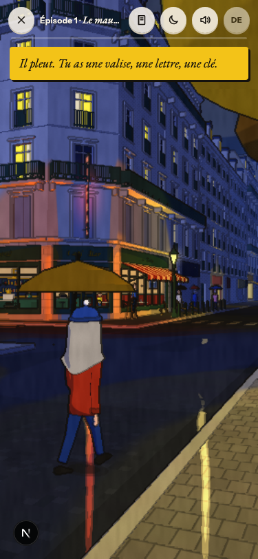

  - The correction is fuller: «Je vend appartement» came back as «Je vends l'appartement» with both reasons in German. The flat version left that sentence uncorrected on the same day.

    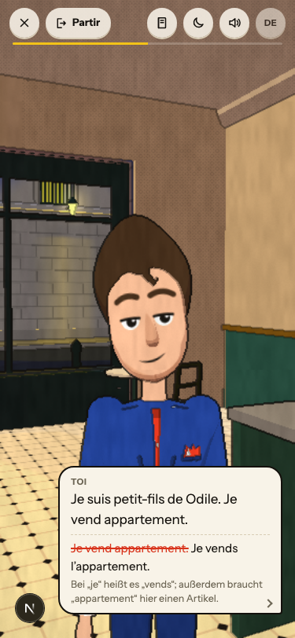

  - The end card recaps what the learner did: «Tu as dit non merci. Margaux a poussé la tasse vers le tabouret d'Odile. … Tu as laissé la clé à Margaux, derrière la caisse.» The flat version has no such recap.

    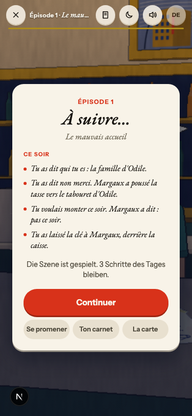

  - The story reacts as it does in the flat version: a German answer drew «Pardon ? … Et en français ?».
- **Controls work on a phone-sized screen:** stick, drag to look, tap the ground, tap a person, and «Y aller» walks you to the scene's next mark.
- **No translation unless you find the «DE» button.** Day 1 is about 27 French cards before a beginner learns that the round «DE» chip puts a German line under each.
- **Help gives the answer in three taps** («Un indice», «Des mots», «Un exemple» = the full sentence).
- **Free talk with people is never corrected** («Je suis fatigue» passed).
- **The day's state disagrees.** «Continuer» goes on to grammar as step 4 of 6, but Home still shows the scene as next and the Feuilleton archive is empty.

  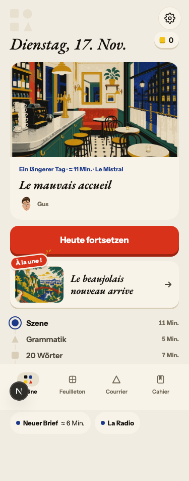

- **The map travels, and that is the richest part.** At the hippodrome the learner places a bet, hears a race, and gets «Tu as appris : la corde, la ligne droite, côte à côte», glossed.

  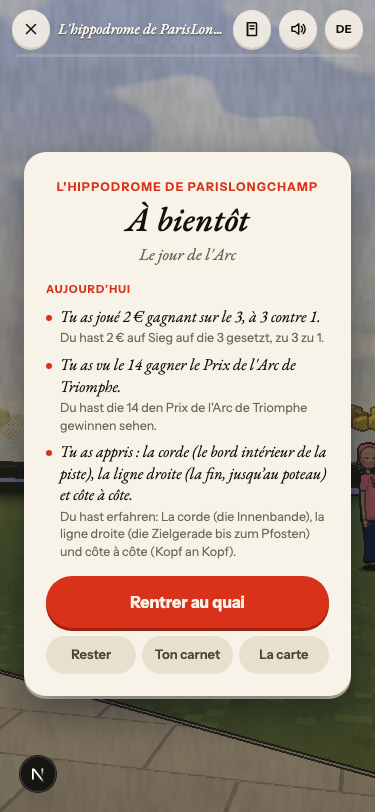

- **Roaming on the quai is thin:** the terrace, about 15 m of quay and the café; objects cannot be tapped; five people speak.
- **The notebook does not read the story.** After seven days it lists Lila and one place, none of the learner's choices.
- **Unfinished places.** The stairwell on day 8 is a blank wall over a tilted floor; the camera frames the betting counter badly; English stage directions appear («to Lila, a whisper»); map labels collide; the episode is labelled «Épisode 8» and «Épisode 2».

  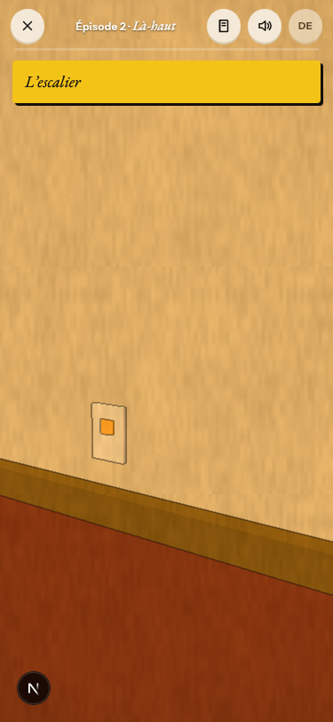

- **Speed:** 5–7 s to enter; the first walk tap blanked the view for 3–7 s. This was software rendering in a headless browser, so it says nothing about an iPhone.

**Not seen.** Sound; the other map places (mairie, gare, hémicycle); most of the built rooms (roof, back room, flats, gérance); anything on a real phone.

**Why it matters.** This is the only part of the product a learner would show to someone else, and it already does two things the flat day lacks: a full correction and a recap of the learner's own choices. Hidden, none of that reaches a tester.

**What I would do.** Package P12 in `docs/implementation/pilot-2026-11-17/README.md`.

## What is good

- The try-before-signup scene.
- The art, the cast, the type and the buttons: one hand throughout, in light and dark.
- The rule card built from a line of today's scene, with silent letters greyed.
- La Forge's correction loop when it judges correctly.
- The story's replies.
- The Journal's idea.
- Offline handling inside a scene, and resuming mid-scene.

## Order of work up to the pilot

1. **Trust (2–3 days).** Remove stored faults from scene corrections; check every printed correction; fix the false accepts and refused right answers found here; switch off automatic downgrading of the level.
2. **The Courrier timeout (an afternoon).**
3. **Shorten the day (2–3 days).** One grammar step, La Forge capped at six, a ten-word deck from the scene and the learner's own words, review cap after an absence. Target fifteen minutes with the story as half.
4. **Hold the thread (2 days).** Yesterday's hook answered in the first panels, a real «previously», page titles, a length floor.
5. **Close the rooms (1 day).** Home, Courrier, Journal; hide the rest; Papier off below B1; first-time notes once; onboarding cards cut.
6. **Language sweep (1–2 days).** One rule, applied to every screen; remove the generator string.
7. **Then your handover's step 8:** walk a full A1-de and B1-en day on the pilot build, on a phone, with sound.

After the pilot: consequences and the season's ending (finding 6), the vocabulary model, the Quartier's place, the writer test.

## What I would cut entirely

- The «Rappel» / «Wiederholung» block around the scene, except the learner's own past mistakes.
- The gold counter and «journée pleine» on learner-facing screens.
- «Noch 5 neue Wörter» and the «25 words a day» banner.
- La Radio.
- The shape and progress onboarding cards.
- The automatic vocabulary check and level re-measurement, for the pilot.
- La Carte and Le Correcteur as separate destinations, for the pilot.
