# Walk · 17 Nov 2026 · nightly explore walk

Main at `60711b3b`. Since the 16 Nov walk (`ac053d76`), main took in:
- the 16 Nov report (#830) and tonight's live report (#854);
- **#836** (the last panel's «À suivre…» no longer opens on a line nobody said; fixes #822), **#833** and **#846** (walk assertions: server banner marker, #196's known match; #794);
- **#831** (after a miss, one copy of a line named twice is asked for, «Compare» above the sheet, the retest is queued; #779);
- **#835** (La Forge: an unchecked answer no longer grows the séance, «Finish» on N/N; fixes #826);
- **#813** (recall drills judge against every right answer; fixes #781, #804, #805);
- **#767** (La Forge: no solution before the second chance) and **#812** («Copy the correction» takes the whole corrected line; fixes #808);
- **#738** (Done screen prints no English before it knows the learner's language; #727), **#793** (singular «1 more new word»; #783);
- the structural packages **#838** (S1/S2 docs), **#839** (R1: La Forge's unread free sentences checked later, flag off), **#840** (S1.1 day brief, shadow), **#841** (S2.1 stored day plan, shadow, flag off), **#842** (deploy gate waits for CI), **#843** (longer A1/A2 pages, «Le soir» for named accounts), **#768** (the walk's fake director writes gap days at every band), **#795** (beta readiness, «looks wrong» tap);
- Quartier forge #820, #848.

`alembic upgrade heads` ran cleanly on a scratch database before the walk (one head, `d7f9b1c3e5a6`).

Fake story provider, local stack, Chromium at 390×844, one persona: `a2-en` (`--fresh --native en --level A2.1`; last played 15 Nov). I signed up through the UI at «I know some basics · A2» as Sam and played off-script with school-French slips (no accents or apostrophes):
- day 1 scene: «Je m appelle Sam, je suis le petit fils de Odile. Mais je ne suis pas ici pour vendre… Et vous, vous etes qui ?», then «Non, pas ce soir, je dors a l hotel. Margaux, pourquoi elle ne donnait jamais cette clé ? Tu etais son amie ?», and I left the key with Margaux («Garde-la pour moi.»);
- day 1 Courrier: the scarf is not mine, «Peut-etre c est a Gus ?», I am at the notary tomorrow;
- day 2 scene: «Non, je vend pas… Je veux ouvrir une librairie au premier etage… Plus simple pour qui ? Pour Solvel ?», nobody reads the letter («Personne»), then I ask Margaux for the key back.

Day 1:
- teaser (Margaux, «Bonjour !», «Un café, s'il vous plaît»), sign-up, character, four onboarding cards, cast page;
- scene «Le mauvais accueil»: two free replies, one choice;
- rule card «Passé composé with avoir», 7 recall drills (one miss on purpose, retried);
- La Forge 7 of 7 on passé composé with avoir (Level 2 → 6), a typed-gap miss and a tile miss, one free sentence unchecked;
- 19 words, Done, Home, Courrier (one reply to Margaux), Cahier, Feuilleton.

Day 2 (clock +1):
- Home «Nº 2 · La clé d'Odile», scene «La lettre»: two free replies, one choice;
- 8 recall drills (my La Forge miss, my Courrier slip «Peut-etre», words, a scene line); no rule card before La Forge;
- La Forge «Forge today's rule» on **Passé composé with être** (its card opens the séance; Level 1 → 6), passé composé with avoir twice as «Review · due today»; one free sentence unread; «Finish» on 10/10;
- 23 words, Done.

Day 7 not played.

Live column: [live walk 17 Nov](../live-walks/2026-11-17.md) (PR #854, merged), production with the real model, release `e81e3e0297e6` (= main before #854), account A1.1 on day 36. Headline: **Q1 and Q12 up to 4 (#576 closed: card, drills, scene and La Forge all on question words); Q6 and Q21 down to 3 (generic Courrier «vous» fallback #538; the same cliffhanger for a third day, #850)**. It filed #849–#853. Its findings are not filed again here.

## Scores (rubric `docs/ops/walk-rubric.md`)

| # | question | 17 Nov a2-en (d1–2) | live 17 Nov | 16 Nov a1-de (d1–2) | 15 Nov a2-en (d1–2) |
|---|---|---|---|---|---|
| 1 | Where am I | 4 | 4 | 4 | 4 |
| 2 | What is at stake | 4 | 4 | 4 | 4 |
| 3 | What to do next | 3 | 3 | 3 | 3 |
| 4 | Scene reacts to my writing | fake | 5 | fake | fake |
| 5 | Story coherent | 3 | 4 | 3 | 3 |
| 6 | Characters consistent | 3 | 3 | 3 | 3 |
| 7 | Image, text, tone fit | 4 | 4 | 4 | 4 |
| 8 | Difficulty fits | 4 | 4 | 4 | 3 |
| 9 | Feedback explained | 2 | 3 | 2 | 2 |
| 10 | Right answers accepted | 3 | 3 | 3 | 3 |
| 11 | French correct | 4 | 3 | 4 | 4 |
| 12 | Clear goal today | 4 | 4 | 4 | 3 |
| 13 | Grammar practised | 4 | 4 | 4 | 4 |
| 14 | Earlier material returns | 4 | 4 | 4 | 4 |
| 15 | I produce French | 4 | 5 | 4 | 4 |
| 16 | Errors, dead ends | 3 | 3 | 3 | 3 |
| 17 | Varied, fun | 3 | 4 | 3 | 3 |
| 18 | Fast enough | 4 | 3 | 4 | 4 |
| 19 | App only | n/a | n/a | n/a | n/a |
| 20 | Satisfying end | 3 | 4 | 3 | 3 |
| 21 | Would come back | 3 | 3 | 3 | 3 |
| 22 | Time vs promise | 3 | 3 | 3 | 3 |

Q14 is scored on day 2 only. Against the last `a2-en` walk (15 Nov) two questions moved, both up: **Q8 3 → 4** and **Q12 3 → 4**. Against last night (`a1-de`) nothing moved. The one 2 (Q9) has its findings (#855 new; #696, #807, #828 again).

**Q12 up to 4 for this persona: the owner's rule of 7 Nov holds for `a2-en` too (#698 after #708).**
- Day 1 taught one rule, passé composé with avoir: card (example from the scene, Marin's «Il a dit ça ?»), recall, La Forge, all on it.
- My day 1 slips («de Odile», «l hotel») put «Le, la, l', les · practising» in the Cahier, with no card. 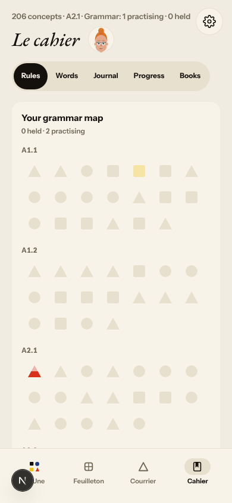
- Day 2's La Forge «Forge today's rule» was the planned **Passé composé with être** (Level 1, its card first), with avoir as «Review · due today». On 15 Nov this persona got the slip rule «Le, la, l', les» as today's rule. 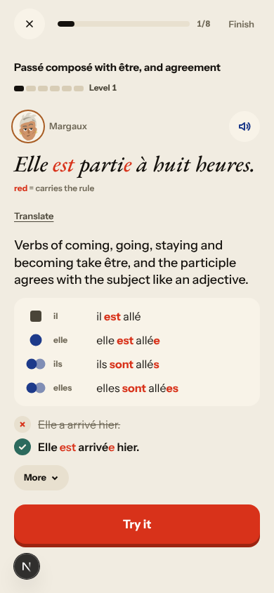 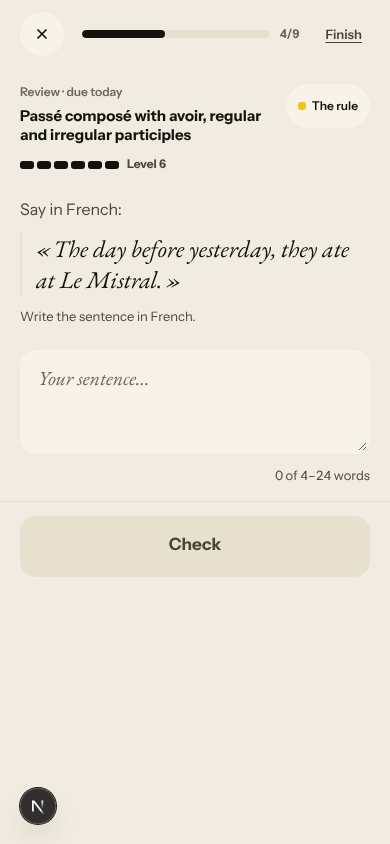
- Not reached again: a day that plans no new rule. Day 2 planned être, so a slip rule as a labelled extra on such a day is still unconfirmed.
- Not 5: day 2 shows no rule card before La Forge (the card opens the séance instead), and none of day 2's 8 recall items is on être.

**Q8 up to 4.** Avoir, then être with agreement, are the right A2 steps; La Forge climbed judge → typed gap → tiles → spot → free sentence, and its feedback named the slip on the way («j ai → j'ai», «reste → resté, a → à») without failing the rule.

**Q9 stays at 2.**
- An unread free sentence lists its basic-check fixes with nothing after the arrow: «J ai →», «derniere →» (#855, new, regression of #767). 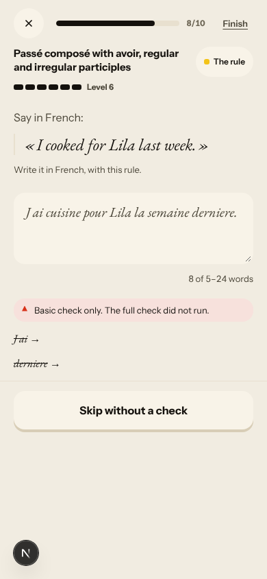
- A typed gap «you wore a hat» → «tu as porte» (only the accent missing) is told «this item needs “vous avez porté”» (#696 again; the English «you» names no tu/vous, and a later free sentence took «tu as mis» as Right). 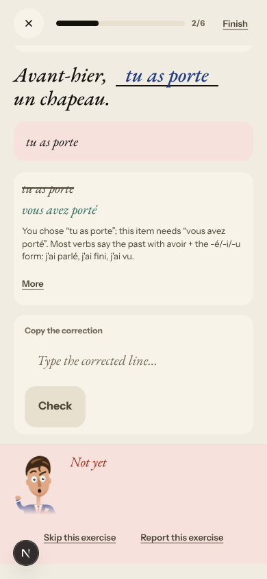
- «Samedi dernier, il a telephone a la banque.» → «Checking is not available right now, so this answer does not count.» (#807 again). 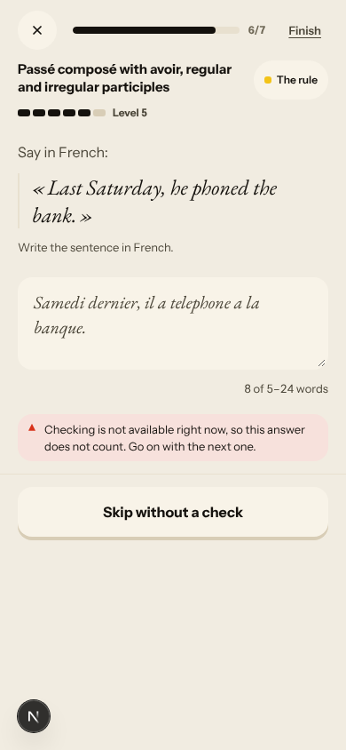
- «You chose “tu as porter”; Most verbs…» on a typed answer (#828 again, in English). 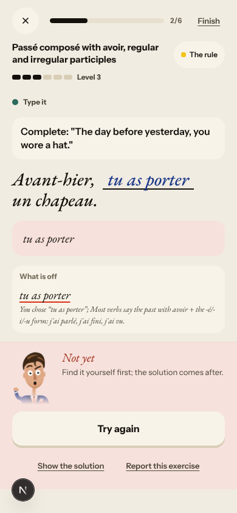
- Courrier: «Peut-etre c est a Gus» → «Peut-être c est à Gus» while «ce n est» and «j ai» are fixed in the same line (#856, new). 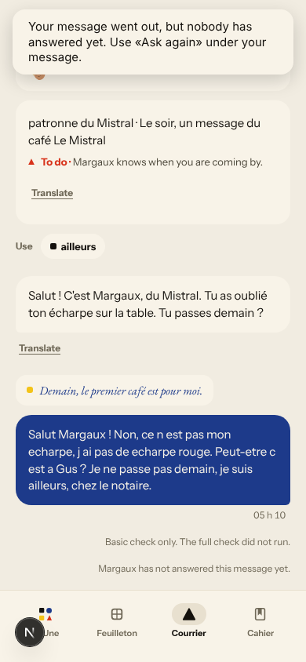
- Good: the recall miss on «j'ai manger» showed the right line and a one-line rule; the agreement miss «Lila est allé» named the rule, and the retry «Lila est allée» passed.

**Q10 at 3.** Accepted: «j ai pris le train» in a correction drill (no note, #562), «Hier, tu as mis les clés sur la table.», «Ce matin, je suis tombée du vélo.», «une lettre» with its article, capitalised tiles. Not accepted: «tu» on a «you» gap (#696).

**Q3, Q16 at 3.**
- The scene's header promised «Exchange 1 of 4» and ended after «3 of 4» (#776 again, on fake). 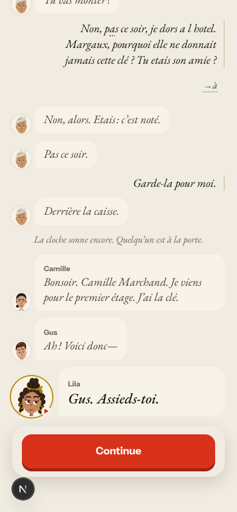
- «Scene finished» appears after the recall drills, under the scene's words, before La Forge (a learner reads it as «done»).
- An unread free sentence offers only «Skip without a check».
- Margaux never answered in the Courrier (#693, fake stack).

**Q5, Q6 at 3 (fake provider).** The authored beats answered by keyword: «Tu etais son amie ?» → Margaux «Non, alors. Etais : c'est noté.» (my misspelt word in her mouth); «Non, je vend pas… Pour Solvel ?» → Camille «Non, alors. Solvel : c'est noté.» and she comes to see the flat on Thursday. 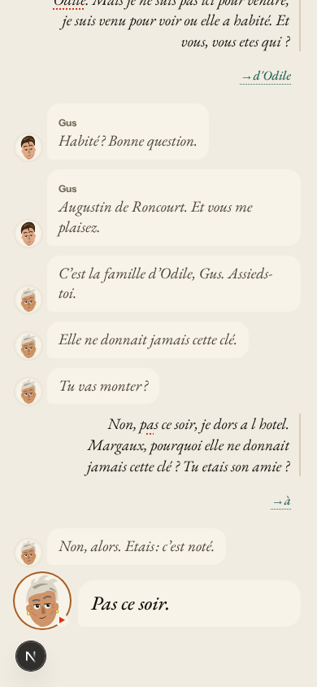 But day 2 honoured day 1's choice: «Ask Margaux for the key you left with her.» 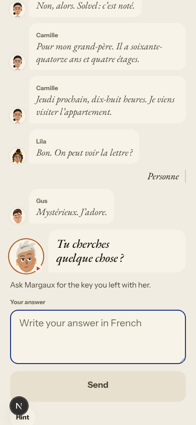 Register held (Gus and Camille vous to me, Margaux and Lila tu; English UI).

**Q20 at 3.** Day 1's «Tomorrow» is a statement («Deux clés pour la même porte», #466); day 2's is a question for the first time, but a generic one («Et demain, qu'est-ce qu'on fait au Mistral ?»). 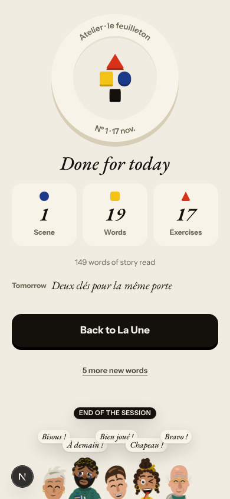 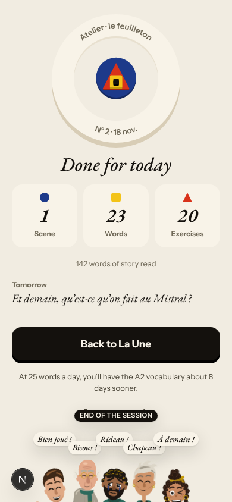

**The best of the night.**
- The fresh path is calm: teaser in four taps, sign-up, figure, four cards, a cast page with one line per person.
- La Forge holds its new promises: no solution before the second chance («Find it yourself first; the solution comes after.»), «Copy the correction» takes the whole line (#808), the counter no longer grows on an unchecked answer (#826), «Finish» on N/N.
- Day 2's words are themed on the flat (l'immeuble, l'étage, le loyer, le propriétaire, déménager).

## Findings, by root cause

Two new findings (#855, #856) and one new root cause (#857). #855 is a child of #333; #856, #825 and #810 are children of #857. All new ones have a **Done when:** comment. Repeats commented: #696, #807, #828, #776, #851 (not reproduced on fake). Re-tests commented: #808, #826, #698 (all hold).

### #857 (new) the basic check prints a «corrected» line that the same check would still correct
The local rules in `app/services/correction_contract.py` fire only in hand-listed contexts (`_BEFORE_C_EST` at `:1781`, the side-by-side «pas plus», the verbs before «a» → «à»), and nothing runs the check again on the line it prints as right. Direction: the corrected line must be a fixed point of the check, and the gates grow from a corpus of walk lines. Guard: `tests/test_basic_check_fixpoint.py`.
- **#856 (new, low)** «Peut-etre c est a Gus» → «Peut-être c est à Gus»: «peut-être» is not in `_BEFORE_C_EST`. 
- **#825** (16 Nov) «je ne pas oublie plus» → «je n'oublie pas plus».
- **#810** (15 Nov) «a» → «à» not fixed after a negation.

### #333 an unread answer is shown as if it were a result
- **#855 (new, medium)** La Forge's unscored branch (`web-frontend/pages/atelier.tsx:4296-4320`) draws `span → replacement` for each basic-check edit, but `solution_gate.withhold_check` (`app/services/solution_gate.py:444-454`, from #767) has blanked every replacement for a second chance an unread answer never gets: «J ai →», «derniere →». 

### #174 a right answer is judged against one stored string
- **#696 (PR #704 open, commented)** «tu as porte» told as the wrong subject; the «you» gap keys only «vous avez porté».

### #146 the day's content and feedback are not driven by one concept
- **#807 (owner, commented)** on both passé composé days the basic check never names a participle without its accent («il a telephone», «J ai cuisine»).

### #542 a drill's instruction is picked from the item's shape, not its task
- **#828 (commented)** «You chose “tu as porter”; Most verbs…» on a typed answer, in English chrome too.

### Seen again, not commented
- #466: day 1 ends on a statement as «Tomorrow».
- #280: 2 of 19 new words on day 1 come from the scene (l'appartement, vendre), 2 of 20 on day 2 (la lettre, l'offre).
- #725: a «From today's scene» card shows the English «letter» as its front (PR #741 open).
- #562: «j ai pris le train» right with no note.
- #693: Margaux did not answer on the fake stack.
- #694: «17 · 11 · 26» on La Forge's end sheet.

### Fake provider (left to the live walk)
- Keyword echoes: «Etais : c'est noté», «Solvel : c'est noté», «Oui. Longtemps, bien.»; Camille comes to see the flat after my «non»; the last panel books my return for Wednesday.
- The scene correction names one slip per reply («d'Odile», «à», «vends», «l'appartement») and misses «m appelle», «ou», «etes», «J ai», «etage».

## Re-tests

| issue | fix | result |
|---|---|---|
| #808 «Copy the correction» rejects the whole line | #812 | **holds**: «Avant-hier, vous avez porté un chapeau.» → «Line copied… Well done!». 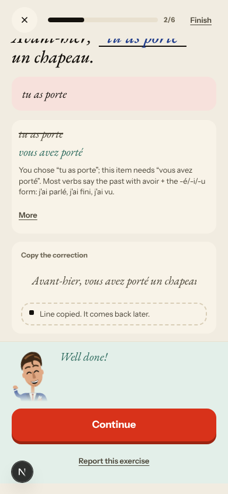 |
| #826 La Forge counter grows on unchecked answers | #835 | **holds**: 6/7 → skip → 7/7; 8/10 → skip → 9/10; «Finish» on N/N. A real miss still adds one (the #831 retest). |
| #698 a slip rule becomes today's rule | #708 | **holds for `a2-en`** (failed for this persona on 15 Nov). |
| #781 / #804 / #805 recall answer variants | #813 | partly reached: capitalised tiles and «une lettre» accepted; the exact «J'ai» tile case and «une» → «one» did not come up. |
| #783 «1 more new words» | #793 | not reached (only «5 more new words»). |
| #779 «Compare» above the sheet | #831 | not reached (no «Compare» on tonight's misses). |
| #851 (live) «I know it» dead under the first-time note | — | not reproduced on fake (0 → 1 with the note open); comment. |
| #727 / #844 French-chrome walk | #738 | not walked (French interface paused). |
| owner rule of 7 Nov (#698) | #708 | **holds** on day 2; the no-new-rule day not reached. |

Root causes advanced: #333 (#855), #857 opened (#856, #825, #810). None closes.

## Scripted walk

- «Browser walk on main» (walk-main.yml): run 54 on `e81e3e02` **failed**; run 55 on tonight's main `60711b3b` **passed**. Runs 52 and 53 on `c6a2e8a3` passed. Open «Main walk fails» issues: #847 (`day-reaches-the-recap`, season-b day 6), #844 (`no-english-on-french-b1`), #837 (`miss-action-above-the-sheet`), #771, #770, #802.
- The scheduled «Browser walk» (walk.yml) run 36 on `65707a82` failed (16 Nov); run 35 passed.
- In tonight's explore walk both days reached Done through La Forge's «Finish» on N/N, then «Next: N words».
