# Walk · 18 Nov 2026 · nightly explore walk

Main at `d1486e6c`. Since the 17 Nov walk (`60711b3b`), main took in:
- the 17 Nov report (#858);
- **#860** (the basic check never prints a corrected line it would still correct: «c'est» after any word, both negation reorders read the word after the verb, «à» after a negated verb; `tests/test_basic_check_fixpoint.py`; fixes #856, #825, #810, the children of #857);
- **#864** (Lexique: «I know it» / «Again» file the card instead of turning it back; fixes #851);
- **#704** (La Forge: a miss is told against the nearest right answer, not the stored key; fixes #696);
- **#863** (the rule drill keys a whole question, never a cut tail with a relative «qui»; fixes #849);
- **#865** (tomorrow's hook does not ask yesterday's question again in other words; #850);
- **#859** (a request refused as «a little fast» is sent again after the wait).

No live report has landed since #854 (see «Live column» below).

`alembic upgrade heads` ran cleanly on a scratch database before the walk (one head, `d7f9b1c3e5a6`).

Fake story provider, local stack, Chromium at 390×844, one persona: `a1-de-fresh` (`--fresh --native de`; last played 16 Nov). I signed up through the UI at «Neu im Französischen · A1» as Jonas and played as a German beginner with real slips:
- day 1 scene: «Bonsoir. Je suis Jonas, le petit fils de Odile. Je suis ici pour vendre le appartement.», then «Oui je monte, je suis fatigue. Mais c est qui, Solvel ?», and I took the key («Je la prends.»);
- day 1 Courrier, to re-test #860: «Salut Lila. Je suis tres fatigue et je ne pas oublie plus Odile. La cle, ce n est pas a moi. Peut-etre c est a Gus ?»;
- day 2 scene: «Non je ne vend pas. Pourquoi plus simple ? C est qui Solvel ?», and Margaux reads the letter.

Day 1 (about 9 minutes of walking):
- teaser (Margaux, «Bonjour !», «Un café, s'il vous plaît»), sign-up, figure, four onboarding cards, cast page;
- scene «Le mauvais accueil»: two free replies, one choice;
- rule card «Ich bin, du bist: Subjektpronomen und être», 2 recall items (one miss on purpose) and a retry;
- La Forge 8 of 8 on être (Level 2 → 5): a judge miss, the speed round, a typed-gap miss and retry, tiles, a spot miss and retry, my own sentence back, two free sentences unread;
- 20 words, Done, Home, Courrier (one reply to Lila), Cahier, Feuilleton.

Day 2 (clock +1, about 5 minutes):
- Home «Nº 2 · La clé d'Odile», scene «La lettre»: one free reply, one choice;
- the known-rule card être; **no new rule card**; 6 recall items (my Courrier slip «a Gus», five words) and a retry;
- La Forge «Regel des Tages schmieden» on **être** again (Level 5 → 6), six free sentences, then the offered «Regelprüfung» (3 of 3, «Die Regel sitzt»);
- 18 words, Done.

Day 7 not played.

**Live column: none tonight.** At 04:16 UTC there was no `claude/live-walk-2026-11-18` branch, no live PR, no `docs/ops/live-walks/2026-11-18.md` on main and no issue touched since midnight UTC. The live walk is the Mac's scheduled task (03:43 Berlin); nothing it writes reached GitHub, so it most likely did not run. The 17 Nov live scores are kept as the nearest live reference.

## Scores (rubric `docs/ops/walk-rubric.md`)

| # | question | 18 Nov a1-de (d1–2) | live 18 Nov | live 17 Nov | 17 Nov a2-en (d1–2) | 16 Nov a1-de (d1–2) |
|---|---|---|---|---|---|---|
| 1 | Where am I | 4 | – | 4 | 4 | 4 |
| 2 | What is at stake | 4 | – | 4 | 4 | 4 |
| 3 | What to do next | 3 | – | 3 | 3 | 3 |
| 4 | Scene reacts to my writing | fake | – | 5 | fake | fake |
| 5 | Story coherent | 3 | – | 4 | 3 | 3 |
| 6 | Characters consistent | 3 | – | 3 | 3 | 3 |
| 7 | Image, text, tone fit | 4 | – | 4 | 4 | 4 |
| 8 | Difficulty fits | 3 | – | 4 | 4 | 4 |
| 9 | Feedback explained | 2 | – | 3 | 2 | 2 |
| 10 | Right answers accepted | 3 | – | 3 | 3 | 3 |
| 11 | French correct | 4 | – | 3 | 4 | 4 |
| 12 | Clear goal today | 4 | – | 4 | 4 | 4 |
| 13 | Grammar practised | 4 | – | 4 | 4 | 4 |
| 14 | Earlier material returns | 4 | – | 4 | 4 | 4 |
| 15 | I produce French | 4 | – | 5 | 4 | 4 |
| 16 | Errors, dead ends | 3 | – | 3 | 3 | 3 |
| 17 | Varied, fun | 3 | – | 4 | 3 | 3 |
| 18 | Fast enough | 4 | – | 3 | 4 | 4 |
| 19 | App only | n/a | – | n/a | n/a | n/a |
| 20 | Satisfying end | 3 | – | 4 | 3 | 3 |
| 21 | Would come back | 3 | – | 3 | 3 | 3 |
| 22 | Time vs promise | 3 | – | 3 | 3 | 3 |

Q14 is scored on day 2 only. Against the last `a1-de` walk (16 Nov) and last night one question moved, down: **Q8 4 → 3**. The one 2 (Q9) has its findings (#893, #894 new; #855, #828, #824 again).

**Q8 down to 3: day 2's La Forge asks for French a beginner was never shown.**
- With être at Level 5–6, La Forge served only free sentences, four of six on a place: «Sie (alle) sind diese Woche in Mexiko.», «Bist du diese Woche in Bordeaux / Brüssel / London?»; the Regelprüfung's own sentence was «Sie ist diese Woche in Japan.» The Cahier still lists «À Paris, en France, au Japon · noch nicht kennengelernt» (#829 again, commented). 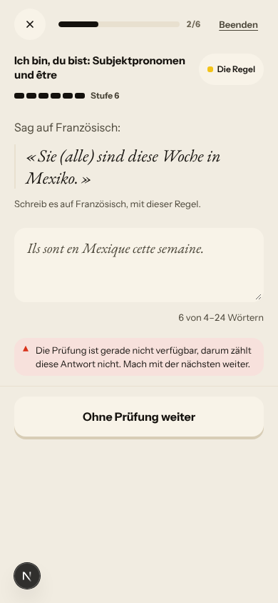
- Day 1 was right for a German beginner: être, then judge → speed round → typed gap → tiles → spot → own sentence → free.

**The owner's rule of 7 Nov (#698): the no-new-rule day was reached, and the rule holds.**
- Day 1 taught être (card, recall, La Forge). My scene slip «le appartement» put «Le, la, l', les · in Übung · 1 Fehler» in the Cahier, with no card. 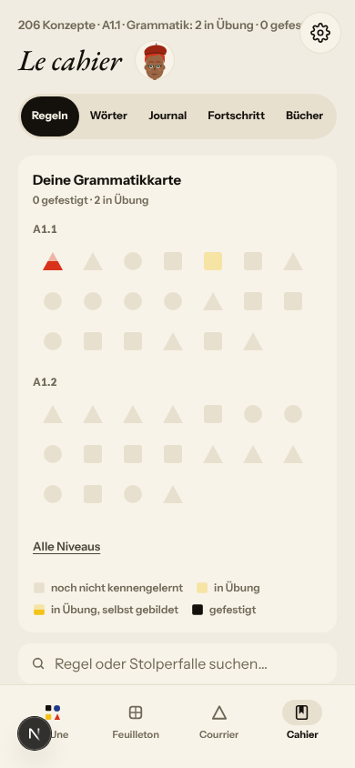
- Day 2 planned **no new rule**: the rhythm's rate is 4.1 a week, one new rule every 2 days (`concept_life.introduction_due`). The known-rule card was être, La Forge's «Regel des Tages» was être, and passing its Regelprüfung closed it («Die Regel sitzt»). 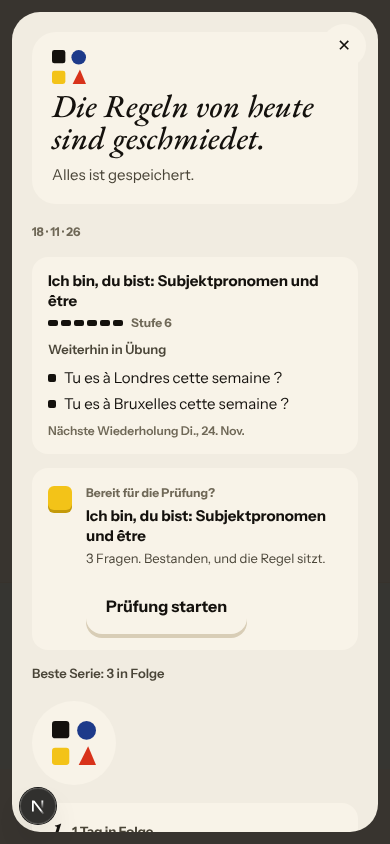
- The slip rule appeared nowhere on day 2: not as today's rule, not as a review, not in recall. So the «labelled review» form itself was not seen; the rule was not due.
- But the slip's «introduced» stamp is counted as one of the week's new rules: after the test-out it was the only stamp in `introductions_in_window`, and it alone made `introduction_due(19 Nov)` false (#895, new).
- Q12 stays 4: day 2's goal (hold être) was clear and closed. Not 5: no new rule is announced as «today we hold être», and the one grammar recall item was mis-tagged (#697).

**Q9 stays at 2.**
- A judge miss prints «„Tu est française, Margaux ? “ stimmt nicht; richtig ist „Tu es française, Margaux ?»: the note is cut at the «?» inside the quotation, its end dropped (#893, new). 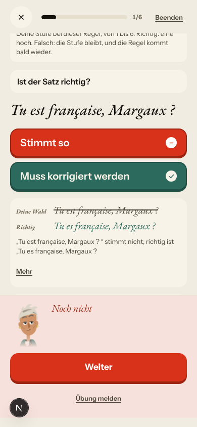
- The first recall item keys «C'est qui, vous ?» against «Vous allez vendre…» under a rule named «Subjektpronomen und être»; the miss names no form (#894, new). 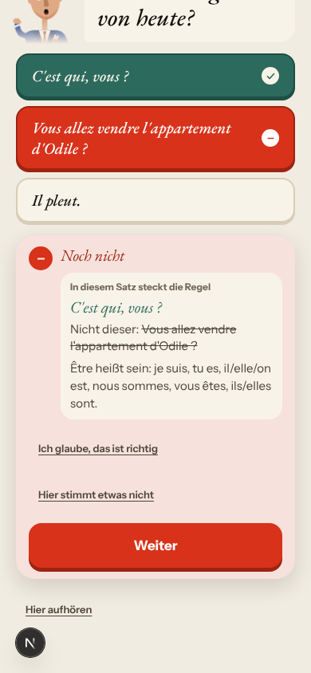
- Unread free sentences still list «~~l hopital~~ →» and «a →» with nothing after the arrow (#855 again). 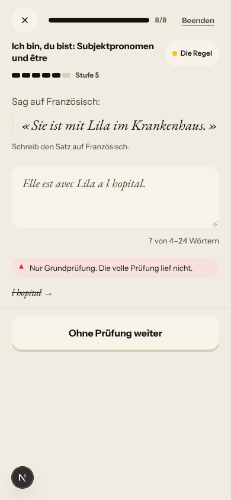
- A typed gap «es» says «Du hast „es“ gewählt; Regel: Ich bin, du bist…» and nothing else before the retry (#828 again). 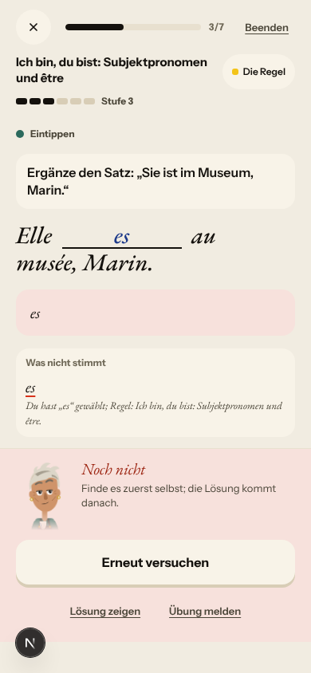
- «Elle et a Paris cette semaine.» (the être slip «et»/«est») is «not checked, does not count» (#824 again). 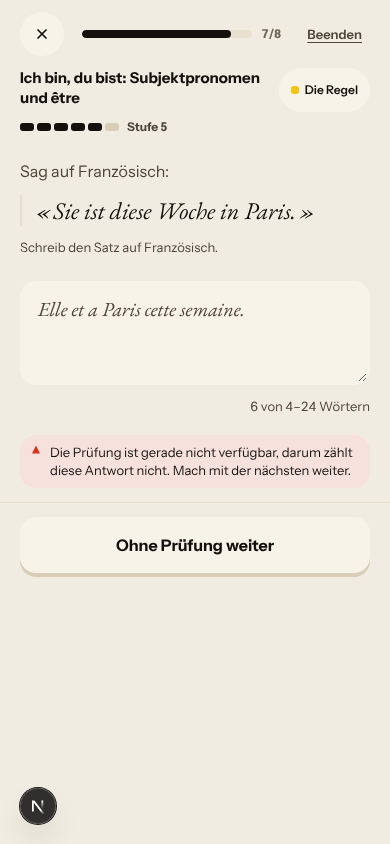
- Good: the Courrier's basic check now prints a right line for all three of #860's cases (re-tests below); the spot miss «est» for «suis» got a hint and no solution, and the retry passed.

**Q10 at 3.** Accepted: «est» on the retry, tiles «Tu es vieille ?», «suis» in a spot, «Il est calme.», «Tu es à Bruxelles cette semaine ?». On fake only: «Je suis gentil.» and «Ils sont en Mexique cette semaine.» not checked; «Elle est en Japon cette semaine.» counted right in the Regelprüfung. 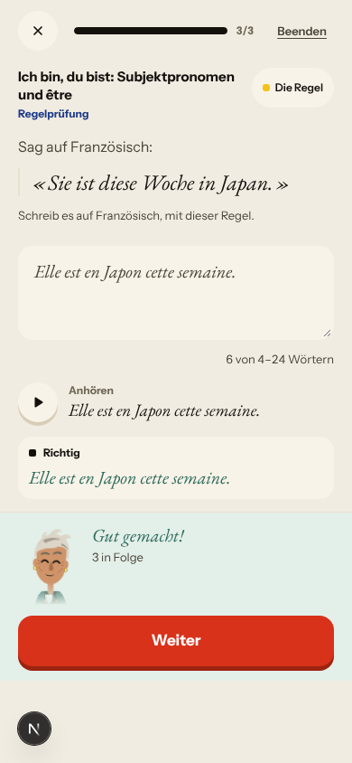

**Q3, Q16 at 3.**
- «Szene · Schritt 2 von 6» jumps to «Regel · Schritt 4 von 6» on day 1; day 2 counts «von 10».
- Day 1's scene promised «Austausch 2 von 4» and ended after the choice (#776, fake).
- «Szene beendet» appears after the recall, before La Forge.
- Lila never answered in the Courrier (#693, fake stack).

**Q5, Q6 at 3 (fake provider).** «Oui je monte… c est qui, Solvel ?» → Margaux «Oui. Solvel, bien. Pas ce soir.»; «Non je ne vend pas» → Camille «Non, alors. Solvel : c'est noté.», then she comes to see the flat on Thursday; Lila: «Tu n'entres pas ? Je comprends.» (I never said so); the last panel books my return for Wednesday. Register held everywhere (Gus, Camille vous; Margaux, Lila tu; German UI du).

**Q17 at 3.** Day 2's La Forge is six free sentences of one shape («Bist du diese Woche in …?» three times).

**Q20 at 3.** Both Done screens end on a statement as «Morgen» («Deux clés pour la même porte», «Ton billet de retour est pour mercredi», #466). Day 2's recall ends on «Fin du chapitre · Ou tu dis au revoir à tout ça ?» (#827 again). 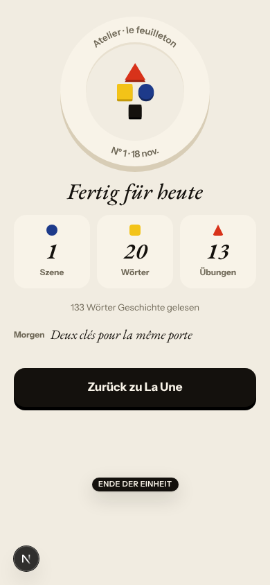 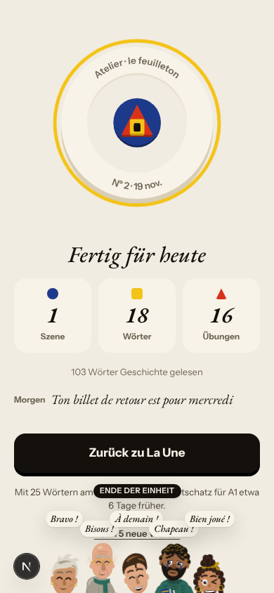

**The best of the night.**
- The fresh path is calm: teaser in four taps, sign-up, figure, four cards, a cast page with one line per person.
- Day 2 opens on «Worum es geht» (keep, share or let go of the flat) before the scene.
- The Regelprüfung offered on La Forge's end sheet is a real moment: three items, «Die Regel sitzt», a rare mark.
- The word drill pairs «ici → hier» and then «hier → gestern», the German learner's false friend, on purpose or not.

## Findings, by root cause

Three new findings (#893, #894, #895) and one new root cause (#896). #893 and #827 are children of #896; #894 of #146; #895 of #143. All new ones have a **Done when:** comment and are `queue:ready`, `lane:code`. Repeats commented: #855, #828, #824, #829, #697, #807, #827. Re-tests commented: #856, #825, #810, #851, #857, #698 (all hold).

### #896 (new) each surface cuts text into sentences with its own regex
`noteSentences` (`web-frontend/lib/correction-notes.ts:26-31`), `question_line` (`app/services/sentence_line.py:109-119`) and `scene_sentences` each end a sentence at `.!?…`; none keeps a quotation, a run-on hesitation or a question chain whole. #863 fixed one splitter for #849, not the others. Direction: one splitter, mirrored on the client, pinned by one shared fixture of walk lines; guard: no module splits on `[.!?…]` without it.
- **#893 (new, low)** a judge miss's note is cut at the quoted «?»: «“.» folds to empty and is dropped. 
- **#827** (16 Nov) «Fin du chapitre · Ou tu dis au revoir à tout ça ?», again. 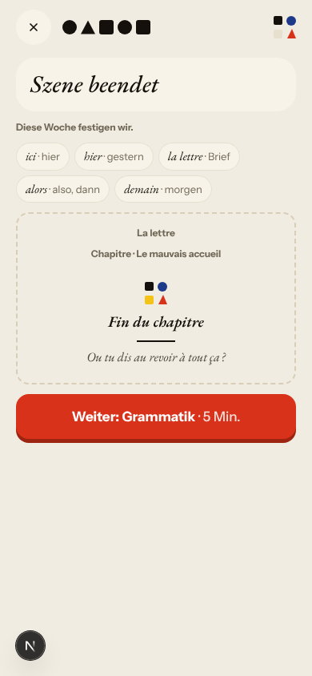

### #146 the day's content and feedback are not driven by one concept
- **#894 (new, low)** the «uses today's rule» item's distractor uses a subject pronoun the rule's title promises; the miss note is the rule's summary, not about the option (`_RECOGNISE_USE`, `app/services/grammar_items.py:70-74`). 
- **#824 (commented)** «Elle et a Paris» not checked.
- **#829 (commented)** day 2's free items and the Regelprüfung on untaught country prepositions.

### #143 the day's progress has no single source of truth
- **#895 (new, low)** `introductions_in_window` (`app/services/concept_life.py:573-592`) counts a rule stamped only by a scene slip as one of the week's new rules and times the spacing from it; #708 taught two other consumers to ask `rule_was_taught` (`:480`). 

### #333 an unread answer is shown as if it were a result
- **#855 (commented)** «l hopital →», «a →». 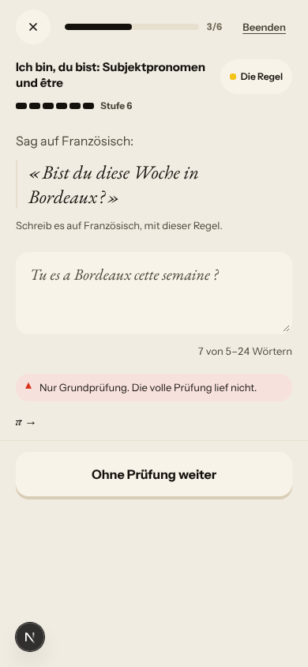

### #542 a drill's instruction is picked from the item's shape, not its task
- **#828 (commented)** «Du hast „es“ gewählt» on a typed gap.

### No root cause named here
- **#697 (owner, commented)** my Courrier slip «a Gus» came back as recall tagged «Regel: Ich bin, du bist… être». 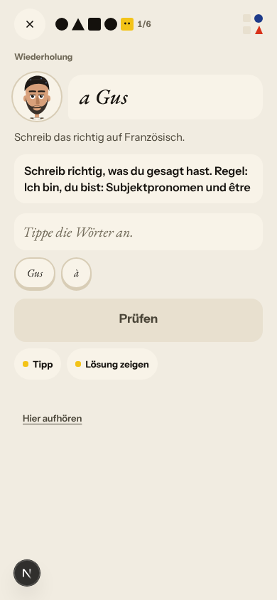
- **#807 (owner, commented)** «Je suis tres fatigue» → «très fatigue»: «très» fixed, «fatigué» not.

### Seen again, not commented
- #466: both days end on a statement as «Morgen».
- #280: 4 of 20 new words on day 1 come from the scene (l'appartement, vendre, la clé, ici), 1 of 14 on day 2 (la lettre).
- #577: Home «Nº 2 · La clé d'Odile» over the scene «La lettre».
- #776: «Austausch 2 von 4», then the scene ends (fake).
- #693: Lila did not answer on the fake stack.
- #694: «18 · 11 · 26» on La Forge's end sheet (also on day 2, the harness clock).
- #469: the first recall of day 2 opens with «Die Wörter · Kurze Wortübungen».

### Fake provider (left to the live walk)
- Keyword echoes and authored beats (above). The scene's correction names one slip per reply («d'Odile», «c'est», «C'est») and misses «petit fils», «le appartement», «fatigue», «vend».
- Free La Forge sentences with no stored key «zählen nicht» («Je suis gentil.», right; «Ils sont en Mexique…»); «Elle est en Japon cette semaine.» counted right in the Regelprüfung.

## Re-tests

| issue | fix | result |
|---|---|---|
| #825 «je ne pas oublie plus» → «je n'oublie pas plus» | #860 | **holds**: → «je n'oublie plus». 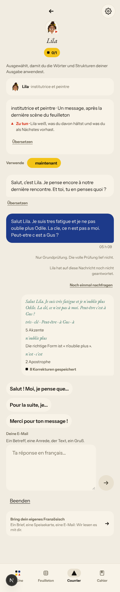 |
| #810 «a» not fixed after a negation | #860 | **holds**: «ce n est pas a moi» → «ce n'est pas à moi». |
| #856 «Peut-être c est à Gus» | #860 | **holds**: → «Peut-être c'est à Gus». |
| #857 (root cause, owner) fixpoint of the basic check | #860 | its three children hold; no new child tonight; labels left (owner). |
| #851 (live) «I know it» dead under the first-time note | #864 | **holds** on fake: 0/20 → 1/20 with the note open; all 20 cards filed. 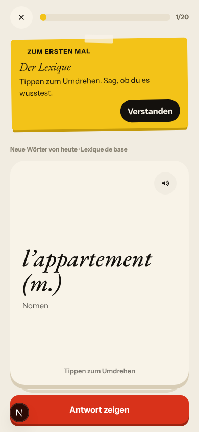 |
| #826 La Forge counter grows on unchecked answers | #835 | **holds**: 8/8 stayed 8/8 after an unread sentence; day 2 6/6. |
| #855 unread sentence «J ai →» | — | **not fixed**: «l hopital →», «a →»; commented, stays `queue:ready`. |
| #696 «Ils ont envoye» told as the wrong subject | #704 | not reached (no subject-ambiguous gap on an A1 être day). |
| #849 (live) rule drill keys a cut question tail | #863 | not reached (no question-word day); the être rule drill keyed a whole sentence. |
| #850 (live, story) the same hook a third day | #865 | live only. |
| owner rule of 7 Nov (#698) | #708 | **holds**, now also on a day that plans no new rule (see Q12 above); side finding #895. |

Root causes: #896 opened (#893, #827); #146 (#894), #143 (#895), #333 (#855), #542 (#828) advanced. None closes.

## Scripted walk

- «Browser walk on main» (walk-main.yml): run 62 on tonight's main `d1486e6c` **failed** in «Walk · en + B1 × 7 days» (the other five shards passed); runs 59 and 61 failed too, 58 and 60 passed. Open «Main walk fails» issues: #868 (`home-headlines-the-episode`, season-b day 7), #844 (`no-english-on-french-b1`), #837, #802, #771, #770.
- The scheduled «Browser walk» (walk.yml) run 37 on `a2d3ccdd` passed (run 36 failed).
- In tonight's explore walk both days reached Done: day 1 through La Forge's «Beenden» on 8/8, day 2 through the Regelprüfung, then «Weiter: N Wörter».
