# Walk · 19 Nov 2026 · nightly explore walk

Main at `d1486e6c`, the same commit as the 18 Nov walk: **nothing has merged to main since 17 Nov**, because every PR's «PostgreSQL · migrations + row locks» check fails (#924, below). The 18 Nov report (#897) is still open and rides in this PR. Since the last `a2-en` walk (17 Nov, `60711b3b`), main took in:
- the 17 Nov report (#858);
- **#860** (the basic check never prints a corrected line it would still correct; fixes #856, #825, #810);
- **#864** (Lexique «I know it» / «Again» file the card; fixes #851);
- **#704** (La Forge: a miss is told against the nearest right answer; fixes #696);
- **#863** (the rule drill keys a whole question; #849), **#865** (tomorrow's hook does not repeat yesterday's question; #850), **#859** (a request refused as «a little fast» is sent again).

The night shift's PRs #899–#906 are open and not on main; nothing of theirs is re-tested as fixed here.

`alembic upgrade heads` ran cleanly on a scratch database before the walk (one head, `d7f9b1c3e5a6`).

Fake story provider, local stack, Chromium at 390×844, one persona: `a2-en` (`--fresh --native en --level A2.1`; last played 17 Nov). I signed up through the UI at «I know some basics · A2» as Sam and played off-script with school-French slips (no accents, no apostrophes):
- day 1 scene: «Bonsoir. Moi c est Sam, j ai venu de Londres… Je ne sais pas si je vend l appartement. Et vous, pourquoi vous etes ici chaque soir ?», then «Je n'ai rien commandé.» (the coffee), «Non, pas tout de suite… Pourquoi elle ne donnait jamais la cle ? Tu as connu Odile longtemps ? Demain je vais chez le notaire.», and I took the key;
- day 1 Courrier to Marin: «Je n ai pas vendu l appartement. J ai garde la cle… Je n ai rien mange, tu connais un bon restaurant ? Peut-etre je reste a Paris, c est fou !»;
- day 2 scene: «Hier soir j ai dormi en haut. J ai trouve une photo de vous avec Odile ! Vous la connaissiez bien ? Je ne vend rien avant le notaire.», and Gus reads the letter.

Day 1 (about 5 minutes of walking from «Let's go» to Done):
- teaser (Margaux, «Bonjour !», «Un café, s'il vous plaît»), sign-up, figure, four onboarding cards, cast page;
- scene «Le mauvais accueil»: two free replies, two choices («Exchange 4 of 4», and it ended there);
- rule card «Passé composé with avoir», 8 recall items (one miss on purpose, retried at the end);
- La Forge 6 of 6 on passé composé with avoir (Level 2 → 6): judge, tiles, a spot answered with «tu» for a «vous» key, three free sentences (one unread, one «not available», one Right);
- 20 words, Done, Home, Courrier (one reply to Marin), Cahier, Feuilleton.

Day 2 (clock +1, about 6 minutes):
- Home «Nº 2 · La clé d'Odile», scene «La lettre»: one free reply, one choice;
- 5 recall items (my Courrier slip «c est», four words); no rule card before La Forge;
- La Forge «Forge today's rule» on **Passé composé with être** (its card opens the séance, Level 1 → 5), avoir twice as «Review · due today»; then the offered test on avoir, 3 of 3, «The rule is yours.»;
- 20 words (4 «Again»), Done.

Day 7 not played.

**Live column: [live walk 19 Nov](../live-walks/2026-11-19.md)** (PR #923, open, red only on the same PostgreSQL check), production with the real model, release `a2d3ccdd` (not main: #860 is still not deployed, #921), account A1.1 on day 37. Headline: **Q4 5 (the scene took up a plain «non», a sick cat and a plastic parrot), Q10 and Q21 up to 4 (#850's new hook holds); Q1, Q2, Q5, Q7 down to 3 (the day's names disagree, «La carte du learner» in «Previously», #917)**. It filed #917–#922. Its findings are not filed again here. There was no live walk on 18 Nov.

## Scores (rubric `docs/ops/walk-rubric.md`)

| # | question | 19 Nov a2-en (d1–2) | live 19 Nov | 18 Nov a1-de (d1–2) | 17 Nov a2-en (d1–2) | live 17 Nov |
|---|---|---|---|---|---|---|
| 1 | Where am I | 4 | 3 | 4 | 4 | 4 |
| 2 | What is at stake | 4 | 3 | 4 | 4 | 4 |
| 3 | What to do next | 3 | 3 | 3 | 3 | 3 |
| 4 | Scene reacts to my writing | fake | 5 | fake | fake | 5 |
| 5 | Story coherent | 3 | 3 | 3 | 3 | 4 |
| 6 | Characters consistent | 3 | 3 | 3 | 3 | 3 |
| 7 | Image, text, tone fit | 4 | 3 | 4 | 4 | 4 |
| 8 | Difficulty fits | 4 | 4 | 3 | 4 | 4 |
| 9 | Feedback explained | 2 | 3 | 2 | 2 | 3 |
| 10 | Right answers accepted | 3 | 4 | 3 | 3 | 3 |
| 11 | French correct | 4 | 3 | 4 | 4 | 3 |
| 12 | Clear goal today | 4 | 4 | 4 | 4 | 4 |
| 13 | Grammar practised | 4 | 4 | 4 | 4 | 4 |
| 14 | Earlier material returns | 4 | 4 | 4 | 4 | 4 |
| 15 | I produce French | 4 | 5 | 4 | 4 | 5 |
| 16 | Errors, dead ends | 3 | 3 | 3 | 3 | 3 |
| 17 | Varied, fun | 3 | 4 | 3 | 3 | 4 |
| 18 | Fast enough | 4 | 3 | 4 | 4 | 3 |
| 19 | App only | n/a | n/a | n/a | n/a | n/a |
| 20 | Satisfying end | 3 | 4 | 3 | 3 | 4 |
| 21 | Would come back | 3 | 4 | 3 | 3 | 3 |
| 22 | Time vs promise | 3 | 3 | 3 | 3 | 3 |

Q14 is scored on day 2 only. Against the last `a2-en` walk (17 Nov) nothing moved. Against last night (`a1-de`) one question moved, up: **Q8 3 → 4** (the A2 path, avoir then être, fits; the A1 être day's untaught countries, #829, were the a1-de persona's). The one 2 (Q9) has its findings (#925 new; #855, #807, #697 again).

**The owner's rule of 7 Nov (#698) holds for `a2-en` again.**
- Day 1 taught one rule, passé composé with avoir: card (Marin's «Il a dit ça ?» from the scene), recall, La Forge, all on it.
- My day 1 slips («l appartement», «n ai», «j ai venu») made no rule card and no slip rule: the Cahier lists only avoir, «practising». On 17 Nov the same slips put «Le, la, l', les · practising» in the Cahier; tonight nothing.
- Day 2's «Forge today's rule» was the planned **Passé composé with être** (Level 1, its card first), with avoir as «Review · due today»; then the end sheet offered avoir's test, and «The rule is yours.» closed it. The Cahier after day 2: avoir held, être practising, no third rule.
- The no-new-rule day was confirmed on 18 Nov; this persona's day 2 planned être, so it was not reached again.

**Q9 stays at 2.**
- Courrier: «Je n ai pas vendu… Je n ai rien mange» → the list says «n'ai · l'appartement · J'ai · c'est · n'ai», the printed line keeps «Je n ai rien mange» (#925, new). 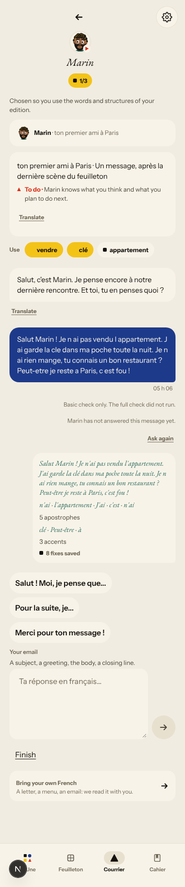
- Unread free sentences still list «derniere →» and, on the être day, «allé →» for the rule's own agreement slip, with nothing after the arrow (#855 again; fix PR #899 open). 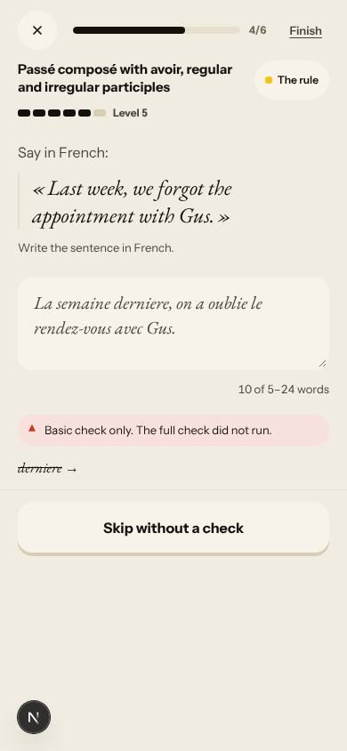 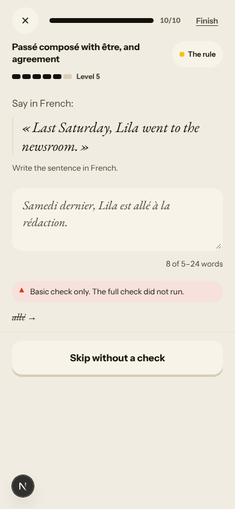
- «Ce matin, tu as chante au Mistral.» → «Checking is not available right now, so this answer does not count.»; «oublie», «garde», «mange» never named (#807 again). 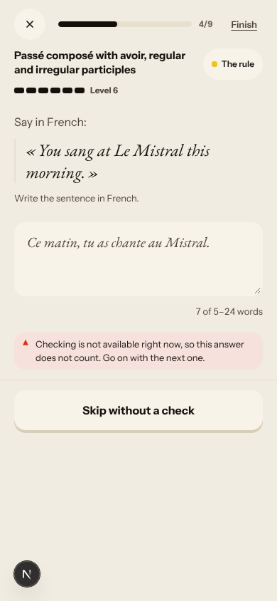
- Recall «c est» under «Rule: Passé composé with avoir» (#697 again). 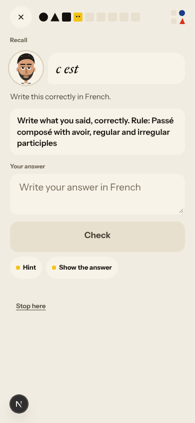
- Good: the avoir recall miss «j'ai manger» showed the right line and one sentence of rule; La Forge named «ferme → fermé» and still counted the fix; the être miss «Gus a sorti» said «this item needs “Gus est sorti”» and why (#828's «You chose» is right on a choice item).

**Q10 at 3.**
- Accepted: «Tu as cherché les clés hier.» on a «vous» key and «Hier soir, tu as goûté la soupe.» (#696 holds after #704), «Elle a ferme…» with its accent named, «l appartement» in a word drill, «J ai pris le train» (no note, #562).
- Refused: «Tu es arrivé à la gare samedi dernier.» for «You arrived…», with «“arrivé” … is wrong» (#926, new). 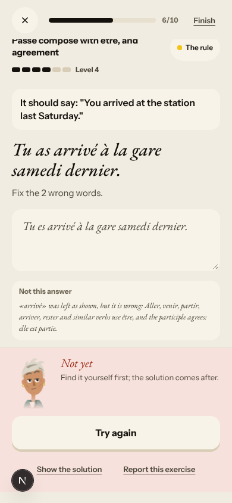
- «Copy the correction» refused «La semaine derniere, Gus est sorti tard.» with «Not quite» and no mark (only the accent of «dernière» differs; #562 commented). 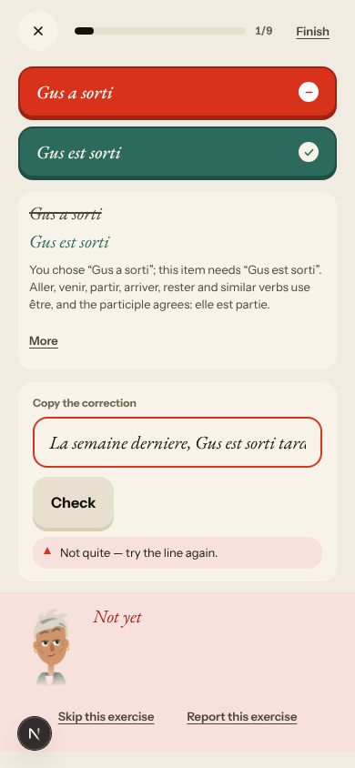
- The end sheet lists «Vous avez cherché les clés hier.», which I never wrote, for my right «Tu as cherché…» (#927, new). 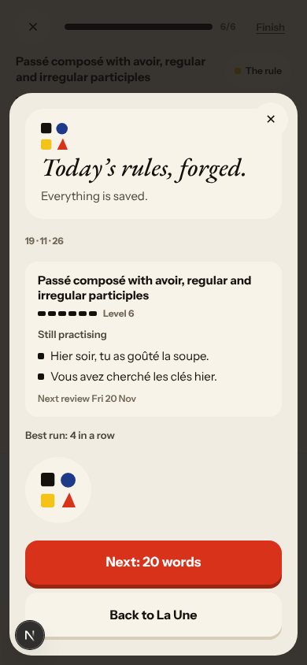
- On fake only: «Samedi dernier, ils ont invité Lila.», «Ce matin, il a donné les clés à Margaux.» «not checked, does not count».

**Q3, Q16 at 3.**
- «Scene · Step 2 of 11» jumps to «Rule · Step 4 of 11»; «Scene finished» appears after the recall, before La Forge.
- The Courrier says «1/3 words used» after «vendu» and «cle» (#928, new). 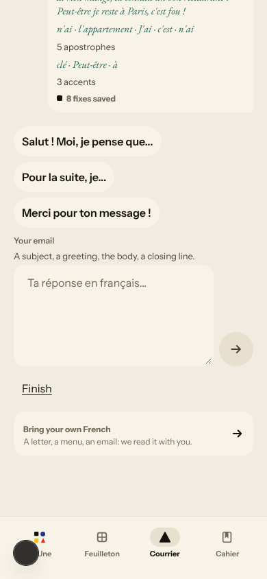
- Marin never answered in the Courrier (#693, fake stack).
- Good: the scene's «Exchange 4 of 4» ended after the fourth exchange on day 1, and day 2's «1 of 2» after the second (#776 not seen on fake tonight). 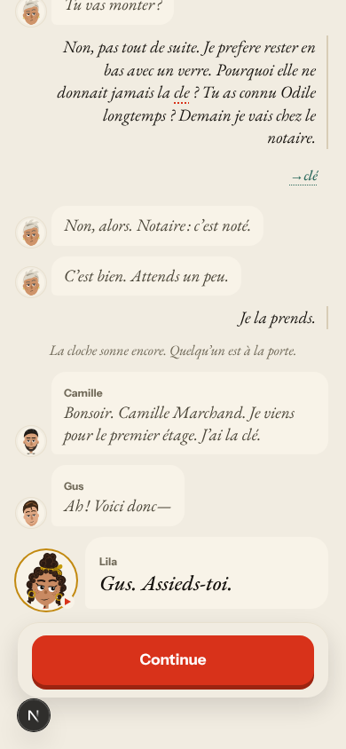

**Q5, Q6 at 3 (fake provider).** «…pourquoi vous etes ici chaque soir ?» → Gus «Chaque ? Bonne question.»; «Demain je vais chez le notaire» → Margaux «Non, alors. Notaire : c'est noté.»; on day 2 «Plus simple pour Solvel, peut-etre» → Camille «Peut-etre ? Bonne question.» (my unaccented word in her mouth), and after «Je ne vend rien» she comes to see the flat on Thursday. The key I took on day 1 is not mentioned on day 2. Register held (Gus and Camille vous to me, Margaux and Lila tu; English UI).

**Q20 at 3.** Both Done screens end on a statement as «Tomorrow» («Deux clés pour la même porte», «Ton billet de retour est pour mercredi», #466). 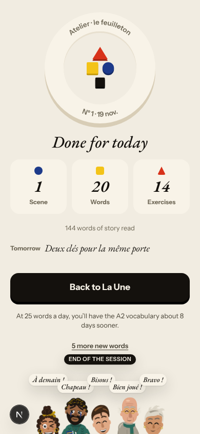 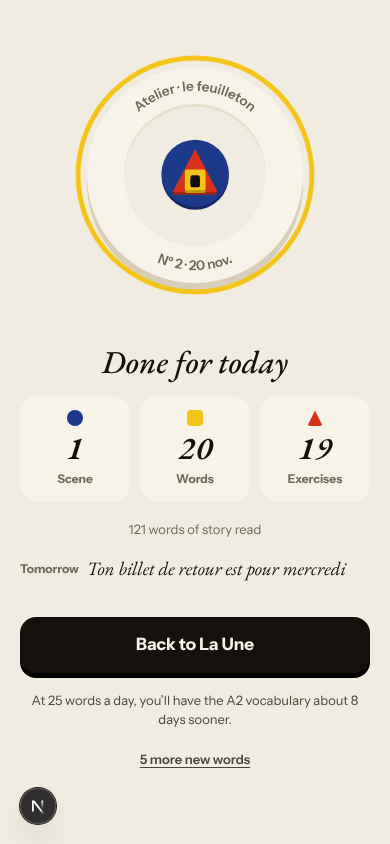

**The best of the night.**
- The fresh path is calm: teaser in four taps, sign-up, figure, four cards, a cast page with one line per person.
- Day 2's test on avoir is a real moment: three items, my own sentence among them, «The rule is yours.», a rare token.
- The Lexique «I know it» counts on every card, both days, also after «Again» (#851 holds). 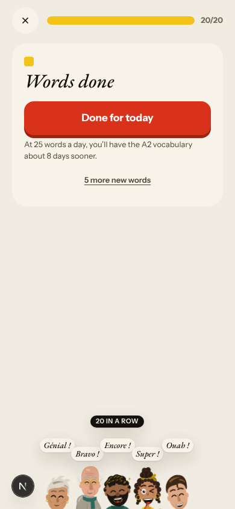
- La Forge tells a tu answer on a vous key right (#696 holds). 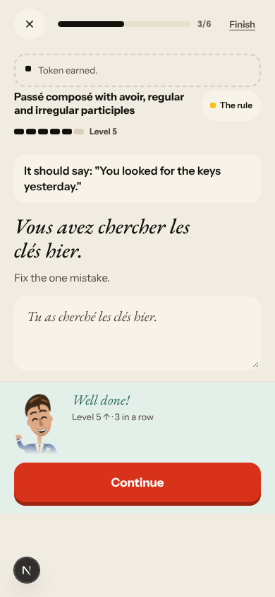

## Findings, by root cause

Four new findings (#925–#928) and one CI blocker (#924). #925 is a child of #857, #926 and #927 of #174, #928 of #143. All new ones have a **Done when:** comment; #925–#928 are `queue:ready`, `lane:code`, `size:S`. Repeats commented: #855, #807, #697, #562. Re-test commented: #696 (holds). No new root cause: each new finding fits an open one.

### CI: no PR can go green (#924, new, high, owner)
Since about 00:30 UTC on 18 Nov every PR fails `tests/test_production_recovery_pg.py::test_current_schema_dump_restores_and_is_verified` with `pg_restore: error: … unrecognized configuration parameter "transaction_timeout"`: `ubuntu-latest` became 26.04, whose client tools are newer than the job's `postgres:15` service. Nothing has merged since: #897 (18 Nov report), this report, the live report #923 and the night shift's #899–#906 all wait, and #860 is still not live (#921). The fix is draft PR #892 (CI pinned to 24.04 with `postgresql-client-15`, a restore drill that refuses a mismatched major, two guard tests); it changes CI, an owner-only path. Filed as #924 (`area:ci`, `sev:high`, `queue:owner`, `lane:code`, `size:S`); **Done when:** the PostgreSQL job is green on main and on PRs.

### #857 the basic check prints a «corrected» line that the same check would still correct
- **#925 (new, medium)** a slip written twice is fixed once in the printed line: the errata hold `n ai → n'ai` twice and the stored `corrected_answer` is right, but `verdicts._errata_as_proposed` (`app/services/verdicts.py:83-104`) drops a fix whose `(span, replacement)` it has seen, so `check.corrected` (`app/core/verdict.py:192`) never places the second. #860's rules are fine; the fixpoint guard has to run on what the screen prints. 

### #174 a right answer is judged against one stored string
- **#926 (new, medium)** «Tu es arrivé» refused: `FR2_A21_PC_ETRE` `pc-etre-end` renders tu as feminine, and `item_bank.with_person_variants` (`app/services/item_bank.py:1595-1619`) will not add the masculine because it is the item's own agreement trap; the English names no gender. 
- **#562 (commented)** a third treatment of a missing accent: «Copy the correction» refuses «derniere» with «Not quite» and no mark.
- **#927 (new, low)** the end sheet's line for a right `transform` answer is always the item's key (`AtelierService._forge_proof_line`, `app/services/atelier.py:8679-8680`), against its own docstring. 

### #143 the day's progress has no single source of truth
- **#928 (new, low)** the Courrier ribbon decides «used» by a substring test on the client (`ribbonWords`, `web-frontend/pages/missions.tsx:235-260`), not from the server's record of used words: «vendu», «cle» leave 1/3. 

### #333 an unread answer is shown as if it were a result
- **#855 (commented; PR #899 open)** «derniere →», «allé →».

### #146 the day's content and feedback are not driven by one concept
- **#807 (owner, commented)** «tu as chante», «on a oublie», «nous sommes passes» never named.
- **#697 (owner, commented)** my Courrier slip «c est» came back tagged «Rule: Passé composé with avoir».

### Seen again, not commented
- #466: both days end on a statement as «Tomorrow».
- #280: 3 of 20 new words on day 1 come from the scene (l'appartement, la clé, vendre), 2 of 20 on day 2 (la lettre, l'offre).
- #725: the «From today's scene» card for vendre shows «to sell» as its front.
- #577: Home «Nº 2 · La clé d'Odile» over the scene «La lettre».
- #693: Marin did not answer on the fake stack.
- #694: «19 · 11 · 26» on La Forge's end sheet on both days (the harness clock).

### Fake provider (left to the live walk)
- Keyword echoes and authored beats (above). The scene correction names one slip per reply («vends», «clé», «j'ai») and misses «j ai venu», «etes», «prefere», «trouve», «Peut-etre».
- Free La Forge sentences that do not match a stored key are «not checked» («Samedi dernier, ils ont invité Lila.»).

## Re-tests

| issue | fix | result |
|---|---|---|
| #696 «tu» on a «you» item told as the wrong subject | #704 | **holds**: «Tu as cherché les clés hier.» on a vous key → Well done; «Hier soir, tu as goûté la soupe.» Right. Commented.  |
| #856 / #825 / #810 basic-check fixpoint | #860 | **hold** for their cases: «Peut-etre … c est» → «Peut-être … c'est», «a Paris» → «à Paris»; new sibling #925 (a repeated slip). |
| #851 «I know it» dead | #864 | **holds**: 0/20 → 20/20 on day 1, and on day 2 with four «Again». |
| #826 La Forge counter grows on unchecked answers | #835 | **holds**: 4/6 → skip → 5/6 of 6; day 2's total grows only on real misses (#831). |
| #776 «Exchange N of M» wrong on fake | — | not seen tonight: «4 of 4» and «1 of 2» ended where they said. Live-walk issue, left. |
| #849 rule drill keys a cut question | #863 | not reached (no question-word day). |
| #850 the same hook again | #865 | live only; the live walk says it holds. |
| #855 unread «J ai →» | PR #899 (open) | not on main; seen again, commented. |
| owner rule of 7 Nov (#698) | #708 | **holds** (see above). |

Root causes advanced: #857 (#925), #174 (#926, #927), #143 (#928). None closes.

## Scripted walk

- «Browser walk on main» (walk-main.yml): no run since run 62 on `d1486e6c` (17 Nov), which **failed** in «Walk · en + B1 × 7 days» (#868; fix PR #906 open). Open «Main walk fails» issues: #868, #844, #837, #802, #771, #770.
- The scheduled «Browser walk» (walk.yml) run 38 on `d1486e6c` (18 Nov) **passed**.
- In tonight's explore walk both days reached Done: day 1 through La Forge's «Finish» on 6/6, day 2 through the avoir test, then «Next: 20 words».
