# Walk · 20 Nov 2026 · nightly explore walk

Main at `7abacf8c`. Since the 19 Nov walk (`d1486e6c`), main took in only five things, none of them app code a learner sees:
- **#892** (CI: the PostgreSQL job pins its client tools to the server's major; the restore drill refuses mismatched versions). It fixed #924: CI on main is green on every push since (run 1468 on `e31dc73b` through run 1503 on `7abacf8c`, «PostgreSQL · migrations + row locks» passed). **#924 closed tonight.**
- the 18 and 19 Nov walk reports (#929);
- two Quartier forge PRs (#883 Odile's frying pan, #945 Romy's tuque);
- tonight's live walk report (#952).

**None of the fixes that were waiting merged.** The night shift's #899, #902, #903, #905, #906 are open with `loop:merge-ready`; #900, #901, #904 were closed (failed verify; #930 now carries #896/#893); the pilot trains #911–#916 are open. So no code-lane walk-finding has a fix merged since the last walk, and nothing is re-tested as fixed tonight. The ones I reached are commented as still seen (below).

`alembic upgrade heads` ran cleanly on a scratch database before the walk (one head, `d7f9b1c3e5a6`).

Fake story provider, local stack, Chromium at 390×844, one persona: `a1-de-fresh` (`--fresh --native de`; last played 18 Nov). I signed up through the UI at «Neu im Französischen · A1» as Jonas and played a German beginner with real slips:
- day 1 scene: «Bonsoir. Je m appelle Jonas, je suis le petit-fils de Odile. Je suis ici pour le appartement. Je vend.», then «Oui, je monte. Demain je vais a le notaire. Mais c est qui, Solvel ?», and I left the key with Margaux («Garde-la pour moi.»);
- day 1 Courrier to Marin: «Salut Marin. Maintenant je suis a l appartement de Odile. Je pense je vend, mais je ne sais pas. Tu es tres gentil. Jonas»;
- day 2 scene: «Non. Je suis pas sur. Pourquoi c est plus simple ? Solvel, c est qui ?», Lila reads the letter, then «Oui, la cle s il te plait. Elle et derriere la caisse ?».

Day 1 (about 6 minutes of walking from «Loslegen» to Done):
- teaser (Margaux, «Bonjour !», «Un café, s'il vous plaît»), sign-up, figure, four onboarding cards, cast page;
- scene «Le mauvais accueil»: two free replies, one choice;
- rule card «Ich bin, du bist: Subjektpronomen und être», 2 recall items (one miss on purpose) and a retry;
- La Forge 6 of 6 on être (Level 2 → 5): a judge miss, the speed round (4 of 4), a typed-gap miss and retry, tiles, a spot miss («et») and retry, my own sentence back, two free sentences unread;
- 20 words, Done, Home, Courrier (one reply to Marin), Cahier, Feuilleton.

Day 2 (clock +1, about 8 minutes):
- Home «Nº 2 · La clé d'Odile», «Worum es geht», scene «La lettre»: two free replies, one choice. The scene remembered day 1: «Bitte Margaux um den Schlüssel, den du bei ihr gelassen hast.»;
- **a new rule, Avoir** (card, 3 recall items with two misses and retries);
- La Forge «Regel des Tages schmieden» on Avoir (Level 1 → 6) with être twice as «Wiederholung · heute fällig» (my own «Elle et vieille.» back), then the offered Regelprüfung on être (#954);
- 23 words, Done.

Day 7 not played.

**Live column: [live walk 20 Nov](../live-walks/2026-11-20.md)** (on main, #952), production with the real model, release `d6208e22254a`, account A1.1 on day 38. Headline: **Q6 up to 4 (Courrier no longer slips into vous); Q10 and Q11 down to 2 (La Forge corrects «Elle est chaud» to the wrong «Elle a chaude ce soir» and refuses the right «Elle a chaud», #946); Q12 down to 3 (card and drills on question words, La Forge on Avoir, #947); Q4 down to 4 («Exchange 3 of 3» for replies 3 to 5, #948).** It filed #946–#951; they are not filed again here. #860 is live now (#921 commented by the live walk).

## Scores (rubric `docs/ops/walk-rubric.md`)

| # | question | 20 Nov a1-de (d1–2) | live 20 Nov | 19 Nov a2-en (d1–2) | 18 Nov a1-de (d1–2) |
|---|---|---|---|---|---|
| 1 | Where am I | 4 | 4 | 4 | 4 |
| 2 | What is at stake | 4 | 4 | 4 | 4 |
| 3 | What to do next | 3 | 3 | 3 | 3 |
| 4 | Scene reacts to my writing | fake | 4 | fake | fake |
| 5 | Story coherent | 3 | 4 | 3 | 3 |
| 6 | Characters consistent | 3 | 4 | 3 | 3 |
| 7 | Image, text, tone fit | 4 | 4 | 4 | 4 |
| 8 | Difficulty fits | 3 | 4 | 4 | 3 |
| 9 | Feedback explained | 2 | 3 | 2 | 2 |
| 10 | Right answers accepted | 3 | 2 | 3 | 3 |
| 11 | French correct | 4 | 2 | 4 | 4 |
| 12 | Clear goal today | 4 | 3 | 4 | 4 |
| 13 | Grammar practised | 4 | 4 | 4 | 4 |
| 14 | Earlier material returns | 4 | 4 | 4 | 4 |
| 15 | I produce French | 4 | 5 | 4 | 4 |
| 16 | Errors, dead ends | 3 | 3 | 3 | 3 |
| 17 | Varied, fun | 4 | 4 | 3 | 3 |
| 18 | Fast enough | 4 | 3 | 4 | 4 |
| 19 | App only | n/a | n/a | n/a | n/a |
| 20 | Satisfying end | 3 | 4 | 3 | 3 |
| 21 | Would come back | 3 | 3 | 3 | 3 |
| 22 | Time vs promise | 3 | 3 | 3 | 3 |

Q14 is scored on day 2 only. Against the last `a1-de` walk (18 Nov) one question moved, up: **Q17 3 → 4**. Against last night (19 Nov, a2-en): Q17 3 → 4, Q8 4 → 3. The one 2 (Q9) has its findings (#954 new; #893, #894, #855, #828, #852, #809 again).

**Q17 up to 4: day 2 had a new rule and a varied séance.**
- Day 2 brought Avoir (card, recall, La Forge) instead of 18 Nov's six free sentences of one shape: choice gaps, a judged sentence, a typed gap, a find-the-mistake, my own day-1 slip («Elle et vieille.») to fix, free sentences, two «Marke verdient», «7 in Folge», and the Regelprüfung's rare token.
- Day 1 kept its good order: judge → speed round → typed gap → tiles → spot → own sentence → free.

**Q8 at 3 (down from 19 Nov's 4, the same as the last a1-de walk): day 1's La Forge asks a total beginner for French nobody showed.**
- Its first two items are «Tu est en Inde cette semaine, Lila ?» and «Tu ___ au Brésil cette semaine, Margaux ?», while the Cahier lists «À Paris, en France, au Japon · noch nicht kennengelernt» (#829 again, commented; #903 open).
- The two free sentences ask «Ich bin in der Redaktion.» and «Sie (alle) sind ernst.»: «rédaction» and «sérieux» were never on a card or in the 20 words.
- Day 2 was right for the level: avoir with faim, soif, âge, frères.

**The owner's rule of 7 Nov (#698, «Nur als Extra»): it holds.**
- Day 1's scene slip «le appartement» put «Le, la, l', les · in Übung · wackelig · 2 Fehler» in the Cahier, with no card and no drill.
- Day 2's «today's rule» slot was **Avoir**, the next rule of the A1 path, not the slip rule; La Forge's «Regel des Tages» was Avoir; the only review in it was être (yesterday's rule, «Wiederholung · heute fällig»). The slip rule appeared nowhere on day 2, so its labelled-review form was not seen (not due).
- Side note on #895 (open, PR #905 not merged): unlike 18 Nov, the slip stamp did not stop day 2's new rule tonight; on 18 Nov day 1 ended with être's test-out, tonight it did not, so the window differed. Not a re-test; #895 stays as it is.

**Q9 stays at 2.**
- The Regelprüfung's own sentence «Ils sont fatigues.» (rule right, accent missing): **«Die Aufgabe · Die Antwort erfüllt die Aufgabe noch nicht. Lies sie noch einmal und versuch es erneut.» · «Noch nicht»**, no corrected line and no retry button; after «Übung überspringen» the result says **«Die Regel sitzt. 3 von 3 richtig, der eigene Satz inklusive.»** (#954, new). 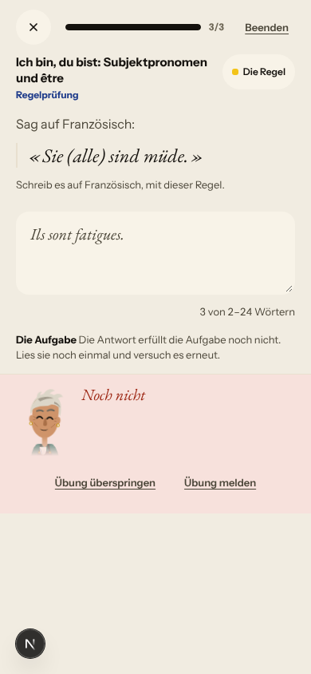 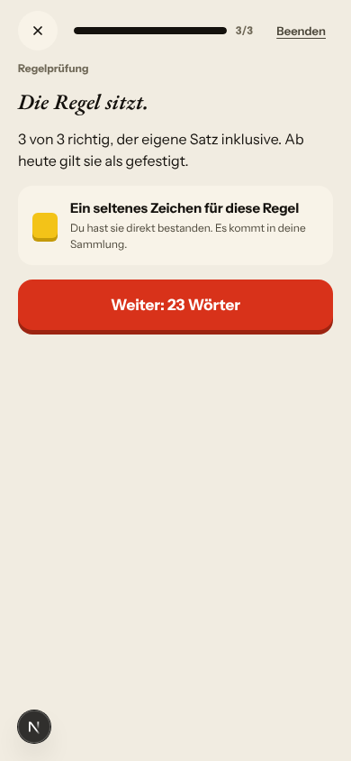
- Unread free sentences print fixes with nothing after the arrow, now on the day's own rule: «Ils est serieux.» → «est →», «serieux →»; «le redaction» → «redaction →» (#855 again). 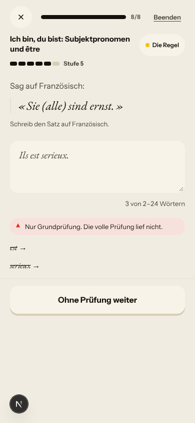
- A judge miss is still cut at the quoted «?»: «„Tu est en Inde cette semaine, Lila ? “ stimmt nicht; richtig ist „Tu es en Inde cette semaine, Lila ?» (#893 again). 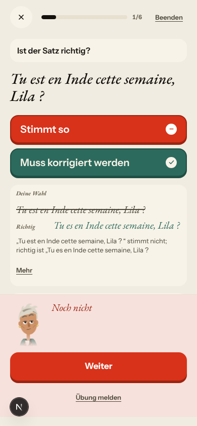
- A typed gap «est»: «Du hast „est“ gewählt; Regel: Ich bin, du bist…» (#828 again). 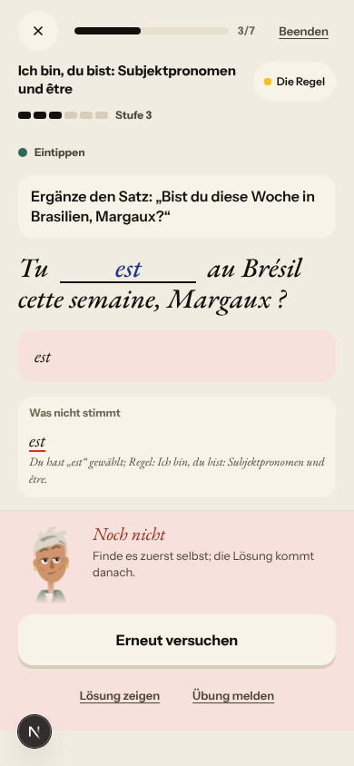
- The first être recall item keys «C'est qui, vous ?» against «Vous allez vendre…» and answers the miss with the rule's summary (#894 again). 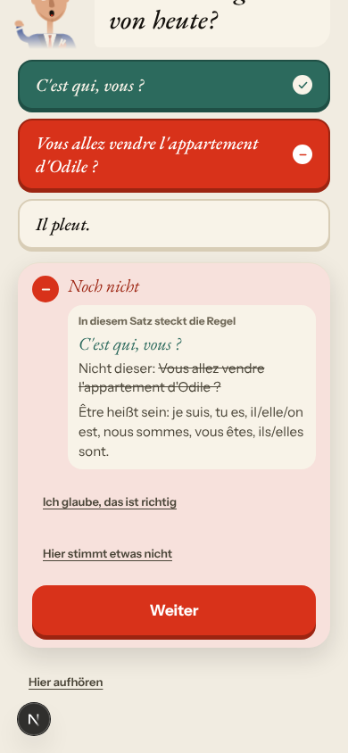
- Choice misses on Avoir name the answer, not the reason: «Du hast „Ils sont“ gewählt; hier ist „Ils ont“ nötig.» for «Lila, sie sind heute Abend müde» → «___ sommeil» (#852, commented). A spot «et» for «es»: «Du hast «et» geschrieben; Être heißt sein.» (#809, commented). 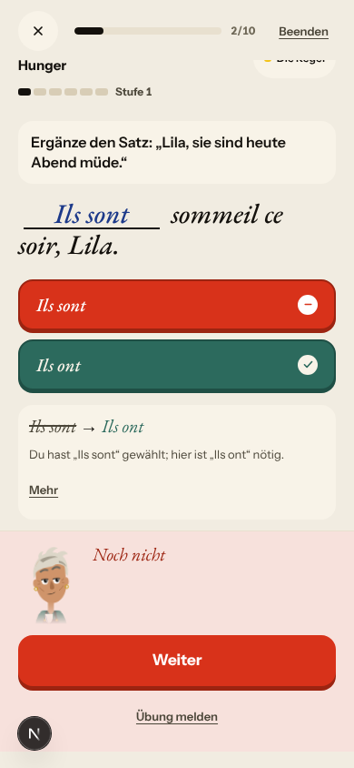
- Good: the recall miss «Je suis vingt ans.» got «Je suis vingt ans. → J'ai vingt ans. Avoir heißt haben; auch für Alter, Hunger, Durst und Kälte»; a tile order miss got «Ab „j'ai“ stimmt die Reihenfolge nicht.»; the Courrier's basic check gave «d'Odile» with «« de » verliert vor einem Vokal… seinen Vokal» and «vends» with «Mit « je » endet dieses Verb auf -s».

**Q10 at 3.** Accepted: «es» on the retry, the tiles, «est» in a spot, «vous avez» typed lowercase for «Vous avez», «Je suis intelligent.», «Tu as soif ce soir ?», the Regelprüfung's corrected «Ils sont au marché du canal.». Not checked on fake: «Il est soif ce soir.» (the avoir card's own trap, #824 again). 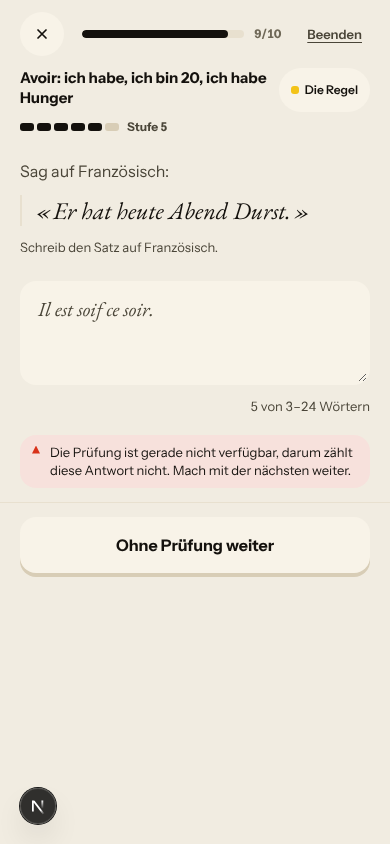

**Q3, Q16 at 3.**
- «Szene · Schritt 2 von 6» jumps to «Regel · Schritt 4 von 6» on day 1; day 2 counts «von 7».
- Day 1's scene said «Austausch 3 von 4» on the choice and ended there (#776, fake).
- «Szene beendet» comes after the recall, before La Forge, both days.
- The Regelprüfung item says «versuch es erneut» and offers only «Übung überspringen» (#954).
- The Courrier tells a beginner to write a friend an e-mail with «Ein Betreff, eine Anrede, der Text, ein Gruß» (#953, new). 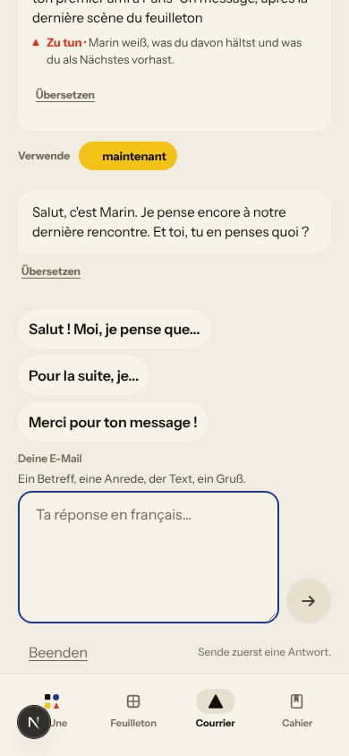
- Marin did not answer, «Noch einmal nachfragen» did nothing (#693, fake stack).

**Q5, Q6 at 3 (fake provider).** Keyword echoes: «… Mais c est qui, Solvel ?» → Margaux «Oui. Solvel, bien. Pas ce soir.»; «Non. Je suis pas sur…» → Camille «Non, alors. Solvel : c'est noté.»; «Elle et derriere la caisse ?» → «Oui. Caisse, bien… Caisse. On en reste là pour ce soir.»; Lila «Tu n'entres pas ? Je comprends.» (I never said so). Good: day 2 knew I had left the key with Margaux and asked me to get it back. Register held everywhere (Gus, Camille vous; Margaux, Lila, Marin tu; German UI du).

**Q20 at 3.** Day 1's Done ends on a statement as «Morgen» («Deux clés pour la même porte», #466). Day 2's Done now asks a question, but a generic one: «Et demain, qu'est-ce qu'on fait au Mistral ?», after the last panel's «Ton billet de retour est pour mercredi. Lila est libre mercredi.». Day 2's recall still ends on «Fin du chapitre · Ou tu dis au revoir à tout ça ?» (#827 again). 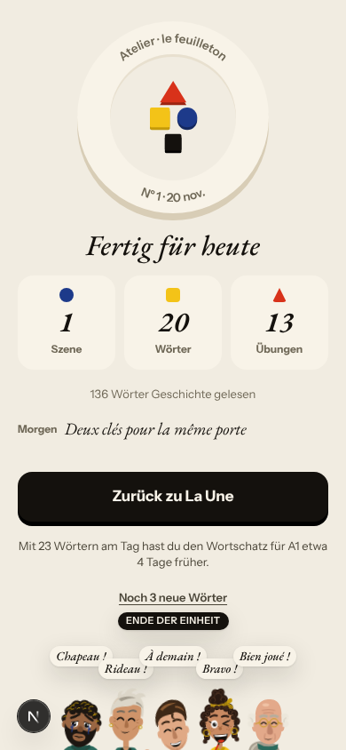 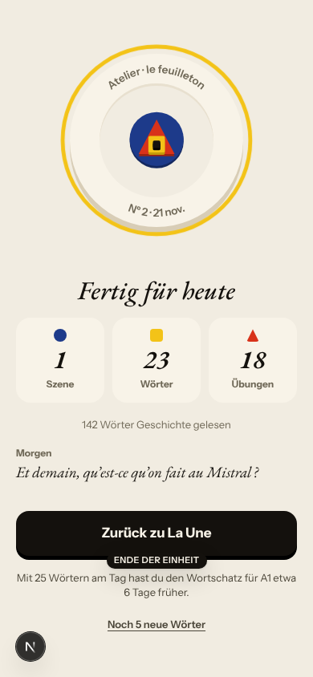

**Q22 at 3.** Home promised day 2 at «8 Min. · + Wörter ≈ 7 Min.» plus «Grammatik 5 Min.»; the landing promises «Die erste Szene dauert eine Minute». The agent needed 6 and 8 minutes; a beginner reading every panel and typing would need about twice that, so the promise is in range, not generous.

**The best of the night.**
- The day-2 scene carries the day-1 choice: the key left «derrière la caisse» comes back as the next task.
- La Forge brings back the learner's own slip from yesterday («Das hast du schon einmal geschrieben. Korrigiere den Fehler. Elle et vieille.»), on day 1 within a minute of the slip and again on day 2.
- The Avoir card says the trap a German makes («Falsch: Je suis vingt ans.») and the recall tests it first. 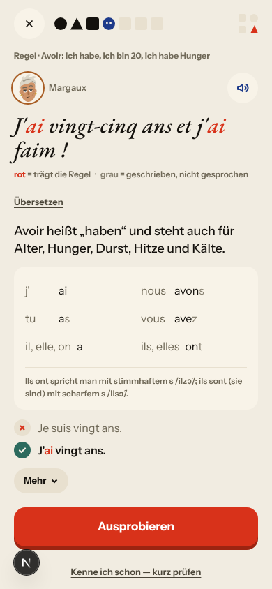
- CI is green again on main.

## Findings, by root cause

Two new findings (#953, #954), both `queue:ready`, `lane:code`, `size:S`, with a **Done when:** comment. #953 is a child of #147, #954 of #333. No new root cause: the two new ones share no mechanism with each other, and each fits an open one. Repeats commented: #893, #894, #855, #828, #824, #829, #827, #852, #809.

### #333 an empty or unread result is shown as if it were a result
- **#954 (new, medium)** the Regelprüfung's own sentence shows «Noch nicht · Die Antwort erfüllt die Aufgabe noch nicht» with no retry, then the result counts it right. The client falls back to `t.task_default_why` when a wrong verdict carries no erratum (`web-frontend/pages/atelier.tsx:4986`); the test's tally is the server's (`:3901-3913`). 
- **#855 (commented)** «est →», «serieux →», «redaction →». 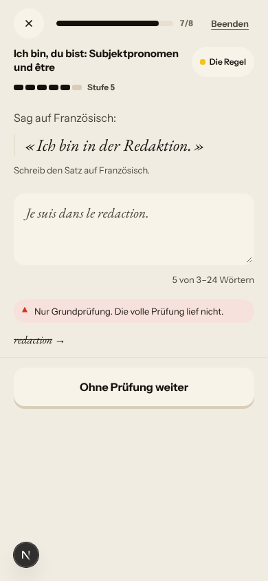

### #147 the cast is not one registry
- **#953 (new, medium)** a friend's tu note («Un mot de Marin») gets the formal e-mail composer: `MissionGenerator._choose_format` (`app/services/missions.py:2698-2717`) draws the format from the channel's and `MISSION_FORMAT_ALTERNATIVES` (`:96`) without asking who writes or in which register; the client then shows `composer_instruction_email` and `send_email` (`web-frontend/pages/missions.tsx:311-316`). 

### #896 each surface cuts text into sentences with its own regex
- **#893 (commented)** the judge miss cut at the quoted «?». #930 is open for it.
- **#827 (commented)** «Fin du chapitre · Ou tu dis au revoir à tout ça ?». 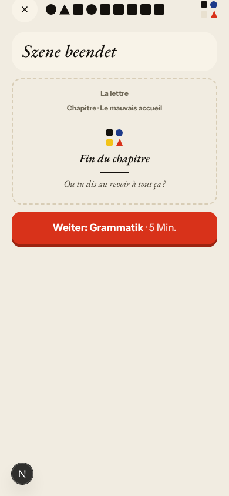

### #146 the day's content and feedback are not driven by one concept
- **#894 (commented)** the «uses today's rule» item's distractor uses a promised subject pronoun.
- **#824 (commented)** «Il est soif ce soir.» not checked; the scene names «cle → clé» and not «Elle et».
- **#829 (commented)** day 1's être items on «en Inde», «au Brésil», «la rédaction», «sérieux».

### #542 a drill's instruction is picked from the item's shape, not its task
- **#828 (commented)** «Du hast „est“ gewählt» on a typed gap.
- **#852 (commented)**, **#809 (commented)** the miss note names the answer or the rule card, not why the chosen word is wrong.

### Seen again, not commented
- #466: day 1 ends on a statement as «Morgen».
- #280: 4 of 20 new words on day 1 come from the scene (l'appartement, vendre, la clé, ici), 1 of 23 on day 2 (la lettre); none of faim, soif, sommeil from the Avoir items.
- #776: «Austausch 3 von 4», then the scene ends (fake).
- #693: Marin did not answer on the fake stack.
- #694: «20 · 11 · 26» on La Forge's end sheet on day 2, and Home says «Freitag, 20. Nov.» after `/clock +1` (the browser's clock, harness).
- #728: «Ich glaube, das ist richtig» offered under plain misses («Je suis vingt ans.»).

### Fake provider (left to the live walk)
- Keyword echoes and authored beats (above). The scene's correction names one slip per reply («d'Odile», «au», «c'est», «clé») and misses «m appelle», «le appartement», «je vend», «Je suis pas sur», «Elle et».
- La Forge free sentences with no stored key «zählen nicht» («Il est soif ce soir.»).

## Re-tests

No walk-finding fix merged to main since the last walk (`d1486e6c` → `7abacf8c` took in only #892, the reports and the forge), so none could be closed or set back. What I reached:

| issue | fix | result |
|---|---|---|
| #924 CI: every PR fails the PostgreSQL job | #892 (merged 19 Nov) | **fixed**: the job is green on every main run since 1468; closed with a comment. |
| #855 unread sentence «J ai →» | #899 open (merge-ready) | still seen («est →», «redaction →»); commented, stays `queue:pr`. |
| #893 judge miss cut at the quoted «?» | #900 closed (failed verify), #930 open | still seen; commented, stays `queue:pr`. |
| #894 être drill distractor «Vous allez» | #904 closed (failed verify) | still seen; commented, stays `queue:ready`. |
| #828 «Du hast „est“ gewählt» | #902 open | still seen; commented. |
| #852 choice miss without a reason | #902 open | seen on fake in German; commented. |
| #829 untaught country prepositions | #903 open | still seen; commented. |
| #824 the card's trap not checked | #901 closed (failed verify) | still seen; commented, `queue:owner`. |
| #895 slip stamp spends a week's new-rule slot | #905 open | not reproduced tonight (day 2 introduced Avoir), but not re-testable as fixed; left. |
| #868 Main walk fails: home-headlines-the-episode | #906 open | not merged; its season-b day 7 is not reached by this walk. Left. |
| #896 and its children | #930 open | #893, #827 still seen. |
| owner rule of 7 Nov (#698) | #708 | **holds** (above). |

Root causes: none opened; #333 (#954), #147 (#953) advanced; #896, #146, #542 have repeats. None closes.

## Scripted walk

- «Browser walk on main» (walk-main.yml): run 66 on `d6208e22` **passed**; run 65 on `c4ebe7cb` and run 64 on `4523490d` failed in «Walk · fr × 7 days» (French interface, paused); run 67 on tonight's `7abacf8c` **failed** in «Walk · en + B1 × 7 days» (the other shards passed), as runs 59–62 did on 17–18 Nov. Open «Main walk fails» issues: #868, #844, #837, #802, #771, #770 (the last two updated 20 Nov 01:50 UTC).
- The scheduled «Browser walk» (walk.yml) run 39 on `4523490d` failed in «Walk · fr × 7 days»; run 38 passed.
- CI on main: green since #892 (run 1503 on `7abacf8c`, all jobs).
- In tonight's explore walk both days reached Done: day 1 through La Forge's «Weiter: 20 Wörter», day 2 through the Regelprüfung, then «Weiter: 23 Wörter».
