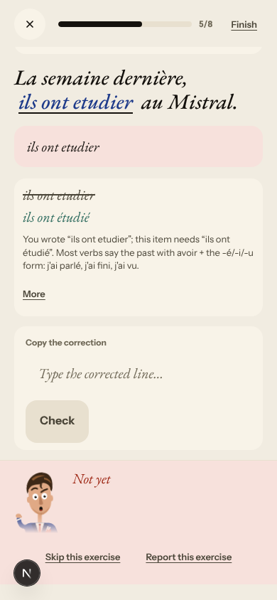
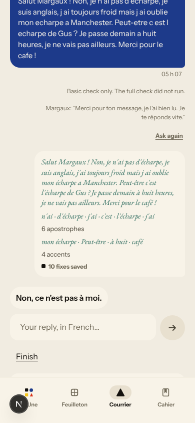
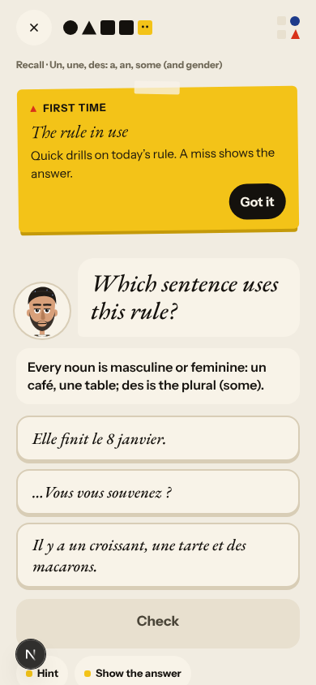
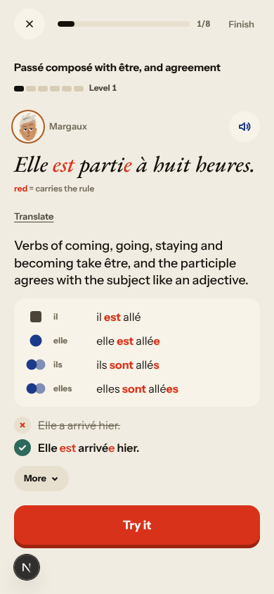
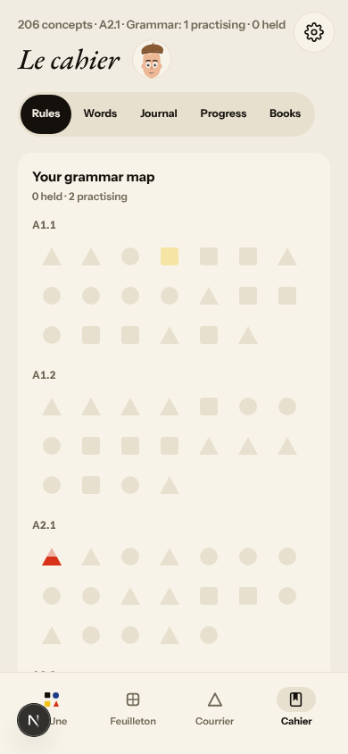
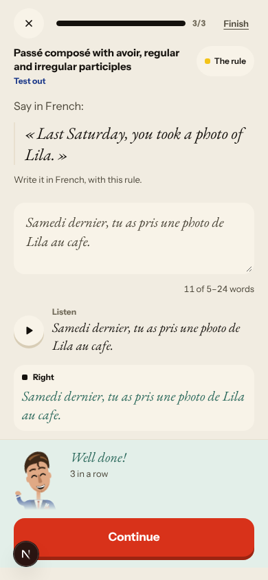
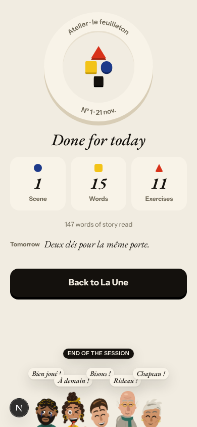
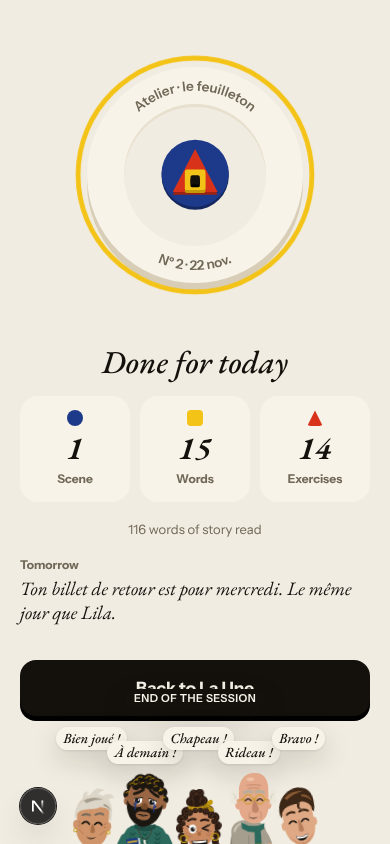
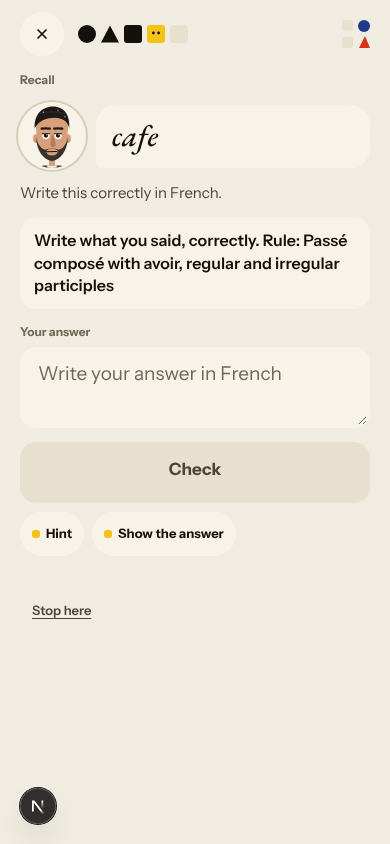

# Walk · 21 Nov 2026 · nightly explore walk

Main at `3facec8a`. Since the 20 Nov walk (`7abacf8c`), main took in:
- **#958, the pilot** (all packages P0–P12 and five fix rounds, 389 files): one rule a day (the card, then La Forge, no recall of it before), the drill around the scene made of the learner's own mistakes and one due rule (P6), a word deck of 15 made of the story (P7), Home with fewer rooms and the Journal chip (P9), Le Quartier switched on (P12), the Courrier's acknowledgement instead of a silent thread (P0), and La Forge's round-4/5 fixes (#937, #941: a typed gap says «You wrote» and gets its retry first);
- **#956** («Précédemment» never says «learner»; fixes #917);
- the live reports #923 and #972, and the forge #965.

The night shift's PRs #899, #902, #903, #905, #906, #930, #933 are still open; #944 too. So of the code-lane walk findings only those the pilot touched could be re-tested: **#828 is fixed and closed tonight**; the rest are below.

`alembic upgrade heads` ran cleanly on a scratch database before the walk (one head, `d7f9b1c3e5a6`, as yesterday).

Fake story provider, local stack, Chromium at 390×844, one persona: `a2-en` (`--fresh --native en --level A2.1`; last played 19 Nov). I signed up through the UI at «I know some basics · A2» as Sam and played off-script with school-French slips (no accents, no apostrophes):
- day 1 scene: «Bonsoir. Je m appelle Sam, je suis anglais et je suis venu de Manchester en train. Je ne suis pas la personne de M. Marchand ! Je suis le petit-fils d Odile. Et vous, monsieur, vous connaissez vraiment un duc ?», «Non merci.» to the coffee, «Non, pas ce soir. Je dors a l hotel. Pourquoi elle ne donnait jamais la cle ? Vous etes sa amie ? Demain je vais visiter l appartement avec mon frere.», and I took the key;
- day 1 Courrier to Margaux (a scarf left at the café, which I deny): «Salut Margaux ! Non, je n ai pas d echarpe, je suis anglais, j ai toujours froid mais j ai oublie mon echarpe a Manchester. Peut-etre c est l echarpe de Gus ? Je passe demain a huit heures, je ne vais pas ailleurs. Merci pour le cafe !»;
- day 2 scene to Camille: «Plus simple pour vous, peut-etre. Hier soir j ai dormi a l hotel et j ai pensé a ma grand-mere. Je ne vend pas avant le notaire. Et vous, pourquoi votre grand-pere veut l immeuble ? Vous avez parlé avec Solvel ?», and nobody reads the letter («Personne»).

Day 1 (about 5 minutes of walking from «Let's go» to Done):
- teaser (Margaux, «Bonjour !», «Un café, s'il vous plaît»), sign-up, figure, onboarding («Scene, then grammar, then your words»), cast page;
- scene «Le mauvais accueil»: two free replies, two choices («Exchange 4 of 4»);
- rule card «Passé composé with avoir, regular and irregular participles», «Try it» goes straight to La Forge (no recall of the rule any more, as the pilot intends);
- La Forge 8 items (Level 1 → 5): a choice miss and retry, a judge miss, a speed round 4 of 4, a typed-gap miss twice (#828's re-test), tiles, a find-the-mistake miss and retry, my own line back;
- 15 words, Done, Home, Courrier (one reply), Cahier (Rules, Journal), Feuilleton.

Day 2 (clock +1, about 5 minutes):
- Home «Nº 2 · La clé d'Odile · La lettre · 20 min» with «Retell yesterday ≈ 2 min»; scene «La lettre»: one free reply, one choice;
- the drill around the scene: my Courrier slip «cafe», then «Un, une, des» as «the rule in use» (#975, #974);
- La Forge «Forge today's rule» on **Passé composé with être, and agreement** (card in the séance, Level 1 → 3), avoir twice as review (my day-1 line back, a free sentence unread), then the offered test on avoir, 3 of 3;
- 15 words, Done.

Day 7 not played.

**Live column: [live walk 21 Nov](../live-walks/2026-11-21.md)** (on main, #972), production with the real model, release `b8564d6757ca` (the tip of main: the pilot is live), account A1.1 on day 39. Headline: **the first live walk after the pilot; Q5, Q6 and Q20 down to 3 (Gus' gloss names Gus as the addressee #970, the neighbour who complains promises to be quieter #969, «Tomorrow» a statement #466); Q10 and Q11 stay at 2 (La Forge refuses «clef» #966, «On cherche ses carnets» for «our notebooks» #968).** It filed #966–#971; they are not filed again here. Its re-tests: #661 and #693 not reproduced (the Courrier answered «non» in character, 3 of 3 replies arrived), #723 still seen.

## Scores (rubric `docs/ops/walk-rubric.md`)

| # | question | 21 Nov a2-en (d1–2) | live 21 Nov | 20 Nov a1-de (d1–2) | 19 Nov a2-en (d1–2) |
|---|---|---|---|---|---|
| 1 | Where am I | 4 | 4 | 4 | 4 |
| 2 | What is at stake | 4 | 4 | 4 | 4 |
| 3 | What to do next | 3 | 3 | 3 | 3 |
| 4 | Scene reacts to my writing | fake | 4 | fake | fake |
| 5 | Story coherent | 3 | 3 | 3 | 3 |
| 6 | Characters consistent | 3 | 3 | 3 | 3 |
| 7 | Image, text, tone fit | 4 | 4 | 4 | 4 |
| 8 | Difficulty fits | 4 | 4 | 3 | 4 |
| 9 | Feedback explained | 3 | 3 | 2 | 2 |
| 10 | Right answers accepted | 3 | 2 | 3 | 3 |
| 11 | French correct | 3 | 2 | 4 | 4 |
| 12 | Clear goal today | 3 | 3 | 4 | 4 |
| 13 | Grammar practised | 4 | 4 | 4 | 4 |
| 14 | Earlier material returns | 4 | 4 | 4 | 4 |
| 15 | I produce French | 4 | 5 | 4 | 4 |
| 16 | Errors, dead ends | 3 | 3 | 3 | 3 |
| 17 | Varied, fun | 4 | 4 | 4 | 3 |
| 18 | Fast enough | 4 | 3 | 4 | 4 |
| 19 | App only | n/a | n/a | n/a | n/a |
| 20 | Satisfying end | 3 | 3 | 3 | 3 |
| 21 | Would come back | 3 | 3 | 3 | 3 |
| 22 | Time vs promise | 3 | 3 | 3 | 3 |

Q14 is scored on day 2 only. Against the last `a2-en` walk (19 Nov): **Q9 2 → 3, Q17 3 → 4** up; **Q11 4 → 3, Q12 4 → 3** down. Against last night (20 Nov, a1-de): Q9 2 → 3, Q8 3 → 4 up; Q11 4 → 3, Q12 4 → 3 down. No 1 or 2 tonight.

**Q9 up to 3: La Forge's own misses now say what I did and why.**
- Typed gap: «You wrote “ils ont etudier”; this item needs “ils ont étudié”. Most verbs say the past with avoir + the -é/-i/-u form…», after a first try that only said «Another word of the line differs» and offered the retry (#828 fixed). 
- Accent misses: «ecoute» in a find-the-mistake and «Lila est arrivee» typed both got «Here the accent changes the word.» and a retry.
- Speed round: «You said “Needs fixing” · the right call is “Correct” · Nothing to fix here: this sentence already follows the rule…»; choice miss «You chose “Hier, Margaux a entré…”; this item needs “… est entrée …”. Aller, venir, partir, arriver, rester … use être».
- Still 3, not 4: a judge miss on «Avant-hier, je suis faite du sport.» says only what is right, not why (faire takes avoir); the Courrier's basic check prints «j ai oublie … a Manchester» as the corrected line while listing «j'ai» twice (#925 again) and never names «oublie» on a passé composé day (#807 again). 

**Q12 down to 3: day 2 names two «today's rules».**
- The drill around the scene ran «Recall · Un, une, des: a, an, some (and gender)» under the sticker **«The rule in use · Quick drills on today's rule»** (#975, new). 
- Then La Forge «Forge today's rule» opened on **Passé composé with être**, the real rule of the day. 
- «Un, une, des» was never taught: it came from my day-1 scene slip «sa amie → son», which the app filed under articles instead of possessives (#974, new). The Cahier shows «Un, une, des · practising · shaky in practice · 1 mistake» and «Mon, ma, mes · not met yet». 

**The owner's rule of 7 Nov (#698, «Nur als Extra»): the slot holds, the label does not.**
- Day 2's card and La Forge «today's rule» were être, the A2 path's next rule; the slip rule did not take the card or La Forge.
- But P6's drill around the scene deals the slip rule («the learner's own due mistakes and one due rule») with the same sticker as the day's rule, «Quick drills on today's rule», and no «from your mistakes» label (#975). By the letter of the rule («slip rules run only as a labelled review») this is a miss on the label, not on the slot.

**Q11 down to 3.** The app printed French that is still wrong as if corrected or right: the Courrier's corrected line keeps «j ai oublie», «a Manchester» (#925, #807); the test-out prints «… de Lila au cafe.» under «Right» (#562 again).  On the fake stack Margaux also echoes my misspelling: «Non, alors. Frere : c'est noté.»

**Q8 at 4.** A2 work on A2 rules: passé composé with avoir, then être with agreement. Two irregular participles not on the card came as traps («Elles ont ouvri», tiles with «bu»); the card lists only faire, prendre, voir, avoir. Not filed.

**Q10 at 3.** Accepted: «vous avez donné», the tiles, «écouté», «Lila est arrivée», «Elle est montée», «téléphoné», «café» in recall, «Il y a un croissant, une tarte et des macarons.». Too lenient once: «au cafe» passed the test-out (#562). The free sentence «Ce matin, elle a vendu des livres a la brocante.» was «Checking is not available right now, so this answer does not count» (fake stack).

**Q3, Q16 at 3.**
- «Scene · Step 2 of 4» jumps to «Rule · Step 4 of 4» on day 1; the rule card's «Try it» opens «Scene · Step 4 of 4 · Scene finished», then La Forge.
- Day 2's drill is «Recall · Step 4 of 5» and «Step 5 of 5», then «Scene finished», then La Forge.
- Once, after «Back to La Une» from day 2's Done, Home showed «Le mur du Mistral» and no «Retell yesterday» though the retell was still waiting; after a reload, and on a second try from Done, the chip was there. Seen once, not filed.
- Harness only: the Next.js dev overlay («Try Turbopack») covered «Let's go» once; Escape closed it.

**Q5, Q6 at 3 (fake provider).** Keyword echoes: «… vous connaissez vraiment un duc ?» → Gus «Vraiment ? Bonne question.»; «… avec mon frere.» → Margaux «Non, alors. Frere : c'est noté.»; «Vous avez parlé avec Solvel ?» → Camille «Solvel ? Bonne question.». The scene's correction names one slip per reply («m'appelle», «son», «peut-être») and misses «d Odile», «a l hotel», «j ai dormi», «je ne vend». Register held everywhere (Gus, Camille, Marin at first meeting: vous; Margaux, Lila: tu). Margaux's letter asks about a scarf I never left; the acknowledgement «Merci pour ton message, je l'ai bien lu. Je te réponds vite.» replaces the silent thread (P0, fake stack: no real answer).

**Q20 at 3.** Both Done screens end on a statement as «Tomorrow»: «Deux clés pour la même porte.» and «Ton billet de retour est pour mercredi. Le même jour que Lila.» (#466). Day 2's scene also sets Camille's visit «Jeudi prochain, dix-huit heures», the day after my ticket home.  

**Q22 at 3.** Home promises day 2 at «20 min» (scene 8, grammar 7, words 5); the agent needed 5 minutes per day, a learner reading every panel and typing would need about 10–12. The promise is now longer than the day, not shorter.

**The best of the night.**
- La Forge's misses are readable and give a retry first, in every widget I missed in (choice, typed gap, find-the-mistake, speed round).
- The word deck is shorter (15) and takes the story's words on day 2: l'offre, la lettre, l'immeuble, l'escalier.
- Day 2 brought a new rule with its card inside La Forge, and the test-out on yesterday's rule («The rule is yours», a rare token).
- Browser walk on main is green four runs in a row (69–72), the scheduled walk run 40 too.

## Findings, by root cause

Two new findings (#974, #975), both `queue:ready`, `lane:code`, `size:S`, with a **Done when:** comment. **One new root cause, #973**: a slip's rule is guessed from a family word or the surface's rule, not from what the correction changed; children #974 (new) and #697 (moved from #146). #975 is a child of #542. Repeats commented: #697, #925, #807, #562. Closed: #828.

### #973 (new) a slip's rule is guessed from a family word or the surface's rule
- **#974 (new, medium)** «sa amie → son» is filed under «Un, une, des»: `infer_concept_id_for_correction` (`app/services/error_memory.py:1003-1008`) turns any swap inside `_DETERMINER_TOKENS` (`:95-100`, articles, possessives and demonstratives together) into «determiner», and `_infer_grammar_concept_id` (`:1027-1037`) takes that family's lowest-difficulty concept. Stored row: `sa → son`, concept 4, `grammar:concept-4:journey_correction:reprise_sa`. 
- **#697 (commented)** the Courrier slip «cafe» is stored under the letter's rule and comes back as «Write what you said, correctly. Rule: Passé composé with avoir…». 

### #542 a drill's instruction is picked from the item's shape, not its task
- **#975 (new, medium)** the drill around the scene labels a slip rule «Quick drills on today's rule»: `DRILL_STICKER` (`web-frontend/lib/first-steps.ts:370-374`) maps every grammar drill to `practice` (`:167-170`), and the planner's role of the target (own mistake, due rule, day's rule; `fill_rappel_items`, `app/services/journey_planner.py`) does not reach the client. 

### #857 the basic check prints a «corrected» line it would still correct
- **#925 (commented)** «j ai» written twice, listed twice, fixed once; «a Manchester» left while «à huit» is fixed. 

### #146 the day's content and feedback are not driven by one concept
- **#807 (commented)** «oublie» not named on a passé composé day, in the same Courrier line.

### #174 a right answer is judged against one stored string
- **#562 (commented)** the test-out takes «… au cafe.» as «Right» and prints it, while a typed gap refuses «arrivee». 

### Seen again, not commented
- #466: both days end on a statement as «Tomorrow».
- #280: 3 of 15 new words on day 1 come from the scene (vendre, l'appartement, la clé), 4 of 15 on day 2; better than 20 Nov.
- #694: Home says «Saturday 21 Nov» after `/clock +1` (the browser's clock, harness).

### Fake provider (left to the live walk)
- Keyword echoes and authored beats (above); one correction per scene reply.
- La Forge's free sentence «not available right now» on the fake stack.

## Re-tests

Main took in the pilot (#958) since the last walk; no night-shift fix PR merged. What I reached:

| issue | fix | result |
|---|---|---|
| #828 typed gap «Du hast „est“ gewählt» | #941 in the pilot #958 | **fixed**: «You wrote “ils ont etudier”; this item needs …», once, retry first; closed with the screenshot. |
| #174 (root cause) right answers judged against one string | P4 in the pilot | no right answer refused on the fake stack tonight; the live walk's #966 («clef») and #723 keep it open; commented. |
| #925 slip written twice fixed once | #931 closed (failed verify) | still seen; commented, stays `queue:ready`. |
| #807 participle accent not named | none | still seen; commented. |
| #697 Courrier slip under the letter's rule | none | still seen; moved to #973. |
| #562 missing accent judged two ways | none merged | still seen in the test-out; commented. |
| #954 Regelprüfung «task not met», then 3 of 3 | none | not reproduced: my own sentence kept the rule right and slipped outside it («au cafe»), and was taken as Right (#562). Left. |
| #953 friend's note as a formal e-mail | none | not re-testable: tonight's letter was Margaux's chat note, with the chat composer. Left. |
| #827 half of the A1 season question | none | not re-testable: the A2 «Fin du chapitre» card prints no question. Left. |
| #855, #893, #894, #824, #829, #852 | open PRs | A1-only or not reached (no unread fix list, no question in a judge item). Left. |
| #868, #844, #837, #802, #771, #770 «Main walk fails» | various | the Browser walk on main passed runs 69–72 (`54c6c93f` to `3facec8a`); left to the workflow. |
| owner rule of 7 Nov (#698) | #708 | slot **holds**, label **does not** (#975). |

Root causes: **#973 opened** (children #974, #697); #542 advanced (#975); #857, #146 and #174 have repeats. None closes.

## Scripted walk

- «Browser walk on main» (walk-main.yml): runs 69 (`54c6c93f`, #956), 70 (`9b966bfb`, the pilot), 71 (`b8564d67`) and 72 (`3facec8a`) **passed**; run 73 on `ef51637e` (the merge of #955) was running when this walk ended.
- The scheduled «Browser walk» (walk.yml) run 40 on `54c6c93f` **passed** (run 39 had failed in the French shard).
- In tonight's explore walk both days reached Done: day 1 through La Forge's «Next: 15 words», day 2 through the test-out, then «Next: 15 words».
