# Walk · 22 Nov 2026 · nightly explore walk

Main at `c348531f`. Since the 21 Nov walk (`3facec8a`), main took in a large batch of fixes (42 commits):
- **the night shift's waiting PRs**: #899 (an unread La Forge sentence prints its fixes whole; an over-long line says to shorten it), #902 (a typed gap says «You wrote»; a question-word miss says what each word asks), #903 (A1 items place people only where the season is), #905 (a scene slip spends no slot of the week's new rules), #906 (Home keeps the episode number while the day is open), #930 (one sentence splitter), #933 (an agreement item says which «you» it means);
- **other fixes**: #979 (Regelprüfung: the item says the verdict the result counts), #788 (a Courrier character keeps its letter's tu), #800 and #672 (the scene knows whom the learner spoke to), #791 (the exchange total is what the scene plays), #789 (recall «Est-ce que il» names the elision), #675 and #989 (an unfinished day closes overnight), #977 («Elle a chaud»), #986, #987 (walk 14's wrong French), #834 (order drill names a tile left out), #818, #741 (Lexique front), #707 (Done and Forge end in the chrome language, for #694), #632 (a stalled La Forge visit fails the browser walk), #764 (a page held to its scene), #606 (one acceptance contract: «X et moi», recall repairs, accents), #641;
- **#845, the grammar pilot**: Le Déclic (the verdict lands on the rule in the sentence) and Le Montage, on in production;
- the 20 and 21 Nov walk reports, the forge #991 and tonight's live report #995.

`alembic upgrade heads` ran cleanly on a scratch database before the walk (one head, `d7f9b1c3e5a6`, as on 20 and 21 Nov).

Fake story provider, local stack, Chromium at 390×844, one persona: `a1-de-fresh` (`--fresh --native de`; last played 20 Nov). I signed up through the UI at «Neu im Französischen · A1» as Jonas and played a German beginner with real slips:
- day 1 scene: «Bonsoir. Je suis Jonas, le petit fils de Odile. Je suis ici pour vend le appartement.», «Oui, je monte. Mais c est qui, Solvel ? Je suis fatigue.», and I took the key;
- day 1 Courrier to Gus: «Bonjour Gus. Je pense que le Mistral est tres bien. Demain je vais a le notaire. Je suis pas sur pour le appartement. Jonas»;
- day 2 scene to Camille: «Je sais pas. Pourquoi c est plus simple ? Je suis pas sur. Le appartement est de ma grand mere.», and Lila reads the letter.

Day 1 (about 5 minutes of walking from «Loslegen» to Done):
- teaser (Margaux, «Bonjour !», «Un café, s'il vous plaît»), sign-up, figure, onboarding («Szene, dann Grammatik, dann deine Wörter»), cast page;
- scene «Le mauvais accueil»: two free replies, one choice («Austausch 1 von 3» … «3 von 3», as #791 intends);
- rule card «Ich bin, du bist: Subjektpronomen und être», «Ausprobieren» goes straight to La Forge;
- La Forge 8 items (Stufe 1 → 4) with the Déclic: a choice miss and retry, a judge miss, a speed round 3 of 4, a typed-gap miss and retry, a tile item with «au» left out and retry, tiles; no free sentence;
- 15 words, Done, Home, Courrier (one reply to Gus), Cahier (Regeln), Feuilleton.

Day 2 (clock +1, about 8½ minutes):
- Home «Nº 2 · La clé d'Odile · La lettre · 22 Min.» with «Gestern erzählen ≈ 2 min»; scene «La lettre»: one free reply, one choice («Austausch 1 von 2»);
- être as «Eine bekannte Regel, auf der heutigen Seite», then **a new rule, Avoir** (card);
- the drill around the scene: my own La Forge slip «Je suis supermarché.» (#821's re-test) and the slip rule «Le, la, l', les» (#975 again);
- La Forge «Regel des Tages schmieden» on Avoir (Stufe 1 → 3), être twice as «Wiederholung · heute fällig», two speed rounds, a spot; then the offered Regelprüfung on être, failed 2 of 3, and its exit opened **a second séance on Avoir** (#997, new);
- 15 words, Done.

Afterwards, a short practice séance on être at Stufe 5 (free sentences only) to reach #855's and #853's screens. Day 7 not played.

**Live column: [live walk 22 Nov](../live-walks/2026-11-22.md)** (on main, #995), production with the real model, release `842320c735c4` (the tip of main before the report: every fix above is live), account A1.1 on day 40. Headline: **Q5, Q10, Q11, Q12 up (no earlier traps on today's day: a rule card opened the day and La Forge drilled the same rule); a Forge miss on «Je voudrai» explains it with the rule's gloss (#992); a writing item with no text (#993); the Fibre letter of 18 Oct again (#994).** It filed #992–#994; they are not filed again here. Its re-tests: #557 and #577 still seen (back to `queue:ready`).

## Scores (rubric `docs/ops/walk-rubric.md`)

| # | question | 22 Nov a1-de (d1–2) | live 22 Nov | 21 Nov a2-en (d1–2) | 20 Nov a1-de (d1–2) |
|---|---|---|---|---|---|
| 1 | Where am I | 4 | 4 | 4 | 4 |
| 2 | What is at stake | 4 | 4 | 4 | 4 |
| 3 | What to do next | 3 | 3 | 3 | 3 |
| 4 | Scene reacts to my writing | fake | 4 | fake | fake |
| 5 | Story coherent | 3 | 4 | 3 | 3 |
| 6 | Characters consistent | 3 | 3 | 3 | 3 |
| 7 | Image, text, tone fit | 4 | 4 | 4 | 4 |
| 8 | Difficulty fits | 4 | 4 | 4 | 3 |
| 9 | Feedback explained | 3 | 3 | 3 | 2 |
| 10 | Right answers accepted | 3 | 4 | 3 | 3 |
| 11 | French correct | 3 | 3 | 3 | 4 |
| 12 | Clear goal today | 3 | 4 | 3 | 4 |
| 13 | Grammar practised | 4 | 4 | 4 | 4 |
| 14 | Earlier material returns | 4 | 4 | 4 | 4 |
| 15 | I produce French | 3 | 5 | 4 | 4 |
| 16 | Errors, dead ends | 3 | 3 | 3 | 3 |
| 17 | Varied, fun | 4 | 4 | 4 | 4 |
| 18 | Fast enough | 4 | 3 | 4 | 4 |
| 19 | App only | n/a | n/a | n/a | n/a |
| 20 | Satisfying end | 3 | 3 | 3 | 3 |
| 21 | Would come back | 3 | 3 | 3 | 3 |
| 22 | Time vs promise | 3 | 3 | 3 | 3 |

Q14 is scored on day 2 only. Against the last `a1-de` walk (20 Nov): **Q8 3 → 4, Q9 2 → 3** up; **Q11 4 → 3, Q12 4 → 3, Q15 4 → 3** down. Against last night (21 Nov, a2-en): Q15 4 → 3. No 1 or 2 tonight.

**Q8 up to 4: day 1 no longer asks a beginner for countries.** La Forge's être items place people at the brocante, the supermarché, the école, the restaurant with Marin, the Mistral, the boulangerie, the marché du canal, Paris (#829 fixed by #903). Day 2's Avoir items are on age, ideas, friends, cold. Only the Stufe-5 practice I opened afterwards asked «Ich bin gesprächig.» (bavard, never shown); not part of the day, not filed.

**Q9 up to 3: the avoir misses and the spot explain; the être misses still do not.**
- Good: «Je suis cinquante et un ans» → «Avoir heißt haben; auch für Alter, Hunger, Durst und Kälte.»; «Elle as» → «Mit «elle» heißt «avoir» «a», nicht «as».»; a spot «Je est» → «Du hast «est» geschrieben. Jede Person hat ihre eigene Form.»; the recall order drill «Es fehlt: „au“.» (#821 fixed); the speed rounds print each right line.
- Not yet: four être misses get only the gloss «Être heißt sein.» («Tu est beau ?», «Tu et anglaise ?», «Nous somme…», the tile item with «au» left out), and the choice miss «On est froid ce soir.» gets the answer, not the reason (#992 seen again, the live walk's new issue). In the Déclic card `whyWithoutEcho` drops the «you chose X, this needs Y» sentence, so when the server's reason is only that echo and the gloss, the gloss is all that is left. 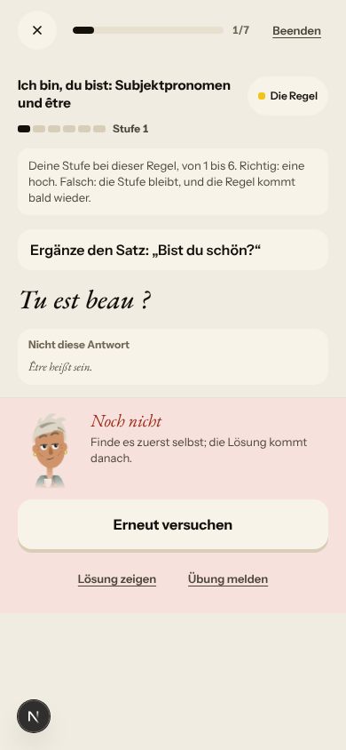 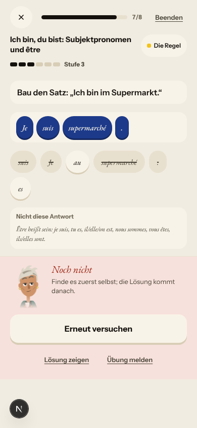

**Q11 down to 3: the basic check prints «à le notaire» as the corrected line** (#996, new). The Courrier fixed «a» → «à» and offered «Demain je vais à le notaire.» as right French; La Forge's unread list for «Ils est tres gentil a le cafe.» named three fixes and nothing on «a le». 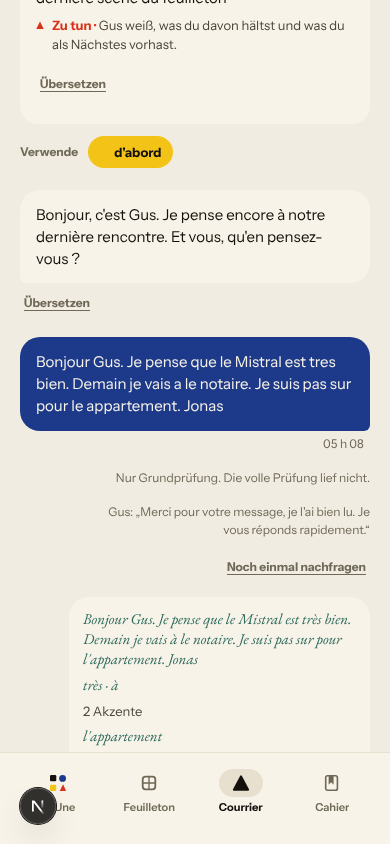

**Q12 down to 3 (the same as 21 Nov): day 2 names two «rules of today».** The Avoir card and La Forge «Regel des Tages» were right, but the drill around the scene ran the slip rule «Le, la, l', les» under «Die Regel im Einsatz · Kurze Übungen zur Regel von heute» (#975 again, now on the A1 path), and my own être slip came under «Die Wörter · Kurze Wortübungen» (#469 again). 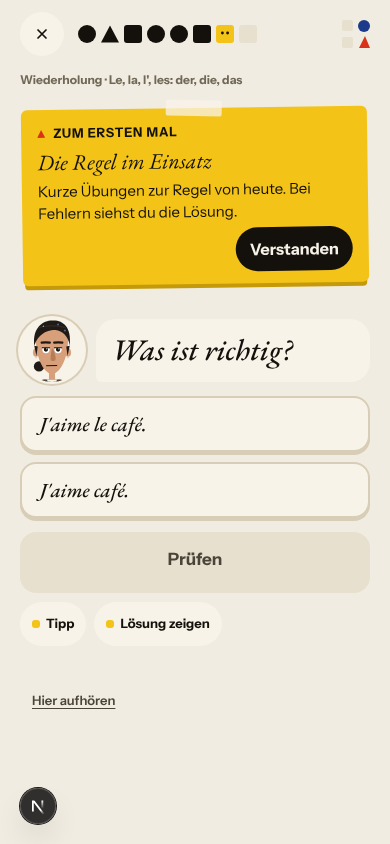 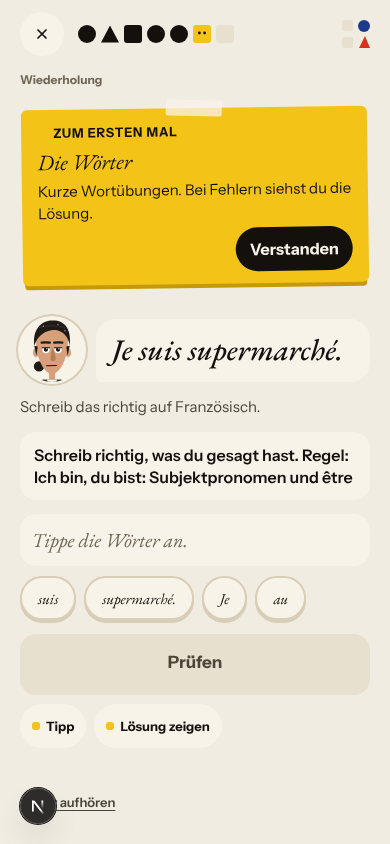

**The owner's rule of 7 Nov (#698, «Nur als Extra»): the slot holds, the label does not.** Day 1's slips («le appartement» in the scene and the Courrier) made «Le, la, l', les · in Übung · wackelig · 2 Fehler» in the Cahier and took no card. Day 2's card and La Forge were Avoir, the next rule of the A1 path (also #895's re-test: the slip did not delay the new rule). The slip rule ran only in the drill around the scene, but labelled as today's rule (#975), not as a review of my mistakes.

**Q15 down to 3.** Neither day's La Forge asked for a sentence of my own: 8 items each, all choice, judge, typed gap, tiles, spot and speed rounds (20 Nov had my own sentence back and two free sentences on day 1). What I wrote myself: two scene replies and the Courrier on day 1, one scene reply on day 2, and the Regelprüfung's one free line. Not filed: the séance is drawn from the rung, and the free items came at Stufe 5.

**Q10 at 3.** Accepted: «es» on the retries, «sommes», «Je suis au supermarché.» and «Elles sont à Paris cette semaine.» from tiles, «suis» in the spot, the Regelprüfung's corrected «Ils sont au supermarché.». Refused: «Vous etes au Mistral ?» in the Regelprüfung, «Noch nicht», while #606 made a gap item take «etes» as right with a note (**#562 reopened**). 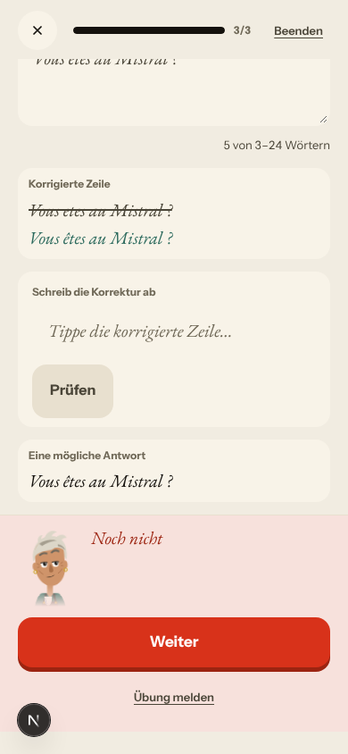

**Q3, Q16 at 3.**
- After the failed Regelprüfung («Noch nicht. Die Schmiede übernimmt. 2 von 3 richtig.»), «Weiter: Grammatik» opened a second séance on Avoir («1/6», Stufe 3), though Home says «Grammatik — erledigt · 15 Wörter — als Nächstes» (#997, new). 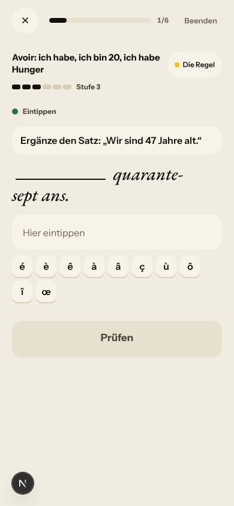 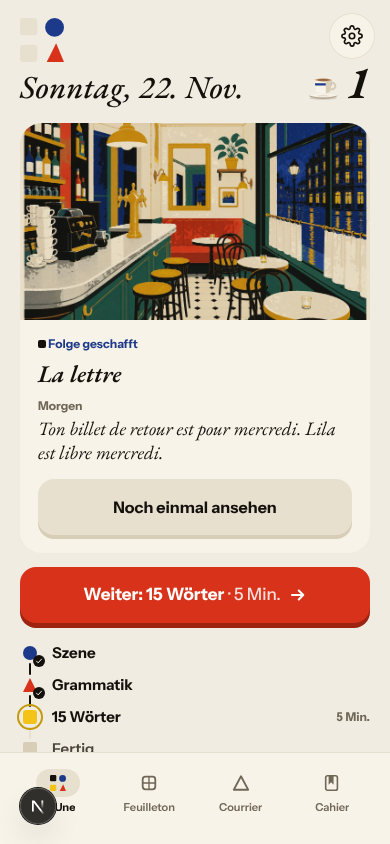
- «Szene · Schritt 2 von 4» jumps to «Regel · Schritt 4 von 4» on day 1; day 2 counts «von 7» and ends the scene («Szene · Schritt 7 von 7 · Szene beendet») after the recall.
- In the scene reader the first «Weiter» on a panel with a speaker finishes the line, the second turns the page (the live walk saw the same at panel 5). Not filed.

**Q5, Q6 at 3 (fake provider).** Keyword echoes: «… Je suis fatigue.» → Margaux «Oui. Fatigue, bien. Pas ce soir.»; «… de ma grand mere.» → Camille «Grand ? Bonne question.»; Lila «Tu n'entres pas ? Je comprends.» (I never said so). The scene's correction names one slip per reply («d'Odile», «c'est», «L'appartement») and misses «pour vend», «petit fils», «Je sais pas», «sur». Register held everywhere (Gus, Camille: vous; Margaux, Lila: tu; German UI: du). Gus' note is the fake stack's generic «Je pense encore à notre dernière rencontre.»

**Q20 at 3.** Both Done screens end on a statement as «Morgen»: «Deux clés pour la même porte.» and «Ton billet de retour est pour mercredi. Lila est libre mercredi.» (#466). On 20 Nov day 2 had asked «Et demain, qu'est-ce qu'on fait au Mistral ?». 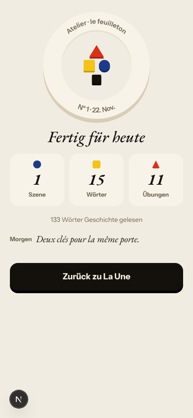 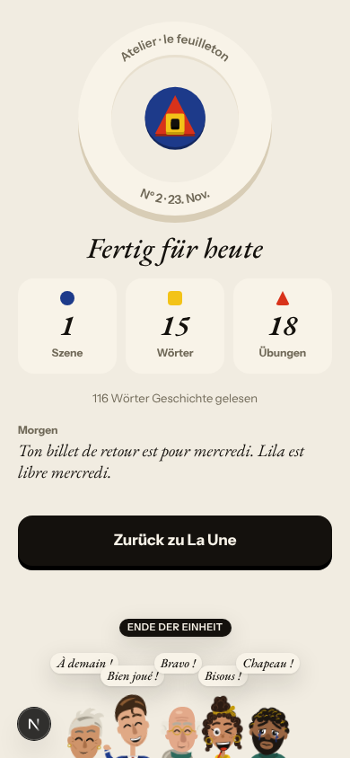

**Q22 at 3.** Home promises day 2 at «22 Min.» (scene 10, grammar 7, words 5); the agent needed 5 and 8½ minutes, a beginner reading and typing would need about 12–15. The retell chip beside it says «≈ 2 min» in German chrome, next to «≈ 6 Min.» (#998, new, low).

**The best of the night.**
- Six fixes reached and confirmed: #829, #853, #855, #821 (recall), #954, #694; #827 fixed and closed tonight.
- The Déclic puts my answer in its sentence («Tu est beau ?», «Je es» → «suis» struck and corrected in place), and the avoir misses say exactly why.
- The recall order drill names what I left out («Es fehlt: „au“.») and brings my own La Forge slip back the next day.
- Day 2 brought Avoir as planned after a day-1 scene slip (#895 holds), with yesterday's être due inside the séance and the test-out offered at the end.
- Browser walk on main is green on every run since 21 Nov (runs 96–103, the last on `c348531f`); the scheduled walk run 41 passed.

## Findings, by root cause

Three new findings (#996, #997, #998), all `queue:ready`, `lane:code`, `size:S`, with a **Done when:** comment. One reopened (#562), one set back from `queue:pr` to `queue:ready` (#469). No new root cause: #996 is a child of #857, #997 of #143, #469 now of #542; #998 has no shared cause. Repeats commented: #992, #975, #953, #469. Closed: #827 and the root cause #896.

### #857 the basic check prints a «corrected» line it would still correct
- **#996 (new, medium)** «Demain je vais a le notaire» → printed as «Demain je vais à le notaire»: `FR_CONTRACTION` (`app/services/correction_contract.py:3163-3192`) refuses every noun on `_TWO_GENDER_NOUNS` (`:910`) though «le» already fixes the gender (notaire, médecin, professeur), and `repair_text` does one pass, so a fix that makes «à le» is never read again («Je vais a le cafe.» → «Je vais à le café.»). 

### #143 the day's progress has no single source of truth
- **#997 (new, medium)** a failed optional Regelprüfung hands on to a second séance on today's rule: `handOnAfterRuleCheck` (`web-frontend/lib/day-plan.ts:149-165`) returns the grammar step's address on any fail, without reading that the step is done or that the check was on another rule. 

### #542 a drill's instruction is picked from the item's shape, not its task
- **#975 (commented)** the slip rule «Le, la, l', les» under «Die Regel im Einsatz · Kurze Übungen zur Regel von heute», on A1 now. 
- **#469 (commented, back to `queue:ready`, added as a child)** my own être slip under «Die Wörter · Kurze Wortübungen»: `dayStepOf` (`web-frontend/lib/day-order.ts:58-61`) calls a recall grammar only when `prompt.target.kind === 'grammar'`. PR #476 (2 Nov) is still open and older than main's own version. 

### #146 the day's content and feedback are not driven by one concept
- **#992 (commented, from the live walk)** four être misses answered with «Être heißt sein.» only, a choice miss with the answer only. 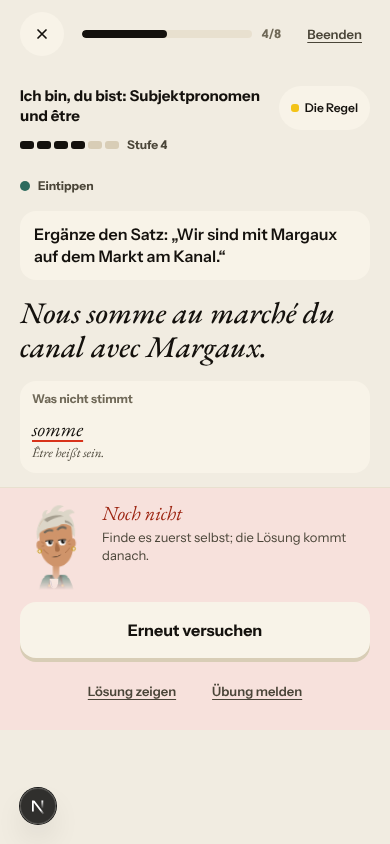

### #174 a right answer is judged against one stored string
- **#562 (reopened)** the Regelprüfung refuses the accent-only «Vous etes au Mistral ?» that #606 made right on a gap item.

### #147 the cast is not one registry
- **#953 (commented)** «Un mot de Gus» gets «Deine E-Mail · Ein Betreff, eine Anrede, der Text, ein Gruß» and «E-Mail senden»; #788 did not touch the composer. 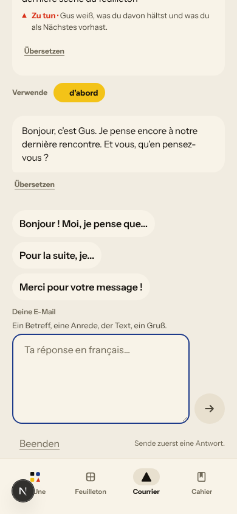

### No shared cause
- **#998 (new, low)** «Gestern erzählen ≈ 2 min» in German chrome: `journalHomeChip` (`web-frontend/lib/journal-home.ts:56-66`) writes the minutes as a literal. 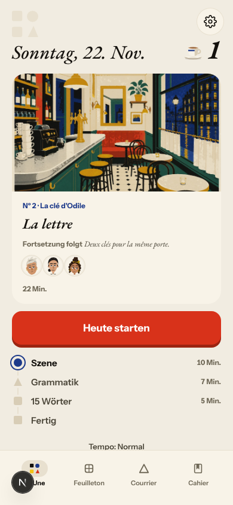

### Seen again, not commented
- #466: both days end on a statement as «Morgen».
- #280: 4 of 15 new words on day 1 come from the scene (vendre, l'appartement, la clé, ici), 1 of 15 on day 2 (la lettre); none of faim, soif, ans from the Avoir items.
- #728/#715: «Ich glaube, das ist richtig» offered under a plain recall miss («Je suis supermarché.»).
- #694 (harness only): after `/clock +1` the client shows the browser's date («Sonntag, 22. Nov.») on Home and the end sheet.

### Fake provider (left to the live walk)
- Keyword echoes and authored beats (above); one correction per scene reply.
- La Forge's free sentence «Die Prüfung ist gerade nicht verfügbar» and the Courrier's «Nur Grundprüfung» on the fake stack.

## Re-tests

| issue | fix | result |
|---|---|---|
| #829 untaught country prepositions | #903 | **fixed**: season places only, both days; commented (closed by the merge). |
| #855 unread sentence «J ai →» | #899 | **fixed**: «est → sont», «tres → très», «cafe → café»; commented. 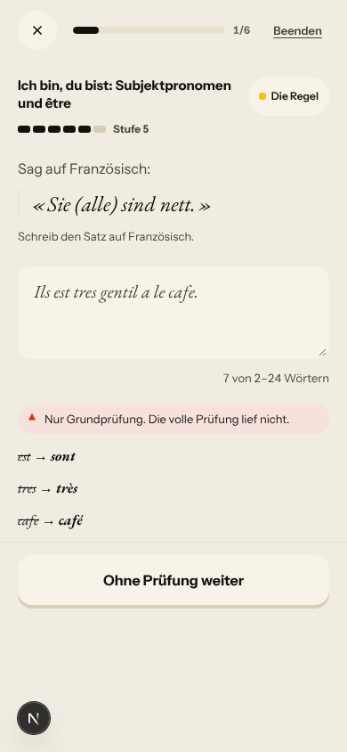 |
| #853 over-long line, no message | #899 | **fixed**: «29 von 2–24 Wörtern · Höchstens 24 Wörter: kürze deinen Satz.»; commented. 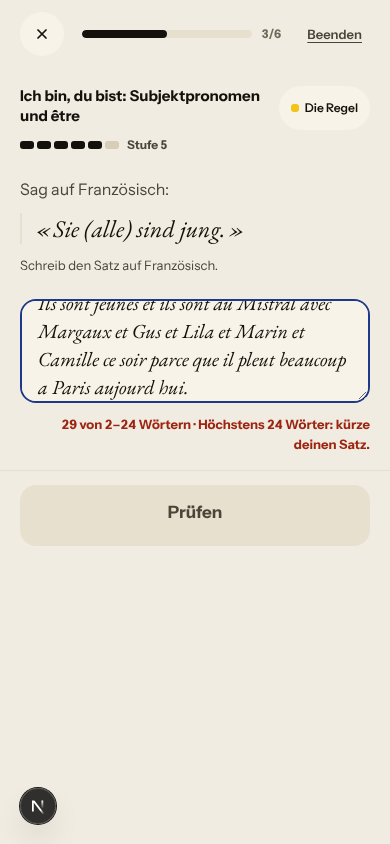 |
| #954 Regelprüfung «task not met», then 3 of 3 | #979 | **fixed**: item «Noch nicht», result «2 von 3 richtig»; commented. 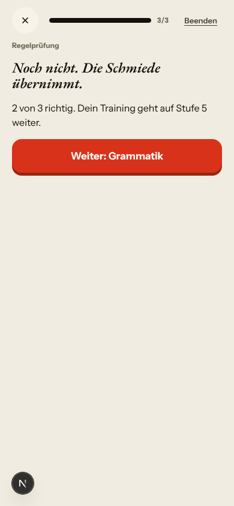 |
| #821 order drill blames the words placed right | #834 | **fixed in recall**: «Es fehlt: „au“.»; commented. La Forge's own tile item still answers with the gloss (on #992). 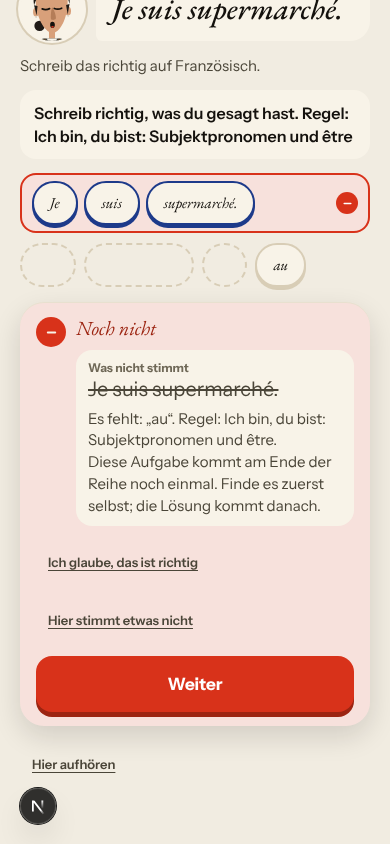 |
| #694 Done and Forge end in English | #707 | **fixed**: «Sonntag, 22. Nov.», «Nº 2 · 23. Nov.»; commented. 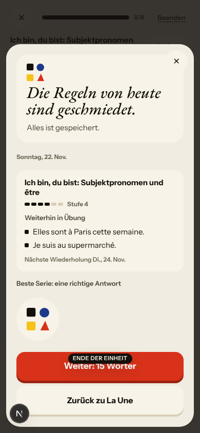 |
| #895 a scene slip spends a new-rule slot | #905 | **holds**: day 2 brought Avoir after day 1's slips; commented. |
| #827 «Fin du chapitre · Ou tu dis…» | #930 | **fixed, closed** with the screenshot: no question fragment. 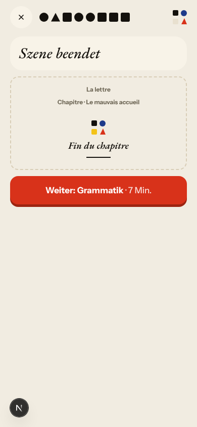 |
| #896 (root cause) one sentence splitter | #930 | **Done when met, closed**: shared fixture with the three walk lines, both splitters agree, a guard fails on any new own splitter (the old ones are a shrink-only allow-list). |
| #562 missing accent judged two ways | #606 | **not fixed on every judge**: the Regelprüfung refuses «Vous etes»; **reopened**, `queue:ready`. |
| #953 friend's note as a formal e-mail | (#788 not for it) | still seen; commented, stays `queue:ready`. |
| #975 slip rule as today's rule | none | still seen (A1 too); commented. |
| #469 grammar recall under «Die Wörter» | main's `dayStepOf` (pilot), PR #476 open | still seen for an own slip; commented, `queue:pr` → `queue:ready`. |
| #893 judge miss cut at the quoted «?» | #930 | not reached: no judge miss on a question on tonight's A1 days. Left closed. |
| #852 question-word miss without a reason | #902 | not reached on A1 days 1–2 (no question words). Left closed. |
| #926 «Tu es arrivé», #946 «Elle a chaud» | #933, #977 | A2 rule / no «chaud» item reached. Left closed. |
| #894 être drill keyed «Vous allez» | none | not reached: day 1 has no recall after the rule card any more. Left. |
| #974, #697, #807, #925, #824 | none | not reproduced or not reachable on A1 days 1–2 (no possessive slip; the Courrier slips went to «Le, la, l', les»; no passé composé; no repeated slip; no avoir free sentence). Left. |
| #868, #802, #837, #844 «Main walk fails» | #906, #818 | the Browser walk on main passed runs 96–103; left to the workflow. |
| owner rule of 7 Nov (#698) | #708 | slot **holds**, label **does not** (#975). |

Root causes: #896 **closed** (Done when met); #857 advanced (#996), #143 advanced (#997), #542 advanced (#469 added, #975 again); #146 (#992) and #174 (#562 reopened) have repeats. None opened.

## Scripted walk

- «Browser walk on main» (walk-main.yml): runs 96 and 97 (`7ff83249`, #788), 98–100 (`bf19b942`, #845), 101 (`7c9e1d75`, #606), 102 (`842320c7`, #991) and 103 (`c348531f`, tonight's main) **passed**.
- The scheduled «Browser walk» (walk.yml) run 41 on `b3966e41` **passed** (run 40 passed too).
- In tonight's explore walk both days reached Done: day 1 through La Forge's «Weiter: 15 Wörter», day 2 through the Regelprüfung's detour (#997), then Home's «Weiter: 15 Wörter».
