# Walk · 23 Nov 2026 · nightly explore walk

Main at `ddf8df6d`. Since the 22 Nov walk (`c348531f`), main took in:
- **the night shift's fixes**: #1000 (a slip is filed under the rule its correction changed; #974, part of #973 and #697), #1001 (each drill named by what it is for: «From your mistakes», «A rule to review»; #975, #469), #1002 (#948, the scene counter), #1003 (#996, «au notaire»), #1005 (#997, a failed optional rule check hands on to the words; #950), #1006 («clef», «Vous etes» in the rule check; #966, #562), #1008 (La Forge's day step works on the day's rule; #947), #1011 (#928, the Courrier ribbon counts «vendu», «cle»);
- **#963**, Le Papier cut to two assignments, on in production; the forge #1022; the 22 Nov walk report #999 and tonight's live report #1026.

`alembic upgrade heads` ran cleanly on a scratch database before the walk: one head, now **`b2d4f6a8c0e1`** (#963's `revue_story_media`; it was `d7f9b1c3e5a6` on 20–22 Nov).

Fake story provider, local stack, Chromium at 390×844, one persona: `a2-en` (`--fresh --native en --level A2.1`; last played 21 Nov). I signed up through the UI at «I know some basics · A2» as Sam and played off-script with school-French slips (no accents, no apostrophes), largely the 21 Nov lines so the fixes could be re-tested:
- day 1 scene to Gus: «Bonsoir. Je m appelle Sam, je suis anglais et je suis venu de Leeds en bus. Je suis le petit-fils d Odile, je viens pour vendre son appartement. Et vous, vous etes sa ami ? Vous avez un chien ?»; to Margaux «Non, je ne monte pas ce soir, je suis tres fatigue. Pourquoi elle ne donnait jamais la cle ? Je dors a l hotel. Demain je vais au notaire avec ma soeur.»; and I left the key with Margaux («Garde-la pour moi.»);
- day 1 Courrier to Margaux (the scarf): «Salut Margaux ! Non, j ai pas d echarpe ici, j ai oublie mon echarpe a Leeds. Peut-etre c est a Gus ? Je passe demain a huit heures, je ne vais pas ailleurs. Apres je vais a le notaire. Merci pour le cafe !»;
- day 2 scene to Camille: «Plus simple pour vous, peut-etre ! Hier soir j ai dormi a l hotel et j ai pense a ma grand-mere. Je ne vend pas avant le notaire. Vous etes la petite-fille de Monsieur Marchand ? Pourquoi votre grand-pere veut l immeuble ?»; Gus reads the letter; to Margaux «Oui, je cherche la cle. Tu as garde la cle derriere la caisse ? …».

Day 1 (about 5 minutes of walking from «Let's go» to Done):
- teaser (Margaux), sign-up, figure, onboarding («Scene, then grammar, then your words»), cast page;
- scene «Le mauvais accueil»: two free replies, one choice («Exchange 1, 2, 3 of 3», #948 holds);
- rule card «Passé composé with avoir, regular and irregular participles», «Try it», a near-empty «Scene finished» card, then La Forge 8 items (Level 1 → 5): a choice miss, a tile miss («est» for «a») and retry, a typed gap, three find-the-mistake items (one my own line back); no free sentence;
- 15 words, Done, Home, Courrier (one reply), Cahier (Rules), Feuilleton.

Day 2 (clock +1, about 9 minutes with a database look):
- Home «Nº 2 · La clé d'Odile · La lettre · 20 min»; scene «La lettre»: a free reply, a choice (who reads the letter), a free reply asking Margaux for **the key I left with her on day 1** (the choice carried over);
- the drill around the scene: «From your mistakes» (my Courrier slip «cafe»), «Rule to review · Mon, ma, mes: possessives»;
- La Forge «Forge today's rule» on **Passé composé with être, and agreement**: Le Montage (five taps: Gus a mangé → est parti → Romy est partie), then 8 items (Level 1 → 4) with avoir twice as «Review · due today» and one free sentence; then the offered test on avoir, failed 1 of 3 on purpose;
- 15 words, Done.

Day 7 not played.

**Live column: [live walk 23 Nov](../live-walks/2026-11-23.md)** (on main, #1026), production with the real model, release `83b33ea85d16` (the tip of main before the report: every fix above is live), account A1.1 on day 41. Headline: **Q11, Q20, Q21, Q22 up to 4; «Tomorrow · Pablo va-t-il bientôt aller mieux ?» is the first Done hook that takes up an off-script reply; a word drill's miss says «Look at the rule again» (#1024); the Courrier answers with a stock line once (#1025); #950 fixed and closed.** It filed #1024 and #1025; they are not filed again here. Its re-tests: #948 and #950 fixed, #167 moved to the owner; #951, #557, #577, #591, #919, #920, #625 seen again.

**Browser walk on main**: green on every run since 22 Nov except run 112 (`f5fea1e3`, failed after 7 s, before any step); runs 113–115 green, the last on `ddf8df6d`. Scheduled «Browser walk» run 42 (`f5fea1e3`) passed.

## Scores (rubric `docs/ops/walk-rubric.md`)

| # | question | 23 Nov a2-en (d1–2) | live 23 Nov | 22 Nov a1-de (d1–2) | 21 Nov a2-en (d1–2) |
|---|---|---|---|---|---|
| 1 | Where am I | 4 | 4 | 4 | 4 |
| 2 | What is at stake | 4 | 4 | 4 | 4 |
| 3 | What to do next | 3 | 3 | 3 | 3 |
| 4 | Scene reacts to my writing | fake | 4 | fake | fake |
| 5 | Story coherent | 3 | 4 | 3 | 3 |
| 6 | Characters consistent | 3 | 3 | 3 | 3 |
| 7 | Image, text, tone fit | 4 | 4 | 4 | 4 |
| 8 | Difficulty fits | 4 | 4 | 4 | 4 |
| 9 | Feedback explained | 3 | 3 | 3 | 3 |
| 10 | Right answers accepted | 4 | 4 | 3 | 3 |
| 11 | French correct | 3 | 4 | 3 | 3 |
| 12 | Clear goal today | 4 | 4 | 3 | 3 |
| 13 | Grammar practised | 4 | 4 | 4 | 4 |
| 14 | Earlier material returns | 4 | 4 | 4 | 4 |
| 15 | I produce French | 3 | 5 | 3 | 4 |
| 16 | Errors, dead ends | 3 | 3 | 3 | 3 |
| 17 | Varied, fun | 4 | 4 | 4 | 4 |
| 18 | Fast enough | 4 | 3 | 4 | 4 |
| 19 | App only | n/a | n/a | n/a | n/a |
| 20 | Satisfying end | 3 | 4 | 3 | 3 |
| 21 | Would come back | 3 | 4 | 3 | 3 |
| 22 | Time vs promise | 3 | 4 | 3 | 3 |

Q14 is scored on day 2 only. Against the last `a2-en` walk (21 Nov): **Q10 3 → 4, Q12 3 → 4** up; **Q15 4 → 3** down. Against last night (22 Nov, a1-de): Q10 and Q12 up. No 1 or 2 tonight.

**Q12 up to 4: one rule a day, and every other drill says what it is.** Day 1's card and La Forge were Passé composé with avoir; day 2's Passé composé with être. Around the scene, my Courrier slip came under «From your mistakes · Something you wrote yourself, set right.» and the slip rule under «Rule to review · Mon, ma, mes: possessives · A rule that came up before, back for a quick check.» (#975 and #469 fixed by #1001). 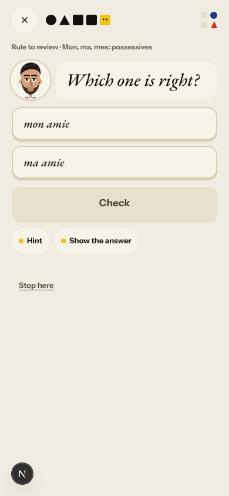

**The owner's rule of 7 Nov (#698, «Nur als Extra»): holds, slot and label, for the first time.** Day 1's scene slip «sa ami → son» became «Mon, ma, mes · practising · shaky · 1 mistake» (now the right rule, #974 fixed by #1000) and took no card; day 2's card and La Forge were the next rule of the A2 path (être); the slip rule ran only in the drill around the scene, labelled «A rule to review». 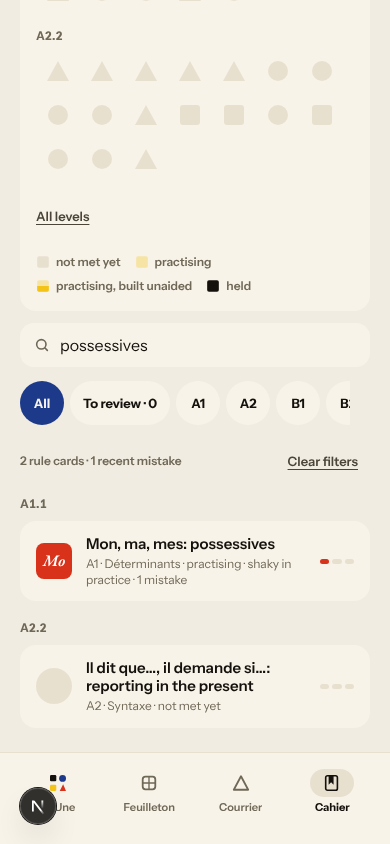

**Q10 up to 4.** Accent-only answers are accepted and named on every judge I reached: the typed gap «vous etes arrivés» → «Right — watch the accent: «êtes».»; the rule check's own sentence «La semaine derniere, j'ai cuisiné pour Lila.» → «Right — watch the accent: «dernière».», printed with the accent (#562 holds after #1006). «joue» for «joué» is refused with «Here the accent changes the word», which is right. 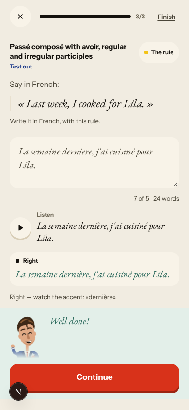

**Q11 at 3.** French printed as a model that is still wrong or one-sided:
- the Courrier's corrected line keeps «j ai oublie … a Leeds» while the list names «j'ai» twice (#925, #807 again); «au notaire» is now right (#996 fixed). 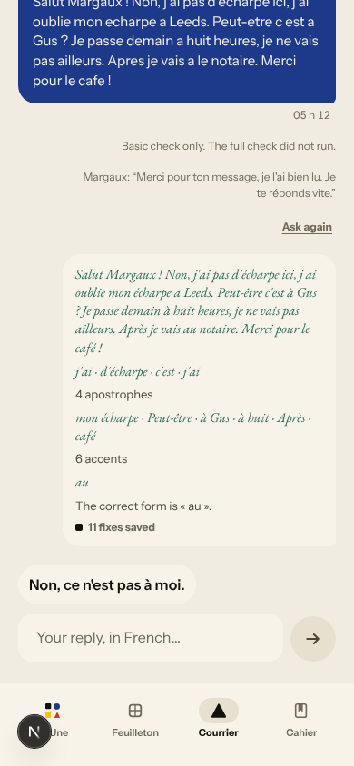
- La Forge's end sheet lists «Still practising: Avant-hier, vous etes arrivés en retard.», my accepted line without the accent it named (commented on #927).
- the être judge item prints «Je suis partie tôt hier soir.» as the one right sentence to a learner whose gender is not set (#1029, new). 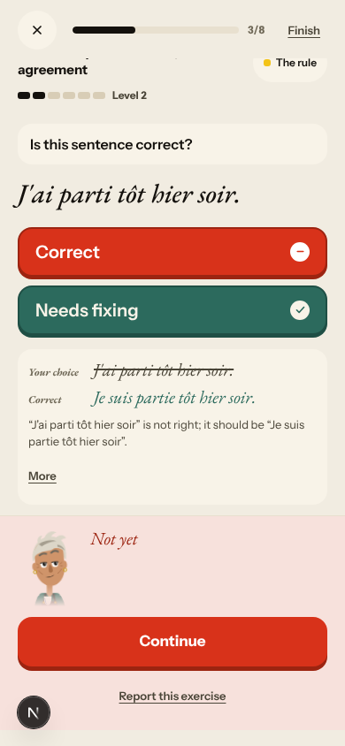

**Q9 at 3.** The être misses explain («You chose "Margaux est allé". Aller, venir, partir … use être, and the participle agrees»; ««allé» was left as shown, but it is wrong.»). The avoir misses still get the gloss only («Il a cuisiner», a tile build with «est» for «a»), and a judge miss gets the echo only, no «partir takes être» (#992 again). 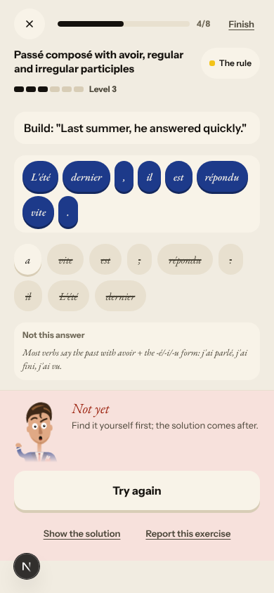

**Q16 at 3.**
- The optional test the end sheet offers («Ready for the test? … Pass, and the rule is yours.») cost three levels when failed: «1 of 3 right. Your practice picks up at level 2.», and `forge_rung` for avoir went 4 → 1 (#1028, new). The hand-on itself is right now: «Next: 15 words» (#997 fixed). 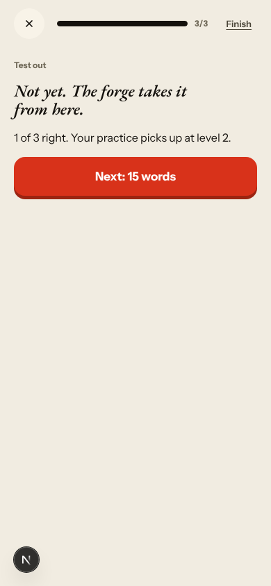
- My Courrier slip «cafe» came back on day 2 as «Write what you said, correctly. **Rule: Passé composé with avoir**» (#697 reopened): the letter's eleven spelling fixes are stored as one row with 10 occurrences and 9 lapses, which takes «a le → au»'s lent rule (#1027, new). 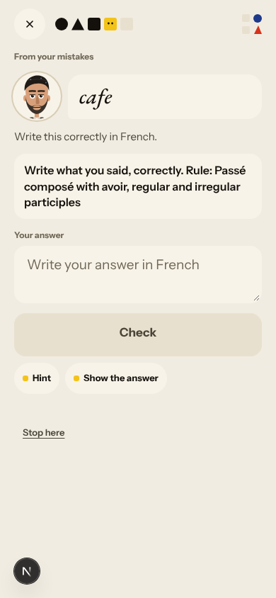

**Q3 at 3.** «Scene · Step 2 of 4» jumps to «Rule · Step 4 of 4»; the rule card's «Try it» opens a «Scene finished» card with only Gus' portrait and «Next: grammar»; day 2 says «Scene · Step 5 of 5 · Scene finished» before the grammar and the words (on #143). 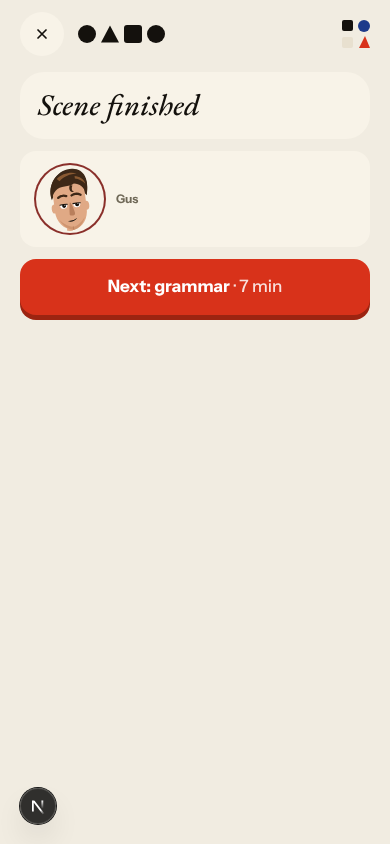

**Q5, Q6 at 3 (fake provider).** Keyword echoes: «… avec ma soeur.» → Margaux «Non, alors. Soeur : c'est noté.»; «… veut l immeuble ?» → Camille «Immeuble ? Bonne question.»; «… chez Marin.» → «Oui. Marin, bien.». One correction per reply («son», «très», «peut-être», «clé»). What the authored beats did well: day 2 remembered that I had left the key with Margaux («Ask Margaux for the key you left with her.»). Le Montage builds the être rule on «Romy», whom I have not met (#1030, new, low). 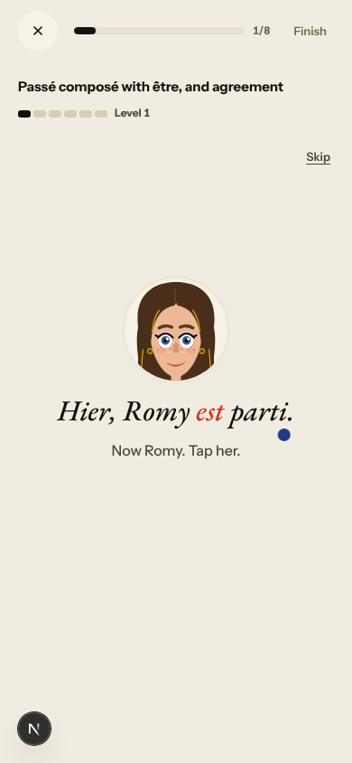

**Q15 down to 3 (against 21 Nov).** Day 1's La Forge had no sentence of my own (8 items: choice, tiles, gap, find the mistake); day 2 had one free sentence, unchecked on the fake stack («Basic check only», «Skip without a check»), and the test's one line. What I wrote myself: two scene replies and the Courrier on day 1, two scene replies on day 2. Not filed: the séance is drawn from the rung.

**Q20 at 3.** Both Done screens end on a statement as «Tomorrow»: «Deux clés pour la même porte.», «Ton billet de retour est pour mercredi. Le même jour que Lila.» (#466; the live walk saw a question tonight). 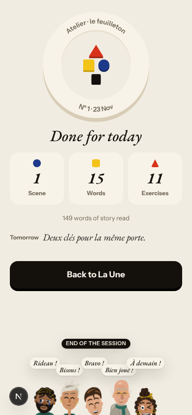 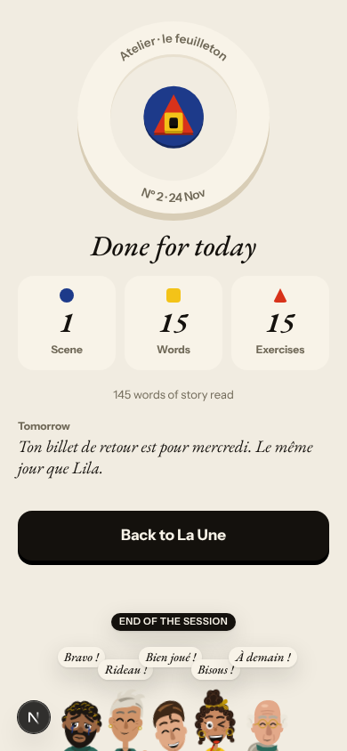

**Q22 at 3.** Home promises day 2 at «20 min» (scene 8, grammar 7, words 5); the agent needed 5 and about 7 minutes of play, a learner reading and typing about 12–15.

**The best of the night.**
- Ten fixes reached and confirmed: #974, #975, #469, #996, #997, #562, #947, #948, #950 (no «day off» line), #928 («1/1 words used» after «ailleurs»).
- The 7 Nov owner rule holds in full.
- Day 2 carried my day-1 choice (the key left with Margaux) into a new task.
- The être misses explain the agreement in the sentence I wrote; Le Montage shows why «partie» changes in five taps.

## Findings, by root cause

Four new findings (#1027–#1030), all `queue:ready`, `lane:code`, `size:S`, each with a **Done when:** comment. One reopened (#697, `queue:owner` → `queue:ready`). Root cause #973 advanced (new child #1027; back from `queue:pr` to `queue:ready`); #542 and #143 advanced; #147 and #174 have new children. #1028 has no shared cause. Repeats commented: #925, #807, #992, #927.

### #973 a slip's rule is guessed, not read from what the correction changed
- **#1027 (new, medium)** one letter's accent and apostrophe fixes share the key `spelling:concept-none:orthography:spelling` (`app/services/error_memory.py:871-882`, no word part), so they become one row («cafe», 10 occurrences, 9 lapses); «a le → au» keeps the letter's rule (`concept_for_slip` → 39), and the WP-L1 legacy branch (`:496-514`) stamps it on that row.
- **#697 (reopened)** the visible symptom: day 2's recall «cafe · Rule: Passé composé with avoir». 

### #174 a right answer is judged against one stored string
- **#1029 (new, low)** the être items store «je» with a feminine participle («Je suis partie tôt hier soir»), printed as the right sentence; La Forge never reads `address_preference` (default «neutral»).
- **#927 (commented)** the end sheet lists «vous etes arrivés» without the accent the item named.

### #147 the cast is not one registry
- **#1030 (new, low)** `web-frontend/lib/rule-montage.ts:65` fixes `ROMY` for every learner; Romy has not appeared by day 2.

### #146 the day's content and feedback are not driven by one concept
- **#992 (commented)** the avoir misses answered with the gloss only; a judge miss with the echo only.

### #857 the basic check prints a «corrected» line it would still correct
- **#925 (commented)** «j ai» twice, listed twice, fixed once; «a Leeds» left. 
- **#807 (commented, owner)** «oublie» not named on a passé composé letter.

### No shared cause
- **#1028 (new, medium)** a failed optional test writes its placement over the rule's level: `ForgeService._finish_test_out` (`app/services/forge.py:2097`) sets `forge_rung = placement_rung`, and `evaluate_test_out` (`app/core/forge.py:1000-1019`) places at the lowest failed rung; Level 5 → Level 2. 

### Seen again, not commented
- #466: both days end on a statement as «Tomorrow».
- #280: 3 of 15 new words on day 1 come from the scene (vendre, la clé, l'appartement), the rest are adverbs; day 2 fits the scene better (la lettre, signer, l'immeuble, l'escalier, l'adresse).
- #694 (harness only): after `/clock +1` Home still says «Monday 23 Nov».
- The «Scene finished» card shows only Gus, though I also spoke to Margaux (on #143 above).

### Fake provider (left to the live walk)
- Keyword echoes and one correction per scene reply (above); Margaux's Courrier answer is the stock «Merci pour ton message, je l'ai bien lu.» (#1025 is the live case); La Forge's free sentence «Basic check only».

## Re-tests

| issue | fix | result |
|---|---|---|
| #974 «sa amie → son» filed under articles | #1000 | **fixed**: concept 17, Cahier «Mon, ma, mes · 1 mistake»; commented (closed by the merge).  |
| #975 slip rule as today's rule | #1001 | **fixed**: «Rule to review · Mon, ma, mes»; commented.  |
| #469 own slip under «The words» | #1001 | **fixed**: «From your mistakes»; commented. |
| #996 «à le notaire» | #1003 | **fixed**: «Après je vais au notaire.»; commented.  |
| #997 failed test opens a second séance | #1005 | **fixed**: «Next: 15 words»; commented (#1028 new on the same screen). |
| #562 missing accent judged two ways | #1006 | **fixed** on the gap and the rule check («dernière» named and printed); commented.  |
| #947 La Forge day step on another rule | #1008 | **holds**: `concept=39` day 1, `concept=40` day 2; commented. |
| #948 «Exchange 3 of 3» past the plan | #1002 | holds (1, 2, 3 of 3, then the end); already closed. |
| #950 «A day off kept your streak» | #1005 | holds (no line); already closed. |
| #928 Courrier ribbon | #1011 | «1/1 words used» after «ailleurs»; «vendu»/«cle» not written tonight. Left closed. |
| #966 «clef» refused | #1006 | not reached (no clé item). Left closed. |
| #697 Courrier slip under the letter's rule | #1000 | **not fixed in the walk**: «cafe · Rule: Passé composé»; **reopened**, `queue:ready`, mechanism in #1027. |
| #973 (root cause) | #1000 | **advanced, not done**: #974 passes, #697 does not; «a le → au» and the merged row are outside the guard's pairs; `queue:pr` → `queue:ready`. |
| #698 owner rule of 7 Nov | #708, #1001 | **holds, slot and label**; commented. |
| #925 slip written twice fixed once | none merged | still seen; commented, stays `queue:ready`. |
| #807 participle accent not named | none | still seen; commented, labels left (owner). |
