# Walk · 24 Nov 2026 · nightly explore walk

Main at `eb1ef3e9`. Since the 23 Nov walk (`ddf8df6d`), main took in:
- **the night shift's fixes**: #1032 (a slip written twice is fixed twice in the printed line; #925), #1033 (each spelling slip of a letter is its own slip, «a le → au» is the contractions rule; #1027, #697, root cause #973), #1037 (the Journal retell is held to the scene's lines; #918, #971), #1039 (La Forge's «we» cards say notre/nos, «One possible answer» is checked; #968);
- the 23 Nov walk report #1031, the forge #1042 and tonight's live report #1046.

`alembic upgrade heads` ran cleanly on a scratch database before the walk: one head, **`b2d4f6a8c0e1`** (unchanged since 23 Nov).

Fake story provider, local stack, Chromium at 390×844, one persona: `a1-de-fresh` (`--fresh --native de`; last played 22 Nov). I signed up through the UI at «Neu im Französischen · A1» as Jonas and played a German beginner with real slips, re-using slips that reach tonight's fixes:
- day 1 scene: to Gus «Bonsoir. Je suis Jonas, je suis allemand. Odile est ma grand mere. Je suis ici pour vend le appartement.»; to Margaux «Non, je suis tres fatigue. Mais c est qui, Solvel ? Demain je vais a le notaire.»; I took the key;
- day 1 Courrier to Lila: «Salut Lila ! Je pense que Gus est drole. Je n ai pas de cle ce soir et je n ai pas faim. D abord je vais a le notaire demain. Le cafe de Margaux est tres bon. Jonas» (a slip written twice for #925, accent slips and «a le» for #1027 / #697);
- day 2 scene to Camille: «Je sais pas. Je suis pas sur. Le appartement est de ma grand mere. Pourquoi c est plus simple pour vous ?», and Gus reads the letter;
- day 2 Journal retell of day 1, with a made-up clause («Le chat a mangé un perroquet.»).

Day 1 (about 8½ minutes from «Loslegen» to Done, sign-up included):
- teaser (Margaux), sign-up, figure, onboarding («Szene, dann Grammatik, dann deine Wörter»), cast page;
- scene «Le mauvais accueil»: two free replies, one choice, one key choice («Austausch 1 … 3 von 3»);
- rule card «Ich bin, du bist: Subjektpronomen und être», «Ausprobieren», a «Szene beendet» card, then La Forge 8 items (Stufe 1 → 3): a choice miss and retry, a judge miss, a speed round 2 of 4, two typed-gap misses and retries, a tile miss and retry, a choice; no free sentence;
- 15 words, Done, Home, Courrier (one reply), Cahier (Regeln), Feuilleton.

Day 2 (clock +1, about 10 minutes):
- Home «Nº 2 · La clé d'Odile · La lettre · 23 Min.» with «Gestern erzählen ≈ 2 min»; scene «La lettre»: one free reply, one choice;
- être as «Eine bekannte Regel, auf der heutigen Seite», then the new rule **Avoir** (card);
- around the scene: «Aus deinen Fehlern» (my La Forge slip «Nous somme à la brocante») and «Regel zum Wiederholen · Le, la, l', les»;
- La Forge «Regel des Tages schmieden» on Avoir, 8 items (Stufe 1 → 5), être as «Wiederholung · heute fällig»; then the offered Regelprüfung on être, **passed** 3 of 3 («Die Regel sitzt»);
- 18 words, Done; then the Journal retell.

Afterwards, to reach the recall of the Courrier slips (#697), the clock went to 27 Nov: day 3 («Plusieurs semaines», the fake story engine) has no recall step, so the screen was not reached. Not scored.

**Live column: [live walk 24 Nov](../live-walks/2026-11-24.md)** (on main, #1046), production with the real model, release `8343a437dffa` (every fix above is live), account A1.1 on day 42. Headline: **Q5, Q10, Q11, Q20 down to 3; the scene allowed one typed reply (#378); Lila invents a refund in the Courrier (#1043); La Forge says «3 corrections» and lists one (#1044); the repair box refuses the corrected line without its accent (#1045).** It filed #1043–#1045; they are not filed again here. Its re-tests: #951 not fixed (#1010 not merged); #378, #919, #920, #466, #557, #577 seen again; #1025 not reproduced.

**Browser walk on main**: run 120 (`48a7e090`, #1032) failed in the `de` shard before any screen (the harness timed out on `/api/auth/csrf`, filed as #1041); runs 121 (`8343a437`) and 122 (`eb1ef3e9`, main tonight) passed, as did runs 117–118. Run 119 was cancelled. The scheduled «Browser walk» run 43 (`48a7e090`) passed.

## Scores (rubric `docs/ops/walk-rubric.md`)

| # | question | 24 Nov a1-de (d1–2) | live 24 Nov | 23 Nov a2-en (d1–2) | 22 Nov a1-de (d1–2) |
|---|---|---|---|---|---|
| 1 | Where am I | 4 | 4 | 4 | 4 |
| 2 | What is at stake | 4 | 4 | 4 | 4 |
| 3 | What to do next | 3 | 3 | 3 | 3 |
| 4 | Scene reacts to my writing | fake | 4 | fake | fake |
| 5 | Story coherent | 3 | 3 | 3 | 3 |
| 6 | Characters consistent | 3 | 3 | 3 | 3 |
| 7 | Image, text, tone fit | 4 | 4 | 4 | 4 |
| 8 | Difficulty fits | 4 | 4 | 4 | 4 |
| 9 | Feedback explained | 3 | 3 | 3 | 3 |
| 10 | Right answers accepted | 3 | 3 | 4 | 3 |
| 11 | French correct | 4 | 3 | 3 | 3 |
| 12 | Clear goal today | 4 | 4 | 4 | 3 |
| 13 | Grammar practised | 4 | 4 | 4 | 4 |
| 14 | Earlier material returns | 4 | 4 | 4 | 4 |
| 15 | I produce French | 3 | 5 | 3 | 3 |
| 16 | Errors, dead ends | 3 | 3 | 3 | 3 |
| 17 | Varied, fun | 4 | 4 | 4 | 4 |
| 18 | Fast enough | 4 | 3 | 4 | 4 |
| 19 | App only | n/a | n/a | n/a | n/a |
| 20 | Satisfying end | 3 | 3 | 3 | 3 |
| 21 | Would come back | 3 | 4 | 3 | 3 |
| 22 | Time vs promise | 3 | 4 | 3 | 3 |

Q14 is scored on day 2 only. Against the last `a1-de` walk (22 Nov): **Q11 3 → 4, Q12 3 → 4** up; nothing down. Against last night (23 Nov, a2-en): Q11 3 → 4 up, **Q10 4 → 3** down. No 1 or 2 tonight.

**Q11 up to 4: the Courrier prints a line with nothing left to fix.** «Je n ai pas de cle ce soir et je n ai pas faim. D abord je vais a le notaire demain.» became «Je n'ai pas de clé ce soir et je n'ai pas faim. D'abord je vais au notaire demain.», the list «n'ai · D'abord · n'ai» matches the line (#925 fixed by #1032), «au notaire» holds (#996). La Forge's items were right French throughout. 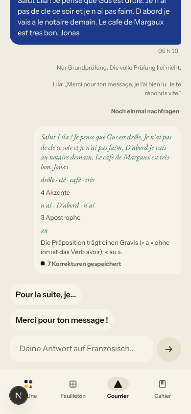

**Q12 up to 4 (against 22 Nov): one rule a day, every other drill labelled.** Day 1's card and La Forge were être; day 2's Avoir, with être only as «Eine bekannte Regel» and «Wiederholung · heute fällig». My own slip came under «Aus deinen Fehlern · Was du selbst geschrieben hast», the slip rule under «Regel zum Wiederholen · Eine Regel, die schon vorkam» (#975, #469 hold on A1).

**The owner's rule of 7 Nov (#698, «Nur als Extra»): holds, slot and label.** Day 1's slip «le appartement» made «Le, la, l', les · in Übung · wackelig · 1 Fehler» and took no card; day 2's card and La Forge were Avoir, the next rule of the A1 path; «Le, la, l', les» ran only around the scene, labelled «Regel zum Wiederholen». 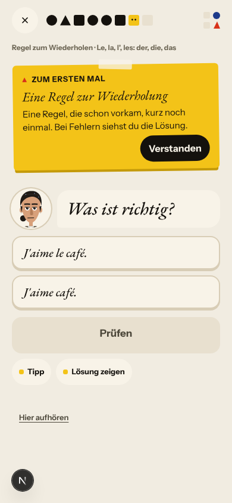

**Q9 at 3.**
- Better: the judge miss «Tu est à l'école ?» now says «Mit «tu» heißt «être» «es», nicht «est».»; the choice and tile misses say «Schau, wer es tut, und nimm die Form von «être» für diese Person.»
- Not yet: the typed-gap misses still get the gloss only: «Il et à la poste.» and «Nous somme à la brocante.» → «Être heißt sein.»; «Je ai un rendez-vous» → «Avoir heißt haben; …», nothing on «j'ai» (#992 again). 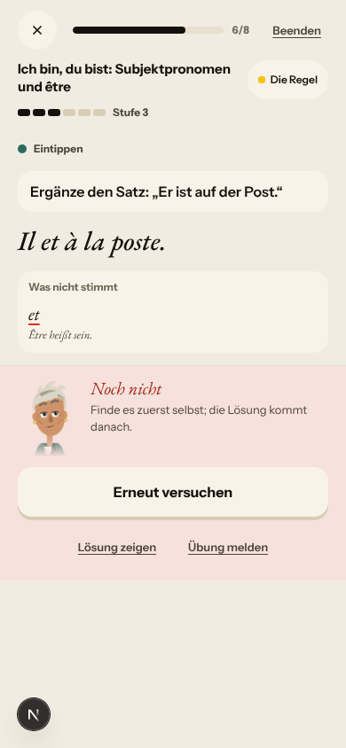 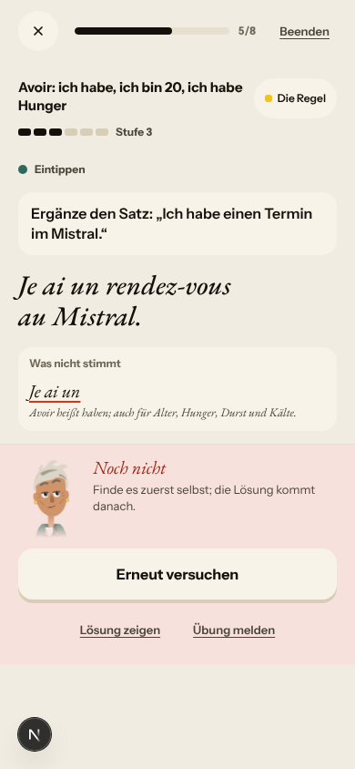
- Wrong: «a le → au» is explained as an accent, in the Courrier and in the scene: «au · Die Präposition trägt einen Gravis (« a » ohne ihn ist das Verb avoir): « au ».» (#1047, new). 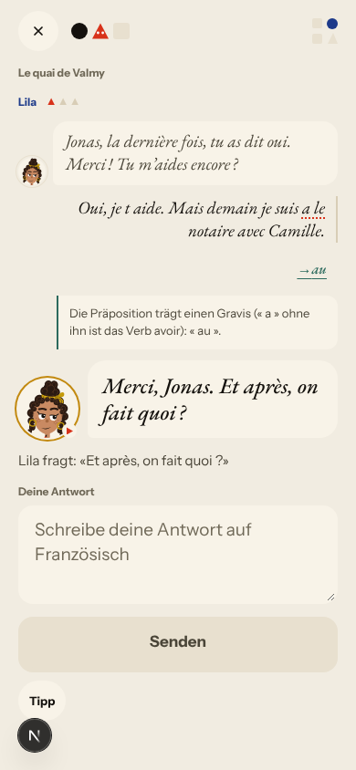

**Q10 down to 3 (against 23 Nov).** Avoir, Stufe 3, typed gap «Ergänze den Satz: „Ich habe einen Termin im Mistral.“ ___ rendez-vous au Mistral.»: «J'ai un» was refused («J'ai un → J'ai», «Noch nicht», «Zwei Fehler am Stück»), though «J'ai un rendez-vous au Mistral.» is right and says what the German says (#1048, new). Accepted and named: the Regelprüfung's «Tu es à la redaction ?» → «Richtig — achte auf den Akzent: «rédaction».» (#562 holds). 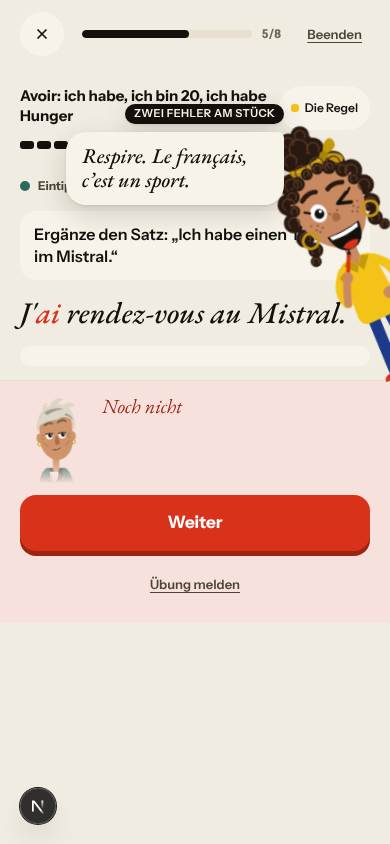

**Q6 at 3.** The new Avoir card puts Romy's line «J'ai vingt-cinq ans et j'ai faim !» under Margaux's face and name, because Romy is not met yet (#1049, new, low). Margaux has run the Mistral for over twenty years. 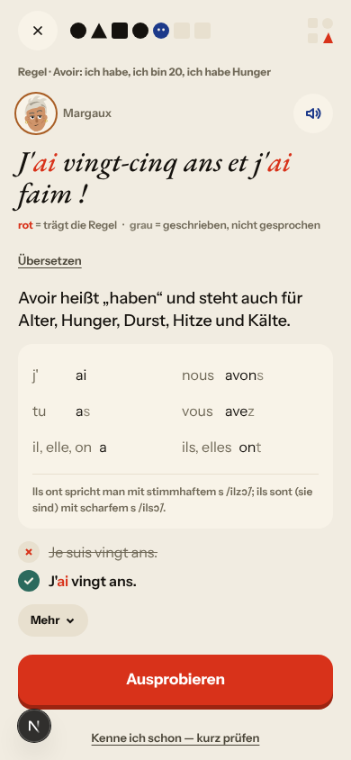

**Q15 at 3.** Neither day's La Forge asked for a sentence of my own: 16 items, all choice, judge, speed round, typed gap, tiles and spot. What I wrote myself: two scene replies and the Courrier on day 1; one scene reply, the recall line, the Regelprüfung's sentence and the Journal retell on day 2. The first free La Forge sentence came on day 3, at Stufe 5. Not filed (the owner's open question below).

**Q3, Q16 at 3.**
- «Szene · Schritt 2 von 4» jumps to «Regel · Schritt 4 von 4»; the rule card's «Ausprobieren» opens a «Szene beendet» card with only Gus' portrait and «Weiter: Grammatik»; day 2 goes «Schritt 6 von 7 · Aus deinen Fehlern», «Schritt 7 von 7 · Regel zum Wiederholen», «Schritt 7 von 7 · Aus deinen Fehlern» (the retry), then «Szene · Schritt 7 von 7 · Szene beendet» before the grammar (on #143). 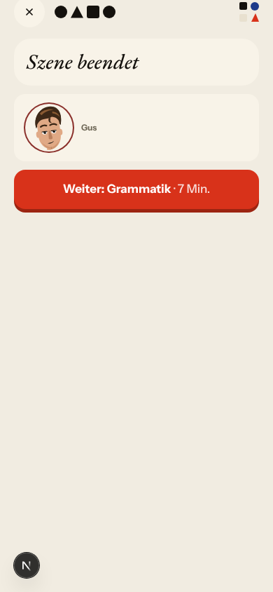
- «Gestern erzählen ≈ 2 min» beside «≈ 6 Min.» (#998, its PR #1012 not merged).

**Q5, Q6 at 3 (fake provider).** Keyword echoes: «… a le notaire.» → Margaux «Non, alors. Notaire : c'est noté.»; «… plus simple pour vous ?» → Camille «Simple ? Bonne question.»; Lila «Tu n'entres pas ? Je comprends.» (I never said so). The scene correction names one slip per reply («l'appartement», «très», «L'appartement») and misses «grand mere», «pour vend», «c est», «Je sais pas», «sur». Register held (Gus, Camille: vous; Margaux, Lila: tu; German UI: du).

**Q20 at 3.** Both Done screens end on a statement as «Morgen»: «Deux clés pour la même porte.» and «Ton billet de retour est pour mercredi. Lila est libre mercredi.» (#466). 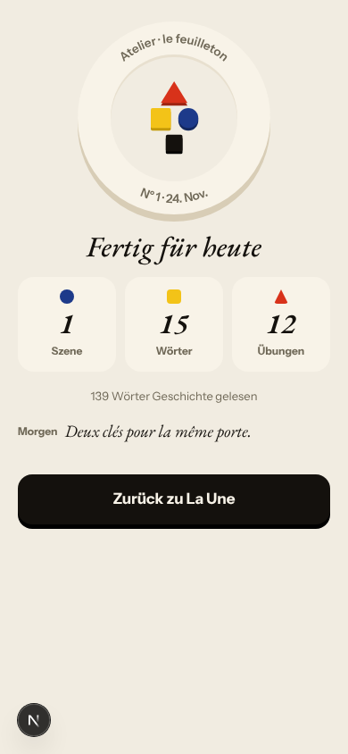 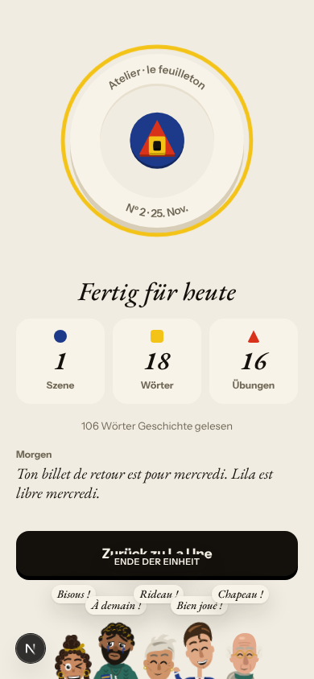

**Q22 at 3.** Home promises day 2 at «23 Min.» (scene 10, grammar 7, words 6); the agent needed about 10 minutes with the test, a beginner reading and typing about 15.

**The best of the night.**
- Three fixes reached and confirmed: #925, #1027, and the source of #697; root cause #973 closed on its Done when.
- One Courrier letter now leaves seven slips, one row each, the accent slips with no rule and «a le → au» under «Au, aux, du, des» (Cahier: «noch nicht kennengelernt · 1 Fehler»).
- The être judge and tile misses say why, in the person's terms.
- The Regelprüfung on être, passed 3 of 3, names the missing accent in my own sentence and hands on to the words.
- The Journal retell no longer confirms a retell with a made-up clause (fake stack; #918's story half is the live walk's). 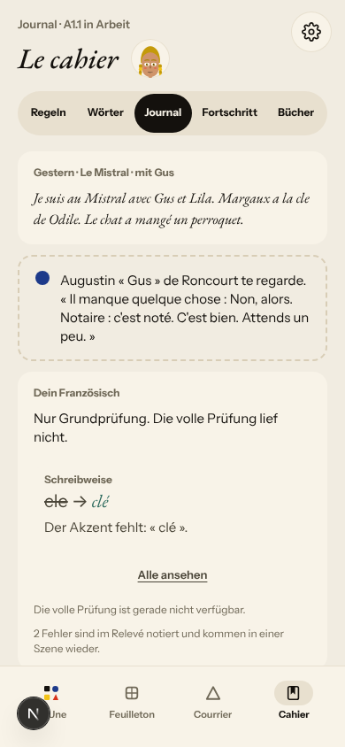

## Findings, by root cause

Three new findings (#1047–#1049), all `queue:ready`, `lane:code`, `size:S`, each with a **Done when:** comment and added as a child of its root cause. Root cause #973 **closed** (Done when met); #857, #174 and #147 have new children. Repeat commented: #992. #1041 (the main walk's start-up flake) closed on its Done when.

### #857 the basic check's composed fixes
- **#1047 (new, medium)** «a le → au» explained as «Die Präposition trägt einen Gravis …: « au »», in the Courrier and the scene. `_settle` (`app/services/correction_contract.py:2948-2978`) folds the contraction found inside «a → à» into the first edit with `replace(edit, …)` and keeps `FR_A_GRAVE`'s rule, label, `task_error_type` and note (requoted to «au», :2976); `_fold_into_source` (:2823) takes the further rule. 

### #174 a right answer is judged against one stored string
- **#1048 (new, medium)** «J'ai un» refused for „Ich habe einen Termin im Mistral“: the avoir object is `rendez-vous au Mistral` with the glosses «an appointment», «einen Termin» (`app/data/grammar_templates/lexicon.json:5167`, `lexicon_de.json:57`), and the blank is graded against its stored forms only (`judge_in_line`, `app/services/answer_acceptance.py:788`), never as the sentence it makes. 

### #147 the cast is not one registry
- **#1049 (new, low)** Romy's «J'ai vingt-cinq ans et j'ai faim !» given to Margaux: `card_for_learner` (`app/services/forge_coaches.py:225-245`) hands a card whose speaker is not met to the stand-in coach when the register fits, and nothing else is checked. With #1030 (Le Montage on Romy before she is met).

### #146 the day's content and feedback are not driven by one concept
- **#992 (commented, owner)** typed-gap misses answered with the gloss only («Il et», «Nous somme», «Je ai un»); the judge, choice and tile misses now explain.

### Seen again, not commented
- #466: both days end on a statement as «Morgen».
- #280: 4 of 15 new words on day 1 come from the scene (vendre, l'appartement, la clé, ici), 1 of 15 on day 2 (la lettre); the rest are adverbs, numbers and ordinals.
- #143: the step counter and the «Szene beendet» card (above).
- #998: «Gestern erzählen ≈ 2 min» (PR #1012 open).
- #1029's kind: «Tu ___ prête ?» for „Bist du fertig?“ prints a feminine participle as the one right sentence; not commented, the item does not say who «tu» is.
- #694 (harness only): after `/clock` Home still says «Dienstag, 24. Nov.».

### Observations, not filed
- La Forge's être and Regelprüfung items place the learner «à la rédaction» (with Margaux on day 1), Romy's newsroom, which an A1 learner has not seen by day 2 (`item_semantics.py:146` allows it as a season place). Watch with #1030.
- The day-1 La Forge misses are stored as one row («somme», 4 occurrences, 3 lapses, key `grammar:concept-1:pronoun_choice:…`): the séance keys its slips by the rule, not by the change. Recall brought back «Nous somme à la brocante.», which is right; watch whether the count misleads.
- On a day-3 panel the text read «Parce que vous avez dit à Lila « Gus » — Nº 2» (`living_story.py:4004` writes «vous»; the quote is the choice of who reads the letter). It was not visible in the screenshot, so not filed.
- A La Forge «Zwei Fehler am Stück» cheer puts Lila's figure over the item's German prompt for a moment. 

### Fake provider (left to the live walk)
- Keyword echoes and one correction per scene reply (above); the Courrier's stock «Merci pour ton message, je l'ai bien lu.» (#1025 is the live case); the Journal retell's targets are the fake stack's echo lines («Non, alors. Notaire : c'est noté.»), so #622 cannot be judged here; day 3's English task «Propose an alternative for the market morning, or decline.» and «Vous avez répondu.» come from the dev story engine.

## Re-tests

| issue | fix | result |
|---|---|---|
| #925 slip written twice fixed once | #1032 | **fixed**: «je n'ai pas de clé … je n'ai pas faim»; commented (closed by the merge).  |
| #1027 a letter's spelling fixes as one row | #1033 | **fixed**: seven rows, one per change, each 1 occurrence; «a le → au» concept 16; commented (closed by the merge). |
| #697 Courrier accent slip under the letter's rule | #1033 | **source fixed**: the accent slips have no rule; the recall screen was not reached (due 27 Nov; day 3 has no recall); commented, left closed. |
| #973 (root cause) slip's rule guessed | #1000, #1033 | **Done when met, closed**: guard pairs through the three record paths pass (23 tests), children hold. |
| #918, #971 Journal retell | #1037 | story lane: on the fake stack no confirmation of a retell with a made-up clause, and «Woran du dich erinnerst» lists scene lines, not my slip. Left to the live walk. |
| #968 «we» cards say «ses» | #1039 | not reached (no possessives card on A1 days 1–2). Left closed. |
| #562 accent judged two ways | #1006 | holds: the Regelprüfung names «rédaction». |
| #975, #469 drills' labels | #1001 | hold on A1. |
| #1028 failed test drops the level | none merged | not reached: the test was passed tonight. |
| #1041 «Main walk fails: harness-ran» | none (flake) | **closed** on its Done when: runs 121, 122 passed. |
| owner rule of 7 Nov (#698) | #708, #1001 | **holds, slot and label.** |

Root causes: #973 **closed**; #857, #174, #147 advanced (new children); none opened.

## Owner questions (open, not asked again)
- **#1028, does decision #88 cover the optional test?** Tonight's test was passed (3 of 3, «Ab heute gilt sie als gefestigt», «Ein seltenes Zeichen für diese Regel»), so it says nothing new on the failed path.
- **Should La Forge ask for one free sentence of the learner's own on a rule's first days?** Tonight: 16 La Forge items over days 1–2 with none; the first free sentence came on day 3 at Stufe 5 («Gus fragt, wie alt du bist. Ich bin 45 Jahre alt.»). The only own sentence on days 1–2 outside the scene and the Courrier was the optional Regelprüfung's.

## Scripted walk

- «Browser walk on main» (walk-main.yml): runs 117 (`19107952`, #1039) and 118 (`989c2587`, #1037) passed; 119 (`1ac7632b`) cancelled; 120 (`48a7e090`, #1032) failed in the `de` shard on the harness start (`/api/auth/csrf` 404 timeout; `fr`, `en + B1`, seasons passed); 121 (`8343a437`) and 122 (`eb1ef3e9`, tonight's main) **passed**.
- The scheduled «Browser walk» (walk.yml) run 43 on `48a7e090` **passed**.
- In tonight's explore walk both days reached Done: day 1 through La Forge's «Weiter: 15 Wörter», day 2 through the passed Regelprüfung's «Weiter: 18 Wörter».
