# Walk · 25 Nov 2026 · nightly explore walk

Main at `78097b8b`. Since the 24 Nov walk (`eb1ef3e9`), main took in:
- **the night shift's fixes**: #1056 (the scene card marks every basic-check slip, up to three; #919), #1012 (the retell chip's minutes in the chrome's language; #998), #1038 (Le Montage names only people met on day 1; #1030), #1051 (the session header counts the day's steps; root cause #143), #1052 (a friend's tu note opens the chat composer, an unanswered reply says so; #953, #1025), #1053 (drill misses say what the item is about; #967, #1024, under #992), #1059 (a rule card's line about its own speaker never goes to a stand-in; #1049), #1060 (La Forge's «je»/«tu» agrees as the learner gave their gender, or not at all; #1029);
- the forge #1061 and tonight's live report #1066.

`alembic upgrade heads` ran cleanly on a scratch database before the walk: one head, **`b2d4f6a8c0e1`** (unchanged since 23 Nov).

Fake story provider, local stack, Chromium at 390×844, one persona: `a2-en` (`--fresh --native en --level A2.1`; last played 23 Nov). I signed up through the UI at «I know some basics · A2» as Sam and played off-script with school-French slips (no accents, no apostrophes), re-using slips that reach tonight's fixes:
- day 1 scene to Gus: «Bonsoir. Je m appelle Sam, je suis anglais, de Leeds. Je ne sais pas ce que est Solvel. Je suis le petit-fils d Odile, je viens pour vendre son appartement, mais je suis pas sur. Hier je suis allé au usine de mon pere. Et vous, vous etes qui ?» (#919's «ce que est», «au usine»); to Margaux «Non, ce soir je monte pas. Je suis tres fatigue et j ai un peu peur. Pourquoi elle ne donnait jamais la cle ? Demain je vais a le notaire avec ma soeur. Tu connais Solvel ?»; I took the key;
- day 1 Courrier to Gus: «Bonjour Gus, je pense que vous etes tres drole. Ce soir j ai pris la cle de ma grand-mere. Demain je vais a le notaire et apres je visite l appartement. Je ne sais pas si je vend. Vous connaissez Camille Marchand ? A bientot, Sam»;
- day 2 scene to Camille: «Non, je ne vend pas maintenant. Hier soir j ai dormi dans l appartement et j ai trouve des photos de ma grand-mere. C est plus simple pour vous, peut-etre. Pourquoi votre grand-pere veut tout l immeuble ? Ce matin je suis allé au hopital pour ma soeur.»; nobody reads the letter («Personne»);
- La Forge misses on purpose (infinitive for participle, «Tu a dit», «Lila est allé»), and the offered test failed 1 of 3 on purpose.

Day 1 (about 7 minutes of walking from «Start» to Done, sign-up included):
- teaser (Margaux), sign-up, figure, onboarding («Scene, then grammar, then your words»), cast page;
- scene «Le mauvais accueil»: two free replies, one choice («Exchange 1 … 3 of 3»);
- rule card «Passé composé with avoir, regular and irregular participles», «Try it», the near-empty «Scene finished» card, then La Forge 8 items (Level 1 → 4): a choice miss and retry, a choice, a judge miss, a speed round 4 of 4, a typed-gap miss and retry, a tile miss and retry, a typed-gap miss and retry, a tile build; no free sentence;
- 15 words, Done, Home, Courrier (one reply to Gus), Cahier (Rules), Feuilleton.

Day 2 (clock +1, about 6 minutes):
- Home «Nº 2 · La clé d'Odile · La lettre · 20 min» with «New letter ≈ 4 min», «Retell yesterday ≈ 2 min»; scene «La lettre»: one free reply, one choice;
- around the scene: «From your mistakes» (my La Forge slip «Samedi dernier, tu as dine chez Lila.»), rebuilt right;
- La Forge «Forge today's rule» on **Passé composé with être, and agreement**: Le Montage (Gus → Lila), then 8 items (Level 1 → 5) with avoir twice as «Review · due today», one free sentence (not checked on the fake stack); then the offered test on avoir, failed 1 of 3;
- 15 words, Done; Courrier opened («Un mot de Camille»), not answered.

Day 7 not played.

**Live column: [live walk 25 Nov](../live-walks/2026-11-25.md)** (on main, #1066), production with the real model, release `56a648d8ddfd` (the tip of main before the report: every fix above is live), account A1.1 on day 43. Headline: **Q9, Q10, Q13 up (La Forge named the gender of «idée», the tense of «voit», être/avoir for age); Q7 down to 3 (the stage line «Dix heures» printed as Margaux's speech, #1064); the Journal says «You recalled everything» for an invented retell (#1063) and «Basic check only» (#1062); the landlord asks the tenant to arrange the repair (#1065).** It filed #1062–#1065; they are not filed again here. Its re-tests: #378, #466, #557, #723, #920 seen again; #622 commented; #951 not reached.

**Browser walk on main**: every run since the last walk that finished passed: 124 (`3e1cc8bc`, #1060), 126 (`3c82eaee`, #1053), 128 (`bf7a878e`, #1051), 130 (`d3031735`, #1012), 131 (`32e474a0`, #1056), 132 (`56a648d8`, #1061) and 133 (`78097b8b`, main tonight). Runs 125, 127 and 129 were cancelled by the next merge.

## Scores (rubric `docs/ops/walk-rubric.md`)

| # | question | 25 Nov a2-en (d1–2) | live 25 Nov | 24 Nov a1-de (d1–2) | 23 Nov a2-en (d1–2) |
|---|---|---|---|---|---|
| 1 | Where am I | 4 | 4 | 4 | 4 |
| 2 | What is at stake | 4 | 4 | 4 | 4 |
| 3 | What to do next | 3 | 3 | 3 | 3 |
| 4 | Scene reacts to my writing | fake | 4 | fake | fake |
| 5 | Story coherent | 3 | 3 | 3 | 3 |
| 6 | Characters consistent | 3 | 3 | 3 | 3 |
| 7 | Image, text, tone fit | 4 | 3 | 4 | 4 |
| 8 | Difficulty fits | 4 | 4 | 4 | 4 |
| 9 | Feedback explained | 3 | 4 | 3 | 3 |
| 10 | Right answers accepted | 4 | 4 | 3 | 4 |
| 11 | French correct | 3 | 3 | 4 | 3 |
| 12 | Clear goal today | 4 | 4 | 4 | 4 |
| 13 | Grammar practised | 4 | 5 | 4 | 4 |
| 14 | Earlier material returns | 4 | 4 | 4 | 4 |
| 15 | I produce French | 3 | 5 | 3 | 3 |
| 16 | Errors, dead ends | 3 | 3 | 3 | 3 |
| 17 | Varied, fun | 4 | 4 | 4 | 4 |
| 18 | Fast enough | 4 | 3 | 4 | 4 |
| 19 | App only | n/a | n/a | n/a | n/a |
| 20 | Satisfying end | 3 | 3 | 3 | 3 |
| 21 | Would come back | 3 | 4 | 3 | 3 |
| 22 | Time vs promise | 3 | 4 | 3 | 3 |

Q14 is scored on day 2 only. Against the last `a2-en` walk (23 Nov): **no question moved.** Against last night (24 Nov, a1-de): **Q10 3 → 4** up, **Q11 4 → 3** down. No 1 or 2 tonight.

**Q9 at 3: the scene card is better, La Forge's avoir misses are not.**
- Better: day 1's first reply now shows three corrections, «→ qu'est», «au usine → à l'usine» with «« au » stands for « à le »; in front of a vowel or a silent h « le » drops its vowel», «m appelle → m'appelle» (#919 fixed by #1056). 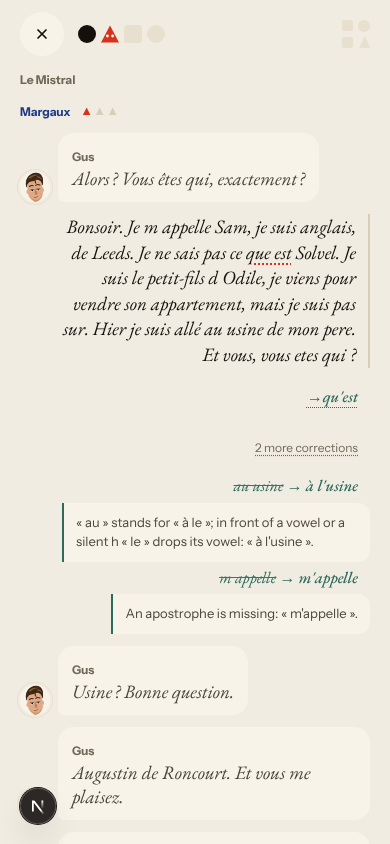
- Not yet: the three places then go by position. Day 2's card: «→ j'ai», «l appartement → l'appartement», «et j ai → et j'ai» (one slip twice); «au hopital», «je vend», «trouve» never shown; day 1's «a le notaire» lost to «très», «j'ai», «clé» (#1068, new). 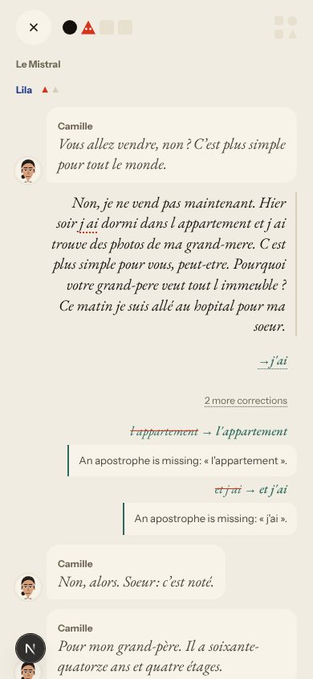
- Wrong: the typed gap «Tu a dit» (key «Tu as dit») is told «Another word of the line differs, not only the rule's form.»; the slip is the rule's own auxiliary (#1067, new). The same slip on another item («tu a étudié») got «With «tu», «avoir» is «as», not «a».». 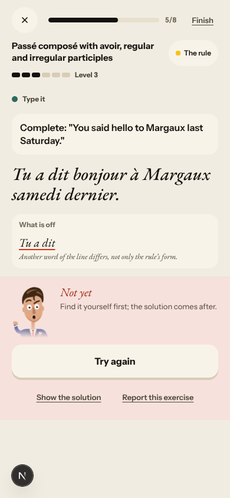 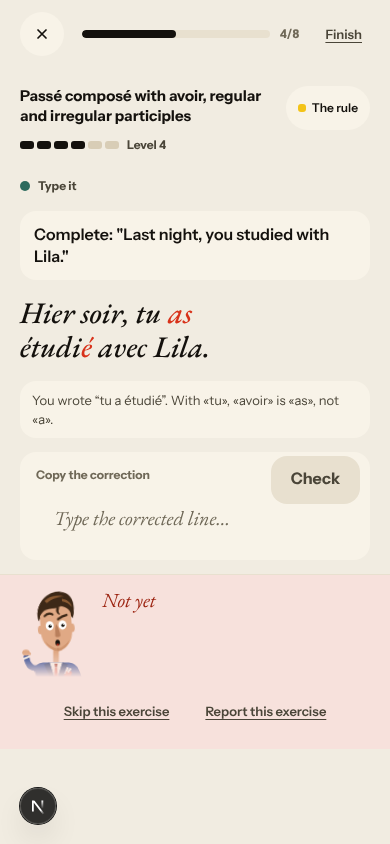
- Still the gloss: «on a lire», «Elle a marcher …», «tu as étudier» → «Most verbs say the past with avoir + the -é/-i/-u form …»; the judge miss «Ils ont commencer …» gets the echo only (#992, re-tested after #1053). The être misses explain («Aller, venir, partir … use être, and the participle agrees»). 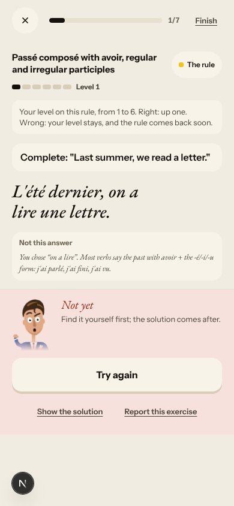
- The Courrier explains «vends» («With « je » this verb ends in -s») but «a le → au» only as «The correct form is « au ».» (#1047). 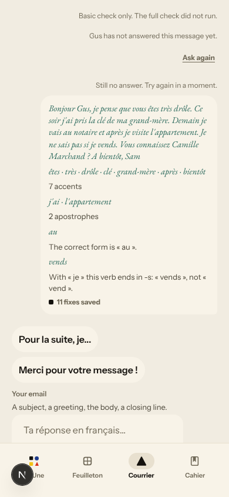

**Q10 at 4 (up from 24 Nov).** «Vous avez dit» is a stored variant beside «Tu as dit»; «tu as dine» was refused with «Here the accent changes the word» (the participle's -é is the rule's form); the spot items took two fixes each. The test's free sentence «Ce matin, ils ont conduit jusqu'au Mistral.» was marked Right though it leaves out half the prompt (see Q11).

**Q11 at 3 (down from 24 Nov).** The optional test asked «Say in French: « They drove at night this morning. »», key «Elles ont conduit la nuit ce matin.» (#1069, new). 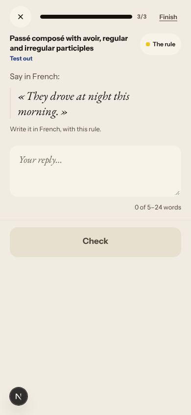 Everything else La Forge printed was right French.

**Q6 at 3.** Keyword echoes on the fake stack (Gus «Usine ? Bonne question.», Margaux «Non, alors. Solvel : c'est noté.», Camille «Non, alors. Soeur : c'est noté.»). The Courrier prints «Camille · Les services», the label of the support-chat domain her letter was laid over (#1070, new). 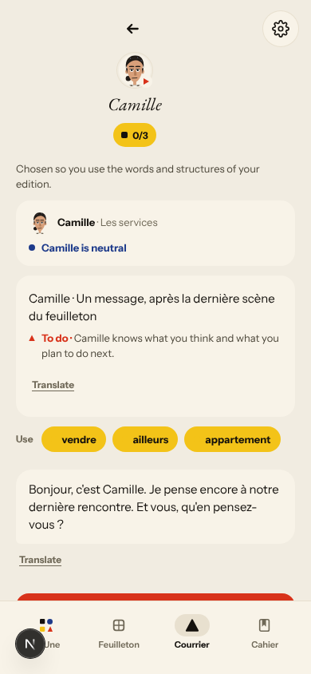 Register held: Gus, Camille and Marin's first lines vous, Margaux and Lila tu.

**Q3, Q16 at 3.**
- «Scene · Step 1 of 4» on every screen of the scene, both days (#1051 holds), and Home counts the same four steps.
- Still: the rule card reads «Rule · Step 1 of 4» and its «Try it» opens the near-empty «Scene finished» card (Gus only, «Next: grammar · 7 min»); La Forge and the words show only their own counters; onboarding lists three steps under «of 4» (on #143). 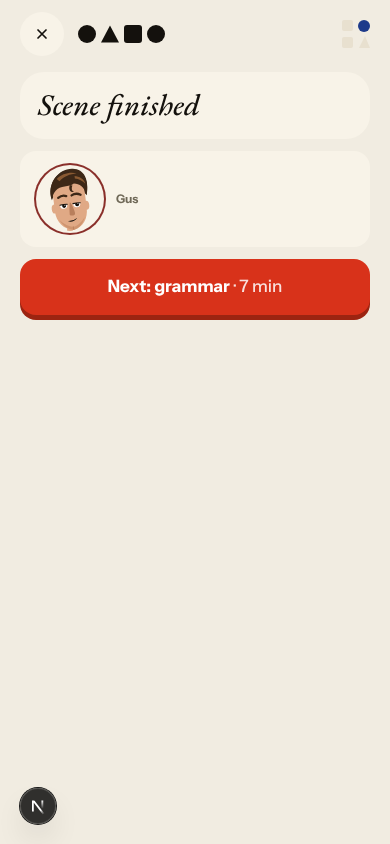
- The Courrier never answers on the fake stack now: «Gus has not answered this message yet.» and «Ask again» → «Still no answer. Try again in a moment.»; «Finish» still works (#1025's honest path).

**Q15 at 3.** Day 1's La Forge (8 items) asked for no sentence of my own; day 2's had one at Level 5 («Yesterday, Gus and Marin went down towards the canal.»), which the fake stack could not check («Checking is not available right now, so this answer does not count.»). What I wrote myself: two scene replies and the Courrier on day 1; one scene reply, the La Forge sentence and the test's sentence on day 2.

**Q20 at 3.** Both Done screens end on a statement as «Tomorrow»: «Deux clés pour la même porte.» and «Ton billet de retour est pour mercredi. Le même jour que Lila.» (#466). 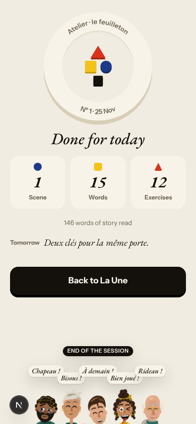 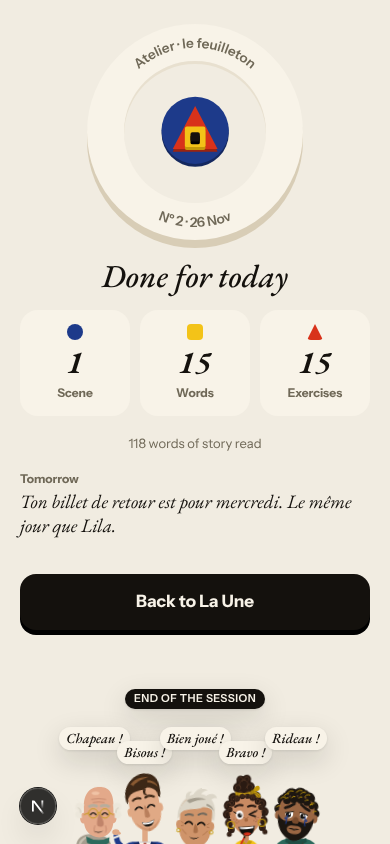

**Q22 at 3.** Home promises day 2 at «20 min» (scene 8, grammar 7, words 5); the agent needed about 6 minutes with the test, a learner reading and typing about 12–15.

**The owner's rule of 7 Nov (#698, «Nur als Extra»): holds, slot and label.** Day 2's rule was être, the next rule of the A2 path; my day-1 slip came back only as «From your mistakes · Something you wrote yourself, set right» around the scene, and avoir only as «Review · due today» inside La Forge. 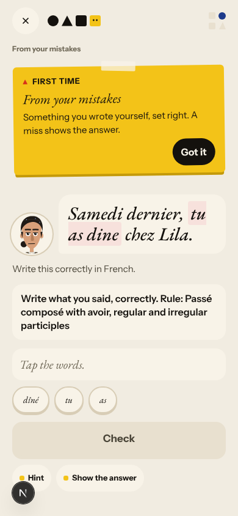

**The best of the night.**
- #919's own reply now shows its three slips, each with a reason.
- Le Montage builds être on Gus and Lila (#1030 fixed). 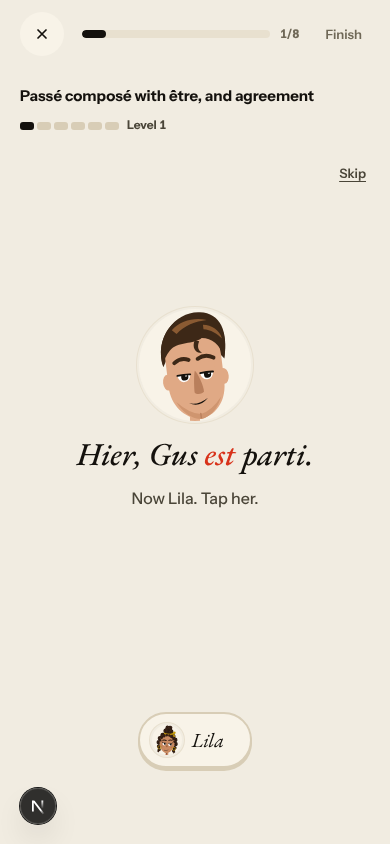
- A learner with no gender set got no «je»/«tu» agreement item on the être day (#1029 holds).
- The Courrier no longer pretends Gus answered (#1025).
- Day 2's words came more from the scene: l'offre, la lettre, l'immeuble, l'escalier (4 of 15; day 1: vendre, l'appartement, la clé, 3 of 15).

## Findings, by root cause

Four new findings (#1067–#1070), all `queue:ready`, `lane:code`, `size:S`, each with a **Done when:** comment, three added as children of their root cause. Root causes #542, #857 and #147 have new children; **#143 advanced** (header holds, stages left), back to `queue:ready`. Repeats commented: #992 (back to `queue:ready`), #1047, #807, #1028.

### #857 the basic check's composed fixes
- **#1068 (new, medium)** the scene card's three places go to the first apostrophes («j'ai» twice); «au hopital», «a le notaire», «je vend», «trouve» never shown. `_with_basic_check` (`app/services/story_lanes.py:813-836`) sorts by `(-severity, start)` to `TUTOR_MAX_CORRECTIONS = 3`; every edit on the reply has severity 1, a folded contraction or elision keeps the accent's rank (#1047). 
- **#1047 (commented)** in English «au · The correct form is « au ».», and the fold's rank keeps «a le» off the scene card.
- **#807 (commented, owner)** «j ai trouve» on the day after the avoir rule: no edit on «trouve».

### #542 a drill's words are picked from the item's shape, not from what it declares
- **#1067 (new, medium)** «Tu a dit» → «Another word of the line differs, not only the rule's form». `_miss_outside_the_rule` (`app/services/atelier.py:987-1003`) reads the rule from the words the hidden choices «Tu as dit» / «Tu as dire» share, so «as» counts as outside the rule; the item's `target_span` «Tu as dit» is never read. 

### #147 the cast is not one registry
- **#1070 (new, low)** «Camille · Les services»: `cast_roles.ROLES` (`app/services/cast_roles.py:20-51`) has no Camille, `missions.py:3121` sets `contact_role` to «», and `story_correspondence.py:244` falls back to `variety.domain_label`. Same shape as #1049 (a stand-in fills a missing cast fact).

### #146 the day's content and feedback are not driven by one concept
- **#992 (commented, back to `queue:ready`)** avoir misses («on a lire», «a marcher», «as étudier», judge «ont commencer») still get the gloss or the echo after #1053, which fixed #967 and #1024.

### No shared cause
- **#1069 (new, medium)** «They drove at night this morning.» in the optional test: the frame `pc-avoir-pp~voc` adds «la nuit» (`app/data/grammar_templates/lexicon.json:9454`) to «ce matin»; `item_semantics.sentence_violations` (`app/services/item_semantics.py:385-431`) compares dayparts only for «lever»/«coucher», and `_TIME_PATTERNS` (`:44-63`) has no bare «la nuit». 

### Seen again, not commented
- #466: both days end on a statement as «Tomorrow».
- #280: 3 of 15 new words from the scene on day 1, 4 of 15 on day 2.
- #824's kind: La Forge's free sentence «Hier, Gus et Marin sont descendu …» is not checked without a model (fake stack).
- #694 (harness only): after `/clock` Home still says «Wednesday 25 Nov».

### Observations, not filed
- La Forge's end sheet lists under «Still practising» the first-try right «J'ai commandé un taxi samedi dernier.»; the slips I made there («on a lire», «ont commencer», «Tu a dit», «a marcher») are not listed.
- The test's free sentence was marked Right without a model while La Forge's said «Checking is not available right now»: two answers to one missing check.
- Gus's note «Un mot de Gus» in vous opens the e-mail composer («A subject, a greeting, the body, a closing line.»), as #1052 intends for a vous writer; its placeholder reads «Ta réponse en français…» (tu). Camille's letter asks to place «La négation au passé composé», a rule not met yet.
- The Next.js dev overlay («Try Turbopack») covered «Let's go» once in the harness; Escape cleared it.

### Fake provider (left to the live walk)
- Keyword echoes (above); the Courrier never answers; the La Forge free sentence is not checked; «Basic check only. The full check did not run.» under the Courrier is the fake stack's (#1062 is the live case).

## Re-tests

| issue | fix | result |
|---|---|---|
| #919 scene correction names one slip | #1056 | **fixed on the fake stack**: «qu'est», «à l'usine», «m'appelle»; commented, left closed (story lane, model half for the live walk). Ranking filed as #1068.  |
| #1030 Le Montage on Romy | #1038 | **fixed**: «Now Lila. Tap her.»; commented, left closed.  |
| #1025 Courrier's stock reply | #1052 | **fixed on the fake stack**: «Gus has not answered this message yet.», «Ask again»; commented, left closed. |
| #953 friend's tu note as e-mail | #1052 | not reached: both letters were from vous writers (Gus, Camille), which keep the e-mail frame by design. Left closed. |
| #1029 feminine «je» for a neutral learner | #1060 | **holds**: no «je»/«tu» agreement item on the être day or in the test; commented, left closed. |
| #992 La Forge misses explained by the gloss | #1053 (partly) | **not fixed** for avoir (choice, judge, tile, typed gap); commented, back to `queue:ready` (it was `queue:owner` after two failed attempts). 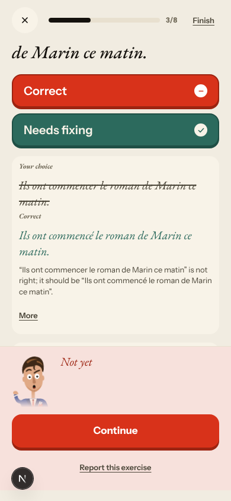 |
| #967, #1024 drill misses | #1053 | not reached on A2 (no pre-scene «café un» build, no recall word pick). Left closed. |
| #998 retell chip minutes | #1012 | German only; the English chip reads «≈ 2 min» as before. Not reachable on `a2-en`; left closed for tomorrow's a1-de walk. |
| #1049 Romy's line under Margaux | #1059 | A1 card, not on the A2 path. Left closed. |
| #143 (root cause) day progress | #1051 | **advanced**: «Scene · Step 1 of 4» through the scene, Home agrees, no early «done»; rule card step, «Scene finished» card, La Forge and words counters remain; commented, back to `queue:ready`. 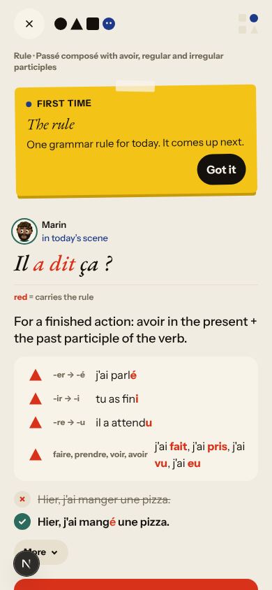 |
| #1028 failed test drops the level | none merged | new evidence: Level 4 → «Your practice picks up at level 2»; commented. 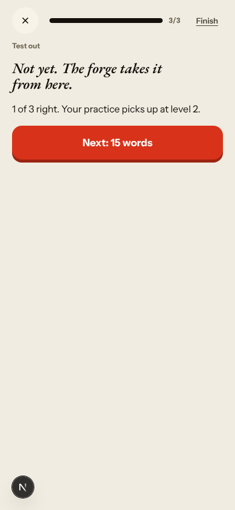 |
| owner rule of 7 Nov (#698) | #708, #1001 | **holds, slot and label.** |

Root causes: #143 advanced (back to `queue:ready`); #857, #542, #147 advanced (new children); none opened or closed.

## Owner questions (open, not asked again)
- **#1028, does decision #88 cover the optional test?** Tonight the test was failed 1 of 3 at Level 4 and practice «picks up at level 2», the same path as 23 Nov; one of its three items was itself nonsense (#1069).
- **Should La Forge ask for one free sentence of the learner's own on a rule's first days?** Day 1: 8 items, none. Day 2: one at Level 5 on the être rule (unchecked on the fake stack), plus the optional test's.

## Scripted walk

- «Browser walk on main» (walk-main.yml): runs 124, 126, 128, 130, 131, 132 passed, and 133 on `78097b8b` (tonight's main) **passed**; 125, 127, 129 were cancelled by the next merge.
- In tonight's explore walk both days reached Done: day 1 through La Forge's «Next: 15 words», day 2 through the failed test's «Next: 15 words».
