# Walk · 26 Nov 2026 · fresh learner, day 1 to day 7

Branch `claude/magical-johnson-yqhai0` at `6bab5e8` (main plus #1090, #1092, #1096). An extra walk beside tonight's nightly report (`2026-11-26.md`), which it does not replace. It is not in `TREND.md`: the trend reads one report a night.

**Why this walk.** The nightly walks since 15 Nov played days 1–2 and wrote «Day 7 not played». The pilot's bar is a learner finishing day 7. This walk plays every day from 1 to 7 to Done.

Fake story provider, local stack, Chromium at 390×844, one persona: `a1-de-fresh` (`--fresh --native de`). I signed up through the UI at «Neu im Französischen · A1» as Jonas, moved the clock one day at a time (`/clock` 1 … 6) and wrote a German beginner's French throughout: no apostrophes («j ai», «c est», «le appartement», «de Odile»), no accents («fatigue», «apres», «cafe»), «a le» for «au», être for avoir («Tu es froid ce soir ?», «Ils sont un rendez-vous»), «Tu est», «Tu a», German genders («le gare», «une livre», «le glace»), German word order («un anglais chapeau»).

## Verdict

**A fresh A1 German learner can get through seven days without getting stuck: every day reached Done, with no error, no dead end and no loop** (0 failed API calls, 0 page errors in 1,829 logged steps). The way forward was on every screen.

**Whether they would is a different question, and this walk can answer only half of it.**

- What would make a real beginner stop is in La Forge and the warm-ups, from day 2 on: whole German sentences to translate with words never taught and no help (#1101), their own slips confirmed as right when retyped unchanged (#1098), a wrong correction taught back the next day (#1100), a pronoun keyed as an article (#1099).
- The story of days 3–7 could not be judged at all. Season 1 has authored episodes for days 1 and 2; days 3–7 are generated, and on this stack they are the dev stub's episode: the same three lines every day and an English task line (#1103). No walk has ever read a fresh learner's real days 3–7.
- Day 7 itself is not marked in any way (#1102).

## Day by day

Minutes are the agent's, from the first screen of the day to the Done card (transcript timestamps). A beginner who reads, taps translations and types on a phone needs two to three times as long.

| day | Done? | min | Home promised | scene | rule | La Forge | words | Courrier / Journal | what broke or would make a beginner quit |
|---|---|---|---|---|---|---|---|---|---|
| 1 | **yes** | 4.8 | «eine Minute» (teaser) | «Le mauvais accueil» (authored): two free replies, two choices; I left the key with Margaux | **être** (card after the scene) | 7 items, Stufe 1 → 5: two picks, a judge, a typed gap, find-the-error, **two free translations** | 15 new | Courrier: Margaux's scarf note, answered | «Tu est» → only «Être heißt sein.» (#1086); end sheet prints «Vous etes grandes ?» (#1088) |
| 2 | **yes** | 4.0 | 22 Min. | «La lettre» (authored): one free reply, a choice, **asks Margaux for the key I left with her** | none new: être as «bekannte Regel»; «Le, la, l', les» as «Regel zum Wiederholen» | 6 items, **all «Sag auf Französisch»**, Stufe 5 → 6; Regelprüfung offered and passed 3/3 («Die Regel sitzt») | 12 new + 3 | Journal retell of day 1 | **«Ich bin mit Marin auf dem Markt am Kanal.» with no word help (#1101)**; Journal has Gus quote Margaux (#1081) |
| 3 | **yes** | 4.1 | 15 Min. | stub «Plusieurs semaines (2)» with Lila: three free replies | **avoir** (card **before** the scene) | 7 items, Stufe 3 → 5: typed gap, tile build, two find-the-error, «Dein Satz», two free translations | 12 new + 2 | none | English task and Tipp (stub, #1103); «englischer Hut», «Frierst du» (#1101); «je blieb stehen, ist aber falsch» (#1085) |
| 4 | **yes** | 4.4 | 12 Min. | stub «La soupe de Marin (3)»: four free replies | none new (avoir goes on) | **«Aus deinen Fehlern»** warm-up (4 items, first time); 6 free sentences incl. one of my own, Stufe 5 → 6; Regelprüfung failed 2/3 → **Stufe 4** | 13 new + 4 | none | **«c est» retyped unchanged = «Richtig» (#1098)**; «69 Jahre», «43 Jahre» (#1101); test drops two levels for one apostrophe (#1028) |
| 5 | **yes** | 5.2 | 12 Min. | stub «Le billet (4)» with Romy (never introduced): three free replies | **il y a** (card before the scene) | 6 items, Stufe 3 → 5; Éclair (60 s, avoir vs il y a) played | 13 new + 3 | Courrier: «Un mot de Lila», asks for three of my «Nochmal» words, answered | «Il est» → «Es bleibt immer gleich.» (#1085); **«a le marche» → «le → la» (#1100)**; «Flohmarkt», «Redaktion» (#1101) |
| 6 | **yes** | 5.7 | 14 Min. | stub «Romy enquête (6)» with Margaux: four free replies | **le, la, l', les** (card inside La Forge) | warm-up (errors ×3 + review rule); 8 items, Stufe 3 → 6, avoir twice as «Wiederholung · heute fällig» (a **Diktat**, new), «Dein Satz», an answer to Margaux (new) | 13 new + **15** | none | **«l'éteint» keyed as the article (#1099)**; **«a la marche» = «Gut gemacht!» (#1100)**; «le glace» → no reason (#1085) |
| 7 | **yes** | 3.5 | 14 Min. | stub «La même chose ? (7)» with Lila: three free replies; «Fin du chapitre» | **un, une, des** (card before the scene) | 6 items, Stufe 3 → 5, il y a once as review | 13 new + **14** | none | **Done is the same card as every day (#1102)** |

The Done card of each day, as proof: [1](2026-11-26-day7/done-d1.png) · [2](2026-11-26-day7/done-d2.png) · [3](2026-11-26-day7/done-d3.png) · [4](2026-11-26-day7/done-d4.png) · [5](2026-11-26-day7/done-d5.png) · [6](2026-11-26-day7/done-d6.png) · [7](2026-11-26-day7/done-d7.png). Day 2's passed test: [«Die Regel sitzt»](2026-11-26-day7/forge-d2-test-passed.png). Day 3's Home, an episode without a title: [Home](2026-11-26-day7/home-d3.png).

After day 7, Cahier → Fortschritt: «A1.1 · 9 %», 1 rule gefestigt and 4 in Übung of 20, 37 words known and 91 in work, «Schätzung: 65 bis 106 Tage» to A1.2, «Serie · 7 Tage», «Le Carnet · 1 von 8 gestempelt». 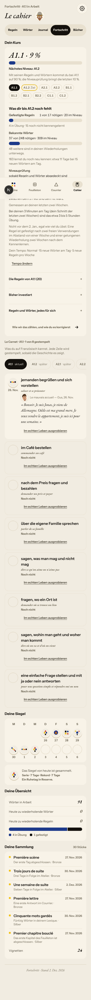

## Scores (rubric `docs/ops/walk-rubric.md`)

Per day; «walk» is the worst day for the per-screen questions (1–11, 16–18) and the typical day for the per-day ones (12–15, 20–22). «stub» = the screen that question is about is the dev stub's on that day, not the product (#1103). The last column is tonight's nightly report.

| # | question | d1 | d2 | d3 | d4 | d5 | d6 | d7 | walk d1–7 | 26 Nov a1-de (d1–2) |
|---|---|---|---|---|---|---|---|---|---|---|
| 1 | Where am I | 4 | 4 | stub | stub | stub | stub | stub | 4 (d1–2) | 4 |
| 2 | What is at stake | 4 | 4 | stub | stub | stub | stub | stub | 4 (d1–2) | 4 |
| 3 | What to do next | 3 | 3 | 3 | 3 | 3 | 3 | 3 | 3 | 3 |
| 4 | Scene reacts to my writing | fake | fake | fake | fake | fake | fake | fake | fake | fake |
| 5 | Story coherent | 3 | 4 | stub | stub | stub | stub | stub | 3 (d1–2) | 3 |
| 6 | Characters consistent | 3 | 3 | stub | stub | stub | stub | stub | 3 (d1–2) | 3 |
| 7 | Image, text, tone fit | 4 | 4 | stub | stub | stub | stub | stub | 4 (d1–2) | 4 |
| 8 | Difficulty fits | 4 | **2** | **2** | **2** | **2** | 3 | 3 | **2** | 4 |
| 9 | Feedback explained | 3 | 3 | 3 | **2** | **2** | **2** | 4 | **2** | 3 |
| 10 | Right answers accepted | 4 | 4 | 4 | 4 | 4 | 4 | 4 | 4 | 4 |
| 11 | French correct | 3 | 4 | 4 | 4 | 3 | **2** | 4 | **2** | 3 |
| 12 | Clear goal today | 4 | 4 | 4 | 3 | 4 | 3 | 4 | 4 | 4 |
| 13 | Grammar practised | 4 | 4 | 4 | 4 | 4 | 4 | 4 | 4 | 4 |
| 14 | Earlier material returns | n/a | 4 | 3 | 4 | 4 | 5 | 4 | 4 | 4 |
| 15 | I produce French | 4 | 5 | 4 | 5 | 4 | 4 | 4 | 4 | 3 |
| 16 | Errors, dead ends | 3 | 4 | 4 | 4 | 3 | 4 | 4 | 3 | 3 |
| 17 | Varied, fun | 4 | 3 | 4 | 4 | 4 | 4 | 4 | 3 | 4 |
| 18 | Fast enough | 4 | 4 | 4 | 4 | 4 | 4 | 4 | 4 | 4 |
| 19 | App only | n/a | n/a | n/a | n/a | n/a | n/a | n/a | n/a | n/a |
| 20 | Satisfying end | 3 | 3 | stub | stub | stub | stub | **2** | 3 | 3 |
| 21 | Would come back | 4 | 3 | stub | stub | stub | stub | 3 | 3 | 3 |
| 22 | Time vs promise | 3 | 3 | 4 | 4 | 4 | 4 | 4 | 4 | 3 |

Every 2 has a finding: Q8 → #1101; Q9 → #1098 (d4), #1100 and #1085 (d5), #1100 and #1099 (d6); Q11 → #1099, #1100; Q20 on day 7 → #1102.

**Against the nightly report: Q8 4 → 2, Q9 3 → 2, Q11 3 → 2 are all things that happen after day 2 or only to a learner who does day 1 well. Q15 3 → 4 and Q22 3 → 4 are better than the two-day walks showed.**

**Q8 at 2.** I made one slip on day 1, so être stood at Stufe 5 that evening. From there the item ladder serves free translation only: day 2 was six «Sag auf Französisch» cards in a row with an empty box. Day 1's last two items already were. 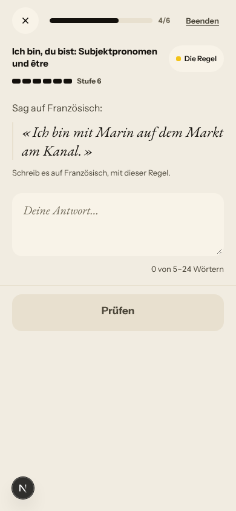 The nightly walks miss day 1 four or five times on purpose and stay at Stufe 1–3, so they have reported the opposite problem («no typed item, no free sentence») for a week.

**Q9, Q11 at 2.** Three screens told me something wrong: my slip retyped is right (#1098), «a le marche» should be «a la marche» and is praised the next day (#1100), «l'» before a verb is the article (#1099). 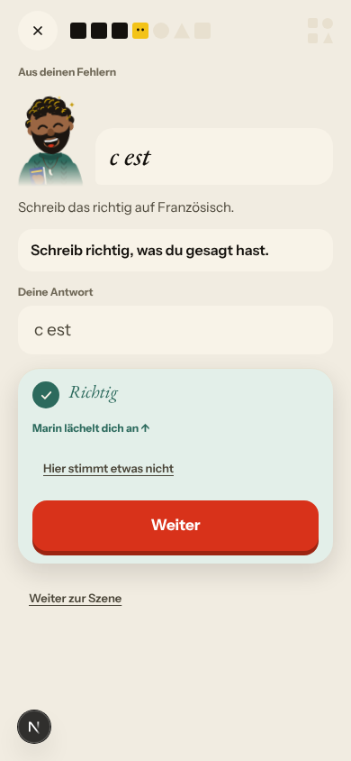 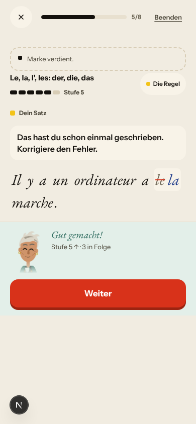 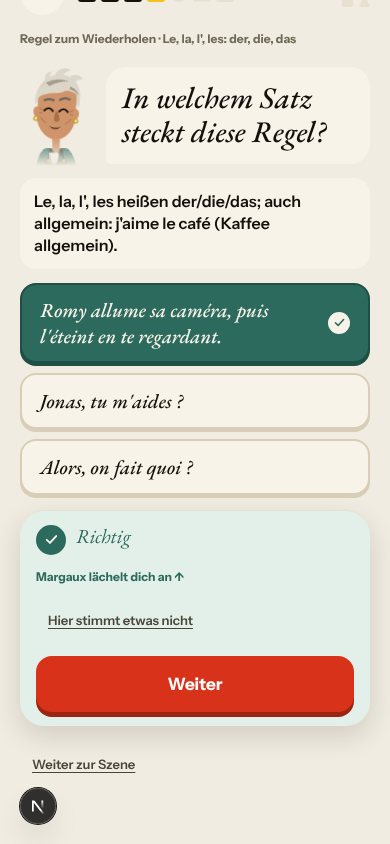

**Q15 at 4.** The owner question «Should La Forge ask for one free sentence of the learner's own on a rule's first days?» has an answer in the product already: day 4 asked «Schreib einen eigenen kurzen Satz auf Französisch, mit dieser Regel.» Over seven days I wrote 22 scene replies, 2 Courrier replies, 1 Journal retell, about 20 La Forge sentences and 6 typed gaps.

**Q22 at 4 from day 3.** Home promises 15, 12, 12, 14, 14 minutes for days 3–7; a beginner at two to three times my 3.5–5.7 minutes lands there. Day 2's «22 Min.» is still high.

## What only shows on days 3–7

- **The order of the day changes on day 3.** Days 1–2: scene, then the rule card, then La Forge. From day 3: the rule card first («Regel · Schritt 1 von 4», quoting a line «in der heutigen Szene» I have not read yet), then the scene. Day 6 puts the card inside La Forge. «Ausprobieren» on the card opens the scene, not a try (the #143 family). The onboarding sentence «Szene, dann Grammatik, dann deine Wörter» is true for two days.
- **Rule pace: five rules in seven days** (être d1, avoir d3, il y a d5, le/la/l'/les d6, un/une/des d7), as «5 neue Regeln pro Woche» in Fortschritt says. Each new rule starts at Stufe 3 and is at 5–6 the same day. Fortschritt says a rule is «gefestigt» «nicht vor dem 2. Jan., egal wie viel du übst», while the day-2 test told me «Die Regel sitzt. Ab heute gilt sie als gefestigt.»: two meanings of one word (observation).
- **Repetition works.** Day 6 is the best review day of the week: my test slip «Je ai une tasse verte.» came back as a rebuild two days later, avoir (dropped to Stufe 4 by the failed test) came back as «Wiederholung · heute fällig» with a dictation, day 1's words came back after five days. 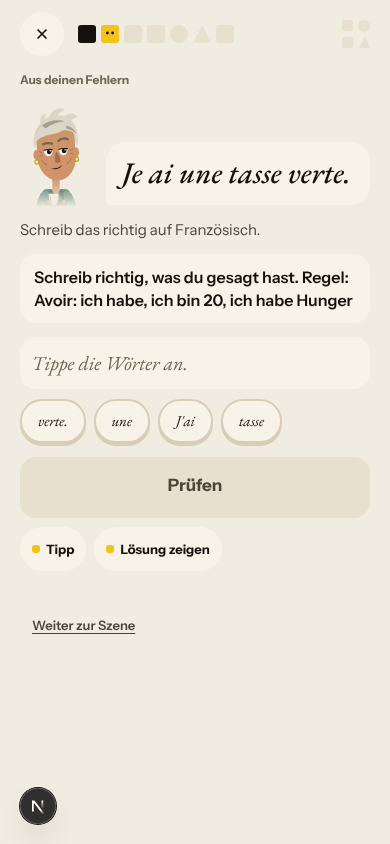
- **Review load jumps on day 6.** Words to review: 0, 3, 2, 4, 3, **15**, **14**; the words step goes from 16 to 28 cards while Home says «5 Min.». New words stay at 12–15 a day, almost all bare cards from the base list (#280). 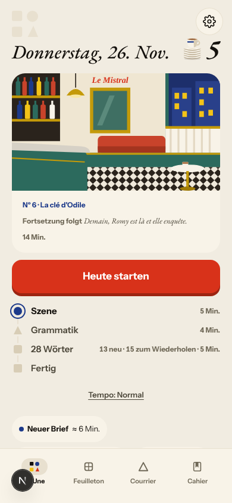
- **New item kinds keep coming**, which carries Q17: «Aus deinen Fehlern» (d4), «Dein Satz» (d3), an own free sentence (d4), Éclair (d3, played d5), Diktat (d6), an answer to Margaux inside La Forge (d6), «Korrigiere die 2 falschen Wörter» as a rewrite (d7).
- **Story continuity, where it could be judged, holds.** Day 2 knows I left the key with Margaux on day 1 («Bitte Margaux um den Schlüssel, den du bei ihr gelassen hast.» → «Tiens. Elle, elle ne la laissait jamais ici.»). 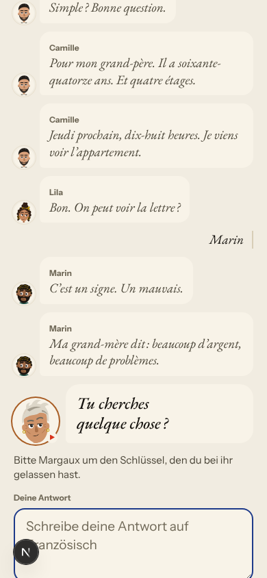 After day 2's hook («Ton billet de retour est pour mercredi. Lila est libre mercredi.») the stub takes over and the thread is gone; what the real generator does with it is unknown (#1103). 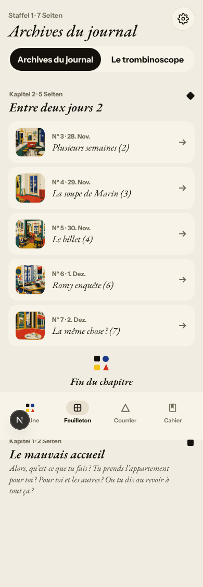
- **Level progression is invisible.** «A1.1 · 9 %» after a week, the Carnet at «1 von 8», «Le mur du Mistral 1/8» since day 1.
- **Week end, recap, day-7 screens: there are none.** 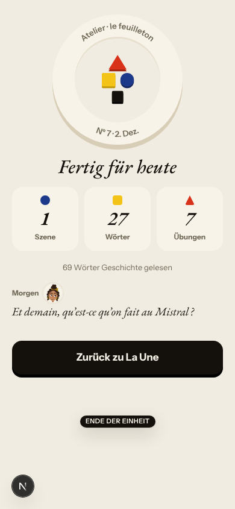 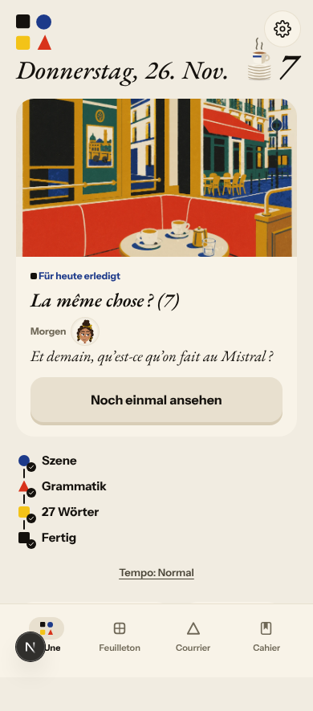
- **The Éclair ends in the Cahier.** Played from La Forge's end sheet with the words step still open, it ends on «Noch einmal» / «Zurück zu den Regeln»; Home has «Weiter: 16 Wörter», so nothing is lost, but the day is one tab away (observation). 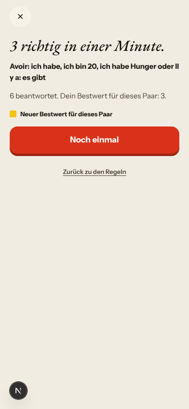

## Findings, ranked

Six new issues (#1098–#1103), each with labels, a **Done when:** comment and, where one fits, its root-cause parent. Six existing issues commented. Open `walk-finding` issues were read first (86 open); none of the six new ones had a match by title or screen.

### 1 · #1101 (new, high, `queue:owner`, child of #146) free translation with untaught words from day 2
Day 2 of French: «Bist du in der Apotheke?», «Ich bin mit Marin auf dem Markt am Kanal.»; later «Wir haben einen englischen Hut.», «Ich bin 69 Jahre alt.», «Auf dem Flohmarkt gibt es einen Computer.», «Romy kauft Notizbücher in der Buchhandlung.» No Tipp, no word bank, no gloss. «le marché», «la gare», «l'âge» arrive as new words on day 7. Hits on day 2, hits exactly the learner who is doing well. Suspected cause: the item kind follows the rule's Stufe alone (`free_sentence_item`, `app/services/grammar_items.py:994`); the prompts are not filtered by the learner's words. Owner: glosses, known-word prompts, or a first-week cap. 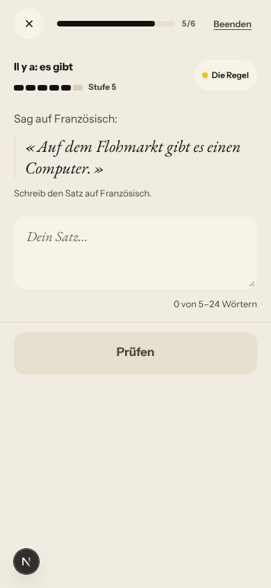

### 2 · #1098 (new, high, `queue:ready`, `size:S`, child of #174) «Aus deinen Fehlern»: the slip retyped unchanged is «Richtig»
Day 4 and 6. «c est» → I type «c est» → «Richtig»; «de Allemagne» → «d Allemagne» → «Richtig». The items are fragments without their sentence («a 10» with two tiles), come back two days after a right answer, and «de Odile» is labelled with the article rule. Suspected cause: the apostrophe-folding normaliser of #1088 grades the own-error recall too; items are built from the basic check's fix spans (`journey_contracts.py:924`, `app/services/journey_learning.py` around 3403 and 4063). 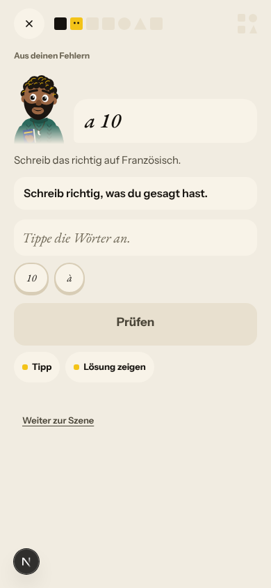 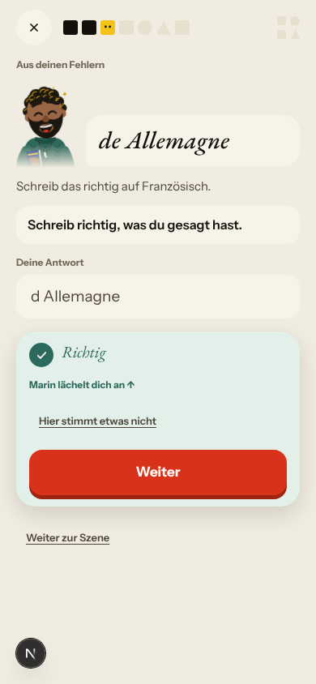

### 3 · #1099 (new, high, `queue:ready`, `size:S`, child of #146) «l'éteint» keyed as the article rule
Day 6, «Regel zum Wiederholen · Le, la, l', les»: none of three options has an article; «Romy allume sa caméra, puis l'éteint en te regardant.» is the right answer. Suspected cause: `rule_span` and `_is_noun_phrase` (`app/services/grammar_items.py:224-265`) accept a clitic before a verb.

### 4 · #1100 (new, medium, `queue:ready`, `size:M`, child of #857) the basic check's «le → la» for «a le marche» becomes next day's drill
Day 5 and 6. Production only when the full check does not run (#333, #1062); on the fake stack every free sentence. 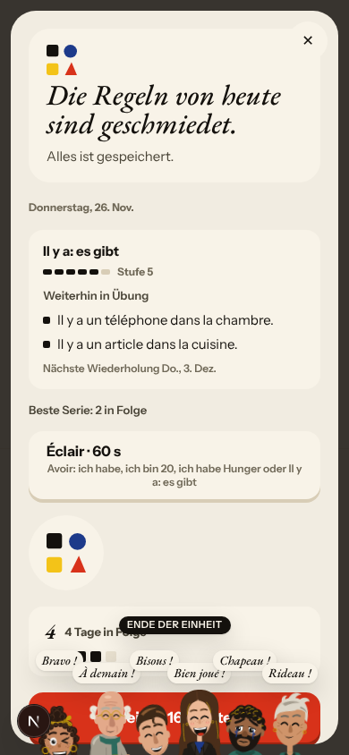

### 5 · #1102 (new, medium, `queue:owner`, `size:M`) day 7 ends like any other day
No recap; «Une semaine de suite · Silber», «Trois jours de suite» and «Cinquante mots gardés» are in the Sammlung and were never shown; Carnet «1 von 8».

### 6 · #1103 (new, medium, `queue:owner`, `size:M`) no walk sees a fresh learner's real days 3–7
The stub's days: English task («Propose an alternative for the market morning, or decline.») and Tipp («Say yes or no, and when.»), «Tu as une minute ? · Un silence. · Alors, on fait quoi ?» five days running, titles «Plusieurs semaines (2)» … «La même chose ? (7)», «Vous avez répondu.», «[dev fake] The day ends at Le Mistral.» (`scripts/dev_story_engine_server.py:77`, `:389`, `:530`, `:642`; whitelisted in `web-frontend/e2e/lib/assertions.mjs:53-61`). Owner: a live fresh-learner walk to day 7, and/or a stub that speaks the learner's language. 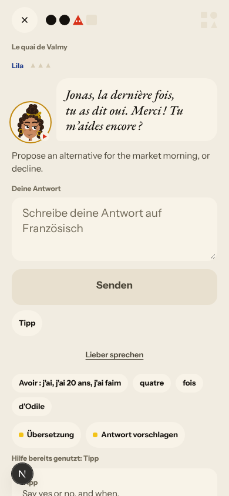 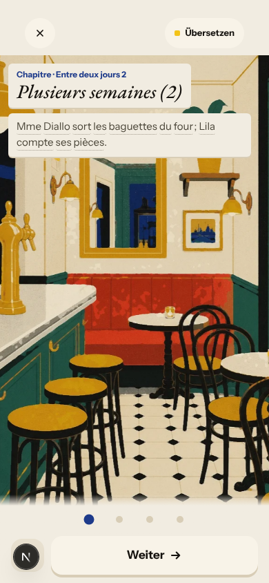

### Commented (seen again)
- **#1085** (root cause, reasons that survive filters): three later-day shapes. «Il est un ordinateur …» → «Es bleibt immer gleich.»; «le glace → la glace · Du hast „le glace“ geschrieben.»; «Je ai» in find-the-error → ««je» blieb stehen, ist aber falsch. Avoir heißt haben …». 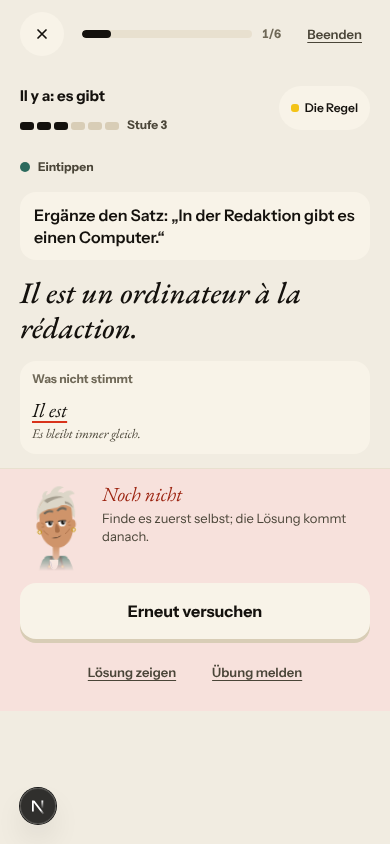 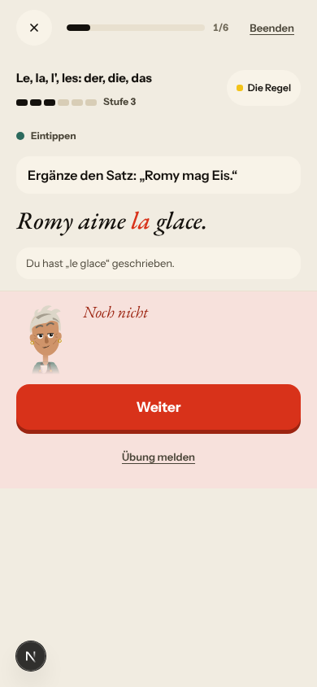 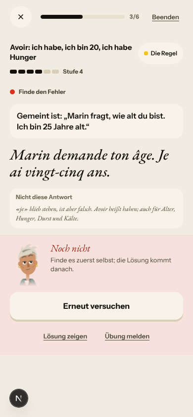
- **#1086**: day 1 «Tu est occupé ?» → «Être heißt sein.» 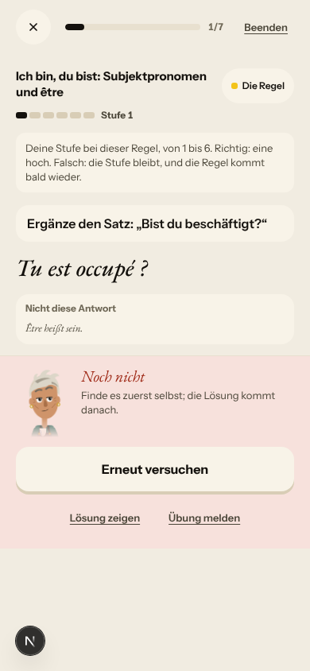
- **#1088**: day 1 end sheet prints «Vous etes grandes ?». 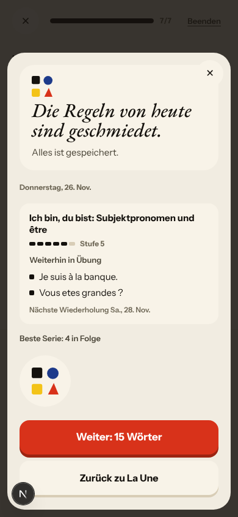
- **#1028**: day 4, test failed 2/3 on one elision slip, «Dein Training geht auf Stufe 4 weiter» from Stufe 6. 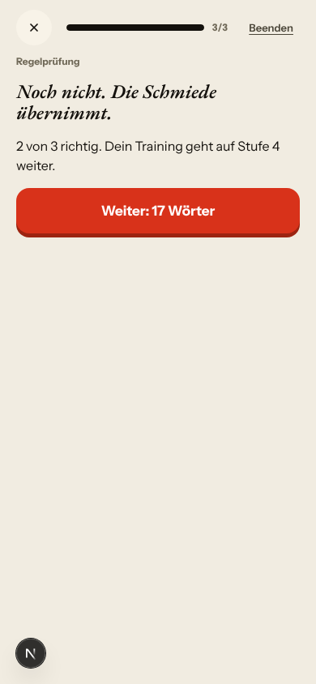
- **#280**: the week's word numbers, the order against La Forge, the day-6 review jump, «ici · hier» beside «hier · gestern».
- **#1081**: Journal on day 2, Gus says Margaux's two lines. 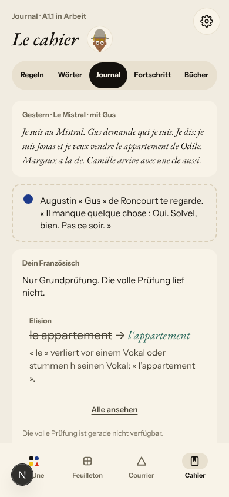

### Seen again, not commented
- #466: days 1 and 2 end on a statement as «Morgen».
- #143 (owner): «Schritt 1 von 4» on every card of every day.
- #824: with no model, «Tu es froid ce soir ?» is «Die Prüfung ist gerade nicht verfügbar, darum zählt diese Antwort nicht.»
- #694 (harness only): after `/clock`, Home still says «Donnerstag, 26. Nov.» while Done says «Nº 7 · 2. Dez.».

### Observations, not filed
- Day 1's exchange counter reads «Austausch 4» after «3 von 3».
- «Regel zum Wiederholen · Eine Regel, die schon vorkam» on day 2 for «Le, la, l', les», which this learner has only met as a correction (the owner's rule of 7 Nov, #698; holds).
- Done says «137 Wörter Geschichte gelesen» on day 1 and on day 2.
- The Journal's instruction is French for a day-2 A1 («De mémoire, sans relire la scène : que s'est-il passé ?»).
- La Forge's «In der Küche gibt es einen Artikel.» is a strange thing to find in a kitchen.
- The Éclair gives no word on a wrong pick; it just moves on.
- The reader's text on days 3 and 4 carries «Parce que vous avez dit à Margaux « Oui, je cherche ma cle. Tu a la cle de Odile, s il te plait ? » — Nº 2» (`app/services/living_story.py:4009`): my uncorrected line, with vous, twice. I did not see it in the screenshot (it may sit behind «Röntgen»); not verified as visible, so not filed. #445 is the neighbouring case.

### Fake provider (left to a live walk)
- Days 1–2 keyword echoes: Gus «Semaine ? Ah bon.»; Margaux «Oui. Solvel, bien.» and «Pas ce soir.» after I said I go up tonight; Camille «Simple ? Bonne question.»; Margaux «Oui. Plait, bien.»
- Every free sentence that is not the stored key: «Die Prüfung ist gerade nicht verfügbar» or «Nur Grundprüfung»; the Courrier never answers.
- Everything in the scenes of days 3–7 (#1103).

## What was good

- Seven days, zero errors, zero dead ends; Home always has the next step, also after leaving mid-day.
- The scene card's corrections on days 1–2 are better than a week ago: «de Allemagne → d'Allemagne», «le appartement → l'appartement», «grand mere → grand-mère», «a → as · Nach « tu » heißt es « as »», «heure → heures · Nach « quatre » steht das Nomen im Plural».
- «etes» is accepted with «Richtig — achte auf den Akzent: «êtes».»
- The test names elision properly: «Vor einem Vokal oder stummen h verliert «je» den Vokal … Das ist die Schreibweise, nicht ein anderes Verb.», then asks to copy the line.
- Gender misses explain in the learner's language: ««gare» ist im Französischen weiblich.», ««livre» ist im Französischen männlich.», «une → un» for «une ticket».
- The Courrier on day 5 asks for exactly the three words I had marked «Nochmal». 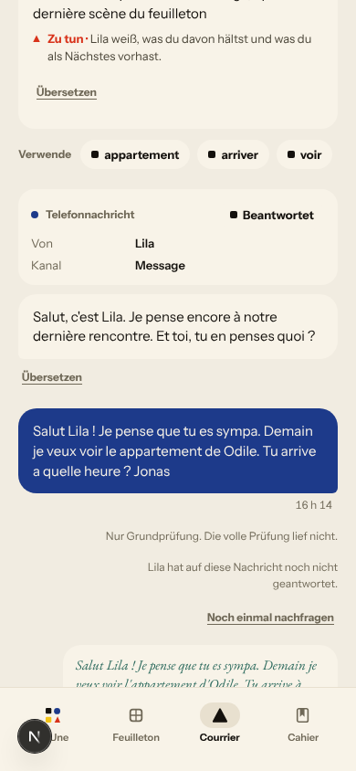
- Margaux's and Lila's notes say tu (#1092 holds on this build).

## Not done, not verified

- **Story quality on days 3–7**: not judged (stub). Questions 1, 2, 5, 6, 7, 20, 21 have no score for those days.
- **Model-written feedback** (question 4, the full check of free sentences, Courrier replies): not judged, fake stack.
- **Whether the Carnet stamps and «Le mur du Mistral» move with the real model** on days 3–7: not verified.
- **Audio**: the dictation and «Anhören» were not heard (headless); the dictation was solved from its tiles.
- **Re-tests of merged fixes** (skill step 5): not done as a pass. Reached in passing: #1092 holds; #1087/#1090 not reached (no two-choice miss came up).
- **The scripted walk's CI result**: not looked up for this branch.
- **`TREND.md`**: not regenerated, on purpose.
- Only one persona, one path: I left the key with Margaux on day 1 and did day 1 nearly clean. A learner who misses more on day 1 gets the easier ladder the nightly walks describe.
- Feuilleton and Cahier were opened once, on day 7; Le Quartier and «Le mur du Mistral» were not opened.
