# Walk · 26 Nov 2026 · nightly explore walk

Main at `5f40553a`. Since the 25 Nov walk (`78097b8b`, report merged as `bb8b69f3`), main took in:
- **the night shift's fixes**: #1074 (a page's title is no longer shown as a line Margaux says; #1064), #1076 (La Forge: «un rendez-vous» matches its gloss, no morning-and-night sentence; #1048, #1069);
- the forge #1079 (M. Marchand's reply card at Le Mistral) and tonight's live report #1084.

`alembic upgrade heads` ran cleanly on a scratch database before the walk: one head, **`b2d4f6a8c0e1`** (unchanged since 23 Nov).

Fake story provider, local stack, Chromium at 390×844, one persona: `a1-de-fresh` (`--fresh --native de`; last played 24 Nov). I signed up through the UI at «Neu im Französischen · A1» as Jonas and played a German beginner with real slips:
- day 1 scene to Gus: «Bonsoir. Je suis Jonas, je suis allemand. Je suis le petit fils de Odile. Je veux vend le appartement, demain je vais a le notaire.»; to Margaux «Non, je suis tres fatigue. Mais c est qui, Solvel ? Ce soir je reste ici, je mange un croissant.»; I took the key;
- day 1 La Forge misses a German speaker makes («Nous êtes», «Tu est», «Ils est», «Tu suis», a judge miss «Tu est à Marseille …»);
- day 1 Courrier to Margaux (a tu note): «Salut Margaux ! Oui, c est mon echarpe, merci. Je passe demain a 9 heure, apres je vais a le notaire. Je ai besoin de un cafe ! Jonas»;
- day 2 scene to Camille: «Je sais pas. Je vend pas maintenant. Je ai les photos de ma grand mere, et le appartement est a elle. C est plus simple pour vous, pas pour moi.», Lila reads the letter;
- day 2 La Forge on Avoir with the trap a German speaker falls into («Tu es chaud», «Tu es cinquante-six ans»), «Je ai», then «J ai»; the Journal retell of day 1 with an elision slip.

Day 1 (about 6 minutes of walking from «Loslegen» to Done, sign-up included):
- teaser (Margaux), sign-up, figure, onboarding («Szene, dann Grammatik, dann deine Wörter»), cast page;
- scene «Le mauvais accueil»: two free replies, one key choice («Austausch 1 … 3 von 3»);
- rule card «Ich bin, du bist: Subjektpronomen und être», «Ausprobieren», the «Szene beendet» card, then La Forge 8 items (Stufe 1 → 3): five choices (four first misses), two speed rounds (3/4, 4/4), one judge miss; no typed item, no free sentence;
- 15 words, Done, Home, Courrier (one reply to Margaux), Cahier (Regeln), Feuilleton.

Day 2 (clock +1, about 6 minutes):
- Home «Nº 2 · La clé d'Odile · La lettre · 22 Min.» with «Gestern erzählen ≈ 2 Min.»; scene «La lettre»: one free reply, one choice;
- être as «Eine bekannte Regel, auf der heutigen Seite», then the new rule **Avoir** (card); around the scene «Aus deinen Fehlern» (my judge pick «Tu est à Marseille cette semaine ?», rebuilt right) and «Regel zum Wiederholen · Le, la, l', les»;
- La Forge «Regel des Tages schmieden» on Avoir, 8 items (Stufe 1 → 3), être twice as «Wiederholung · heute fällig»; no Regelprüfung offered (an «Éclair · 60 s» instead);
- 15 words, Done; Journal retell; Courrier opened («Un mot de Camille»), not answered.

Day 7 not played.

**Live column: [live walk 26 Nov](../live-walks/2026-11-26.md)** (on main, #1084), production with the real model, release `831173baea27` (the tip of main before the report: #1074 and #1076 are live), account A1.1 on day 44. Headline: **Q6 up to 4, Q13 down to 4 (no rule card before La Forge); Courrier ends «Partly · goals met 0/1» after the agent confirmed both details (#1080); the Journal glues four scene lines into one speech of Margaux and prints «Dix heures» three times (#1081); La Forge calls «s» a conjunction and capitalises «À» mid-sentence (#1082); a new word card «le janvier» (#1083).** It filed #1080–#1083; they are not filed again here. Its re-tests: #381, #951, #466, #557, #1062, #920, #280 seen again; #1064 fixed in the scene reader (the Journal half is #1081); #1048, #1069 not reached.

**Browser walk on main**: every run since the last walk passed: 134 (`bb8b69f3`), 135 (`297c45de`, #1076), 136 (`47878b30`, #1074), 137 (`831173ba`, #1079) and 138 (`5f40553a`, main tonight). The scheduled «Browser walk» run 45 (`47878b30`) **failed** in the `season 6-10` shard on the harness start (`/api/auth/csrf` 404 timeout, 0 screens), the same flake as run 120: #1041 reopened.

## Scores (rubric `docs/ops/walk-rubric.md`)

| # | question | 26 Nov a1-de (d1–2) | live 26 Nov | 25 Nov a2-en (d1–2) | 24 Nov a1-de (d1–2) |
|---|---|---|---|---|---|
| 1 | Where am I | 4 | 4 | 4 | 4 |
| 2 | What is at stake | 4 | 4 | 4 | 4 |
| 3 | What to do next | 3 | 3 | 3 | 3 |
| 4 | Scene reacts to my writing | fake | 4 | fake | fake |
| 5 | Story coherent | 3 | 3 | 3 | 3 |
| 6 | Characters consistent | 3 | 4 | 3 | 3 |
| 7 | Image, text, tone fit | 4 | 3 | 4 | 4 |
| 8 | Difficulty fits | 4 | 4 | 4 | 4 |
| 9 | Feedback explained | 3 | 4 | 3 | 3 |
| 10 | Right answers accepted | 4 | 4 | 4 | 3 |
| 11 | French correct | 3 | 3 | 3 | 4 |
| 12 | Clear goal today | 4 | 4 | 4 | 4 |
| 13 | Grammar practised | 4 | 4 | 4 | 4 |
| 14 | Earlier material returns | 4 | 4 | 4 | 4 |
| 15 | I produce French | 3 | 5 | 3 | 3 |
| 16 | Errors, dead ends | 3 | 3 | 3 | 3 |
| 17 | Varied, fun | 4 | 4 | 4 | 4 |
| 18 | Fast enough | 4 | 3 | 4 | 4 |
| 19 | App only | n/a | n/a | n/a | n/a |
| 20 | Satisfying end | 3 | 3 | 3 | 3 |
| 21 | Would come back | 3 | 4 | 3 | 3 |
| 22 | Time vs promise | 3 | 4 | 3 | 3 |

Q14 is scored on day 2 only. Against the last `a1-de` walk (24 Nov): **Q10 3 → 4** up, **Q11 4 → 3** down. Against last night (25 Nov, a2-en): **no question moved.** No 1 or 2 tonight.

**Q10 up to 4 (against 24 Nov): the 24 Nov refusal is gone.** The Avoir items now ask for «___ un rendez-vous au Mistral.» and the tile build «Tu as un rendez-vous au Mistral.» was accepted (#1048 fixed by #1076). 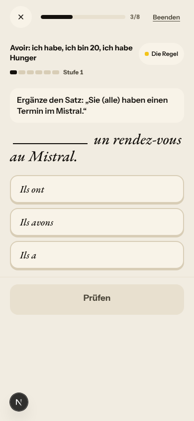 The flip side: «J ai» (no apostrophe) was accepted as «Richtig» with nothing said about the apostrophe (#1088, below).

**Q11 down to 3 (against 24 Nov).** La Forge's end sheet printed my unfixed «Margaux demande ton âge. **J ai** trente-cinq ans.» as what the séance proved (#1088, new). The basic check still calls «a le → au» an accent, in the scene and the Courrier (#1047). La Forge's own items were right French. 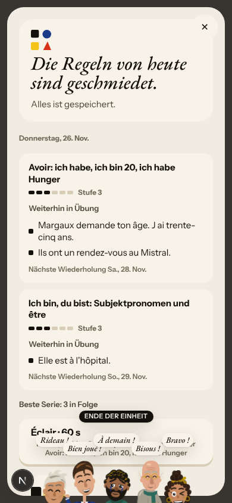

**Q9 at 3: more misses explain, two new ways to explain nothing.**
- Better: «Je ai» in a typed gap → «Vor einem Vokal oder stummen h verliert «je» den Vokal und bekommt einen Apostroph …»; «Tu es cinquante-six ans» → «Avoir heißt haben; auch für Alter, Hunger …»; «Tu a» → «Mit «tu» heißt «avoir» «as», nicht «a».»; «Nous êtes», «Ils est» → «Schau, wer es tut, und nimm die Form von «être» für diese Person.» 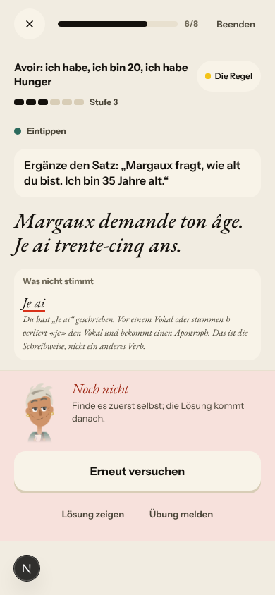
- New: on every «tu es» item («Tu est», «Tu suis») the person hint is scrubbed because the German «wer **es** tut» contains the answer «es», and only «Être heißt sein.» is left (#1086). 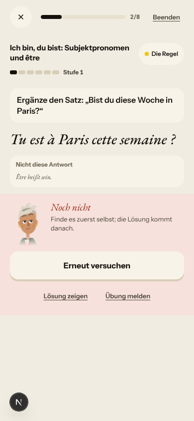
- New: the two-choice miss «Tu es chaud ce soir ?» shows «Tu es → Tu as · Noch nicht» and no reason at all; the server sent one, the card strips both its sentences (#1087). 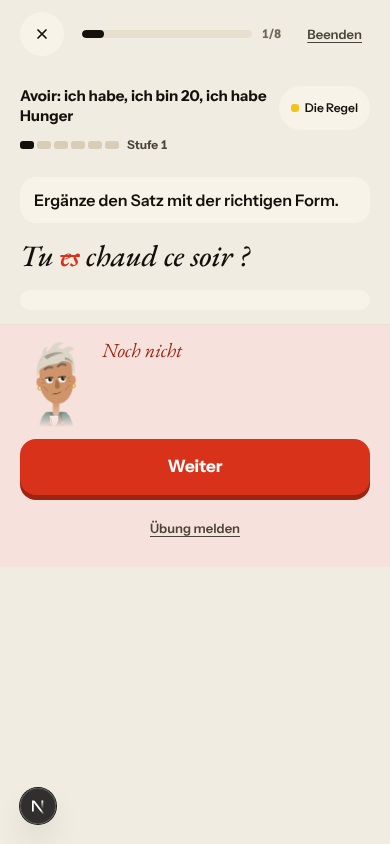
- Still the gloss: «Elle et à l'hôpital.» → «Être heißt sein.»; a tile line out of order → «Avoir heißt haben; …» (#992). 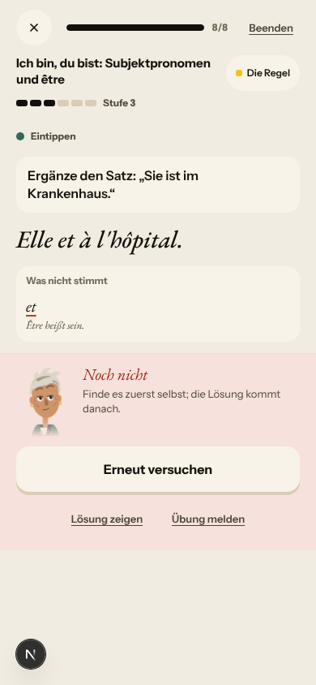
- The scene card: «d'Odile», «l'appartement», «a le → au» (Gravis note, #1047); «Je veux vend» and «petit fils» never shown (#1068). 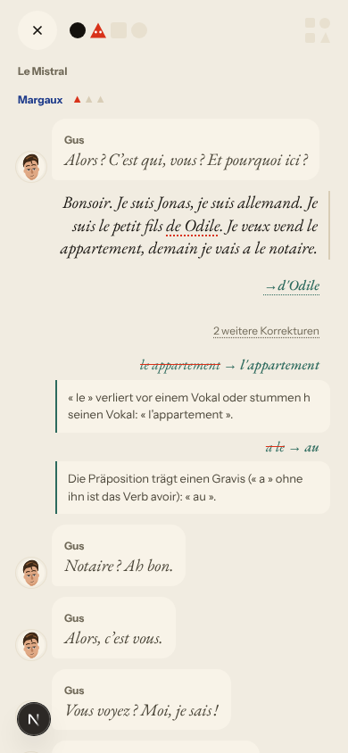

**Q6 at 3.** The Journal retell of day 1 has Gus say «Il manque quelque chose : Non, alors. Croissant : c'est noté. Pas ce soir.», two of Margaux's lines glued (the fake stack's echo lines, but the gluing and the speaker are code: #1081, commented). Camille's letter is now labelled «Camille · La mairie» (#1070, commented). Register held: Gus, Camille vous; Margaux, Lila tu; German UI du. 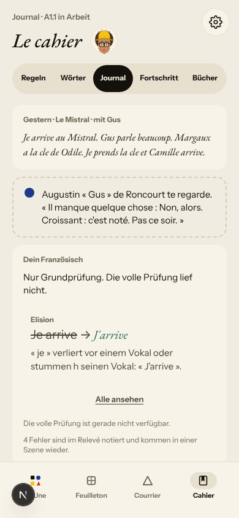 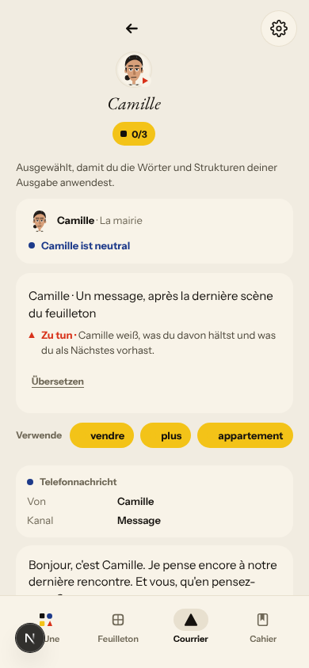

**Q15 at 3.** Day 1's La Forge (8 items) had no typed item at all: five choices, two speed rounds, one judge; my misses kept it at Stufe 1–2, where only picks are served. Day 2's had two typed gaps and one tile build, no free sentence. What I wrote myself: two scene replies and the Courrier on day 1; one scene reply, two typed gaps and the Journal retell on day 2.

**Q3, Q16 at 3.**
- On #143: the rule card reads «Regel · Schritt 1 von 4», «Aus deinen Fehlern · Schritt 1 von 4» and «Regel zum Wiederholen · Schritt 1 von 4» while the top bar shows four steps done; «Ausprobieren» opens the «Szene beendet» card with only Gus' name and «Weiter: Grammatik· 7 Min.».
- «Aus deinen Fehlern · Was du selbst geschrieben hast» brought back a sentence I *picked* in a judge item («Tu est à Marseille cette semaine ?») and asks «Schreib richtig, was du gesagt hast.» (observation).
- After a minute on a miss, a «Eine Pause?» Margaux cheer covers the item's header for a moment.

**Q20 at 3.** Both Done screens end on a statement as «Morgen»: «Deux clés pour la même porte.» and «Ton billet de retour est pour mercredi. Lila est libre mercredi.» (#466). 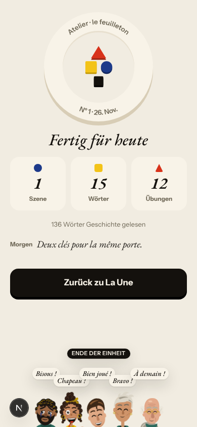 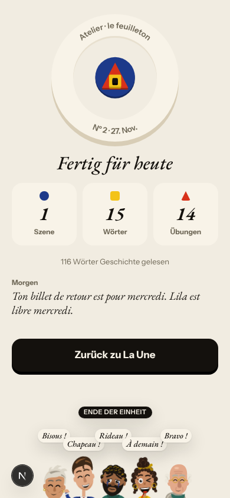

**Q22 at 3.** Home promises day 2 at «22 Min.» (scene 10, grammar 7, words 5); the agent needed about 6 minutes, a beginner reading and typing about 12–15.

**The owner's rule of 7 Nov (#698, «Nur als Extra»): holds, slot and label.** Day 1's scene slip «le appartement» made «Le, la, l', les · in Übung» and took no card; day 2's card and La Forge were Avoir, the next rule of the A1 path; «Le, la, l', les» ran only around the scene as «Regel zum Wiederholen · Eine Regel, die schon vorkam», my La Forge slip as «Aus deinen Fehlern», être only as «Eine bekannte Regel» and «Wiederholung · heute fällig». 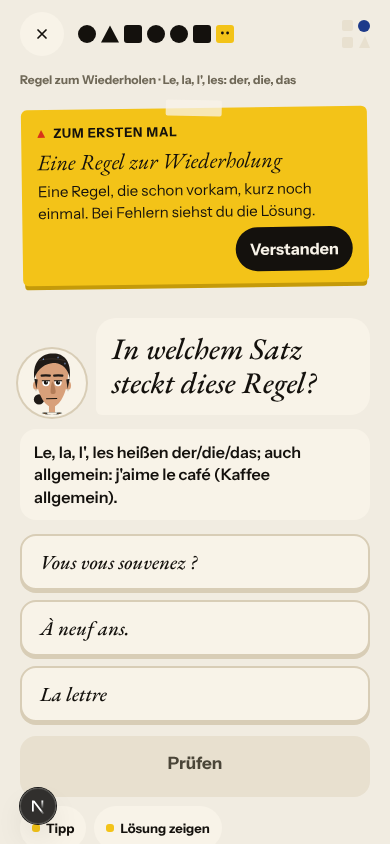

**The best of the night.**
- #1048 fixed: the avoir object and its glosses agree («un rendez-vous au Mistral»).
- #998 fixed: «Gestern erzählen · ≈ 2 Min.». 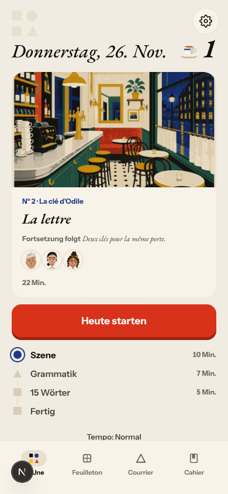
- #1049 fixed: the Avoir card's «J'ai vingt-cinq ans et j'ai faim !» has no stand-in face. 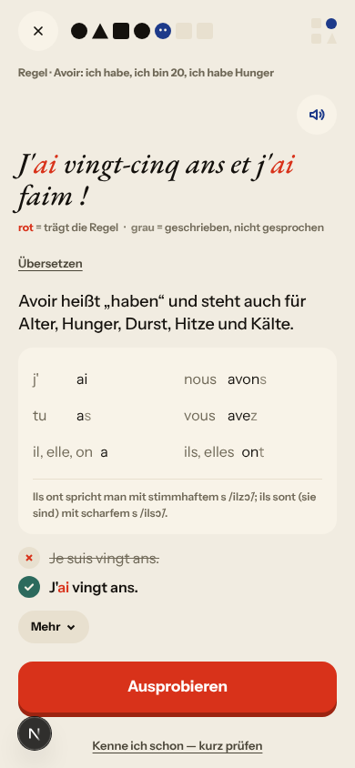
- #953 holds: Margaux's tu note opens the chat composer, not the e-mail frame. 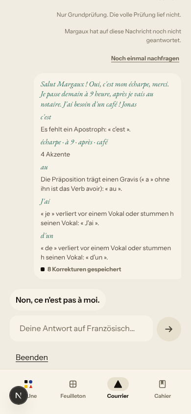
- The Courrier lists eight slips of one letter in five rows («c'est», «4 Akzente», «au», «J'ai», «d'un»), each with its reason.
- La Forge explains elision («Je ai»), age with avoir and «tu as» in the learner's language.

## Findings, by root cause

Three new findings (#1086–#1088), all `queue:ready`, `lane:code`, `size:S`, each with a **Done when:** comment and added as a child of its root cause. **New root cause #1085** (two children). #174 and #146 have new comments. Repeats commented: #992, #1047, #1068, #1070, #1081 (the live walk's, fake-stack evidence). #1041 reopened (CI flake recurred).

### #1085 (new) a miss's reason is whatever survives string filters
Why the code allowed it: the reason a La Forge miss shows is a composed sentence put through filters written for other problems: the server's answer-leak scrub (`solution_gate.scrub_hint`, `app/services/solution_gate.py:316-410`, via `_hint_without_answer`, `app/services/atelier.py:6821-6848`) compares the French answer's tokens with every word of the learner-language text; the client's `whyWithoutEcho` (`web-frontend/lib/rule-diff.ts:157`) and `withoutRuleReference` (`web-frontend/lib/forge-progress.ts:282`) cut sentences that echo the fix or name the rule. Nothing checks that something explaining is left. Done when: a guard test over drill kinds × slip categories × de/en/fr asserts a non-empty reason that is not only the gloss when the slip is named, and no learner-language word counts as an answer token.
- **#1086 (new, medium)** «Tu est» / «Tu suis» → only «Être heißt sein.»: the repair «Schau, wer **es** tut …» (`learner_copy.py:732-736`) is scrubbed because «es» is the answer. Checked: `scrub_hint(repair, [], {'es'}) == ''`. 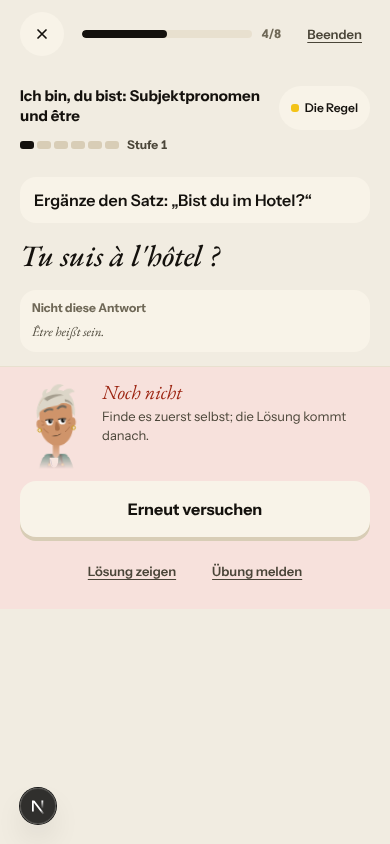
- **#1087 (new, medium)** two-choice «Tu es chaud ce soir ?»: no reason on the card; the payload had `why_wrong` «Du hast „Tu es“ gewählt; hier ist „Tu as“ nötig. Regel: Avoir …» and `hint` «Avoir heißt haben; auch für Alter, Hunger …»; the echo strip and the rule-name strip (`web-frontend/pages/atelier.tsx:4600-4625`) leave nothing, and the `hint` is only used while the solution is withheld.

### #174 a right answer is judged against one stored string
- **#1088 (new, medium)** «J ai» accepted as «Richtig» with no word on the apostrophe, and printed unfixed on the end sheet under «Weiterhin in Übung»: `_forge_proof_line` (`app/services/atelier.py:9003`) fills the gap with the learner's text when the verdict is right, and the grader's normalizer folds the apostrophe; `changeText` (`web-frontend/lib/forge-progress.ts:202`) puts «Weiterhin {stage}» right above the proof list, which reads as «still practising these» (the 25 Nov walk read it so too). Sibling of #927.

### #146 the day's content and feedback are not driven by one concept
- **#992 (commented, stays `queue:ready`)** «Je ai», «Tu a», age with «Tu es» now explain; «Elle et» and a tile order still get the gloss. Part of its choice-item fallback is #1086.

### #857 the basic check's composed fixes
- **#1047 (commented, owner)** «a le → au · Die Präposition trägt einen Gravis …» in the scene and the Courrier.
- **#1068 (commented)** the three places go to «d'Odile», «l'appartement», «au»; «Je veux vend», «petit fils» never shown; day 2 «a elle», «C est», «grand mere» not shown and no «+ N» line.

### #147 the cast is not one registry / #145 the scene has no state
- **#1070 (commented)** «Camille · La mairie» (25 Nov: «Les services»).
- **#1081 (commented, live walk's)** on the fake stack too: the Journal has Gus say two of Margaux's lines, glued.

### No shared cause
- **#1041 (reopened, low)** the scheduled «Browser walk» run 45 failed its `season 6-10` start-up on `/api/auth/csrf` (404 timeout), as run 120 did on 24 Nov.

### Seen again, not commented
- #466: both days end on a statement as «Morgen».
- #280: 4 of 15 new words on day 1 from the scene (vendre, l'appartement, la clé, ici), 1 of 15 on day 2 (la lettre); the rest adverbs, numbers, ordinals, être, avoir.
- #143 (owner): the step counter (above).
- #694 (harness only): after `/clock` Home and the end sheet still say «Donnerstag, 26. Nov.».

### Observations, not filed
- The day-2 La Forge offered no Regelprüfung (the 24 Nov walk passed the être test at the same point); an «Éclair · 60 s» instead. #1028 not reached.
- «Welcher Satz sagt: „Bist du diese Woche in Marseille?“?»: the prompt ends on «?“?».
- The être typed gap turned into a choice after «Erneut versuchen» («est · richtig» among est/es/sont).
- The speed round's «Tu est vieille ?» assumes a woman as the «tu»; it is a sentence to judge, not the learner, so not #1029.

### Fake provider (left to the live walk)
- Keyword echoes: Gus «Notaire ? Ah bon.», Margaux «Non, alors. Croissant : c'est noté.» then «Pas ce soir.» after I said I stay; Camille «Simple ? Ah bon.»; Lila «Tu n'entres pas ? Je comprends.». The Courrier never answers («Margaux hat auf diese Nachricht noch nicht geantwortet.») and shows «Nur Grundprüfung. Die volle Prüfung lief nicht.» (#1062 is the live case); the Journal's missing detail is the fake echo line.

## Re-tests

| issue | fix | result |
|---|---|---|
| #1048 «J'ai un» refused for «einen Termin» | #1076 | **fixed**: «___ un rendez-vous au Mistral.», tile build accepted; guard test passes; commented, left closed.  |
| #1069 «They drove at night this morning» | #1076 | not reached (no test offered; A2 frame); `tests/test_daypart_1069.py` passes on main; commented, left closed. |
| #1064 title as Margaux's line | #1074 | live-only screen (T6/T7 day B); the live walk found the reader fixed and the Journal half (#1081). Left to it. |
| #998 retell chip minutes | #1012 | **fixed**: «Gestern erzählen · ≈ 2 Min.»; commented, left closed. |
| #1049 Romy's line under Margaux | #1059 | **fixed**: no face under the Avoir card's line; commented, left closed. |
| #953 friend's tu note as e-mail | #1052 | **holds**: Margaux's tu note opens the chat composer; commented, left closed. |
| #967, #1024 word drill misses | #1053 | not reached (no pre-scene word drill on this path). Left closed. |
| #992 misses explained by the gloss | #1053 (partly) | partly: elision, age, «tu as» explained; «Elle et», tile order still gloss; commented, stays `queue:ready`. |
| #1028 failed test drops the level | none merged | not reached: no test offered tonight. |
| #1041 «Main walk fails: harness-ran» | none (flake) | **recurred** on scheduled run 45; reopened with a Done when. |
| owner rule of 7 Nov (#698) | #708, #1001 | **holds, slot and label.** |

Root causes: **#1085 opened** (children #1086, #1087); #174 advanced (child #1088); #146 commented; none closed.

## Owner questions (open, not asked again)
- **Should La Forge ask for one free sentence of the learner's own on a rule's first days?** Tonight: 16 La Forge items over days 1–2 with none; day 1's eight were all picks (five choices, two speed rounds, one judge) because the misses kept the rule at Stufe 1–2; day 2 had two typed gaps and one tile build.
- **#1028, does decision #88 cover the optional test?** No test was offered tonight; no new evidence.

## Scripted walk

- «Browser walk on main» (walk-main.yml): runs 134 (`bb8b69f3`), 135 (`297c45de`), 136 (`47878b30`), 137 (`831173ba`) and 138 on `5f40553a` (tonight's main) **passed**.
- The scheduled «Browser walk» (walk.yml) run 45 on `47878b30` **failed**: `season 6-10` timed out on the harness start (`/api/auth/csrf` 404), 0 screens; `de`, `fr`, `en + B1`, `season 1-5` passed (#1041 reopened).
- In tonight's explore walk both days reached Done: day 1 through La Forge's «Weiter: 15 Wörter», day 2 through La Forge's end sheet and the words.
