# Walk · 27 Nov 2026 · nightly explore walk

Main at `03ca6c29`. Since the 26 Nov walk (`5f40553a`, report merged as `e5b3bd19`), main took in:
- **the night shift's fixes**: #1090 (La Forge: a miss whose reason was cut away shows the server's next reason; part of #1087 and #1085), #1092 (Courrier: a friend says tu and never sells; a played letter does not come back; #920, #1043, part of #994), #1095 (word cards show months and days bare; #1083), #1096 (Browser walk waits for the web server to compile and retries the csrf probe; #1041);
- the forge #1104 (Lila's painting at the zinc) and tonight's live report #1107.

`alembic upgrade heads` ran cleanly on a scratch database before the walk. There is one head, **`b2d4f6a8c0e1`** (unchanged since 23 Nov).

Setup: fake story provider, local stack, Chromium at 390×844, one persona, `a2-en` (`--fresh --native en --level A2.1`; last played 25 Nov). I signed up through the UI at «I know some basics · A2» as Sam and played off-script with school-French slips (no accents, no apostrophes, English prepositions):
- day 1 scene to Gus: «Bonsoir. Non, je ne suis pas de M. Marchand, je connais pas ce monsieur. Je m appelle Sam, je suis professeur de musique a Bristol. Odile etait ma grand-mere. Je vend peut-etre, je sais pas. Pourquoi tout le monde parle de Solvel ? Et vous, vous etes qui ?»; I refused the café crème («Je n'ai rien commandé.»); to Margaux «Non, je monte pas ce soir. Je vais a le hotel pres de la gare, j ai deja reserve une chambre. … Mais pourquoi elle ne donnait jamais la cle ? Tu la connaissais bien, Odile ?»; I **left the key with Margaux** («Garde-la pour moi.»; 25 Nov I took it);
- day 1 La Forge misses on purpose (infinitive for participle, «je suis entendu», an English «ils ont écouté à»);
- day 1 Courrier to Gus: «Bonjour Gus, je pense que vous etes un peu theatral, mais sympa. Je n ai pas pris la cle hier, Margaux la garde. Demain je vais signer les papiers chez le notaire, mais je veux pas vendre a Solvel. Vous connaissez quelqu un qui a habite dans l immeuble ? A bientot, Sam»;
- day 2 scene to Camille: «Simple pour qui ? Pour votre grand-pere, oui. Hier j ai parle avec le notaire et il a dit que l offre est trop petit. Je ne vend pas maintenant. Et vous, pourquoi vous avez une cle de mon etage ?»; Marin reads the letter; to Margaux «Oui, je cherche la cle que je t ai donne hier soir. Tu peux me la rendre, s il te plait ? …»;
- day 2 La Forge's free sentences with slips («L ete dernier, ils ont prepare …», «Elle a attendu pour Margaux …»), the offered test failed 1 of 3 on purpose; Courrier to Margaux (a tu note) and the Journal retell with an invented dog.

Day 1 took about 8 minutes of walking from «Start» to Done, sign-up included:
- teaser (Margaux), sign-up, figure, onboarding («Scene, then grammar, then your words»), cast page;
- scene «Le mauvais accueil»: two free replies, two choices («Exchange 1 … 3 of 3»);
- rule card «Passé composé with avoir, regular and irregular participles», «Try it», the near-empty «Scene finished» card, then La Forge 8 items (Level 1 → 4): a choice miss and copy, a choice, a judge miss, a speed round 4/4, a typed-gap miss then accent miss then copy, a tile miss then solution then copy, a typed-gap miss and retry, a tile build. There was no free sentence.
- 15 words, Done, Home, Courrier (one reply to Gus), Cahier (Rules), Feuilleton.

Day 2 (clock +1) took about 8 minutes:
- Home «Nº 2 · La clé d'Odile · La lettre · 20 min» with «New letter ≈ 4 min», «Retell yesterday ≈ 2 min»; scene «La lettre»: two free replies, one choice («Ask Margaux for the key you left with her.»: the scene kept my day-1 choice);
- **no new rule**: «Next: grammar» opened «La Forge · Forge today's rule» on **avoir again** (Level 4 → 6: a find-the-mistake, four «Say in French», three of them unchecked on the fake stack), then the offered test, failed 1 of 3 (#1108, below);
- 15 words, Done; Courrier (Margaux's tu note, answered), the Journal retell of day 1.

Day 7 not played.

**Live column: [live walk 27 Nov](../live-walks/2026-11-27.md)** (on main, #1107): production with the real model, release `a454b71a0b83` (the tip of main before the report, so #1090, #1092, #1095 and #1096 are live), account A1.1 on day 45. Headline: **Q9 down to 3, Q10 and Q11 down to 2. La Forge's review item refused the correct fix «grande» + «blancs» and printed «Ta chambre est très grand» as the corrected line (#1105). The Courrier «corrected» «cinq rue Bonaparte» to «cinq rues» (#1106). Q4 held at 4 (the scene took up a «non», a pigeon and the Sunday croissants).** It filed #1105 and #1106; they are not filed again here. Its re-tests: #381, #557, #1062, #1081, #466, #445 and #1083 seen again; #1090 not contradicted; #1092 friend case not reached.

**Browser walk on main**: every run since the last walk passed: 139 (`e5b3bd19`), 140 (`491c0bf9`, #1095), 141 (`c7cdbf4c`, #1090), 142 (`d53ae2dd`, #1096), 143 (`6bab5e81`, #1092), 144 (`a454b71a`, #1104) and 145 (`03ca6c29`, main tonight). The scheduled «Browser walk» run 46 (`6bab5e81`, #1096 included) **passed all six jobs**, `season 6-10` included (#1041, below).

## Scores (rubric `docs/ops/walk-rubric.md`)

| # | question | 27 Nov a2-en (d1–2) | live 27 Nov | 26 Nov a1-de (d1–2) | 25 Nov a2-en (d1–2) |
|---|---|---|---|---|---|
| 1 | Where am I | 4 | 4 | 4 | 4 |
| 2 | What is at stake | 4 | 4 | 4 | 4 |
| 3 | What to do next | 3 | 3 | 3 | 3 |
| 4 | Scene reacts to my writing | fake | 4 | fake | fake |
| 5 | Story coherent | 3 | 3 | 3 | 3 |
| 6 | Characters consistent | 3 | 4 | 3 | 3 |
| 7 | Image, text, tone fit | 4 | 3 | 4 | 4 |
| 8 | Difficulty fits | 4 | 4 | 4 | 4 |
| 9 | Feedback explained | 3 | 3 | 3 | 3 |
| 10 | Right answers accepted | 4 | 2 | 4 | 4 |
| 11 | French correct | 3 | 2 | 3 | 3 |
| 12 | Clear goal today | 3 | 4 | 4 | 4 |
| 13 | Grammar practised | 4 | 4 | 4 | 4 |
| 14 | Earlier material returns | 4 | 4 | 4 | 4 |
| 15 | I produce French | 3 | 5 | 3 | 3 |
| 16 | Errors, dead ends | 3 | 3 | 3 | 3 |
| 17 | Varied, fun | 4 | 4 | 4 | 4 |
| 18 | Fast enough | 4 | 3 | 4 | 4 |
| 19 | App only | n/a | n/a | n/a | n/a |
| 20 | Satisfying end | 3 | 3 | 3 | 3 |
| 21 | Would come back | 3 | 4 | 3 | 3 |
| 22 | Time vs promise | 3 | 4 | 3 | 3 |

Q14 is scored on day 2 only. Against the last `a2-en` walk (25 Nov) and against last night (26 Nov, a1-de), one question moved: **Q12 4 → 3** (down). No question scored 1 or 2 tonight.

**Q12 down to 3: day 2 had no goal of its own.** Day 1's goal was clear (the avoir card, then La Forge on it). On day 2 the plan introduced nothing: the tentpole page `t1b` uses none of the A2 learner's next units. La Forge then opened «Forge today's rule» on avoir, chosen because my day-1 slip «ils ont écouté à» was due (`reason='due_erratum'`). The day never said it was a review, and être, the next rule (day 2 on 25 Nov), did not come (#1108, new, high). 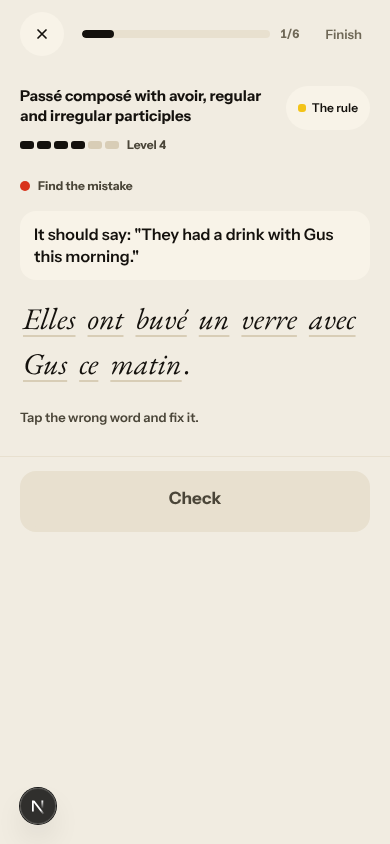

**The owner's rule of 7 Nov (#698, «Nur als Extra»): does not hold tonight.** A slip's rule took the «today's rule» slot, unlabelled. There was no «From your mistakes» and no «Review · due today» on day 2. The slip that drove it was not even a slip on the rule (the extra «à», #1109). This held on 25 and 26 Nov because those days planned a rule; the picker only guards the slot when the plan names one (#1108).

**Q9 at 3: no empty reason any more, and three ways to explain the wrong thing.**
- Better: no miss showed an empty reason bar (#1090). The accent miss «elle a commence» got «Here the accent changes the word: «commencé», not «commence».». The scene card ranks the grammar slip first: «vends · With « je » this verb ends in -s» ahead of «m'appelle» and «était». «a le hotel» now reads «à · The preposition takes a grave accent …» with «le hotel → l'hôtel» as its own row. 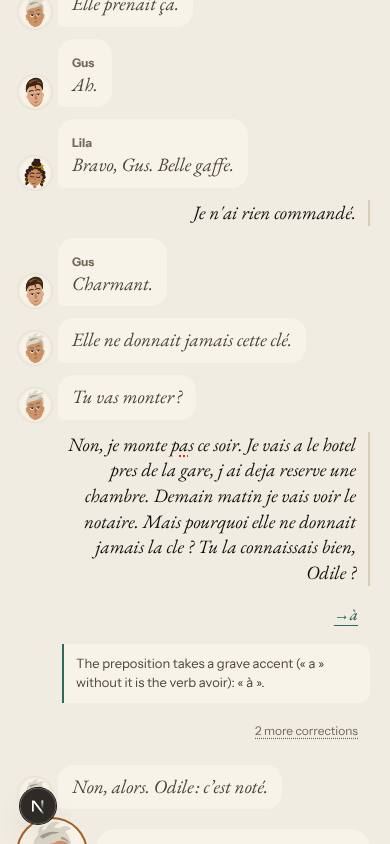
- New: the typed gap «ils ont écouté à» (participle right, an extra «à») got «… this item needs “ils ont écouté”. Most verbs say the past with avoir + the -é/-i/-u form …», above «Find it yourself first; the solution comes after.» So the rule was blamed and the key shown while withheld (#1109, new). 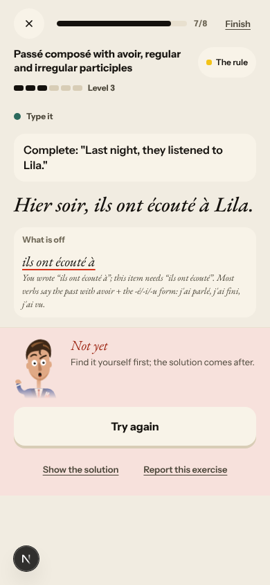
- Still the gloss: «Vous avez commencer», «elle a commencer», «Ils ont expliquer …» → «Most verbs say the past with avoir …»; the judge miss «Ce matin, je suis entendu Marin.» → the echo only (#992). 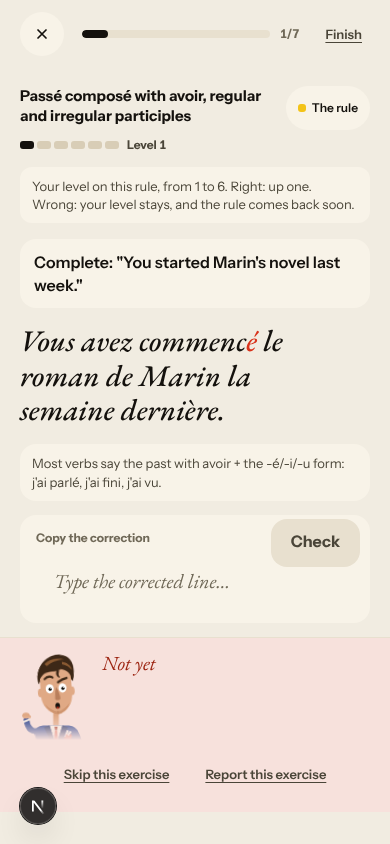 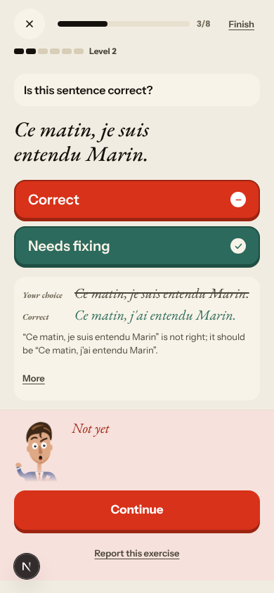
- The basic check misses «Je ne vend pas» on day 2 though it caught «Je vend» on day 1 (#1110, new). 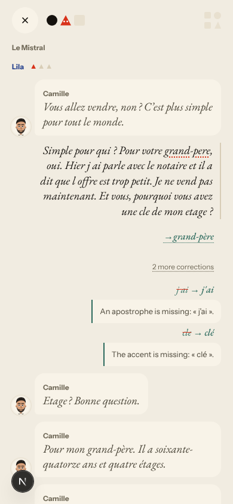

**Q11 at 3.** La Forge's own French was right. The Courrier saved «corrected» lines that are still wrong: «un peu theatral», «vendre a Solvel», «qui a habite», «A bientôt» (to Gus); «ailleurs, a Bristol», «10 heure» (to Margaux, beside «à moi» and «demain à» fixed). The «Ma echarpe → Mon écharpe» fix went into one row with «d'écharpe» and «!», with the bare note «The correct form is …» (#857, #1047, commented). 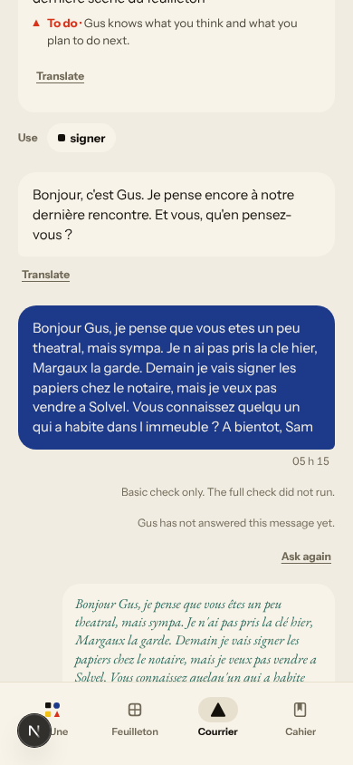 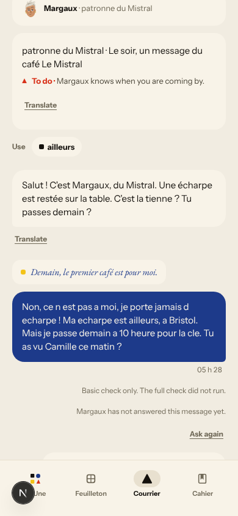

**Q10 at 4.** «elle a commence» was refused with the accent named; «on a conduit» was accepted for «we drove»; the exact free sentences «Ils ont ouvert la valise hier.» and «Hier soir, il a bu un café au Mistral.» were marked Right. Other free sentences said «Checking is not available right now» (fake stack).

**Q6 at 3.** Keyword echoes on the fake stack: Gus «Solvel ? Bonne question.», Margaux «Non, alors. Odile : c'est noté.», Camille «Etage ? Bonne question.», Margaux «Oui. Chose, bien.» … «Chose. On en reste là pour ce soir.» (from «quelque chose»). The Journal has Gus say two of Margaux's lines, glued (#1081, commented). 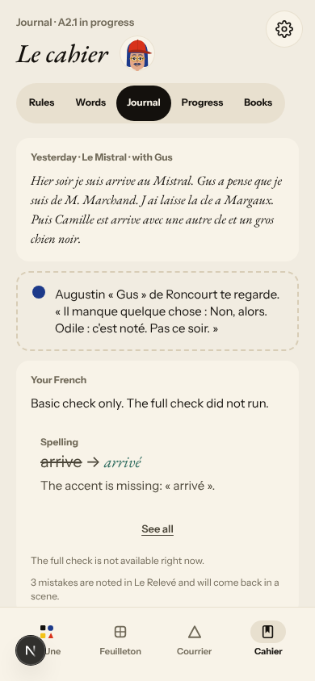 Register held: Gus, Camille and Marin's first lines used vous; Margaux and Lila used tu; Margaux's tu note opened the chat composer (#953 holds).

**Q3, Q16 at 3.** On #143: «Rule · Step 1 of 4» on the rule card while the scene was done; «Try it» opens the near-empty «Scene finished» card («Gus · Next: grammar · 7 min»); onboarding lists three steps under «Step 1 of 4». The Courrier never answers on the fake stack («Gus has not answered this message yet.», «Ask again» → «Still no answer.»; «Finish» works).

**Q15 at 3.** Day 1's La Forge had two typed gaps and two tile builds, but no sentence of my own. Day 2's had four «Say in French» at Level 5–6 (only the two exact matches were checked on the fake stack) plus the test's sentence. What I wrote myself: two scene replies and the Courrier on day 1; two scene replies, four La Forge sentences, the test's sentence, the Courrier and the Journal on day 2.

**Q14 at 4.** Avoir came back on day 2, but as the whole séance (Q12). My choice from day 1 came back in the scene («Ask Margaux for the key you left with her.»). Day 1's words did not come back as reviews on day 2 (all marked «I know it»).

**Q20 at 3.** Both Done screens end on a statement as «Tomorrow»: «Deux clés pour la même porte.» and «Ton billet de retour est pour mercredi. Le même jour que Lila.» (#466). 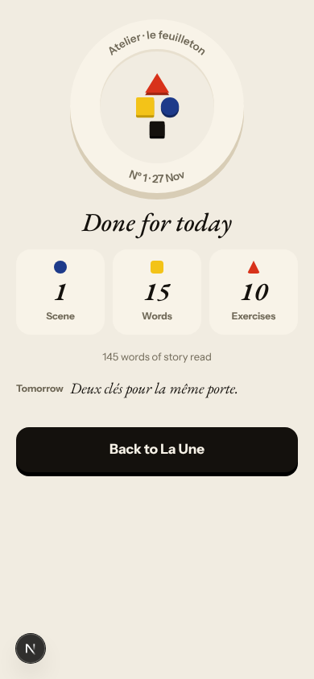 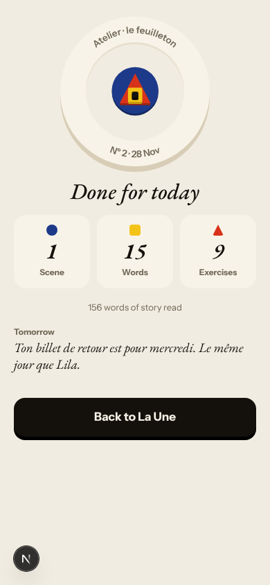

**Q22 at 3.** Home promises day 2 at «20 min» (scene 8, grammar 7, words 5). The agent needed about 8 minutes with the test; a learner reading and typing would need about 15.

**The best of the night.**
- The scene kept my off-script choice: I left the key with Margaux on day 1, and day 2's turn was «Ask Margaux for the key you left with her.», and she hands it back («Tiens.»).
- Day 2's words came more from the scene and the building: l'offre, la lettre, l'immeuble, l'escalier, l'étage, l'ascenseur, l'adresse (7 of 15; day 1: vendre, l'appartement, la clé, 3 of 15).
- The scene card ranks «je vend → vends» above the apostrophes (#1068's day-1 case).
- No empty reason bar on any miss (#1090).
- The Journal named a participle («arrive → arrivé»).

## Findings, by root cause

Three new findings (#1108–#1110), all `queue:ready`, `lane:code`, `size:S`, each with a **Done when:** comment and added as a child of its root cause. Root causes #146, #542 and #857 got new children; **#1085 advanced** (#1090, client half). Repeats commented: #992, #1047, #807, #1081, #1028. #1087 is back to `queue:ready`, narrowed to its German half.

### #146 the day's content is not driven by one concept
- **#1108 (new, high)**: on a day that plans no new rule, «Forge today's rule» is a due slip's rule. `forge_picker._anchor` (`app/services/forge_picker.py:462-470`) returns `REASON_DUE_ERRATUM` with `role='today'` before the quota's new rule (`:472-477`). Only a planned rule (`_planned_rule_id`, `app/services/daily_journey.py:238-260`) outranks it, and day 2 on `t1b` planned none (`concept_life.introduction_for_today` with the page's units, `app/services/concept_life.py:699-709`). Checked on the walk's DB: `ForgeUnit(concept_id=39, role='today', reason='due_erratum')`. This breaks the owner's 7 Nov rule. 

### #542 a drill's words are read from the item's shape, not from what it declares
- **#1109 (new, medium)**: the typed gap «ils ont écouté à» gets the avoir gloss and the key while withheld. `_miss_outside_the_rule` (`app/services/atelier.py:987-1003`) sees a dropped or changed shared word, never an added one. «You wrote …; this item needs …» (`app/services/learner_copy.py:153-157`) carries the key into the withheld card. This is the mirror of #1067. The withheld half is #1085's mechanism.

### #857 the basic check's composed fixes
- **#1110 (new, medium)**: «Je ne vend pas», «Je le vend», «Tu ne prend pas» get no edit. The -dre rule (`app/services/correction_contract.py:3221-3226`) reads only the token right before the verb.
- **#857 (commented)**: Courrier lines saved with «theatral», «a Solvel», «a habite», «A bientôt», «a Bristol»; «l offre» unmarked while «l appartement» is marked.
- **#1047 (commented, owner)**: «d echarpe ! Ma echarpe» folded into one row «The correct form is « d'écharpe ! Mon écharpe ».».
- **#807 (commented, owner)**: «prepare» (La Forge), «parle» (scene) and «habite» (Courrier) are not named on the avoir rule's own day 2; the Journal named «arrivé». 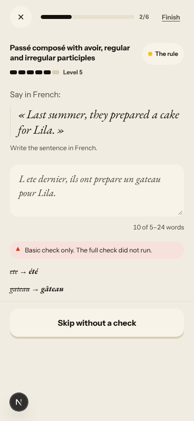

### #146 and #1085: what a La Forge miss explains
- **#992 (commented, stays `queue:ready`)**: infinitive misses get the gloss; the judge «je suis entendu» gets the echo.
- **#1085 (advanced, stays `queue:owner`)**: #1090 fixed the empty bar. New server-side evidence: a filter that let the key through (#1109).

### #145 the scene has no state / #147 the cast
- **#1081 (commented, live walk's)**: on the fake stack, the Journal has Gus say Margaux's two lines, glued.

### No shared cause
All three new findings fit an open root cause, so no new root cause was opened.

### Seen again, not commented
- #466: both days end on a statement as «Tomorrow».
- #280: 3 of 15 new words from the scene on day 1, 7 of 15 on day 2.
- #143 (owner): the step counter (above).
- #1062's kind on the fake stack: «Basic check only. The full check did not run.» under the Courrier, La Forge's free sentences and the Journal.
- #694 (harness only): after `/clock`, Home and the end sheet still say «Friday 27 Nov».

### Observations, not filed
- «Paris. Le 25 novembre.» on a learner's first day of 27 Nov: by design, the season's opening is moved to the Wednesday nearest the start (`app/services/season/dates.py`), so the weekdays stay true.
- The teaser's first item changes its line to «Bienvenue au Mistral !» after the right answer, while the task still reads «Say hello back.».
- La Forge's end sheets list first-try right lines under «Still practising» (25 Nov's observation, #1088's reading).
- The judge miss card's «More» link did nothing visible in the harness.

### Fake provider (left to the live walk)
- Keyword echoes (above); the Courrier never answers; three La Forge free sentences unchecked («Checking is not available right now, so this answer does not count.»); the Journal's «What you remember» quotes the echo line.

## Re-tests

| issue | fix | result |
|---|---|---|
| #1087 two-choice miss with no reason | #1090 (part) | **client half holds on the English path**: five misses (choice, typed, tile before and after «Show the solution») all showed a reason; guard `forge-miss-reason-1087.test.js` 8/8 on main. The German «Tu es chaud» item (A1) was not reached. The German-meaning half is still open: commented, back to `queue:ready` with a narrowed **Done when**. |
| #1085 (root cause) miss reason through filters | #1090 | **advanced** (client fallback); new evidence for the server half (#1109); commented, stays `queue:owner`. |
| #1086 «Tu est» → «Être heißt sein.» | none | German only, not reachable on `a2-en`; untouched by #1090; stays `queue:ready`. |
| #1083 «le janvier» word card | #1095 | not reachable: no month or day card on the A2 path. `tests/test_bare_nouns.py` passes on main (3/3). Left to the live walk (it reported months as new words tonight). |
| #1041 Browser walk start-up flake | #1096 | **holds so far**: scheduled run 46 passed all six jobs including `season 6-10`; commented, left closed. |
| #920, #1043, #994 Courrier register / refund / repeated letter | #1092 | story lane, live only. Tonight's letters came from Gus (vous) and Margaux (tu, host), so the friend case was not reached. |
| #953 friend's tu note as e-mail | #1052 | **holds**: Margaux's tu note opens the chat composer. |
| #1028 failed test drops the level | none merged | new evidence: Level 6, 1 of 3 failed → «picks up at level 4»; commented. 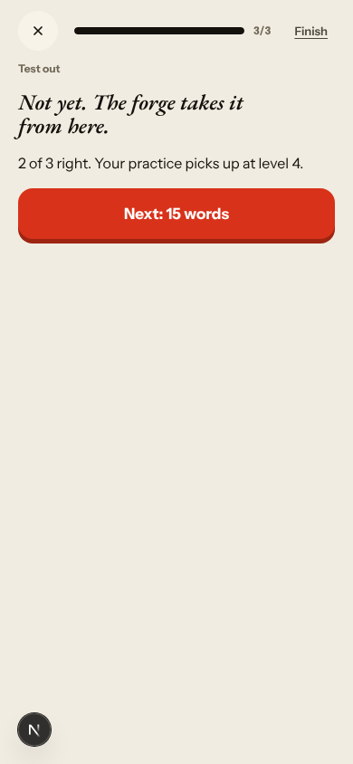 |
| owner rule of 7 Nov (#698) | #708, #1001 | **does not hold** on a day that plans no rule (#1108). |

Root causes: #1085 advanced; #146, #542 and #857 have new children; none opened or closed.

## Owner questions (open, not asked again)
- **Should La Forge ask for one free sentence of the learner's own on a rule's first days?** Day 1 (the avoir rule's first day): 8 items, no free sentence (two typed gaps, two tile builds). Day 2 (avoir again, #1108): four «Say in French» at Level 5–6, three of them translations of a given English line, not the learner's own.
- **#1028, does decision #88 cover the optional test?** Tonight's test at Level 6 failed 1 of 3 → «Your practice picks up at level 4», again two levels down (25 Nov: 4 → 2).

## Scripted walk

- «Browser walk on main» (walk-main.yml): runs 139–144 passed, and 145 on `03ca6c29` (tonight's main) **passed**.
- The scheduled «Browser walk» (walk.yml) run 46 on `6bab5e81` **passed** in every job: scope, `de`, `fr`, `en + B1`, `season 1-5`, `season 6-10`.
- In tonight's explore walk both days reached Done: day 1 through La Forge's «Next: 15 words», day 2 through the failed test's «Next: 15 words».
