# Walk · 28 Nov 2026 · nightly explore walk

Main at `209aa034` when walked (`22aac548` when the report was written: it added only the 27 Nov report, #1111). Since the 27 Nov walk (`03ca6c29`), main took in:
- **the fixes**: #1112 (La Forge's «today's rule» is never a due slip's rule; #1108), #1114 (Journal: the full check is asked again within the browser's wait, every basic slip is marked, each scene line is printed once; #1062, #1081, #1110);
- the forge #1118 (the Christmas note for M. Marchand) and tonight's live report #1123.

`alembic upgrade heads` ran cleanly on a scratch database before the walk. There is one head, **`b2d4f6a8c0e1`** (unchanged since 23 Nov).

Setup: fake story provider, local stack, Chromium at 390×844, one persona, `a1-de-fresh` (`--fresh --native de`; last played 26 Nov, which is the comparison). I signed up through the UI at «Neu im Französischen · A1» as Jonas and played a German beginner with real slips:
- day 1 scene to Gus: «Bonsoir. Je suis Jonas, je suis allemand. Odile est ma grand mere. Je suis ici pour le appartement, mais je ne vend pas tout de suite.»; to Margaux «Non, je suis tres fatigue. Je reste ici ce soir. C est qui, Solvel ? Je le prend, la cle.»; I took the key;
- day 1 La Forge misses a German speaker makes («Ils est», «Nous êtes» judged right, «Elles est», a tile «Tu est à la rédaction ?»);
- day 1 Courrier to Marin: «Salut Marin ! Je pense que Gus est drole. Je suis un peu perdu, je ne comprend pas tout. D abord je vais a le notaire demain. Tu es la ce soir ? Jonas»;
- day 2 scene to Camille: «Non, je ne vend pas maintenant. Le appartement est a ma grand mere, et je ai ses photos. C est plus simple pour vous, pas pour moi.»; Margaux reads the letter;
- day 2 La Forge on Avoir with the traps («Vous êtes chaud», «Ils sont deux frères», a tile order slip, a dictée «Tu est italienne ?»);
- the Journal retell of day 1 with «Je lui a dit», «je ne vend pas», «le appartement».

Day 1 (about 8 minutes of walking from «Loslegen» to Done, sign-up included):
- teaser (Margaux), sign-up, figure, onboarding, cast page;
- scene «Le mauvais accueil»: two free replies, one choice, the key;
- rule card «Ich bin, du bist: Subjektpronomen und être», «Ausprobieren», the «Szene beendet» card, then La Forge 8 items (Stufe 1 → 3): four choices, two speed rounds (3/4, 3/4), one judge, one tile build, plus one copied correction; no typed item, no free sentence;
- 15 words, Done, Home, Courrier (one reply to Marin), Cahier (Regeln), Feuilleton.

Day 2 (clock +1, about 8 minutes):
- Home «Nº 2 · La clé d'Odile · La lettre · 22 Min.» with «Gestern erzählen ≈ 2 Min.»; scene «La lettre»: one free reply, one choice;
- être as «Eine bekannte Regel, auf der heutigen Seite», then the new rule **Avoir** (card); around the scene «Aus deinen Fehlern» (my tile «Tu est à la rédaction ?», rebuilt right) and «Regel zum Wiederholen · Le, la, l', les»;
- La Forge «Regel des Tages schmieden» on Avoir, 8 items (Stufe 1 → 3), être twice as «Wiederholung · heute fällig»; one typed gap, two tile builds, a dictée; no Regelprüfung offered (an «Éclair · 60 s» instead);
- 15 words, Done; Journal retell of day 1.

Day 3 (clock +2), checked only for the owner's rule and #1108: the rule card «Il y a: es gibt» came first, then the scene, then La Forge «Regel des Tages» on Il y a. The scene is the dev stub's episode with an English task line («Propose an alternative for the market morning, or decline.»), which is #1103. Not scored.

**Live column: [live walk 28 Nov](../live-walks/2026-11-28.md)** (on main, #1123), production with the real model, release `ffe7e01aa45f` (#1112 and #1114 live), account A1.1 on day 46. Headline: **Q9 down to 2, Q6 down to 3, Q20 up to 4; La Forge still presents a correct sentence as a mistake (#625); the numbers review rejects «quarante neuf» with no reason (#1119); «Ton frère te demande» with Lila as the speaker (#1120); the Journal's recall check says 0/2 for an accurate retell (#1121); Level 6 in La Forge against «shaky» in the Cahier (#1122); #1081 reopened (a stitched Journal line after #1114).** It filed #1119–#1122; they are not filed again here.

**Browser walk on main**: every run since the last walk passed: 146 (`93b09e05`, #1114), 147 (`b6a3995f`, #1112), 148 (`ffe7e01a`, #1118) and 149 (`209aa034`, main tonight). The scheduled «Browser walk» run 47 (`b6a3995f`) passed all shards.

## Scores (rubric `docs/ops/walk-rubric.md`)

| # | question | 28 Nov a1-de (d1–2) | live 28 Nov | 27 Nov a2-en (d1–2) | 26 Nov a1-de (d1–2) |
|---|---|---|---|---|---|
| 1 | Where am I | 4 | 4 | 4 | 4 |
| 2 | What is at stake | 4 | 4 | 4 | 4 |
| 3 | What to do next | 3 | 3 | 3 | 3 |
| 4 | Scene reacts to my writing | fake | 4 | fake | fake |
| 5 | Story coherent | 3 | 3 | 3 | 3 |
| 6 | Characters consistent | 3 | 3 | 3 | 3 |
| 7 | Image, text, tone fit | 4 | 3 | 4 | 4 |
| 8 | Difficulty fits | 4 | 4 | 4 | 4 |
| 9 | Feedback explained | 3 | 2 | 3 | 3 |
| 10 | Right answers accepted | 4 | 2 | 4 | 4 |
| 11 | French correct | 3 | 2 | 3 | 3 |
| 12 | Clear goal today | 4 | 4 | 3 | 4 |
| 13 | Grammar practised | 4 | 4 | 4 | 4 |
| 14 | Earlier material returns | 4 | 4 | 4 | 4 |
| 15 | I produce French | 3 | 5 | 3 | 3 |
| 16 | Errors, dead ends | 3 | 3 | 3 | 3 |
| 17 | Varied, fun | 4 | 4 | 4 | 4 |
| 18 | Fast enough | 4 | 3 | 4 | 4 |
| 19 | App only | n/a | n/a | n/a | n/a |
| 20 | Satisfying end | 3 | 4 | 3 | 3 |
| 21 | Would come back | 3 | 4 | 3 | 3 |
| 22 | Time vs promise | 3 | 4 | 3 | 3 |

Q14 is scored on day 2 only. Against the last `a1-de` walk (26 Nov): **no question moved.** Against last night (27 Nov, a2-en): **Q12 3 → 4** (day 2 had its own new rule, Avoir, with a card; 27 Nov day 2 repeated yesterday's rule, #1108). No 1 or 2 tonight.

**Q9 at 3: two of 26 Nov's three gaps closed, one remains, one new wrong reason.**
- Better: the two-choice miss «Vous êtes chaud ce soir ?» now shows «Vous êtes → Vous avez · Avoir heißt haben; auch für Alter, Hunger, Durst und Kälte …» (#1087 client half holds); «Elles est timides.» → «Mit «elles» heißt «être» «sont», nicht «est».»; a tile order slip → «Die richtigen Wörter sind da, aber sie stehen nicht in der verlangten Reihenfolge.» (#992 better). 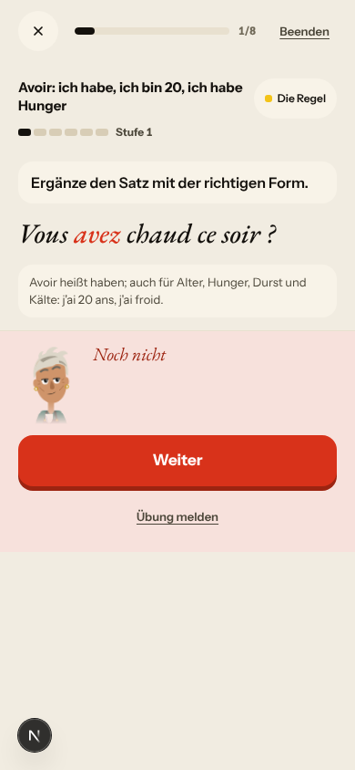 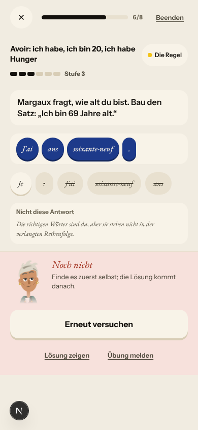
- Still: «Tu est à la rédaction ?» (tile) and «Tu est italienne ?» (dictée) → only «Être heißt sein.» until «Lösung zeigen» (#1086); the typed «Ils sont deux frères» → the avoir gloss, the être/avoir mix-up not named (#992). 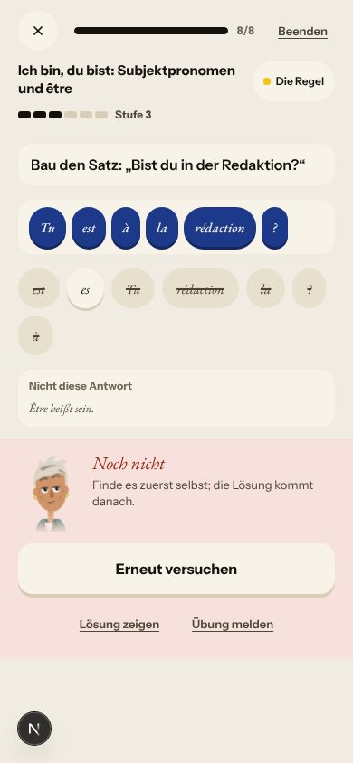 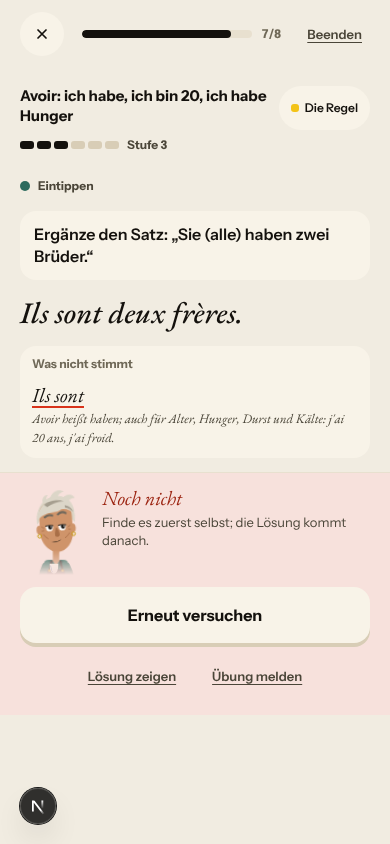
- New: the Journal's basic check explains «Je lui a dit» as «Nach « lui » heißt es « ai », nicht « a ».» (#1125, below).
- The copy box after «Lösung zeigen» refused «Tu es a la redaction ?» (accents missing, the rule right) with a bare «Nicht ganz — versuch die Zeile noch einmal.» (#1045, commented). 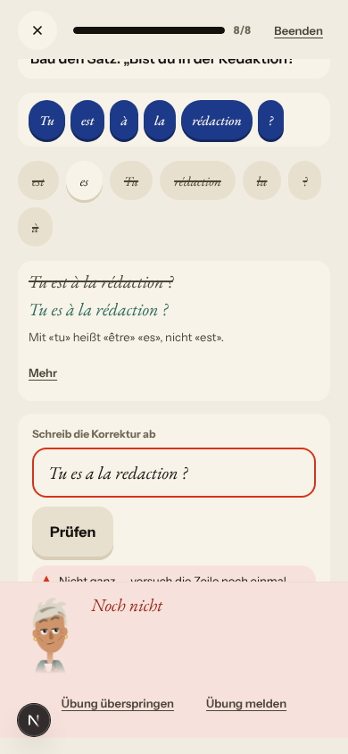

**Q11 at 3.** The «lui» note teaches a false rule (#1125); the Courrier calls «a le → au» a Gravis (#1047). La Forge's own items were right French.

**Q6 at 3.** La Forge's avoir items give me a new age each time: «Gus demande ton âge. J'ai vingt-trois ans.», «Marin demande ton âge. J'ai cinquante-six ans.», then «Margaux fragt, wie alt du bist. Bau den Satz: „Ich bin 69 Jahre alt.“» (#1126, new). The fake echoes (Gus «Suite ? Ah bon.», Margaux «Non, alors. Prend : c'est noté.» echoing my own slip, Camille «Simple : c'est noté.») are the fake provider. Marin's Courrier note «Je pense encore à notre dernière rencontre» after one line in the scene. Register held: Gus, Camille vous; Margaux, Lila, Marin's note tu; German UI du. 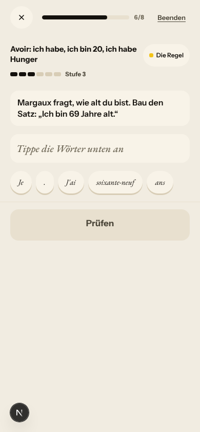

**Q15 at 3.** Day 1's La Forge again had no typed item: four choices, two speed rounds, one judge, one tile build; the only line I typed was the copied correction. Day 2's had one typed gap, two tile builds and a dictée, no free sentence. What I wrote myself: two scene replies and the Courrier on day 1; one scene reply, one typed gap and the Journal retell on day 2.

**Q3, Q16 at 3.**
- On #143: «Regel · Schritt 1 von 4», «Aus deinen Fehlern · Schritt 1 von 4», «Regel zum Wiederholen · Schritt 1 von 4»; the day 1 scene reads «Austausch 4» after «3 von 3».
- «Die Regeln von heute sind geschmiedet.» after a séance on one rule.
- «Aus deinen Fehlern · Was du selbst geschrieben hast» brought back a sentence I *built from tiles* («Tu est à la rédaction ?»), as on 26 Nov (observation).

**Q20 at 3.** Both Done screens end on a statement as «Morgen»: «Deux clés pour la même porte.» and «Ton billet de retour est pour mercredi. Lila est libre mercredi.» (#466). 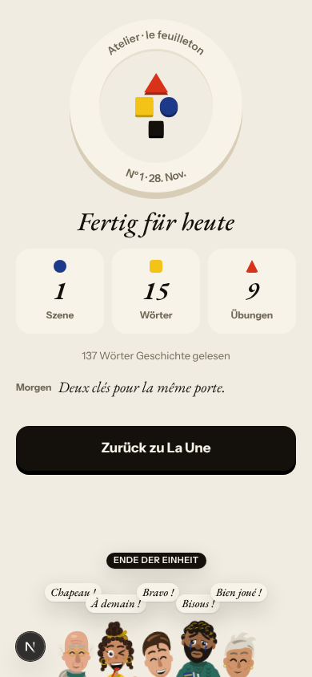 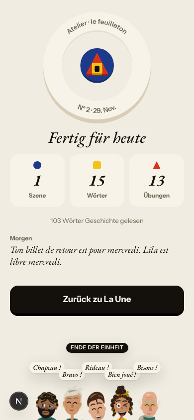

**Q22 at 3.** Home promises day 2 at «22 Min.» (scene 10, grammar 7, words 5); the agent needed about 8 minutes, a beginner reading and typing about 12–15.

**The owner's rule of 7 Nov (#698, «Nur als Extra»): holds, slot and label, on days 1–3.** Day 1's scene slip «le appartement» made «Le, la, l', les · in Übung» and took no card. Day 2's card and La Forge were Avoir, the next rule of the A1 path. Day 3's were «Il y a». «Le, la, l', les» ran only around the scene as «Regel zum Wiederholen · Eine Regel, die schon vorkam», my La Forge slip only as «Aus deinen Fehlern», être only as «Eine bekannte Regel» and «Wiederholung · heute fällig». The #1108 condition (a day that plans no new rule) did not occur on this path; `tests/test_forge_today_not_erratum_1108.py` passes on main. 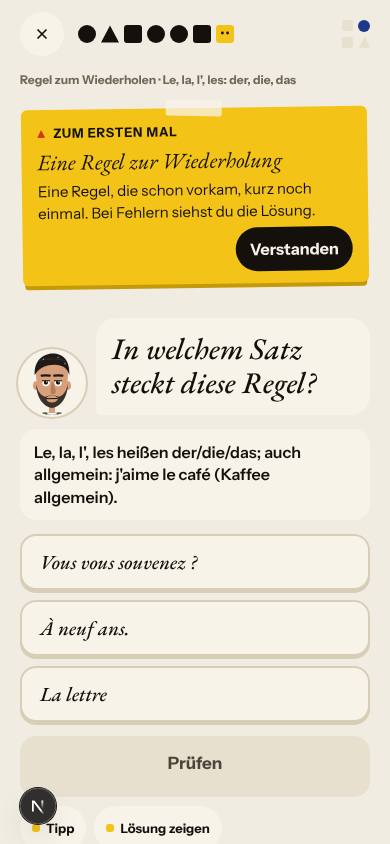

**The best of the night.**
- #1110 fixed: «je ne vend pas», «Je le prend» and the Journal's «je ne vend pas» all get «vends»/«prends». 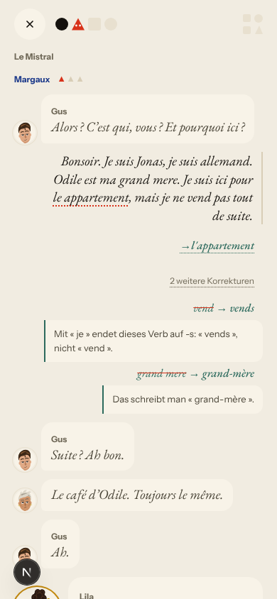
- #1081 on the fake stack: the Journal names whose line it quotes («ce que Margaux a dit, “Prend : c'est noté”») and «Die Szene, wie sie war» prints each line once with its speaker. 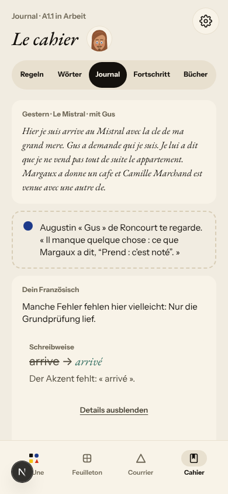
- #1062 on the fake stack: «Manche Fehler fehlen hier vielleicht: Nur die Grundprüfung lief.» and all ten slips of the retell are listed.
- The two-choice and «elles» misses explain the person in German; the tile order miss says what is wrong.

## Findings, by root cause

Two new findings (#1125, #1126), both `queue:ready`, `lane:code`, `size:S`, each with a **Done when:** comment. #1125 is a child of #857 (commented). Repeats commented: #1086, #1087, #992, #1045, #1047, #1068; re-tests commented on #1110, #1108, #1081, #1062.

### #857 the basic check's composed fixes and notes
- **#1125 (new, medium)** the Journal retell «Je lui a dit …» → «Verbform · lui a → lui ai · Nach « lui » heißt es « ai », nicht « a ».» (also «Je les a vus.» → «Nach « les » …», «Il lui ai dit.» → «Nach « lui » heißt es « a »»). Why the code allowed it: #1114 taught `_subject_person` to look past «ne» and object pronouns, but the FR_PERSON_AUX note's `{subject}` is still the token in front of the verb (`pronoun = source[prev.start : prev.end]`, `app/services/correction_contract.py:3229-3237`; template `:1069-1075`). The person is resolved from one word and explained with another.
- **#1047 (commented, owner)** «a le → au · Die Präposition trägt einen Gravis …» in the Courrier. 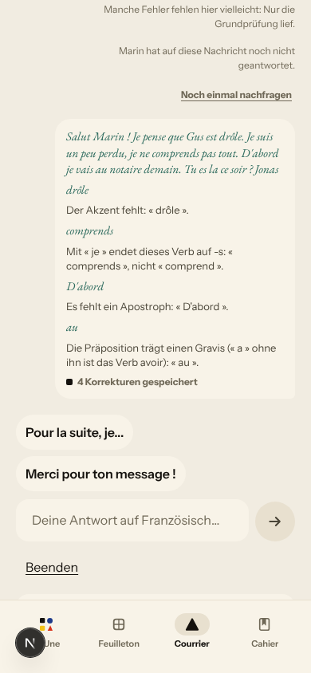
- **#1068 (commented, owner)** day 1 «fatigué», «clé» never shown; day 2 «à ma», «grand-mère», «C'est» never shown; no «+ N» line. 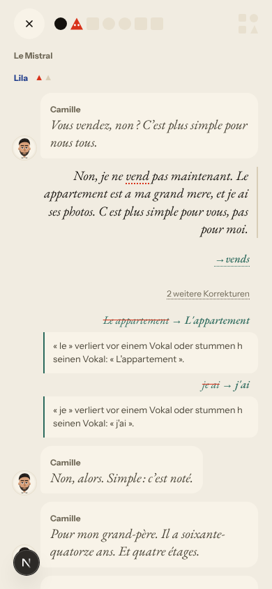

### #1085 a miss's reason is whatever survives string filters
- **#1086 (commented, stays `queue:ready`)** «Tu est» in a tile build and a dictée → only «Être heißt sein.»; the person hint survives where the answer is not «es» («Ils est», «Elles est»). 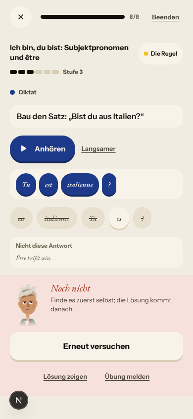
- **#1087 (commented, stays `queue:ready`)** the reason is back on the card; the German meaning of «___ chaud ce soir ?» is still missing.

### #146 the day's content and feedback are not driven by one concept
- **#992 (commented, stays `queue:ready`)** tile order explained now; «Ils sont deux frères» still gets the avoir gloss.

### #174 a right answer is judged against one stored string
- **#1045 (commented, owner)** the copy box refuses a line with the rule right and the accents missing, with a bare «Nicht ganz».

### No shared cause
- **#1126 (new, low)** La Forge's age items frame a random number as the learner's own age («Margaux fragt, wie alt du bist» → «Ich bin 69 Jahre alt.»; 23 and 56 in the speed round). The item frames bind a learner fact to the number pool. Sibling of the closed #1029 (a feminine «je» for a learner with no gender); no open root cause.

### Seen again, not commented
- #466: both days end on a statement as «Morgen».
- #280: 4 of 15 new words on day 1 from the scene (vendre, l'appartement, la clé, ici), 1 of 15 on day 2 (la lettre); the rest adverbs, numbers, ordinals, faire, aller.
- #143 (owner): the step counter (above).
- #694 (harness only): after `/clock` Home and the end sheet still say «Samstag, 28. Nov.»; the day 2 end sheet says «1 Tag in Folge».
- #1103 (owner): day 3 on the fake stack is the dev stub's episode, with an English task line.

### Observations, not filed
- The day-2 La Forge offered no Regelprüfung (as on 26 Nov); an «Éclair · 60 s» instead. #1028 not reached.
- «Welcher Satz sagt: „Sie (alle) sind schüchtern.“?»: the prompt still ends on «?“?».
- The rule-to-review item «In welchem Satz steckt diese Regel?» offers the page title «La lettre» as a sentence.
- Day 3's «Il y a» séance started at Stufe 3: my three scene replies used «Il y a un cafe …» before La Forge (counted as my own use, it seems).

### Fake provider (left to the live walk)
- Keyword echoes: Gus «Suite ? Ah bon.», Margaux «Non, alors. Prend : c'est noté.» (my slip echoed) then «Pas ce soir.» after I took the key; Camille «Non, alors. Simple : c'est noté.»; Lila «Tu n'entres pas ? Je comprends.». The Courrier never answers («Marin hat auf diese Nachricht noch nicht geantwortet.») and shows «Nur die Grundprüfung lief.»; the Journal's missing detail is the fake echo line.

## Re-tests

| issue | fix | result |
|---|---|---|
| #1110 «Je ne vend pas» unmarked | #1114 | **fixed**: scene «je ne vend pas», «Je le prend» and the Journal's «je ne vend pas» all corrected; guard test passes; commented, left closed. 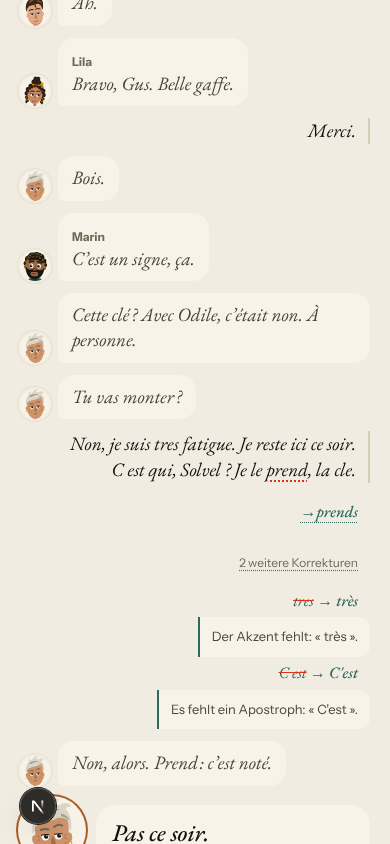 |
| #1108 due slip takes «today's rule» | #1112 | **condition not reached**: days 1–3 each planned a rule (être, Avoir, Il y a) and La Forge forged it; slips only as labelled review; guard test passes; commented, left closed. |
| #1081 stitched Journal line | #1114 | **fake stack: holds** (one line, speaker named, each scene line once); the live walk reopened it for the real retell; commented, stays `queue:ready`. |
| #1062 Journal basic check | #1114 | **holds on fake**: the notice and all ten slips; commented, left closed. |
| #1087 two-choice miss, no reason | #1090 (part) | client half **holds** on the German path; German meaning still missing; commented, stays `queue:ready`. |
| #1086 «Tu est» → gloss only | none merged | **seen again** (tile, dictée); commented, stays `queue:ready`. |
| #1088 «J ai» accepted silently | none merged | not reached (no typed «j'ai» item tonight). |
| #1028 failed test drops the level | none merged | not reached: no test offered. |
| owner rule of 7 Nov (#698) | #708, #1001, #1112 | **holds, slot and label**, days 1–3. |

Root causes: #857 advanced (child #1125); none opened, none closed.

## Owner questions (open, not asked again)
- **Should La Forge ask for one free sentence of the learner's own on a rule's first days?** Tonight again 16 La Forge items over days 1–2 with none. Day 1: no typed item at all (the only typed line was a copied correction); day 2: one typed gap. Across the two `a1-de` walks (26 and 28 Nov) a German beginner typed 3 La Forge answers in 32 items.
- **#1028, does decision #88 cover the optional test?** No test was offered tonight (day 2 end sheet: «Éclair · 60 s»); no new evidence.

## Scripted walk

- «Browser walk on main» (walk-main.yml): runs 146 (`93b09e05`), 147 (`b6a3995f`), 148 (`ffe7e01a`) and 149 on `209aa034` (tonight's main) **passed**.
- The scheduled «Browser walk» (walk.yml) run 47 on `b6a3995f` **passed** every shard.
- In tonight's explore walk both days reached Done: day 1 through La Forge's «Weiter: 15 Wörter», day 2 through La Forge's end sheet, the words and the Journal.
